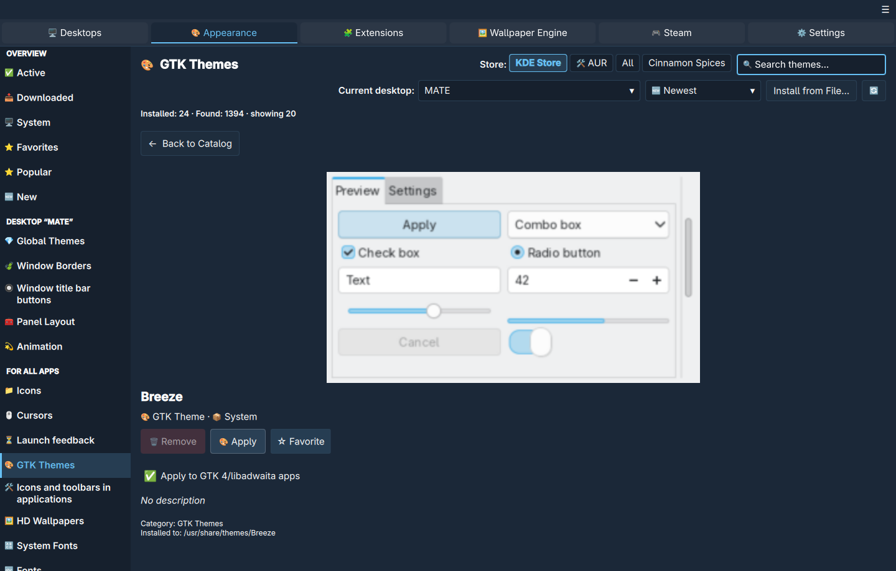
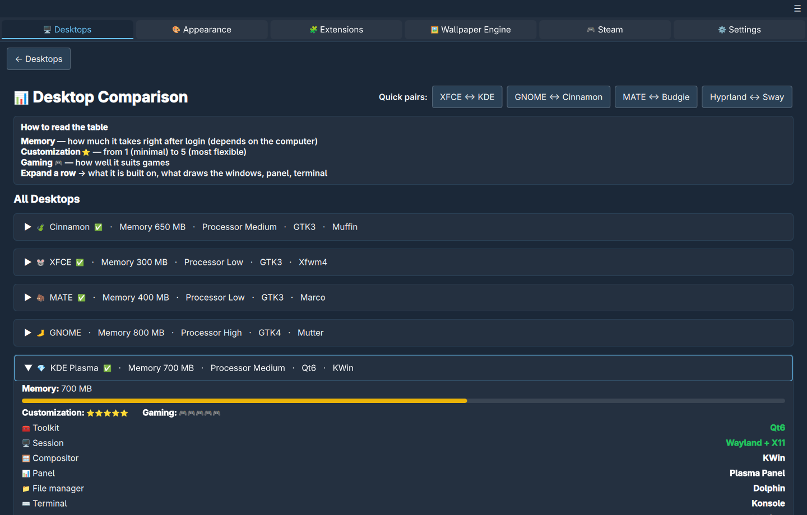

[English](README.md) | [Русский](README.ru.md) | Deutsch | [简体中文](README.zh-CN.md) | [Français](README.fr.md) | [Español](README.es.md)

# Rexon

Rexon ist ein kostenloser Desktop-Manager für Linux. In einem einzigen Fenster
installiert, wechselt und entfernt er Desktop-Umgebungen und wendet Designs,
Erweiterungen und Live-Hintergründe auf sie an.

Er richtet sich an alle, die einen anderen Desktop ausprobieren möchten – KDE
Plasma, GNOME, Cinnamon, Hyprland und weitere – oder das Aussehen des aktuellen
ändern wollen, ohne sich vorher mit den Paketnamen, Konfigurationsdateien und
Design-Ordnern jedes einzelnen Desktops vertraut machen zu müssen.

Rexon ist in Rust geschrieben, die Oberfläche in Qt 6 / QML (über [cxx-qt](https://github.com/KDAB/cxx-qt)).
Das Programm ist noch jung: Die Versionsnummer lautet noch 0.x, und die wichtigste
Plattform für Entwicklung und Tests ist Arch Linux / CachyOS.


<table>
  <tr>
    <td></td>
    <td></td>
    <td></td>
  </tr>
</table>

## Handbuch

Eine Schritt-für-Schritt-Anleitung zu allen Reitern — Desktops,
Erscheinungsbild, Erweiterungen, Wallpaper Engine, Steam und Einstellungen —
auf Deutsch, Englisch, Russisch, Chinesisch, Französisch und Spanisch: [guide/](guide/README.md).

## Funktionen

**Desktops**

- Desktop-Umgebungen installieren, wechseln und entfernen: KDE Plasma, GNOME,
  Cinnamon, Xfce, MATE, Budgie, Pantheon, COSMIC, LXQt, Deepin (nur die
  Treeland-Sitzung, experimentell, auf Arch-basierten Systemen), Hyprland, Sway,
  niri, River und Wayfire.
- Der Desktop, in dem Sie gerade angemeldet sind, lässt sich nicht entfernen, ebenso
  wenig alles, was das System zum Starten braucht (siehe
  [Was Rexon mit Root-Rechten macht](#was-rexon-mit-root-rechten-macht)).
- Anmeldemanager: SDDM, Plasma Login Manager, GDM, LightDM, LXDM, COSMIC Greeter
  und weitere installieren, aktivieren oder zwischen ihnen wechseln – mit einem
  festgehaltenen Weg zurück.
- Vergleich von Desktops nebeneinander (Speicherverbrauch, Oberflächenbibliothek,
  Compositor, Voreinstellungen).
- Prüfung des aktuellen Desktops (fehlende Pakete, Einstellungen) mit Reparatur per
  Klick.
- „Wie in einer Distribution“: ein komplettes Erscheinungsbild auf einmal anwenden
  (derzeit SteamOS und Garuda Dr460nized) und den vorherigen Zustand wiederherstellen.
- Schutz Ihrer Standardanwendungen (Browser, Terminal, Bildbetrachter), die Desktops
  beim Wechsel gerne zurücksetzen. Standardmäßig aktiviert.

**Erscheinungsbild**

- Die Erscheinungsbild-Einstellungen aus den Systemeinstellungen von KDE Plasma auf
  jedem unterstützten Desktop, geschrieben in dessen eigene Einstellungen: globale
  Designs (komplett oder in Teilen angewendet, dazu „Aktuelles Erscheinungsbild
  speichern…“, um das aktuelle Aussehen als Design zu sichern), Farbschemata mit
  Schema-Editor, Akzentfarbe, zeitgesteuerter Wechsel zwischen hellem und dunklem
  Design, Anwendungsstil, Fensterdekorationen und Knöpfe der Titelleiste,
  Schriftarten und eine Schriftverwaltung mit Schriftgruppen, Weichzeichnen des
  Hintergrunds, Systemklänge und Hintergrundgeräusche.
- GTK-Designs werden auch auf GTK-4-/libadwaita-Anwendungen übertragen, sofern das
  Design eine Version für GTK 4 mitbringt, und die Design-Kacheln zeigen echte
  Bedienelemente, die in diesem Design gezeichnet sind.
- Designs für GTK, Qt / Kvantum, Symbole, Zeiger, Schriftarten, Fensterknöpfe,
  Animationen, KDE Plasma, Cinnamon, MATE-Leistenlayouts und Deepin – aus dem
  OpenDesktop-/Pling-Katalog, Cinnamon Spices und dem AUR (bei AUR-Paketen werden
  vor der Installation Risikoanzeichen angezeigt).
- Windows-Zeiger (`.cur` / `.ani`), umgewandelt in Xcursor.
- Designs für den Anmeldebildschirm (SDDM) und den Boot-Bildschirm (Plymouth).
- Conky-Widgets mit Vorschau.
- Bildschirmeffekte (Bildzeilen, Röhrenbildschirm, Videokassette, Filmstreifen und weitere) mit
  Live-Vorschau. Rexon schaltet sie unter Hyprland, GNOME und Cinnamon auf dem ganzen
  Bildschirm ein, unter KDE Plasma, Pantheon und COSMIC den eingebauten Schwarz-Weiß-Filter; in
  anderen Umgebungen sagt der Abschnitt ehrlich, was der Compositor dort
  erlaubt.
- Sicherungen der Desktop-Einstellungen und ein Notfall-Menüeintrag
  „Erscheinungsbild des Desktops wiederherstellen“ (KDE) für den Fall, dass ein
  Design den Desktop beschädigt.
- Erweiterungen für GNOME Shell und Cinnamon.

**Erweiterungen**

- Rexons eigene `.rxn`-Pakete (Designs, Hintergrundsammlungen, Schriften,
  Desktop-Werkzeuge und Plugins): aus einer Datei oder per Ziehen ins Fenster
  installieren, aktivieren und deaktivieren, entfernen.
- Windows-Designs (`.themepack`, `.msstyles`), Zeiger und Symbolpakete werden
  bei der Installation für Linux umgewandelt.

**Live-Hintergründe**

- Video-, Web- und Szenen-Hintergründe, einschließlich Wallpaper-Engine-Hintergründen,
  die Sie auf Steam besitzen; dargestellt von der Engine
  [waywallen](https://github.com/hypengw/waywallen).
- Funktioniert unter KDE Plasma (Hintergrundbild-Plugin), in wlroots-artigen
  Compositoren wie Hyprland, Sway und niri (layer-shell) sowie unter GNOME und
  Cinnamon (Shell-Erweiterungen). Auf X11-Desktops, auf denen waywallen keine
  Ausgabe hat, spielt Rexons eigener Hintergrund-Host Video- und Web-Hintergründe ab.
- Flash-Hintergründe (`.swf`) über einen eingebauten [Ruffle](https://ruffle.rs)-Player.
- Videos von YouTube und ähnlichen Seiten als Hintergrund (optional, benötigt `yt-dlp`).

**Steam**

- Ein Startvideo nach der Anmeldung wie auf dem Steam Deck, ausgewählt aus den
  Videos Ihrer Steam-Bibliothek.
- Ihre Steam-Profilhintergründe als Hintergrundbilder.

**Einstellungen**

- Sprache und Aussehen des Rexon-Fensters, Symbol im Systembereich, eine
  Hintergrund-Bibliothek.
- Gesicherte Kopien der KDE-Plasma-Leiste, der Schalter für den Schutz der
  Standardanwendungen und der Import von Windows-Designs.

**Systemsicherheit**

- Vor einer Systemaktualisierung warnt Rexon, wenn die Aktualisierung einen nicht
  zusammenpassenden Satz von Qt-Paketen installieren würde (genau die Art von
  Teilaktualisierung, nach der der Anmeldebildschirm schwarz bleibt).
- Startet der Anmeldebildschirm trotzdem nicht, erscheint statt eines schwarzen
  Bildschirms eine Erklärung als Text auf der Konsole; `rexon doctor` gibt denselben
  Bericht aus.

## Unterstützte Systeme

| Plattform | Stand |
|---|---|
| Arch Linux, CachyOS und andere Arch-basierte Distributionen | Hauptplattform: Hier wird Rexon entwickelt und getestet. Siehe [Installation](#installation). |
| SteamOS (Steam Deck, Steam Machine) | Desktops werden als `systemd-sysext`-Abbilder installiert, weil `/usr` schreibgeschützt ist und bei jeder Aktualisierung des Betriebssystems ersetzt wird. |
| Debian / Ubuntu, Fedora, openSUSE, Gentoo, Alpine, Void, Solus, Clear Linux, ALT | Rexon hat Pakettabellen für diese Familien, sie sind aber deutlich weniger getestet. |
| NixOS | Rexon installiert Desktops nicht selbst, sondern liefert einen Ausschnitt für `configuration.nix`. |

Das Paket wird für x86_64 gebaut. Qt 6.6 oder neuer wird benötigt.

## Installation

Für Arch Linux / CachyOS gibt es in diesem Repository zwei Pakete:

- [`packaging/rexon/`](packaging/rexon/) – die Veröffentlichung. Sie wird aus dem
  signierten Release-Tag (`v0.1.1`) gebaut, und `makepkg` prüft die Signatur des Tags
  gegen den Schlüssel `B4505C7C7841ECC12D7A0E9D0083083C32159A72`. Importieren Sie ihn
  einmalig mit `curl -s https://github.com/wehrwolfmann.gpg | gpg --import`.
- [`packaging/aur/`](packaging/aur/) – `rexon-git`, der neueste Code aus `main`.

```sh
git clone https://github.com/wehrwolfmann/rexon.git
cd rexon/packaging/rexon
makepkg -si
```

## Aus dem Quellcode bauen

Installieren Sie unter Arch Linux / CachyOS die Build-Abhängigkeiten (die Liste
folgt `makedepends` und `depends` in [`packaging/aur/PKGBUILD`](packaging/aur/PKGBUILD)):

```sh
sudo pacman -S --needed base-devel git rust protobuf gettext \
    qt6-base qt6-declarative qt6-websockets qt6-multimedia qt6-svg qt6-webengine \
    qt6-grpc qt6-shadertools layer-shell-qt wayland libglvnd mpv alsa-lib \
    vulkan-icd-loader openssl polkit pacman-contrib cmake ninja \
    jre-openjdk-headless
```

Java wird nur beim Bauen gebraucht: Der Flash-Player kompiliert damit seine
ActionScript-Klassen.

Dann bauen. Alle cargo-Befehle werden im Verzeichnis `rust/` ausgeführt:

```sh
git clone https://github.com/wehrwolfmann/rexon.git
cd rexon/rust
cargo build-app       # Kern + Fenster + seine QML-Bibliotheken (Release)
cargo build-splash    # Player für das Startvideo bei der Anmeldung (absichtlich getrennt)
cargo test-core       # Tests des Kerns, ohne Qt
```

> **Verwenden Sie nicht einfach `cargo build --release`.** Der Workspace setzt
> `default-members = ["rexon-core"]`, damit die Tests des Kerns kein Qt brauchen, und
> ein schlichtes `cargo build` baut deshalb nur den Kern. Die obigen Aliase sind in
> [`rust/.cargo/config.toml`](rust/.cargo/config.toml) definiert (`cargo --list`
> zeigt sie an) und funktionieren nur, wenn cargo in `rust/` ausgeführt wird.

Der Reiter „Live-Hintergründe“ braucht außerdem drei QML-Plugins, die mit CMake
gebaut werden. Die Skripte in `tools/` legen sie in `~/.local/share/rexon/qml_modules` ab:

```sh
tools/build_qml_material.sh
tools/build_qml_control.sh
tools/build_qml_qextra.sh    # benötigt lito >= 0.8.7, clang, lld (AUR: lito oder lito-bin)
```

Um alles auf einmal zu bekommen – die Plugins, die Engine waywallen, die
privilegierten Hilfsprogramme und ihre polkit-Richtlinien –, bauen Sie besser das
Paket:

```sh
cd packaging/aur
makepkg -si
```

## Starten

Aus dem Quellbaum:

```sh
rust/target/release/rexon-main-window
```

Nach der Installation aus dem Paket lautet der Befehl `rexon`. Nützliche Optionen:

- `rexon --tray` – im Systemabschnitt ohne Fenster starten;
- `rexon --page=<name>` – eine bestimmte Seite öffnen;
- `rexon doctor` – einen Bericht über Anmeldebildschirm und Sitzung ausgeben, ohne Qt
  (praktisch auf einer Textkonsole).

Um Rexon in einer anderen Sprache zu starten, setzen Sie `LANGUAGE`, zum Beispiel
`LANGUAGE=de rust/target/release/rexon-main-window`, oder wählen Sie die Sprache in
den Einstellungen.

Beim Start aus dem Quellbaum sind keine privilegierten Hilfsprogramme installiert;
Systemänderungen laufen dann über ein einfaches `pkexec` und fragen jedes Mal nach
dem Passwort.

## Was Rexon mit Root-Rechten macht

Rexon selbst läuft immer unter Ihrem Benutzer. Alles, was Root-Rechte braucht, läuft
über eine kleine Gruppe von Hilfsprogrammen: Sie werden mit `pkexec` unter benannten
polkit-Aktionen gestartet und führen nur Vorgänge aus einer geschlossenen Liste aus.
Dieser Abschnitt beschreibt genau, um welche Hilfsprogramme es sich handelt und was
sie verweigern.

### Das Sitzungs-Hilfsprogramm: ein Passwort pro Fenster

Der Hauptweg ist `rexon-priv-helper` (polkit-Aktion `org.rexon.session`).

- Wenn Sie zum ersten Mal etwas tun, das Root-Rechte braucht, startet Rexon das
  Hilfsprogramm einmal mit `pkexec`. Die Richtlinie ist `auth_admin` **ohne** „keep“:
  polkit merkt sich das Passwort nicht. Das Hilfsprogramm selbst bleibt aber so lange
  aktiv wie das Fenster, sodass Sie das Passwort einmal pro Fenstersitzung eingeben
  und nicht vor jedem Vorgang.
- Solange es aktiv ist, zeigen die Einstellungen und das Menü im Systemabschnitt
  „Rexon darf das System ändern, bis das Fenster geschlossen wird“ mit einem Knopf
  **„Jetzt entziehen“**.
- Das Recht, das System zu ändern, endet, wenn:
  1. das Rexon-Fenster geschlossen wird (auch beim Minimieren in den
     Systemabschnitt) oder Rexon beendet wird;
  2. 15 Minuten lang keine privilegierte Aktion erfolgt ist;
  3. der Bildschirm gesperrt wird (geprüft über `loginctl`);
  4. der Rechner in den Ruhezustand geht.

  Ein bereits laufender Vorgang wird zu Ende geführt; neue werden abgelehnt, und der
  nächste fragt wieder nach dem Passwort.
- Fenster und Hilfsprogramm sprechen über ein privates Socket-Paar miteinander. Das
  Hilfsprogramm prüft, dass am anderen Ende derselbe Benutzer sitzt, der das Passwort
  bestätigt hat (`PKEXEC_UID`), und das Fenster weigert sich, ein Hilfsprogramm zu
  starten, dessen Datei oder Verzeichnis für jemand anderen als root beschreibbar ist.
- Das Fenster schickt **Vorgänge, keine Befehle**: zum Beispiel „diese Pakete aus der
  Desktop-Tabelle installieren“ oder „diesen Design-Ordner in das Design-Verzeichnis
  des Anmeldebildschirms legen“. Den Befehl baut das Hilfsprogramm selbst, anhand der
  Tabellen, die in seine eigene Programmdatei einkompiliert sind. Kein Argument darf
  mit `-` beginnen oder Shell-Syntax enthalten, und Dateien aus Ihrem Persönlichen
  Ordner werden als bereits geöffnete Dateideskriptoren übergeben, nie als Pfade, die
  root öffnen würde. Zielverzeichnisse sind im Hilfsprogramm als Konstanten festgelegt.
- Der Build des Hilfsprogramms muss zu dem des Fensters passen; nach einer
  Aktualisierung bittet Rexon Sie, das Programm neu zu starten, statt mit einer
  anderen Version zu sprechen.
- Lehnt das Hilfsprogramm einen Vorgang ab, geschieht nichts, und Rexon versucht ihn
  **nicht** erneut über ein einfaches `pkexec`.
- Jeder Vorgang wird im Systemjournal protokolliert (`journalctl -t rexon-priv-helper`).

### Ältere Hilfsprogramme für einzelne Aufgaben

Einige Vorgänge übernimmt das Sitzungs-Hilfsprogramm noch nicht (zum Beispiel
Gentoo-Overlays, das Zurücksetzen von Plasma-Forks, das Zurücksetzen des Plymouth-
oder SDDM-Designs). Sie laufen über vier ältere Hilfsprogramme, jedes mit eigener
polkit-Aktion und der Richtlinie `auth_admin_keep` (polkit merkt sich das Passwort für
diesen Rexon-Prozess einige Minuten lang):

| Hilfsprogramm | Aktion | Zweck |
|---|---|---|
| `rexon-de-helper` | `org.rexon.de-install` | einen Desktop aus Rexons Tabelle installieren |
| `rexon-pkg-helper` | `org.rexon.pkg` | Vorgänge der Paketverwaltung |
| `rexon-stage-helper` | `org.rexon.stage` | Design-Ordner nach `/usr/share` kopieren |
| `rexon-system-helper` | `org.rexon.system-install` | Designs für Anmelde- und Boot-Bildschirm |

Sie verwenden dieselben Erlaubnislisten und dieselbe Liste „niemals entfernen“ wie das
Sitzungs-Hilfsprogramm. Das Paket installiert sie in `/usr/lib`, die Richtlinien in
`/usr/share/polkit-1/actions/`.

**Optional: ganz ohne Passwort.** Der Einrichtungsassistent beim ersten Start bietet
eine polkit-Regel an (`/etc/polkit-1/rules.d/49-rexon-nopasswd.rules`), mit der
Administratoren in einer aktiven lokalen Sitzung Desktops aus Rexons Liste ohne
Passwort installieren können. Sie ist **standardmäßig deaktiviert**, gilt nur für
`org.rexon.de-install`, und das Paket installiert sie nie. Designs für Anmeldung und
Systemstart sowie jede andere Software fragen weiterhin nach dem Passwort. Die
Sitzungsaktion `org.rexon.session` ist nie Teil dieser Regel.

### Was installiert werden kann

Pakete werden nur aus Tabellen installiert, die in Rexon eingebaut sind: Desktops und
ihre Bestandteile, Anmeldemanager, Abhängigkeiten für Video-Hintergründe, Shells,
Conky, Bestandteile der MATE-Leiste, Symbol- und Zeigerdesigns, „Wie in einer
Distribution“. Das Fenster nennt die Tabelle; das Hilfsprogramm prüft jeden
Paketnamen gegen seine eigene Kopie dieser Tabelle.

**AUR-Pakete werden nie automatisch installiert.** Jeden AUR-Build starten Sie selbst;
er läuft unter Ihrem Benutzer mit `paru` oder `yay`. Deren `sudo` wird innerhalb von
Rexon durch `rexon-sudo-shim` ersetzt, das keine eigenen Rechte hat: Es reicht nur den
Aufruf von `pacman` an das Sitzungs-Hilfsprogramm weiter. Das Hilfsprogramm
installiert nur Build-Abhängigkeiten, die es in den offiziellen Repositorys gibt, und
nur die Pakete, deren Bau Sie verlangt haben (den Paketnamen liest es aus jedem
gebauten Paket).

Rexon führt niemals ein fremdes Installationsskript als root aus. Das `install.sh`,
das manche Design-Autoren mitliefern, wird ignoriert. Die einzigen fremden Skripte,
die Rexon überhaupt ausführt, sind die Installations- und Deinstallationsskripte von
`.rxn`-Erweiterungspaketen der Typen `desktop-tool` und `plugin`, und diese laufen
unter Ihrem Benutzer.

### Was niemals entfernt wird

- **Der Desktop, in dem Sie angemeldet sind.** Der Knopf ist im Fenster deaktiviert,
  und auch das Hilfsprogramm lehnt ab.
- **Alles, was zum Starten und Verwalten des Systems nötig ist**: Kernel und ihre
  Header, Firmware und Microcode, Bootloader (GRUB, systemd-boot, Limine),
  initramfs-Generatoren (mkinitcpio, dracut, booster), DKMS-Module, Grafiktreiber
  (NVIDIA, Mesa, Vulkan, `xf86-video-*`), `glibc`, `systemd`, `dbus`, `bash`,
  `coreutils`, Paketverwaltungen, `sudo`, `polkit`, `openssl` – und Rexon selbst.
- Wird ein Desktop entfernt, werden seine Abhängigkeiten nur dann entfernt, wenn nichts
  anderes im System sie noch braucht.
- Ein Design für Anmelde- oder Boot-Bildschirm, das eigenen Binärcode mitbringt (zum
  Beispiel ein Plymouth-Design, das auf ein eigenes `.so`-Modul verweist), wird
  abgelehnt, noch bevor nach dem Passwort gefragt wird.
- Auf schreibgeschützten Systemen rührt Rexon die Paketverwaltung nicht an. Unter
  SteamOS werden Desktops als `systemd-sysext`-Abbilder unter `/home/.rexon/sysext`
  gebaut; das Hilfsprogramm dafür liegt in `/var/lib/rexon/bin`, weil `/usr`
  schreibgeschützt ist.

### Rückgängig machen und Wiederherstellung

- **Wechsel des Anmeldemanagers:** Lässt sich der neue Anmeldemanager nicht
  aktivieren, wird der vorherige wiederhergestellt. Außerdem notiert Rexon einen
  Befehl, mit dem sich der vorherige von einer Textkonsole aus zurückholen lässt.
- **Ausfall des Anmeldebildschirms:** Solange Rexon installiert ist, hat jeder
  Anmeldemanager eine systemd-Ergänzung `OnFailure=` (`rexon-login-rescue`), die statt
  eines schwarzen Bildschirms eine Erklärung im Klartext auf der Konsole anzeigt.
- **Erscheinungsbild:** Was Rexon geändert hat, lässt sich mit „Zurücksetzen“ rückgängig
  machen, und das Layout der KDE-Leiste kann unter Desktops → Werkzeuge
  gesichert und zurückgeholt werden („Leiste sichern“ / „Leiste zurückholen“). KDE hat einen Notfall-Menüeintrag
  „Erscheinungsbild des Desktops wiederherstellen“, der auch dann funktioniert, wenn
  das Rexon-Fenster nicht startet.
- **„Wie in einer Distribution“** merkt sich, was geändert wurde, und lässt sich
  rückgängig machen.
- **Designs für Anmelde- und Boot-Bildschirm** lassen sich auf die Voreinstellung der
  Distribution zurücksetzen.
- **Design-Forks von Plasma** (etwa AeroThemePlasma) lassen sich durch die
  Standardpakete ersetzen, und nach einer Plasma-Aktualisierung, die sie beschädigt,
  kann Rexon Sie einmalig ohne sie anmelden.

Beim Entfernen des Rexon-Pakets werden auch seine Hilfsprogramme, Richtlinien und die
Rettungs-Units für die Anmeldung entfernt (es sind Dateien, die zum Paket gehören).

## Übersetzungen

Die Oberfläche wird mit GNU gettext übersetzt: ein Katalog für den Rust-Code und die
QML-Seiten zugleich. Die Vorlage ist [`po/rexon.pot`](po/rexon.pot), jede Sprache ist
eine Datei in [`po/`](po/). Die Basissprache ist Englisch; Übersetzungen gibt es auf
Russisch, Deutsch, vereinfachtem Chinesisch, Französisch und Spanisch. Wie man eine Sprache hinzufügt, steht in
[`po/README.md`](po/README.md) – Änderungen am Code sind dafür nicht nötig.

## Danksagungen

Rexons Live-Hintergründe bauen auf der Arbeit anderer auf:

- **[waywallen](https://github.com/hypengw/waywallen)** von hypengw – MIT. Die
  Hintergrund-Engine (ein eigenständiger Dienst); das Paket liefert ihre offizielle
  Veröffentlichung unverändert aus. Die Seite „Live-Hintergründe“ verwendet die
  QML-Oberfläche von waywallen mit kleinen Patches, die in
  `data/qt_wallpaper_engine/qml_ui/waywallen/patches/` liegen.
- **[Open Wallpaper Engine](https://github.com/waywallen/open-wallpaper-engine)** –
  GPL-2.0-only. Das waywallen-Plugin, das Szenen- und Web-Hintergründe darstellt. Es
  läuft in eigenen Prozessen, die der waywallen-Dienst startet; Rexon linkt nicht
  dagegen. Das Paket liefert die offizielle Veröffentlichung unverändert aus, zusammen
  mit dem vollständigen Quellcode.
- **[waywallen-display](https://github.com/waywallen/waywallen-display)** – das
  Hintergrundbild-Plugin für KDE Plasma, unverändert ausgeliefert.
- **[Ruffle](https://github.com/ruffle-rs/ruffle)** (MIT / Apache-2.0) –
  Flash-Hintergründe; **[QmlMaterial](https://github.com/hypengw/QmlMaterial)** und
  **[QExtra](https://github.com/hypengw/QExtra)** (MIT) – QML-Plugins der
  Hintergrundseite; Modelle von **[Mozilla Translations](https://github.com/mozilla/translations)**
  mit dem Crate `fxtranslate` (MPL-2.0) – Offline-Übersetzung der
  Hintergrundbeschreibungen; **mpv** – der Player für das Startvideo.

Die vollständige Liste der Fremdkomponenten, ihrer Lizenzen und der vorgenommenen
Änderungen steht in [`NOTICE`](NOTICE).

Rexon steht in keiner Verbindung zu Wallpaper Engine, dessen Entwicklern oder Valve
und wird von ihnen weder unterstützt noch gesponsert. „Steam“, „Steam Deck“ und
„SteamOS“ sind Marken der Valve Corporation; alle anderen Produktnamen gehören ihren
jeweiligen Inhabern.

## Lizenz

Rexon steht unter der [Apache License 2.0](LICENSE). Copyright 2026 Wehrwolfmann.

Fremdkomponenten behalten ihre eigenen Lizenzen (siehe [`NOTICE`](NOTICE)); die dort
aufgeführten GPL-Komponenten sind eigenständige Programme, die zusammen mit Rexon
ausgeliefert werden, und fallen nicht unter die Apache License.

„Rexon“ und das Rexon-Logo sind Marken von Wehrwolfmann; die Lizenz gewährt kein
Recht, sie zu verwenden (Apache License 2.0, Abschnitt 6).

## Mitwirken und Sicherheit

Wie man baut, testet und übersetzt, steht in [CONTRIBUTING.md](CONTRIBUTING.md); wie
man Sicherheitslücken vertraulich meldet, in [SECURITY.md](SECURITY.md).
