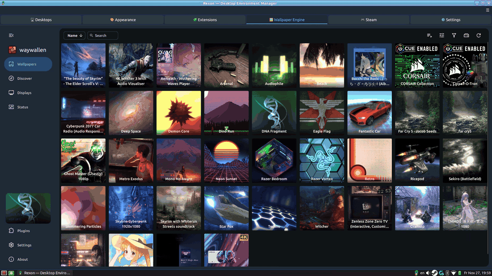
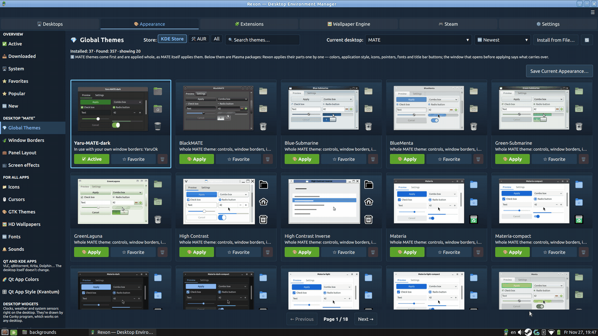
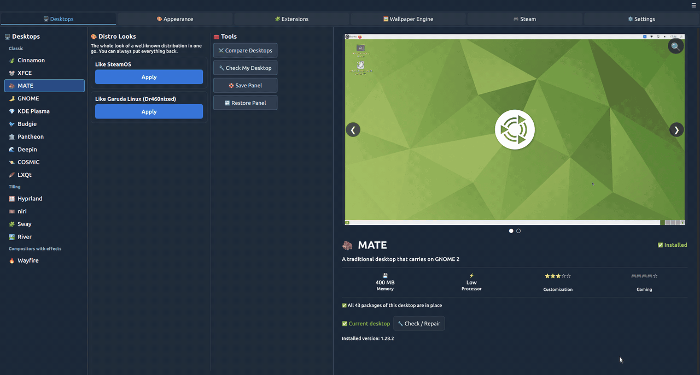
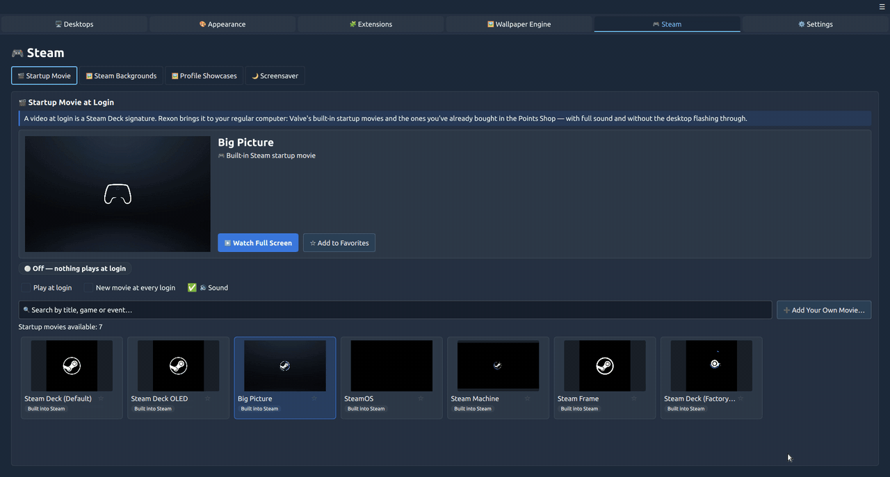
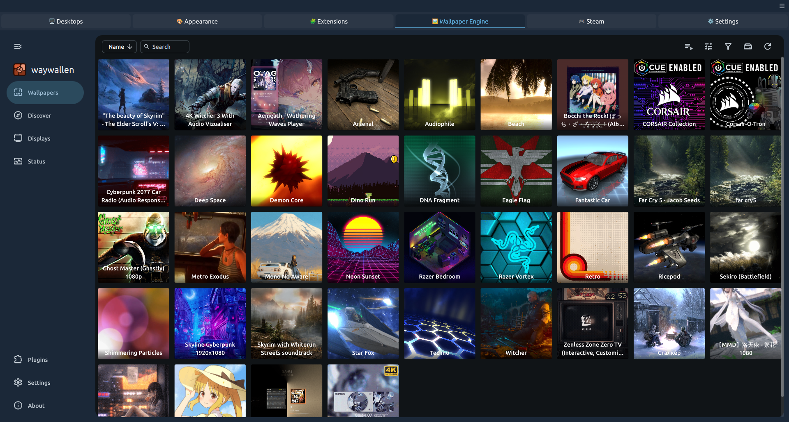
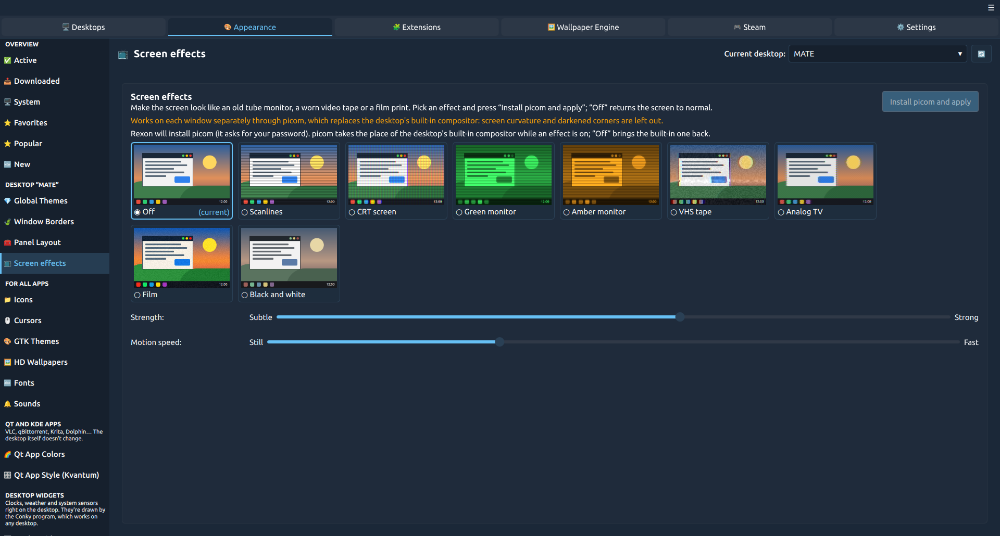
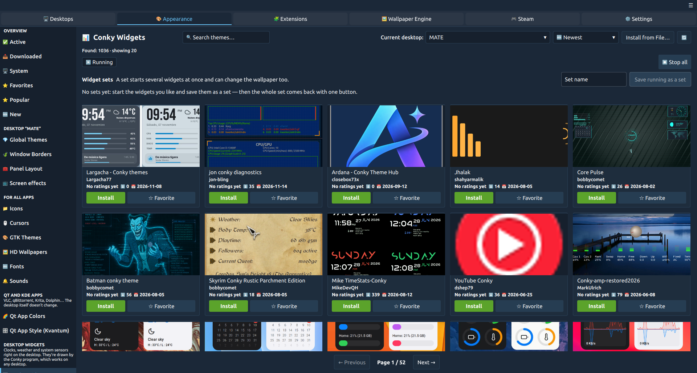
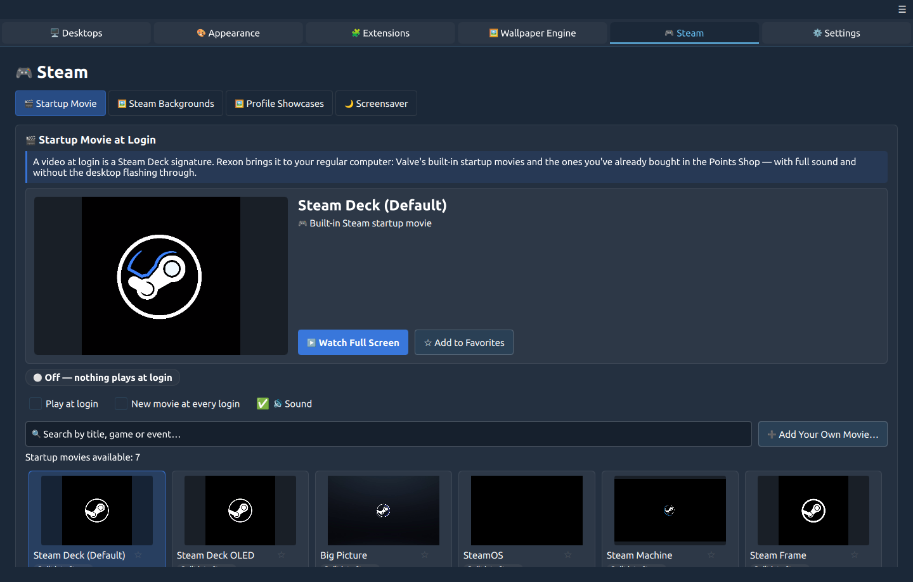

[English](README.md) | [Русский](README.ru.md) | [Deutsch](README.de.md) | [简体中文](README.zh-CN.md) | [Français](README.fr.md) | Español | [Українська](README.uk.md)

[](https://github.com/wehrwolfmann/rexon/releases/latest) [](https://github.com/wehrwolfmann/rexon/actions/workflows/ci.yml) [](LICENSE)

# Rexon

Rexon es un gestor de entornos de escritorio gratuito para Linux. En una sola
ventana instala, cambia y desinstala entornos de escritorio, y les aplica
temas, extensiones y fondos de pantalla animados.

Está pensado para quien quiere probar otro entorno de escritorio —KDE Plasma,
GNOME, Cinnamon, Hyprland y otros— o cambiar el aspecto del actual sin tener
que averiguar antes cómo se llaman los paquetes de cada uno, dónde están sus
archivos de configuración y sus carpetas de temas.

Rexon está escrito en Rust, y su interfaz, en Qt 6 / QML (mediante [cxx-qt](https://github.com/KDAB/cxx-qt)).
El programa es joven: su número de versión aún es 0.x, y la plataforma
principal de desarrollo y pruebas es Arch Linux / CachyOS.





<details>
<summary>▶ La pestaña «Escritorios» en movimiento</summary>

</details>

<details>
<summary>▶ La pestaña «Steam» en movimiento</summary>

</details>

<table>
  <tr>
    <td></td>
    <td></td>
    <td></td>
  </tr>
  <tr>
    <td></td>
    <td></td>
    <td></td>
  </tr>
  <tr>
    <td></td>
    <td></td>
    <td></td>
  </tr>
</table>

## Guía

Una guía paso a paso de todas las pestañas —«Escritorios», «Apariencia»,
«Extensiones», Wallpaper Engine, Steam y «Ajustes»— en ruso, inglés, alemán,
chino, francés, español y ucraniano: [guide/](guide/README.md).
Versión en español: [Escritorios](guide/es/desktops.md) · [Apariencia](guide/es/appearance.md) · [Extensiones](guide/es/extensions.md) · [Wallpaper Engine](guide/es/wallpaper-engine.md) · [Steam](guide/es/steam.md) · [Ajustes](guide/es/settings.md).

## Funciones

**Entornos de escritorio**

- Instalación, cambio y desinstalación de entornos de escritorio: KDE Plasma,
  GNOME, Cinnamon, Xfce, MATE, Budgie, Pantheon, COSMIC, LXQt, Deepin (solo la
  sesión Treeland, experimental, en sistemas basados en Arch), Hyprland, Sway,
  niri, River y Wayfire.
- No se puede desinstalar el entorno de escritorio en el que estás trabajando,
  ni nada sin lo que el sistema no arrancaría (consulta
  [Qué hace Rexon con los permisos de root](#qué-hace-rexon-con-los-permisos-de-root)).
- Gestor de inicio de sesión: instalación, activación y cambio entre SDDM,
  Plasma Login Manager, GDM, LightDM, LXDM, COSMIC Greeter y otros, con una
  forma guardada de dejarlo todo como estaba.
- Comparación de entornos de escritorio lado a lado (consumo de memoria,
  biblioteca de interfaz, compositor, ajustes predeterminados).
- Comprobación del entorno de escritorio actual (paquetes que faltan, ajustes)
  con reparación en un clic.
- «Como en una distribución»: un conjunto de apariencia completo y listo
  (por ahora SteamOS y Garuda Dr460nized), con la posibilidad de volver al
  aspecto anterior.
- Protección de tus aplicaciones predeterminadas (navegador, terminal, visor),
  que los entornos de escritorio suelen restablecer al cambiar de uno a otro.
  Activada por defecto.

**Apariencia**

- Los ajustes de apariencia de las «Preferencias del sistema» de KDE Plasma, en
  cada entorno de escritorio compatible y guardados en sus propios ajustes:
  temas globales (enteros o por partes; además, «Guardar la apariencia
  actual…» guarda el aspecto actual como tema), esquemas de color con editor de
  esquemas, color de acento, cambio programado entre tema claro y oscuro,
  estilo de las aplicaciones, decoración de ventanas y botones de la barra de
  título, tipos de letra y gestión de tipos de letra con grupos, desenfoque del
  fondo de pantalla, sonidos de eventos y sonidos ambientales.
- Los temas GTK se aplican también a las aplicaciones GTK 4 / libadwaita si el
  tema tiene versión para GTK 4, y las miniaturas de los temas muestran
  controles reales dibujados con ese tema.
- Temas para GTK, Qt / Kvantum, iconos, cursores, tipos de letra, botones de
  ventana, animaciones, KDE Plasma, Cinnamon, diseños del panel de MATE y
  Deepin, desde el catálogo de OpenDesktop / Pling, Cinnamon Spices y AUR (en
  los paquetes de AUR se muestran las señales de riesgo antes de instalarlos).
- Cursores de Windows (`.cur` / `.ani`) convertidos a Xcursor.
- Temas de la pantalla de inicio de sesión (SDDM) y de la pantalla de arranque
  (Plymouth).
- Widgets de Conky con vista previa.
- Efectos de pantalla (líneas de barrido, tubo de rayos catódicos, cinta de
  vídeo, película de cine y otros) con vista previa en vivo. Rexon los activa
  en toda la pantalla en Hyprland, GNOME y Cinnamon, y en KDE Plasma, Pantheon
  y COSMIC, el filtro de blanco y negro propio del entorno; en los demás
  entornos, la sección dice con franqueza lo que permite allí el compositor.
- Copias de seguridad de los ajustes del escritorio y una entrada de menú de
  emergencia «Restaurar la apariencia del escritorio» (KDE) por si un tema ha
  estropeado el escritorio.
- Extensiones de GNOME Shell y Cinnamon.

**Extensiones**

- Los paquetes propios de Rexon, `.rxn` (temas, conjuntos de fondos de
  pantalla, tipos de letra, herramientas para el escritorio y plugins):
  instalación desde un archivo o arrastrándolos a la ventana, activación y
  desactivación, eliminación.
- Los temas de Windows (`.themepack`, `.msstyles`), los cursores y los
  conjuntos de iconos se convierten para Linux al instalarlos.

**Fondos de pantalla animados**

- Fondos de pantalla de vídeo, web y de escena, incluidos los fondos de
  pantalla de Wallpaper Engine que hayas comprado en Steam; los dibuja el
  motor [waywallen](https://github.com/hypengw/waywallen).
- Funcionan en KDE Plasma (plugin de fondo de pantalla), en compositores al
  estilo de wlroots —Hyprland, Sway, niri (layer-shell)— y también en GNOME y
  Cinnamon (extensiones del shell). En los escritorios X11, donde waywallen no
  sabe mostrar nada, los fondos de pantalla de vídeo y web los muestra el
  reproductor de fondos de pantalla propio de Rexon.
- Fondos de pantalla Flash (`.swf`) mediante el reproductor integrado [Ruffle](https://ruffle.rs).
- Vídeos de YouTube y sitios parecidos como fondo de pantalla (opcional,
  necesita `yt-dlp`).

**Steam**

- Un vídeo de bienvenida después de iniciar sesión, como en el Steam Deck, a
  elegir entre los vídeos de tu biblioteca de Steam.
- Tus fondos de perfil de Steam como fondos de pantalla.

**Ajustes**

- Idioma y apariencia de la ventana de Rexon, icono en la bandeja del sistema,
  biblioteca de fondos de pantalla.
- Copias guardadas del panel de KDE Plasma, interruptor de la protección de
  las aplicaciones predeterminadas e importación de temas de Windows.

**Seguridad del sistema**

- Antes de una actualización del sistema, Rexon avisa si la actualización
  instalaría un conjunto incoherente de paquetes Qt (una actualización parcial
  así deja negra la pantalla de inicio de sesión).
- Si aun así la pantalla de inicio de sesión no arranca, en lugar de una
  pantalla negra aparece en la consola una explicación en texto; `rexon doctor`
  muestra el mismo informe.

## Sistemas compatibles

| Plataforma | Estado |
|---|---|
| Arch Linux, CachyOS y otras distribuciones basadas en Arch | Plataforma principal: aquí se desarrolla y se prueba Rexon. Consulta [Instalación](#instalación). |
| SteamOS (Steam Deck, Steam Machine) | Los entornos de escritorio se instalan como imágenes `systemd-sysext`, porque `/usr` es de solo lectura y se sustituye en cada actualización del sistema. |
| Debian / Ubuntu, Fedora, openSUSE, Gentoo, Alpine, Void, Solus, Clear Linux, ALT | Rexon tiene tablas de paquetes para estas familias, pero están mucho menos probadas. |
| NixOS | Rexon no instala los entornos de escritorio por sí mismo, sino que ofrece un fragmento para `configuration.nix`. |

El paquete se compila para x86_64. Se necesita Qt 6.6 o posterior.

## Instalación

Para Arch Linux / CachyOS, este repositorio contiene dos paquetes:

- [`packaging/rexon/`](packaging/rexon/): la versión publicada. Se compila a
  partir de la etiqueta de versión firmada (`v0.1.2`), y `makepkg` comprueba la
  firma de la etiqueta con la clave
  `B4505C7C7841ECC12D7A0E9D0083083C32159A72`. Importa la clave una vez:
  `curl -s https://github.com/wehrwolfmann.gpg | gpg --import`.
- [`packaging/aur/`](packaging/aur/): `rexon-git`, el código más reciente de `main`.

El motor de fondos de pantalla se instala como paquetes aparte del AUR: el
servicio `waywallen` y su complemento `open-wallpaper-engine`; para compilar
hace falta además `lito` (AUR). Instálalos primero y luego compila Rexon:

```sh
paru -S waywallen open-wallpaper-engine lito
git clone https://github.com/wehrwolfmann/rexon.git
cd rexon/packaging/rexon
makepkg -si
```

Sin un asistente de AUR, compila cada uno de los tres de la misma forma,
`waywallen` antes que `open-wallpaper-engine`:
`git clone https://aur.archlinux.org/<nombre>.git && cd <nombre> && makepkg -si`.
`waywallen-bin` (el AppImage precompilado) todavía no sirve: declara
`waywallen` sin versión, y pacman no lo cuenta para la dependencia
`waywallen>=0.6.3` de Rexon y de `open-wallpaper-engine`. En Plasma, Rexon
instala por sí mismo el complemento de fondos `plasma-wallpaper-waywallen`.

## Compilar desde el código fuente

En Arch Linux / CachyOS, instala las dependencias de compilación (la lista
repite `makedepends` y `depends` de [`packaging/aur/PKGBUILD`](packaging/aur/PKGBUILD)):

```sh
sudo pacman -S --needed base-devel git rust protobuf gettext \
    qt6-base qt6-declarative qt6-websockets qt6-multimedia qt6-svg qt6-webengine \
    qt6-grpc qt6-shadertools layer-shell-qt wayland libglvnd mpv alsa-lib \
    vulkan-icd-loader openssl polkit pacman-contrib cmake ninja \
    jre-openjdk-headless
```

Java solo se necesita para compilar: el reproductor Flash lo usa para compilar
sus clases de ActionScript.

Después, compila. Todas las órdenes de cargo se ejecutan desde el directorio `rust/`:

```sh
git clone https://github.com/wehrwolfmann/rexon.git
cd rexon/rust
cargo build-app       # núcleo + ventana + sus bibliotecas QML (release)
cargo build-splash    # reproductor del vídeo de bienvenida al iniciar sesión (aparte a propósito)
cargo test-core       # pruebas del núcleo, sin Qt
```

> **No uses simplemente `cargo build --release`.** El espacio de trabajo define
> `default-members = ["rexon-core"]` para que las pruebas del núcleo no
> necesiten Qt, así que un `cargo build` normal solo compila el núcleo. Los
> alias de arriba están definidos en
> [`rust/.cargo/config.toml`](rust/.cargo/config.toml) (`cargo --list` los muestra)
> y solo funcionan si cargo se ejecuta desde `rust/`.

La pestaña «Fondos de pantalla animados» necesita otros tres módulos QML, que
se compilan con CMake. Los scripts de `tools/` los colocan en
`~/.local/share/rexon/qml_modules`:

```sh
tools/build_qml_material.sh
tools/build_qml_control.sh
tools/build_qml_qextra.sh    # necesita lito >= 0.8.11, clang, lld (AUR: lito o lito-bin)
```

Para obtenerlo todo de una vez —los módulos, los asistentes con privilegios
y sus políticas de polkit—, mejor compila el paquete (también hacen falta los
paquetes del motor de arriba):

```sh
cd packaging/aur
makepkg -si
```

## Ejecución

Desde el árbol de código fuente:

```sh
rust/target/release/rexon-main-window
```

Una vez instalado desde el paquete, la orden es `rexon`. Opciones útiles:

- `rexon --tray`: iniciar en la bandeja del sistema, sin ventana;
- `rexon --page=<name>`: abrir la página que quieras;
- `rexon doctor`: mostrar un informe sobre la pantalla de inicio de sesión y
  la sesión, sin Qt (útil en una consola de texto).

Para ejecutar Rexon en otro idioma, define `LANGUAGE`, por ejemplo
`LANGUAGE=es rust/target/release/rexon-main-window`, o elige el idioma en
«Ajustes».

Al ejecutarlo desde el árbol de código fuente, los asistentes con privilegios
no están instalados, así que los cambios en el sistema pasan por un `pkexec`
normal y la contraseña se pide cada vez.

## Qué hace Rexon con los permisos de root

Rexon en sí siempre se ejecuta con tu usuario. Todo lo que necesita root pasa
por un pequeño conjunto de programas asistentes: se ejecutan mediante `pkexec`
bajo acciones de polkit con nombre y solo realizan operaciones de una lista
cerrada. Esta sección describe con precisión qué asistentes son y a qué se
niegan.

### El asistente de sesión: una contraseña por ventana

La vía principal es `rexon-priv-helper` (acción de polkit `org.rexon.session`).

- La primera vez que haces algo que necesita root, Rexon ejecuta el asistente
  una vez mediante `pkexec`. La política es `auth_admin` **sin** «keep»: polkit
  no recuerda la contraseña. En cambio, el propio asistente sigue vivo mientras
  la ventana está abierta, así que la contraseña se introduce una vez por
  sesión de la ventana, y no antes de cada operación.
- Mientras el asistente está en marcha, en «Ajustes» y en el menú de la bandeja
  se ve el aviso «Rexon puede modificar el sistema hasta que cierres la
  ventana» y el botón **«Prohibir ahora»**.
- El permiso para modificar el sistema desaparece cuando:
  1. se cierra la ventana de Rexon (también si se minimiza a la bandeja) o
     Rexon termina;
  2. pasan 15 minutos sin ninguna acción con privilegios;
  3. se bloquea la pantalla (se comprueba mediante `loginctl`);
  4. el ordenador entra en suspensión.

  Una operación que ya está en curso se termina, las nuevas se rechazan, y la
  siguiente volverá a pedir la contraseña.
- La ventana y el asistente se comunican por un par de sockets privado. El
  asistente comprueba que en el otro extremo está el mismo usuario que
  confirmó la contraseña (`PKEXEC_UID`), y la ventana se niega a ejecutar el
  asistente si su archivo o su directorio tiene permiso de escritura para
  alguien que no sea root.
- La ventana transmite **operaciones, no órdenes**: por ejemplo, «instalar
  estos paquetes de la tabla de entornos de escritorio» o «colocar esta carpeta
  de tema en el directorio de temas de la pantalla de inicio de sesión». La
  orden la construye el propio asistente, a partir de tablas integradas en su
  propio ejecutable. Ningún argumento puede empezar por `-` ni contener sintaxis
  del shell, y los archivos de tu carpeta personal se transmiten como
  descriptores de archivo ya abiertos, no como rutas que abriría root. Los
  directorios de destino son constantes del asistente.
- La compilación del asistente debe coincidir con la de la ventana: tras una
  actualización, Rexon pedirá que lo reinicies en lugar de comunicarse con otra
  versión.
- Si el asistente rechaza una operación, no se hace nada, y Rexon **no**
  intenta repetirla mediante un `pkexec` normal.
- Cada operación se anota en el registro del sistema (`journalctl -t rexon-priv-helper`).

### Los asistentes antiguos para tareas concretas

Algunas operaciones todavía no las realiza el asistente de sesión (por ejemplo,
los overlays de Gentoo, el restablecimiento de forks de Plasma o el
restablecimiento del tema de Plymouth o de SDDM). Pasan por cuatro asistentes
antiguos, cada uno con su propia acción de polkit y la política
`auth_admin_keep` (polkit recuerda la contraseña unos minutos para ese proceso
de Rexon):

| Asistente | Acción | Función |
|---|---|---|
| `rexon-de-helper` | `org.rexon.de-install` | instalar un entorno de escritorio de la tabla de Rexon |
| `rexon-pkg-helper` | `org.rexon.pkg` | operaciones del gestor de paquetes |
| `rexon-stage-helper` | `org.rexon.stage` | copiar carpetas de temas en `/usr/share` |
| `rexon-system-helper` | `org.rexon.system-install` | temas de la pantalla de inicio de sesión y de la pantalla de arranque |

Tienen las mismas listas permitidas y la misma lista de «nunca eliminar» que el
asistente de sesión. El paquete los instala en `/usr/lib`, y las políticas, en
`/usr/share/polkit-1/actions/`.

**Opcional: sin ninguna contraseña.** El asistente del primer inicio ofrece una
regla de polkit (`/etc/polkit-1/rules.d/49-rexon-nopasswd.rules`) que permite a
los administradores, en una sesión local activa, instalar sin contraseña los
entornos de escritorio de la lista de Rexon. Está **desactivada por defecto**,
solo afecta a `org.rexon.de-install`, y el paquete nunca la instala. Los temas
de inicio de sesión y de arranque y cualquier otro programa siguen pidiendo la
contraseña. La acción de sesión `org.rexon.session` nunca forma parte de esta
regla.

### Qué se puede instalar

Los paquetes solo se instalan desde tablas integradas en Rexon: entornos de
escritorio y sus partes, gestores de inicio de sesión, dependencias de los
fondos de pantalla de vídeo, shells, Conky, partes del panel de MATE, temas de
iconos y de cursores, conjuntos «Como en una distribución». La ventana nombra
la tabla, y el asistente comprueba cada nombre de paquete con su propia copia
de esa tabla.

**Los paquetes de AUR nunca se instalan automáticamente.** Cada compilación
desde AUR la lanzas tú; se ejecuta con tu usuario mediante `paru` o `yay`. Su
`sudo` se sustituye dentro de Rexon por `rexon-sudo-shim`, que no tiene
permisos propios: solo pasa la llamada a `pacman` al asistente de sesión. El
asistente solo instala las dependencias de compilación que están en los
repositorios oficiales, y solo los paquetes que has pedido compilar (lee el
nombre del paquete de cada paquete compilado).

Rexon nunca ejecuta como root scripts de instalación de terceros. El
`install.sh` que adjuntan algunos autores de temas se ignora. Los únicos
scripts de terceros que Rexon ejecuta en absoluto son los scripts de
instalación y desinstalación de los paquetes de extensiones `.rxn` de tipo
`desktop-tool` y `plugin`, y se ejecutan con tu usuario.

### Qué nunca se elimina

- **El entorno de escritorio en el que estás trabajando.** El botón de la
  ventana está desactivado, y el asistente también se negaría.
- **Todo lo necesario para arrancar y administrar el sistema**: los núcleos y
  sus cabeceras, el firmware y el microcódigo, los cargadores de arranque
  (GRUB, systemd-boot, Limine), los generadores de initramfs (mkinitcpio,
  dracut, booster), los módulos DKMS, los controladores gráficos (NVIDIA, Mesa,
  Vulkan, `xf86-video-*`), `glibc`, `systemd`, `dbus`, `bash`, `coreutils`, los
  gestores de paquetes, `sudo`, `polkit`, `openssl`, y el propio Rexon.
- Al desinstalar un entorno de escritorio, sus dependencias solo se eliminan si
  ya no las necesita nada más en el sistema.
- Un tema de pantalla de inicio de sesión o de pantalla de arranque que trae su
  propio código binario (por ejemplo, un tema de Plymouth que apunta a su propio
  módulo `.so`) se rechaza antes incluso de pedir la contraseña.
- En los sistemas de solo lectura, Rexon no toca el gestor de paquetes. En
  SteamOS, los entornos de escritorio se compilan como imágenes `systemd-sysext`
  en `/home/.rexon/sysext`, y el asistente correspondiente está en
  `/var/lib/rexon/bin`, porque `/usr` es de solo lectura.

### Deshacer y restaurar

- **Cambio de gestor de inicio de sesión:** si no se ha podido activar el nuevo
  gestor de inicio de sesión, se vuelve al anterior. Además, Rexon guarda la
  orden con la que se puede recuperar el anterior desde una consola de texto.
- **Fallo de la pantalla de inicio de sesión:** mientras Rexon está instalado,
  cada gestor de inicio de sesión tiene un complemento de systemd `OnFailure=`
  (`rexon-login-rescue`) que, en lugar de una pantalla negra, muestra en la
  consola una explicación en texto sencillo.
- **Apariencia:** lo que ha cambiado Rexon se deshace con el botón «Restaurar
  como estaba», y el diseño del panel de KDE se puede guardar y recuperar en la
  pestaña «Escritorios» → «Herramientas» («Guardar el panel» / «Restaurar el
  panel»). En KDE hay una entrada de menú de emergencia «Restaurar la apariencia
  del escritorio», que funciona aunque la ventana de Rexon no arranque.
- **Los conjuntos «Como en una distribución»** recuerdan lo que han cambiado y
  se pueden revertir.
- **Los temas de la pantalla de inicio de sesión y de la pantalla de arranque**
  se pueden restablecer a los estándar de la distribución.
- **Los forks temáticos de Plasma** (por ejemplo, AeroThemePlasma) se pueden
  sustituir por los paquetes normales, y tras una actualización de Plasma que
  los estropee, Rexon puede dejarte entrar una vez en el sistema sin ellos.

Al desinstalar el paquete de Rexon, se eliminan también sus asistentes, sus
políticas y sus unidades de recuperación del inicio de sesión (son archivos que
pertenecen al paquete).

## Traducciones

La interfaz se traduce con GNU gettext: un solo catálogo tanto para el código
en Rust como para las páginas QML. La plantilla es [`po/rexon.pot`](po/rexon.pot),
y cada idioma es un archivo en [`po/`](po/). El idioma base es el inglés; hay
traducciones al ruso, alemán, chino simplificado, francés, español y ucraniano. Cómo
añadir un idioma se explica en [`po/README.md`](po/README.md); no hace falta
cambiar el código.

## Agradecimientos

Los fondos de pantalla animados de Rexon se basan en el trabajo de otras personas:

- **[waywallen](https://github.com/hypengw/waywallen)**, de hypengw (MIT). El
  motor de fondos de pantalla (un servicio aparte); el paquete de Rexon depende del
  paquete `waywallen`, y la compilación con el motor integrado incluye su versión
  oficial sin cambios. La página «Fondos de pantalla animados» usa la
  interfaz QML de waywallen con pequeños cambios, que están en
  `data/qt_wallpaper_engine/qml_ui/waywallen/patches/`.
- **[Open Wallpaper Engine](https://github.com/waywallen/open-wallpaper-engine)**
  (GPL-2.0-only). El plugin de waywallen que dibuja los fondos de pantalla de
  escena y web. Funciona en procesos separados que lanza el servicio waywallen;
  Rexon no se enlaza con él. El paquete
  de Rexon depende del paquete `open-wallpaper-engine`; la compilación con el motor
  integrado incluye la versión oficial sin cambios junto con el código fuente completo.
- **[waywallen-display](https://github.com/waywallen/waywallen-display)**: el
  plugin de fondo de pantalla para KDE Plasma, incluido sin cambios.
- **[Ruffle](https://github.com/ruffle-rs/ruffle)** (MIT / Apache-2.0): los
  fondos de pantalla Flash;
  **[QmlMaterial](https://github.com/hypengw/QmlMaterial)** y
  **[QExtra](https://github.com/hypengw/QExtra)** (MIT): los módulos QML de la
  página de fondos de pantalla; los modelos
  **[Mozilla Translations](https://github.com/mozilla/translations)** con el
  crate `fxtranslate` (MPL-2.0): la traducción de las descripciones de los
  fondos de pantalla sin Internet; **mpv**: el reproductor del vídeo de
  bienvenida.

La lista completa de componentes de terceros, sus licencias y lo que se ha
cambiado en ellos está en el archivo [`NOTICE`](NOTICE).

Rexon no está afiliado a Wallpaper Engine, a sus desarrolladores ni a Valve, ni
cuenta con su aprobación o patrocinio. «Steam», «Steam Deck» y «SteamOS» son
marcas comerciales de Valve Corporation; todos los demás nombres de productos
pertenecen a sus propietarios.

## Licencia

Rexon se distribuye bajo la [licencia Apache 2.0](LICENSE). Copyright 2026
Wehrwolfmann.

Los componentes de terceros conservan sus propias licencias (consulta
[`NOTICE`](NOTICE)); los componentes bajo GPL que allí se enumeran son programas
separados que se distribuyen junto con Rexon, y la licencia Apache no se les
aplica.

«Rexon» y el logotipo de Rexon son marcas comerciales de Wehrwolfmann; la
licencia no da derecho a usarlos (Apache License 2.0, sección 6).

## Colaborar y seguridad

Cómo compilar, probar y traducir: [CONTRIBUTING.md](CONTRIBUTING.md); cómo
informar de una vulnerabilidad en privado: [SECURITY.md](SECURITY.md).
