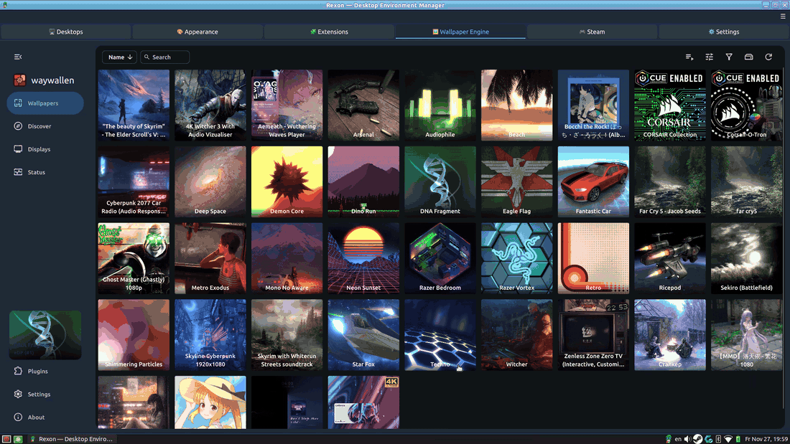
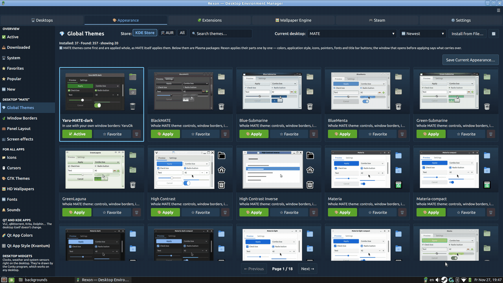
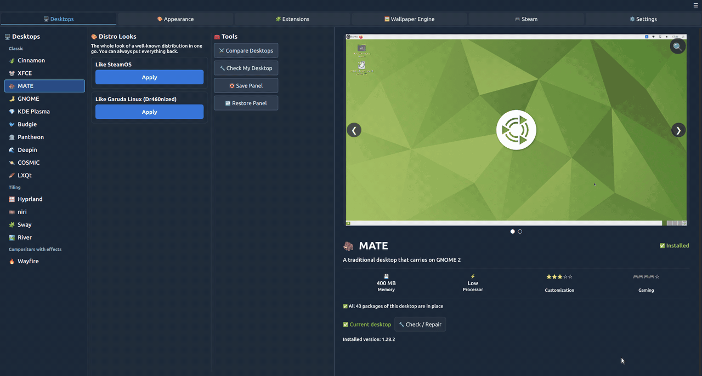
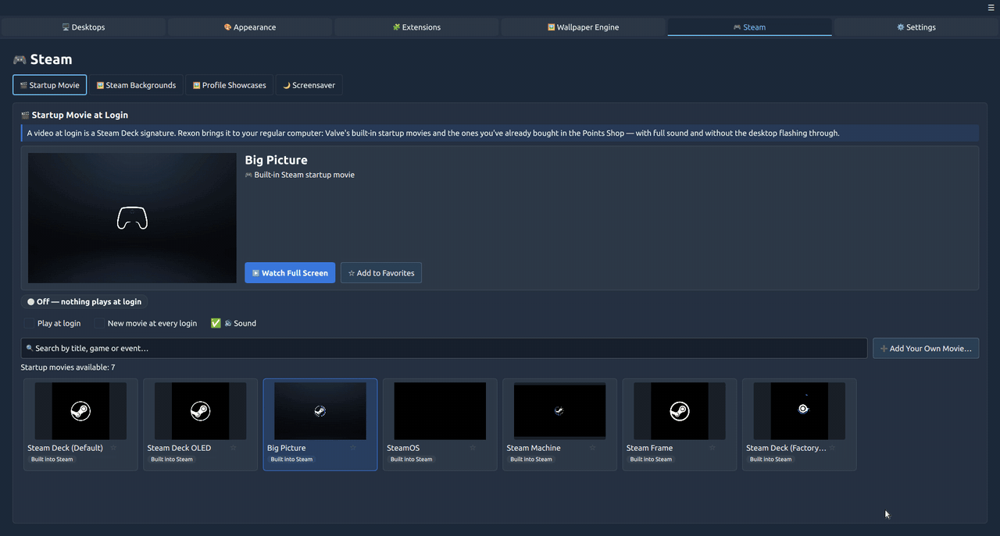
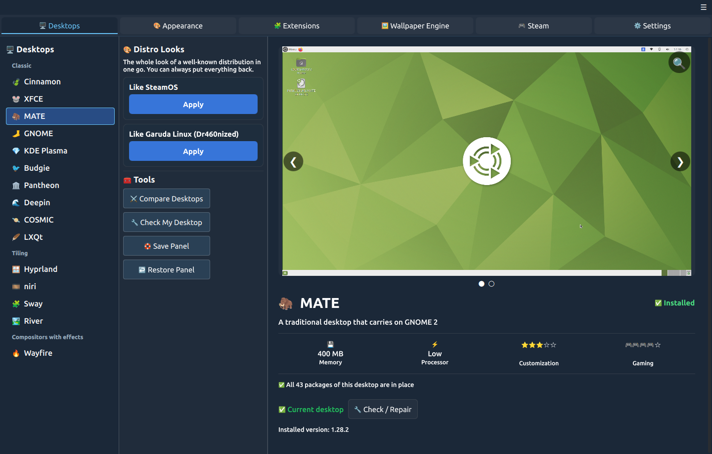
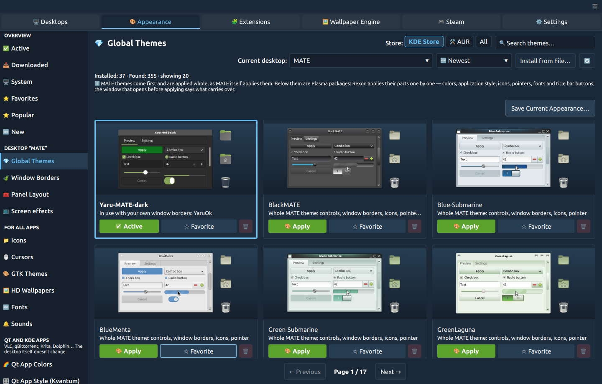
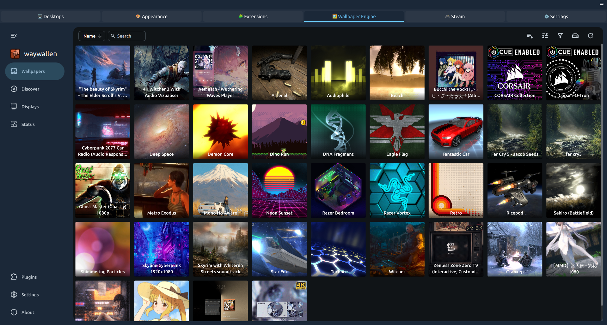
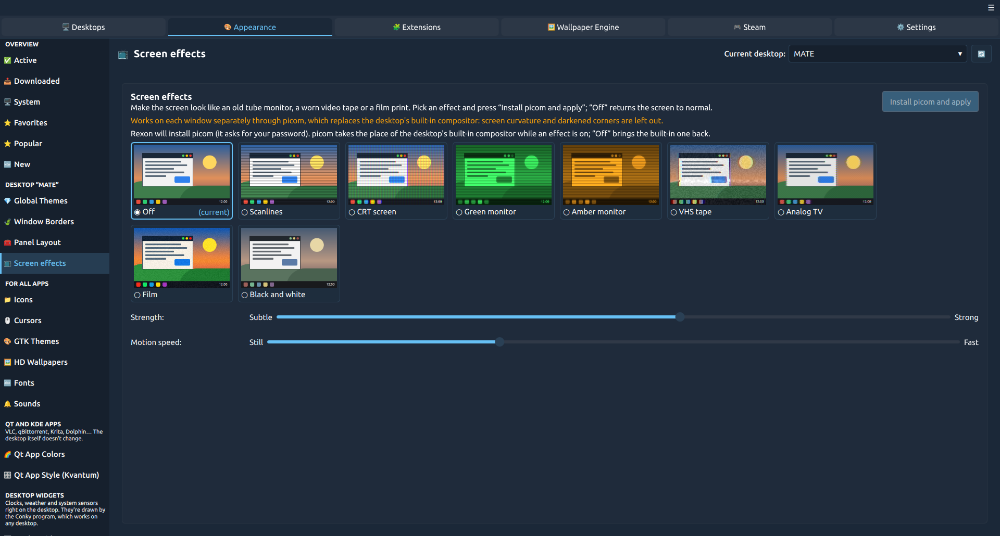
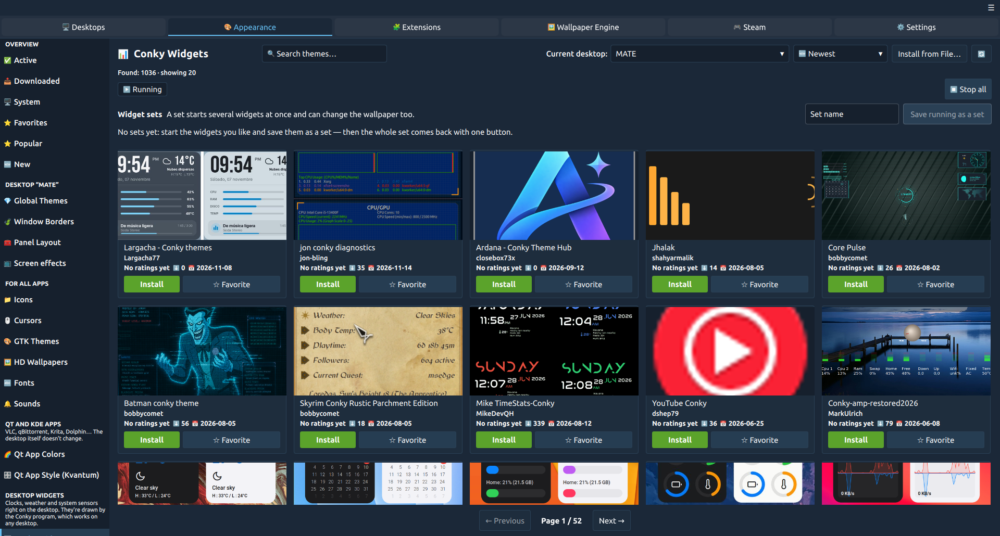
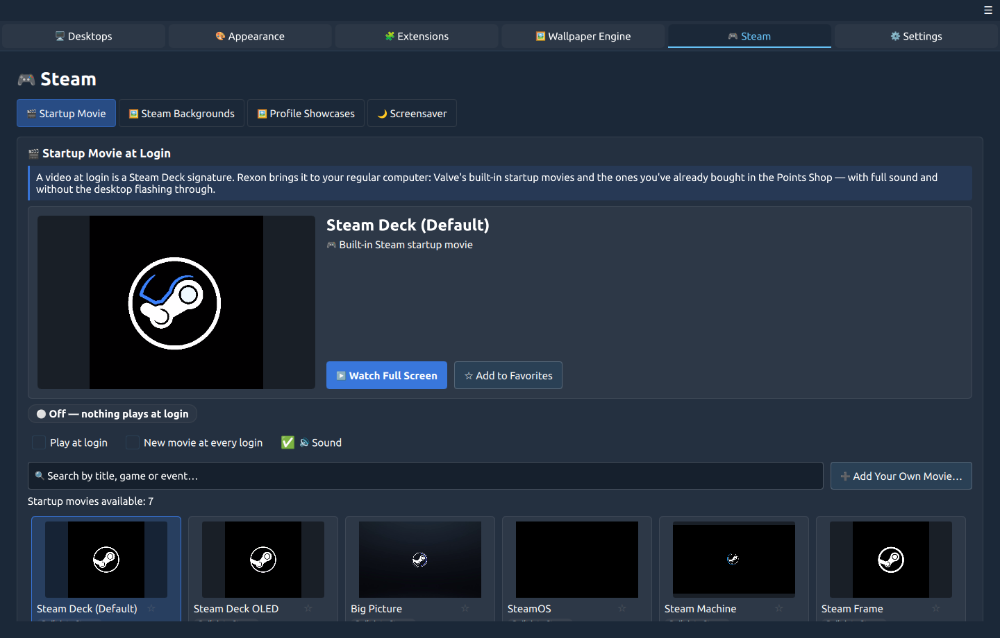

[English](README.md) | [Русский](README.ru.md) | [Deutsch](README.de.md) | [简体中文](README.zh-CN.md) | Français | [Español](README.es.md) | [Українська](README.uk.md)

[](https://github.com/wehrwolfmann/rexon/releases/latest) [](https://github.com/wehrwolfmann/rexon/actions/workflows/ci.yml) [](LICENSE)

# Rexon

Rexon est un gestionnaire d'environnements de bureau gratuit pour Linux. Dans
une seule fenêtre, il installe, change et supprime des environnements de
bureau, et leur applique des thèmes, des extensions et des fonds d'écran
animés.

Il s'adresse à ceux qui veulent essayer un autre environnement de bureau —
KDE Plasma, GNOME, Cinnamon, Hyprland et d'autres — ou changer l'apparence de
l'actuel sans devoir d'abord apprendre comment s'appellent les paquets de
chacun, où se trouvent ses fichiers de configuration et ses dossiers de
thèmes.

Rexon est écrit en Rust, son interface en Qt 6 / QML (via [cxx-qt](https://github.com/KDAB/cxx-qt)).
Le programme est jeune : son numéro de version est encore 0.x, et la
plateforme principale de développement et de test est Arch Linux / CachyOS.





<details>
<summary>▶ L'onglet « Bureaux » en mouvement</summary>

</details>

<details>
<summary>▶ L'onglet « Steam » en mouvement</summary>

</details>

<table>
  <tr>
    <td></td>
    <td></td>
    <td></td>
  </tr>
  <tr>
    <td></td>
    <td></td>
    <td></td>
  </tr>
  <tr>
    <td></td>
    <td></td>
    <td></td>
  </tr>
</table>

## Guide

Un guide pas à pas de tous les onglets — « Bureaux », « Apparence »,
« Extensions », Wallpaper Engine, Steam et « Paramètres » — en russe, en
anglais, en allemand, en chinois, en français, en espagnol et en ukrainien : [guide/](guide/README.md).
Version française : [Bureaux](guide/fr/desktops.md) · [Apparence](guide/fr/appearance.md) · [Extensions](guide/fr/extensions.md) · [Wallpaper Engine](guide/fr/wallpaper-engine.md) · [Steam](guide/fr/steam.md) · [Paramètres](guide/fr/settings.md).

## Fonctionnalités

**Environnements de bureau**

- Installation, changement et suppression d'environnements de bureau : KDE
  Plasma, GNOME, Cinnamon, Xfce, MATE, Budgie, Pantheon, COSMIC, LXQt, Deepin
  (session Treeland uniquement, expérimental, sur les systèmes basés sur
  Arch), Hyprland, Sway, niri, River et Wayfire.
- Impossible de supprimer l'environnement de bureau dans lequel vous
  travaillez, ni tout ce sans quoi le système ne démarrerait plus (voir
  [Ce que Rexon fait avec les droits root](#ce-que-rexon-fait-avec-les-droits-root)).
- Gestionnaire de connexion : installation, activation et passage entre SDDM,
  Plasma Login Manager, GDM, LightDM, LXDM, COSMIC Greeter et d'autres, avec
  une méthode enregistrée pour tout remettre comme avant.
- Comparaison côte à côte des environnements de bureau (consommation de
  mémoire, bibliothèque d'interface, compositeur, réglages par défaut).
- Vérification de l'environnement de bureau actuel (paquets manquants,
  réglages) avec réparation en un clic.
- « Comme dans une distribution » : un ensemble d'apparence complet prêt à
  l'emploi (actuellement SteamOS et Garuda Dr460nized), avec la possibilité de
  revenir à l'apparence précédente.
- Protection de vos applications par défaut (navigateur, terminal, visionneuse),
  que les environnements de bureau aiment réinitialiser lors d'un changement.
  Activée par défaut.

**Apparence**

- Les réglages d'apparence de la « Configuration du système » de KDE Plasma —
  sur chaque environnement de bureau pris en charge, écrits dans ses propres
  réglages : thèmes globaux (en entier ou par parties, et « Enregistrer
  l'apparence actuelle… » enregistre l'apparence actuelle comme thème),
  schémas de couleurs avec éditeur de schémas, couleur d'accentuation,
  alternance programmée des thèmes clair et sombre, style des applications,
  décorations de fenêtres et boutons de la barre de titre, polices et gestion
  des polices avec groupes de polices, flou du fond d'écran, sons
  d'événements et sons d'ambiance.
- Les thèmes GTK s'appliquent aussi aux applications GTK 4 / libadwaita si le
  thème a une version GTK 4, et les vignettes des thèmes montrent de vrais
  contrôles dessinés dans ce thème.
- Des thèmes pour GTK, Qt / Kvantum, les icônes, les curseurs, les polices,
  les boutons de fenêtre, les animations, KDE Plasma, Cinnamon, les
  dispositions de panneau MATE et Deepin — depuis le catalogue OpenDesktop /
  Pling, Cinnamon Spices et l'AUR (pour les paquets AUR, les signes de risque
  sont affichés avant l'installation).
- Curseurs Windows (`.cur` / `.ani`) convertis en Xcursor.
- Thèmes de l'écran de connexion (SDDM) et de l'écran d'amorçage (Plymouth).
- Widgets Conky avec aperçu.
- Effets d'écran (lignes de balayage, tube cathodique, cassette vidéo,
  pellicule et autres) avec aperçu en direct. Rexon les active sur tout
  l'écran sous Hyprland, GNOME et Cinnamon ; dans les autres environnements,
  la section indique honnêtement ce que le compositeur y permet.
- Sauvegardes des réglages du bureau et entrée de menu de secours
  « Restaurer l'apparence du bureau » (KDE) au cas où un thème aurait cassé
  le bureau.
- Extensions GNOME Shell et Cinnamon.

**Extensions**

- Les paquets propres à Rexon, `.rxn` (thèmes, ensembles de fonds d'écran,
  polices, outils pour le bureau et greffons) : installation depuis un fichier
  ou par glisser-déposer dans la fenêtre, activation et désactivation,
  suppression.
- Les thèmes Windows (`.themepack`, `.msstyles`), les curseurs et les jeux
  d'icônes sont convertis pour Linux à l'installation.

**Fonds d'écran animés**

- Fonds d'écran vidéo, web et scènes, y compris les fonds d'écran Wallpaper
  Engine que vous avez achetés sur Steam ; ils sont rendus par le moteur
  [waywallen](https://github.com/hypengw/waywallen).
- Ils fonctionnent sous KDE Plasma (greffon de fond d'écran), dans les
  compositeurs de type wlroots — Hyprland, Sway, niri (layer-shell) — ainsi
  que sous GNOME et Cinnamon (extensions du shell). Sur les bureaux X11, où
  waywallen ne sait pas afficher, les fonds d'écran vidéo et web sont affichés
  par le lecteur de fonds d'écran de Rexon.
- Fonds d'écran Flash (`.swf`) via le lecteur intégré [Ruffle](https://ruffle.rs).
- Vidéos de YouTube et de sites semblables comme fonds d'écran (en option,
  nécessite `yt-dlp`).

**Steam**

- Une vidéo de démarrage après la connexion, comme sur le Steam Deck, au choix
  parmi les vidéos de votre bibliothèque Steam.
- Vos arrière-plans de profil Steam comme fonds d'écran.

**Paramètres**

- Langue et apparence de la fenêtre de Rexon, icône dans la zone de
  notification, bibliothèque de fonds d'écran.
- Copies enregistrées du panneau KDE Plasma, interrupteur de la protection des
  applications par défaut et import de thèmes Windows.

**Sécurité du système**

- Avant une mise à jour du système, Rexon prévient si elle installerait un
  ensemble incohérent de paquets Qt (une telle mise à jour partielle laisse
  l'écran de connexion noir).
- Si l'écran de connexion ne démarre malgré tout pas, une explication en texte
  apparaît dans la console au lieu d'un écran noir ; `rexon doctor` affiche le
  même rapport.

## Systèmes pris en charge

| Plateforme | État |
|---|---|
| Arch Linux, CachyOS et les autres distributions basées sur Arch | Plateforme principale : Rexon y est développé et testé. Voir [Installation](#installation). |
| SteamOS (Steam Deck, Steam Machine) | Les environnements de bureau sont installés sous forme d'images `systemd-sysext`, car `/usr` est en lecture seule et remplacé à chaque mise à jour du système. |
| Debian / Ubuntu, Fedora, openSUSE, Gentoo, Alpine, Void, Solus, Clear Linux, ALT | Rexon a des tables de paquets pour ces familles, mais elles sont beaucoup moins testées. |
| NixOS | Rexon n'installe pas lui-même les environnements de bureau, il fournit un fragment pour `configuration.nix`. |

Le paquet est construit pour x86_64. Qt 6.6 ou plus récent est nécessaire.

## Installation

Pour Arch Linux / CachyOS, ce dépôt contient deux paquets :

- [`packaging/rexon/`](packaging/rexon/) — la version publiée. Elle est
  construite à partir de l'étiquette de version signée (`v0.1.2`), et
  `makepkg` vérifie la signature de l'étiquette avec la clé
  `B4505C7C7841ECC12D7A0E9D0083083C32159A72`. Importez la clé une fois :
  `curl -s https://github.com/wehrwolfmann.gpg | gpg --import`.
- [`packaging/aur/`](packaging/aur/) — `rexon-git`, le code le plus récent de
  `main`.

Le moteur de fonds d'écran est fourni par des paquets AUR séparés : le démon
`waywallen` et son greffon `open-wallpaper-engine` ; la construction demande
aussi `lito` (AUR). Installez-les d'abord, puis construisez Rexon :

```sh
paru -S waywallen open-wallpaper-engine lito
git clone https://github.com/wehrwolfmann/rexon.git
cd rexon/packaging/rexon
makepkg -si
```

Sans assistant AUR, construisez chacun des trois de la même façon,
`waywallen` avant `open-wallpaper-engine` :
`git clone https://aur.archlinux.org/<nom>.git && cd <nom> && makepkg -si`.
`waywallen-bin` (l'AppImage précompilée) ne convient pas encore : il fournit
`waywallen` sans version, et pacman n'en tient pas compte pour la dépendance
`waywallen>=0.6.3` de Rexon et d'`open-wallpaper-engine`. Sous Plasma, Rexon
installe lui-même le greffon de fond d'écran `plasma-wallpaper-waywallen`.

## Construire depuis les sources

Sous Arch Linux / CachyOS, installez les dépendances de construction (la liste
reprend `makedepends` et `depends` de [`packaging/aur/PKGBUILD`](packaging/aur/PKGBUILD)) :

```sh
sudo pacman -S --needed base-devel git rust protobuf gettext \
    qt6-base qt6-declarative qt6-websockets qt6-multimedia qt6-svg qt6-webengine \
    qt6-grpc qt6-shadertools layer-shell-qt wayland libglvnd mpv alsa-lib \
    vulkan-icd-loader openssl polkit pacman-contrib cmake ninja \
    jre-openjdk-headless
```

Java n'est nécessaire qu'à la construction : le lecteur Flash s'en sert pour
compiler ses classes ActionScript.

Construisez ensuite. Toutes les commandes cargo se lancent depuis le
répertoire `rust/` :

```sh
git clone https://github.com/wehrwolfmann/rexon.git
cd rexon/rust
cargo build-app       # noyau + fenêtre + ses bibliothèques QML (release)
cargo build-splash    # lecteur de la vidéo de démarrage à la connexion (séparé exprès)
cargo test-core       # tests du noyau, sans Qt
```

> **N'utilisez pas simplement `cargo build --release`.** L'espace de travail
> définit `default-members = ["rexon-core"]` pour que les tests du noyau
> n'aient pas besoin de Qt ; un `cargo build` ordinaire ne construit donc que
> le noyau. Les alias ci-dessus sont définis dans
> [`rust/.cargo/config.toml`](rust/.cargo/config.toml) (`cargo --list` les
> affiche) et ne fonctionnent que si cargo est lancé depuis `rust/`.

L'onglet des fonds d'écran animés a besoin de trois modules QML de plus, qui
se construisent avec CMake. Les scripts de `tools/` les placent dans
`~/.local/share/rexon/qml_modules` :

```sh
tools/build_qml_material.sh
tools/build_qml_control.sh
tools/build_qml_qextra.sh    # nécessite lito >= 0.8.11, clang, lld (AUR : lito ou lito-bin)
```

Pour tout obtenir d'un coup — les modules, les assistants privilégiés et
leurs politiques polkit —, construisez plutôt le paquet (les paquets du
moteur ci-dessus sont aussi nécessaires) :

```sh
cd packaging/aur
makepkg -si
```

## Lancement

Depuis l'arborescence des sources :

```sh
rust/target/release/rexon-main-window
```

Une fois installé depuis le paquet, la commande est `rexon`. Options utiles :

- `rexon --tray` — démarrer dans la zone de notification, sans fenêtre ;
- `rexon --page=<name>` — ouvrir la page voulue ;
- `rexon doctor` — afficher un rapport sur l'écran de connexion et la session,
  sans Qt (utile dans une console texte).

Pour lancer Rexon dans une autre langue, définissez `LANGUAGE`, par exemple
`LANGUAGE=fr rust/target/release/rexon-main-window`, ou choisissez la langue
dans les « Paramètres ».

Lancé depuis l'arborescence des sources, Rexon n'a pas ses assistants
privilégiés installés : les modifications du système passent alors par un
`pkexec` ordinaire, et le mot de passe est demandé à chaque fois.

## Ce que Rexon fait avec les droits root

Rexon lui-même tourne toujours sous votre utilisateur. Tout ce qui nécessite
root passe par un petit ensemble de programmes assistants : ils sont lancés
via `pkexec` sous des actions polkit nommées et n'exécutent que les opérations
d'une liste fermée. Cette section décrit précisément ces assistants et ce
qu'ils refusent.

### L'assistant de session : un mot de passe par fenêtre

La voie principale est `rexon-priv-helper` (action polkit `org.rexon.session`).

- La première fois que vous faites quelque chose qui nécessite root, Rexon
  lance l'assistant une fois via `pkexec`. La politique est `auth_admin`
  **sans** « keep » : polkit ne retient pas le mot de passe. En revanche,
  l'assistant lui-même vit tant que la fenêtre est ouverte : le mot de passe
  se saisit une fois par session de fenêtre, et non avant chaque opération.
- Tant que l'assistant tourne, les « Paramètres » et le menu de la zone de
  notification affichent « Rexon peut modifier le système jusqu'à la
  fermeture de la fenêtre » et un bouton **« Retirer maintenant »**.
- Le droit de modifier le système disparaît quand :
  1. la fenêtre de Rexon est fermée (y compris réduite dans la zone de
     notification) ou Rexon s'est terminé ;
  2. aucune action privilégiée n'a eu lieu pendant 15 minutes ;
  3. l'écran est verrouillé (vérifié via `loginctl`) ;
  4. l'ordinateur se met en veille.

  Une opération déjà en cours va jusqu'au bout, les nouvelles sont refusées,
  et la suivante redemandera le mot de passe.
- La fenêtre et l'assistant communiquent par une paire de sockets privée.
  L'assistant vérifie qu'à l'autre bout se trouve le même utilisateur qui a
  confirmé le mot de passe (`PKEXEC_UID`), et la fenêtre refuse de lancer
  l'assistant si son fichier ou son répertoire est accessible en écriture à
  quelqu'un d'autre que root.
- La fenêtre transmet **des opérations, pas des commandes** : par exemple
  « installer ces paquets de la table des environnements de bureau » ou
  « placer ce dossier de thème dans le répertoire des thèmes de l'écran de
  connexion ». C'est l'assistant qui construit la commande, à partir de tables
  intégrées à son propre exécutable. Aucun argument ne peut commencer par `-`
  ni contenir de syntaxe du shell, et les fichiers de votre dossier personnel
  sont transmis sous forme de descripteurs de fichiers déjà ouverts, et non de
  chemins que root ouvrirait. Les répertoires de destination sont des
  constantes de l'assistant.
- La version de l'assistant doit correspondre à celle de la fenêtre : après
  une mise à jour, Rexon demande à être relancé plutôt que de parler à une
  autre version.
- Si l'assistant refuse une opération, rien n'est fait, et Rexon **n'essaie
  pas** de la refaire via un `pkexec` ordinaire.
- Chaque opération est consignée dans le journal du système
  (`journalctl -t rexon-priv-helper`).

### Les anciens assistants dédiés

Certaines opérations ne sont pas encore prises en charge par l'assistant de
session (par exemple les overlays Gentoo, la réinitialisation des forks de
Plasma, la réinitialisation du thème Plymouth ou SDDM). Elles passent par
quatre anciens assistants, chacun avec sa propre action polkit et la politique
`auth_admin_keep` (polkit retient le mot de passe quelques minutes pour ce
processus Rexon) :

| Assistant | Action | Rôle |
|---|---|---|
| `rexon-de-helper` | `org.rexon.de-install` | installer un environnement de bureau de la table de Rexon |
| `rexon-pkg-helper` | `org.rexon.pkg` | opérations du gestionnaire de paquets |
| `rexon-stage-helper` | `org.rexon.stage` | copier des dossiers de thèmes dans `/usr/share` |
| `rexon-system-helper` | `org.rexon.system-install` | thèmes de l'écran de connexion et de l'écran d'amorçage |

Ils ont les mêmes listes autorisées et la même liste « ne jamais supprimer »
que l'assistant de session. Le paquet les installe dans `/usr/lib`, et leurs
politiques dans `/usr/share/polkit-1/actions/`.

**En option : sans aucun mot de passe.** L'assistant de premier lancement
propose une règle polkit (`/etc/polkit-1/rules.d/49-rexon-nopasswd.rules`) qui
permet aux administrateurs, dans une session locale active, d'installer sans
mot de passe les environnements de bureau de la liste de Rexon. Elle est
**désactivée par défaut**, ne concerne que `org.rexon.de-install`, et le
paquet ne l'installe jamais. Les thèmes de connexion et d'amorçage et tous les
autres programmes demandent toujours le mot de passe. L'action de session
`org.rexon.session` ne fait jamais partie de cette règle.

### Ce qui peut être installé

Les paquets ne s'installent qu'à partir des tables intégrées à Rexon :
environnements de bureau et leurs parties, gestionnaires de connexion,
dépendances des fonds d'écran vidéo, shells, Conky, parties du panneau MATE,
thèmes d'icônes et de curseurs, ensembles « Comme dans une distribution ». La
fenêtre nomme la table, et l'assistant vérifie chaque nom de paquet avec sa
propre copie de cette table.

**Les paquets AUR ne sont jamais installés automatiquement.** C'est vous qui
lancez chaque construction depuis l'AUR ; elle tourne sous votre utilisateur
via `paru` ou `yay`. Leur `sudo` est remplacé dans Rexon par
`rexon-sudo-shim`, qui n'a aucun droit propre : il ne fait que transmettre
l'appel à `pacman` à l'assistant de session. L'assistant n'installe que les
dépendances de construction présentes dans les dépôts officiels, et seulement
les paquets que vous avez demandé de construire (il lit le nom du paquet dans
chaque paquet construit).

Rexon ne lance jamais en root des scripts d'installation tiers. Le
`install.sh` que certains auteurs de thèmes joignent est ignoré. Les seuls
scripts tiers que Rexon lance tout court sont les scripts d'installation et de
suppression des paquets d'extensions `.rxn` de type `desktop-tool` et
`plugin`, et ils s'exécutent sous votre utilisateur.

### Ce qui n'est jamais supprimé

- **L'environnement de bureau dans lequel vous travaillez.** Le bouton de la
  fenêtre est désactivé, et l'assistant refuserait aussi.
- **Tout ce qu'il faut pour démarrer et administrer le système** : noyaux et
  leurs en-têtes, micrologiciels et microcode, chargeurs d'amorçage (GRUB,
  systemd-boot, Limine), générateurs d'initramfs (mkinitcpio, dracut,
  booster), modules DKMS, pilotes graphiques (NVIDIA, Mesa, Vulkan,
  `xf86-video-*`), `glibc`, `systemd`, `dbus`, `bash`, `coreutils`, les
  gestionnaires de paquets, `sudo`, `polkit`, `openssl` — et Rexon lui-même.
- Quand un environnement de bureau est supprimé, ses dépendances ne sont
  supprimées que si plus rien d'autre dans le système n'en a besoin.
- Un thème d'écran de connexion ou d'écran d'amorçage qui apporte son propre
  code binaire (par exemple un thème Plymouth qui pointe vers son propre
  module `.so`) est refusé avant même la demande de mot de passe.
- Sur les systèmes en lecture seule, Rexon ne touche pas au gestionnaire de
  paquets. Sur SteamOS, les environnements de bureau sont construits sous
  forme d'images `systemd-sysext` dans `/home/.rexon/sysext`, et l'assistant
  correspondant se trouve dans `/var/lib/rexon/bin`, car `/usr` est en lecture
  seule.

### Annulation et restauration

- **Changement de gestionnaire de connexion :** si le nouveau gestionnaire de
  connexion n'a pas pu être activé, le précédent est rétabli. De plus, Rexon
  enregistre la commande qui permet de rétablir le précédent depuis une
  console texte.
- **Échec de l'écran de connexion :** tant que Rexon est installé, chaque
  gestionnaire de connexion a un complément systemd `OnFailure=`
  (`rexon-login-rescue`) qui, au lieu d'un écran noir, affiche une explication
  en texte simple dans la console.
- **Apparence :** ce que Rexon a modifié s'annule avec le bouton « Rétablir
  comme avant », et la disposition du panneau KDE peut être sauvegardée et
  rétablie dans l'onglet « Bureaux » → « Outils » (« Sauvegarder le panneau » /
  « Rétablir le panneau »). KDE dispose d'une entrée de menu de secours
  « Restaurer l'apparence du bureau », qui fonctionne même si la fenêtre de
  Rexon ne démarre pas.
- **Les ensembles « Comme dans une distribution »** retiennent ce qu'ils ont
  modifié et peuvent être annulés.
- **Les thèmes de l'écran de connexion et de l'écran d'amorçage** peuvent être
  réinitialisés aux thèmes standard de la distribution.
- **Les forks thématiques de Plasma** (par exemple AeroThemePlasma) peuvent
  être remplacés par les paquets ordinaires, et après une mise à jour de
  Plasma qui les casse, Rexon peut vous laisser entrer une fois dans le
  système sans eux.

Quand le paquet Rexon est supprimé, ses assistants, ses politiques et ses
unités de secours de la connexion le sont aussi (ce sont des fichiers qui
appartiennent au paquet).

## Traductions

L'interface est traduite avec GNU gettext : un seul catalogue pour le code
Rust et pour les pages QML. Le modèle est [`po/rexon.pot`](po/rexon.pot),
chaque langue est un fichier dans [`po/`](po/). La langue de base est
l'anglais ; il existe des traductions en russe, en allemand, en chinois
simplifié, en français, en espagnol et en ukrainien. La façon d'ajouter une langue est décrite dans
[`po/README.md`](po/README.md) ; il n'y a pas de code à modifier.

## Remerciements

Les fonds d'écran animés de Rexon reposent sur le travail d'autres personnes :

- **[waywallen](https://github.com/hypengw/waywallen)** de hypengw — MIT. Le
  moteur de fonds d'écran (un service à part) ; le paquet Rexon dépend du
  paquet `waywallen`, et la version avec moteur intégré fournit sa version officielle
  sans modification. La page des fonds d'écran animés utilise
  l'interface QML de waywallen avec de petites modifications, qui se trouvent
  dans `data/qt_wallpaper_engine/qml_ui/waywallen/patches/`.
- **[Open Wallpaper Engine](https://github.com/waywallen/open-wallpaper-engine)** —
  GPL-2.0-only. Le greffon de waywallen qui rend les fonds d'écran scènes et
  web. Il tourne dans des processus séparés, lancés par le service waywallen ;
  Rexon n'est pas lié avec lui. Le paquet
  Rexon dépend du paquet `open-wallpaper-engine` ; la version avec moteur intégré fournit
  la version officielle sans modification, avec son code source complet.
- **[waywallen-display](https://github.com/waywallen/waywallen-display)** — le
  greffon de fond d'écran pour KDE Plasma, fourni sans modification.
- **[Ruffle](https://github.com/ruffle-rs/ruffle)** (MIT / Apache-2.0) — les
  fonds d'écran Flash ;
  **[QmlMaterial](https://github.com/hypengw/QmlMaterial)** et
  **[QExtra](https://github.com/hypengw/QExtra)** (MIT) — les modules QML de la
  page des fonds d'écran ; les modèles
  **[Mozilla Translations](https://github.com/mozilla/translations)** avec le
  crate `fxtranslate` (MPL-2.0) — la traduction des descriptions de fonds
  d'écran sans Internet ; **mpv** — le lecteur de la vidéo de démarrage.

La liste complète des composants tiers, de leurs licences et de ce qui y a été
modifié se trouve dans le fichier [`NOTICE`](NOTICE).

Rexon n'est ni affilié à Wallpaper Engine, à ses développeurs ou à Valve, ni
approuvé ou parrainé par eux. « Steam », « Steam Deck » et « SteamOS » sont
des marques de Valve Corporation ; tous les autres noms de produits
appartiennent à leurs propriétaires.

## Licence

Rexon est distribué sous la [licence Apache 2.0](LICENSE). Copyright 2026
Wehrwolfmann.

Les composants tiers conservent leurs propres licences (voir
[`NOTICE`](NOTICE)) ; les composants sous GPL qui y sont listés sont des
programmes séparés, fournis avec Rexon, et la licence Apache ne s'applique
pas à eux.

« Rexon » et le logo de Rexon sont des marques de Wehrwolfmann ; la licence
ne donne pas le droit de les utiliser (Apache License 2.0, section 6).

## Contribuer et sécurité

Comment construire, tester et traduire : [CONTRIBUTING.md](CONTRIBUTING.md) ;
comment signaler une vulnérabilité en privé : [SECURITY.md](SECURITY.md).
