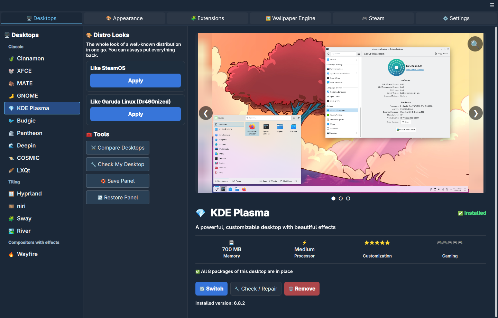
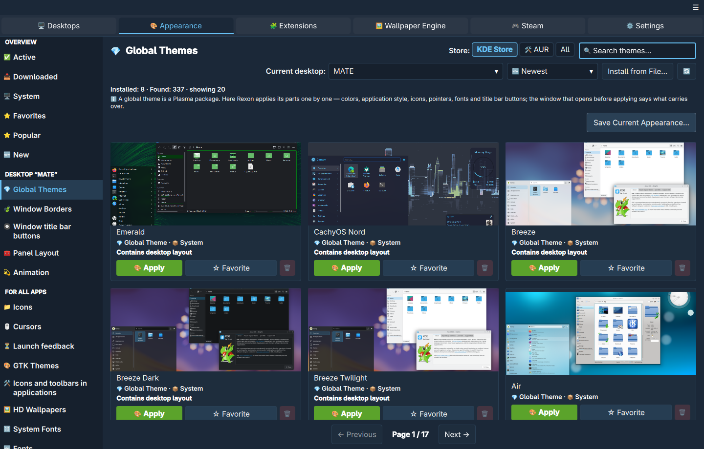
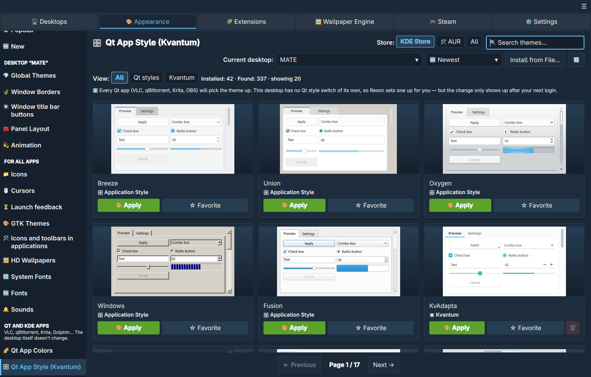
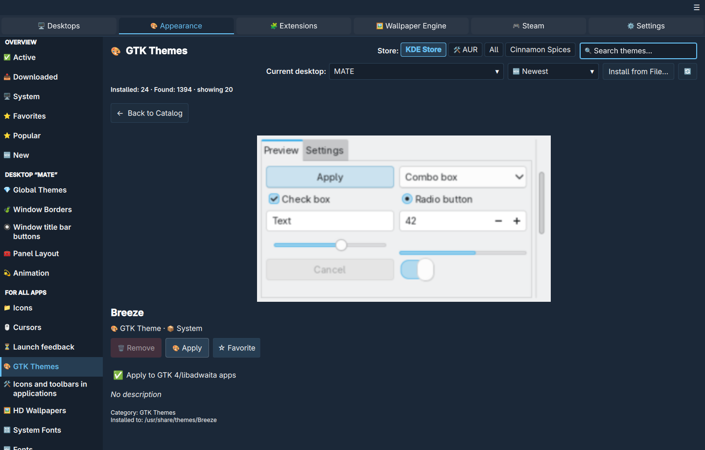
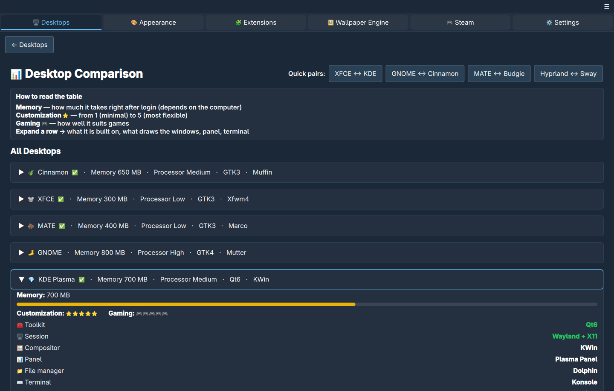

# Rexon

Rexon is a free desktop environment manager for Linux. In one window it installs,
switches and removes desktop environments, and applies themes, extensions and live
wallpapers to them.

It is meant for people who want to try another desktop — KDE Plasma, GNOME,
Cinnamon, Hyprland and others — or change how their current one looks, without
learning each desktop's package names, config files and theme folders first.

Rexon is written in Rust with a Qt 6 / QML interface (via [cxx-qt](https://github.com/KDAB/cxx-qt)).
It is early software: the version number is still 0.x, and the main development
and test platform is Arch Linux / CachyOS.





<table>
  <tr>
    <td></td>
    <td></td>
    <td></td>
  </tr>
</table>

## Features

**Desktops**

- Install, switch and remove desktop environments: KDE Plasma, GNOME, Cinnamon,
  Xfce, MATE, Budgie, Pantheon, COSMIC, LXQt, Deepin (Treeland session only,
  experimental, Arch-based systems), Hyprland, Sway, niri, River and Wayfire.
- The desktop you are logged into can't be removed, and neither can anything the
  system needs to boot (see [What Rexon does with root](#what-rexon-does-with-root)).
- Login manager: install, enable or switch between SDDM, Plasma Login Manager, GDM,
  LightDM, LXDM, COSMIC Greeter and others, with a written-down way back.
- Side-by-side comparison of desktops (memory use, toolkit, compositor, defaults).
- Checks of the current desktop (missing packages, settings) with one-click repair.
- "Like a distribution" looks: apply a complete set (currently SteamOS and Garuda
  Dr460nized) and revert to how it was.
- Protection of your default apps (browser, terminal, viewer) that desktops tend to
  reset when you switch between them. On by default.

**Appearance**

- The appearance settings of KDE Plasma's System Settings on every supported
  desktop, written to that desktop's own settings: global themes (applied whole or
  part by part, and "Save Current Appearance…" to keep your current look as a theme),
  colour schemes with a scheme editor, accent colour, light and dark switching on a
  schedule, application style, window decorations and title-bar buttons, fonts and a
  font manager with font groups.
- GTK themes are carried over to GTK 4 / libadwaita apps when the theme ships a
  GTK 4 version, and theme tiles show real widgets drawn in that theme.
- Themes for GTK, Qt / Kvantum, icons, cursors, fonts, window buttons, animations,
  KDE Plasma, Cinnamon, MATE panel layouts and Deepin, from the OpenDesktop / Pling
  catalog, Cinnamon Spices and the AUR (AUR packages show risk signs before you
  install them).
- Windows cursors (`.cur` / `.ani`) converted to Xcursor.
- Login screen (SDDM) and boot splash (Plymouth) themes.
- Conky widgets with previews.
- Screen effects (scanlines, CRT, VHS, film and others) where the compositor allows a
  shader.
- Backups of desktop settings and an emergency "Recover desktop appearance" menu
  entry (KDE) for when a theme breaks the desktop.
- Extensions: GNOME Shell and Cinnamon extensions, and Rexon's own `.rxn` packages.

**Live wallpapers**

- Video, web and scene wallpapers, including Wallpaper Engine wallpapers you own on
  Steam, rendered by the [waywallen](https://github.com/hypengw/waywallen) engine.
- Works on KDE Plasma (wallpaper plugin), wlroots-style compositors such as Hyprland,
  Sway and niri (layer-shell), and GNOME and Cinnamon (shell extensions). On X11
  desktops, where waywallen has no output, Rexon's own wallpaper host plays video and
  web wallpapers.
- Flash (`.swf`) wallpapers through a built-in [Ruffle](https://ruffle.rs) player.
- Video from YouTube and similar sites as a wallpaper (optional, needs `yt-dlp`).

**Steam**

- A startup movie after login, like on the Steam Deck, chosen from the movies in
  your Steam library.
- Steam profile backgrounds you own, as wallpapers.

**System safety**

- Before a system update, Rexon warns if the update would install a mismatched set
  of Qt packages (the kind of partial update that leaves a black login screen).
- If the login screen fails anyway, a text explanation appears on the console
  instead of a black screen; `rexon doctor` prints the same report.

## Supported systems

| Platform | State |
|---|---|
| Arch Linux, CachyOS and other Arch-based distributions | Primary platform: developed and tested here. See [Installing](#installing). |
| SteamOS (Steam Deck, Steam Machine) | Desktops are installed as `systemd-sysext` images, because `/usr` is read-only and replaced on every OS update. |
| Debian / Ubuntu, Fedora, openSUSE, Gentoo, Alpine, Void, Solus, Clear Linux, ALT | Rexon has package tables for these families, but they are tested much less. |
| NixOS | Rexon does not install desktops itself; it gives you a `configuration.nix` snippet. |

The package is built for x86_64. Qt 6.6 or newer is required.

## Installing

On Arch Linux / CachyOS there are two packages in this repository:

- [`packaging/rexon/`](packaging/rexon/) — the release. It is built from the signed
  tag (`v0.1.0`), and `makepkg` checks the tag's signature against the key
  `B4505C7C7841ECC12D7A0E9D0083083C32159A72`. Import it once with
  `curl -s https://github.com/wehrwolfmann.gpg | gpg --import`.
- [`packaging/aur/`](packaging/aur/) — `rexon-git`, the latest code from `main`.

```sh
git clone https://github.com/wehrwolfmann/rexon.git
cd rexon/packaging/rexon
makepkg -si
```

## Building from source

On Arch Linux / CachyOS, install the build dependencies (the list follows
`makedepends` and `depends` in [`packaging/aur/PKGBUILD`](packaging/aur/PKGBUILD)):

```sh
sudo pacman -S --needed base-devel git rust protobuf gettext \
    qt6-base qt6-declarative qt6-websockets qt6-multimedia qt6-svg qt6-webengine \
    qt6-grpc qt6-shadertools layer-shell-qt wayland libglvnd mpv alsa-lib \
    vulkan-icd-loader openssl polkit pacman-contrib cmake ninja \
    jre-openjdk-headless
```

Java is only needed at build time: the Flash player compiles its ActionScript
classes with it.

Then build. All cargo commands run from the `rust/` directory:

```sh
git clone https://github.com/wehrwolfmann/rexon.git
cd rexon/rust
cargo build-app       # core + the window + its QML libraries (release)
cargo build-splash    # login startup-movie player (separate on purpose)
cargo test-core       # core tests, no Qt needed
```

> **Don't use plain `cargo build --release`.** The workspace sets
> `default-members = ["rexon-core"]` so that the core tests don't need Qt, and plain
> `cargo build` therefore builds only the core. The aliases above are defined in
> [`rust/.cargo/config.toml`](rust/.cargo/config.toml) (`cargo --list` shows them).
> They only work when cargo is run from `rust/`.

The Live wallpapers tab also needs three QML plugins built with CMake. The scripts
in `tools/` put them into `~/.local/share/rexon/qml_modules`:

```sh
tools/build_qml_material.sh
tools/build_qml_control.sh
tools/build_qml_qextra.sh    # needs lito >= 0.8.7, clang, lld (AUR: lito or lito-bin)
```

To get everything at once — the plugins, the waywallen engine, the privileged
helpers and their polkit policies — build the package instead:

```sh
cd packaging/aur
makepkg -si
```

## Running

From a source tree:

```sh
rust/target/release/rexon-main-window
```

When installed from the package, the command is `rexon`. Useful options:

- `rexon --tray` — start in the system tray without a window;
- `rexon --page=<name>` — open a specific page;
- `rexon doctor` — print a report about the login screen and session, without Qt
  (useful from a text console).

To run Rexon in another language, set `LANGUAGE`, for example
`LANGUAGE=de rust/target/release/rexon-main-window`, or pick the language in
Settings.

A run from the source tree has no privileged helpers installed, so system changes
fall back to plain `pkexec` and ask for the password every time.

## What Rexon does with root

Rexon itself always runs as your user. Everything that needs root goes through a
small set of helper programs, started with `pkexec` under named polkit actions, and
only for a closed list of operations. This section describes exactly what they are
and what they refuse to do.

### The session helper: one password per window

`rexon-priv-helper` (polkit action `org.rexon.session`) is the main path.

- When you first do something that needs root, Rexon starts the helper once with
  `pkexec`. The policy is `auth_admin` **without** "keep": polkit does not remember
  the password. The helper itself stays alive for the window, so you enter the
  password once per window session rather than once per operation.
- While it is alive, Settings and the tray menu show
  "Rexon can change the system until the window is closed", with a
  **Revoke Now** button.
- The right to change the system ends when:
  1. the Rexon window is closed, including when it is minimised to the tray, or Rexon
     quits;
  2. 15 minutes pass without a privileged action;
  3. the screen is locked (checked through `loginctl`);
  4. the computer goes to sleep.

  An operation already running is finished; new ones are refused, and the next one
  asks for the password again.
- The window talks to the helper over a private socket pair. The helper checks that
  the other end is the same user who confirmed the password (`PKEXEC_UID`), and the
  window refuses to start a helper whose file or directory is writable by anyone but
  root.
- The window sends **operations, not commands**: for example "install these packages
  from the desktop table" or "put this theme folder into the login-screen theme
  directory". The helper builds the command itself from the tables compiled into its
  own binary. No argument may start with `-` or contain shell syntax, and files from
  your home folder are passed as already-open file descriptors, never as paths for
  root to open. Destination directories are constants in the helper.
- The helper's build must match the window's; after an update you are asked to
  restart Rexon rather than talking to a different version.
- If the helper refuses an operation, nothing is done, and Rexon does **not** retry
  it through plain `pkexec`.
- Every operation is logged to the system journal (`journalctl -t rexon-priv-helper`).

### Older per-purpose helpers

Some operations are not handled by the session helper yet (for example Gentoo
overlays, resetting Plasma forks, resetting the Plymouth or SDDM theme). They go
through four older helpers, each with its own polkit action and policy
`auth_admin_keep` (polkit remembers the password for a few minutes for that Rexon
process):

| Helper | Action | Purpose |
|---|---|---|
| `rexon-de-helper` | `org.rexon.de-install` | install a desktop from Rexon's table |
| `rexon-pkg-helper` | `org.rexon.pkg` | package manager operations |
| `rexon-stage-helper` | `org.rexon.stage` | copy theme folders into `/usr/share` |
| `rexon-system-helper` | `org.rexon.system-install` | login screen and boot splash themes |

They use the same allow-lists and the same "never remove" list as the session helper.
The package installs them in `/usr/lib`; policies go to
`/usr/share/polkit-1/actions/`.

**Optional: no password at all.** The first-run wizard offers a polkit rule
(`/etc/polkit-1/rules.d/49-rexon-nopasswd.rules`) that lets administrators in an
active local session install desktops from Rexon's list without a password. It is
**off by default**, covers only `org.rexon.de-install`, and the package never
installs it. Login and boot themes and any other software still ask for the
password. The session action `org.rexon.session` is never part of that rule.

### What can be installed

Packages are installed only from tables built into Rexon: desktops and their parts,
login managers, video wallpaper dependencies, shells, Conky, MATE panel parts,
icon and cursor themes, "Like a distribution" looks. The window names the table;
the helper checks every package name against its own copy of that table.

**AUR packages are never installed automatically.** You start each AUR build
yourself; it runs as your user with `paru` or `yay`. Their `sudo` is replaced inside
Rexon by `rexon-sudo-shim`, which has no rights of its own: it only forwards the
`pacman` call to the session helper. The helper installs only build dependencies
that exist in the official repositories, and only the packages you asked to build
(it reads the package name from each built package).

Rexon never runs a third-party installer script as root. The `install.sh` that some
theme authors ship is ignored. The only third-party scripts Rexon runs at all are
the install and uninstall scripts of `.rxn` extension packages of the
`desktop-tool` and `plugin` types, and those run as your user.

### What is never removed

- **The desktop you are logged into.** The button is disabled in the window, and the
  helper refuses as well.
- **Anything needed to boot and to manage the system**: kernels and their headers,
  firmware and microcode, boot loaders (GRUB, systemd-boot, Limine), initramfs
  generators (mkinitcpio, dracut, booster), DKMS modules, graphics drivers (NVIDIA,
  Mesa, Vulkan, `xf86-video-*`), `glibc`, `systemd`, `dbus`, `bash`, `coreutils`,
  package managers, `sudo`, `polkit`, `openssl` — and Rexon itself.
- When a desktop is removed, its dependencies are removed only if nothing else on
  the system still needs them.
- A login screen or boot splash theme that ships its own binary code (for example a
  Plymouth theme pointing at its own `.so` module) is refused before the password
  is asked.
- On read-only systems Rexon does not touch the package manager. On SteamOS,
  desktops are built as `systemd-sysext` images under `/home/.rexon/sysext`; the
  helper for that is placed in `/var/lib/rexon/bin`, because `/usr` is read-only.

### Undo and recovery

- **Login manager switch:** if enabling the new login manager fails, the previous
  one is restored. Rexon also writes down a command to bring the previous one back
  from a text console.
- **Login screen failure:** while Rexon is installed, every login manager has a
  systemd `OnFailure=` drop-in (`rexon-login-rescue`) that shows a plain-text
  explanation on the console instead of a black screen.
- **Appearance:** desktop settings are backed up before changes (Settings →
  Desktop backups). KDE has an emergency "Recover desktop appearance" menu entry that
  works even if the Rexon window doesn't start.
- **"Like a distribution" looks** remember what they changed and can be reverted.
- **Login screen and boot splash** themes can be reset to the distribution default.
- **Theme forks of Plasma** (such as AeroThemePlasma) can be replaced with the stock
  packages, and after a Plasma update that breaks them Rexon can log you in once
  without them.

Removing the Rexon package removes its helpers, policies and the login-rescue units
(they are files owned by the package).

## Translations

The interface is translated with GNU gettext: one catalog for both the Rust code and
the QML pages. The template is [`po/rexon.pot`](po/rexon.pot), and each language is
one file in [`po/`](po/). English is the base language, and translations are
available in Russian and German. See [`po/README.md`](po/README.md) to add a
language — no code changes are needed.

## Credits

Rexon's live wallpapers are built on the work of others:

- **[waywallen](https://github.com/hypengw/waywallen)** by hypengw — MIT. The
  wallpaper engine (a separate daemon); the package ships its official release
  unmodified. The Live wallpapers page uses waywallen's QML interface with small
  patches kept in `data/qt_wallpaper_engine/qml_ui/waywallen/patches/`.
- **[Open Wallpaper Engine](https://github.com/waywallen/open-wallpaper-engine)** —
  GPL-2.0-only. The waywallen plugin that renders scene and web wallpapers. It runs as
  separate processes started by the waywallen daemon; Rexon does not link to it. The
  package ships the official release unmodified, together with its full source code.
- **[waywallen-display](https://github.com/waywallen/waywallen-display)** — the KDE
  Plasma wallpaper plugin, shipped unmodified.
- **[Ruffle](https://github.com/ruffle-rs/ruffle)** (MIT / Apache-2.0) — Flash
  wallpapers; **[QmlMaterial](https://github.com/hypengw/QmlMaterial)** and
  **[QExtra](https://github.com/hypengw/QExtra)** (MIT) — QML plugins of the
  wallpaper page; **[Mozilla Translations](https://github.com/mozilla/translations)**
  models with the `fxtranslate` crate (MPL-2.0) — offline translation of wallpaper
  descriptions; **mpv** — the startup movie player.

The complete list of third-party components, their licenses and what was changed is
in [`NOTICE`](NOTICE).

Rexon is not affiliated with, endorsed by or sponsored by Wallpaper Engine, its
developers, or Valve. "Steam", "Steam Deck" and "SteamOS" are trademarks of Valve
Corporation; all other product names belong to their owners.

## License

Rexon is licensed under the [Apache License 2.0](LICENSE). Copyright 2026
Wehrwolfmann.

Third-party components keep their own licenses (see [`NOTICE`](NOTICE)); the GPL
components listed there are separate programs shipped alongside Rexon and are not
covered by the Apache License.

"Rexon" and the Rexon logo are trademarks of Wehrwolfmann; the license does not grant
permission to use them (Apache License 2.0, section 6).

## Contributing and security

See [CONTRIBUTING.md](CONTRIBUTING.md) for building, testing and translating, and
[SECURITY.md](SECURITY.md) for reporting vulnerabilities privately.
