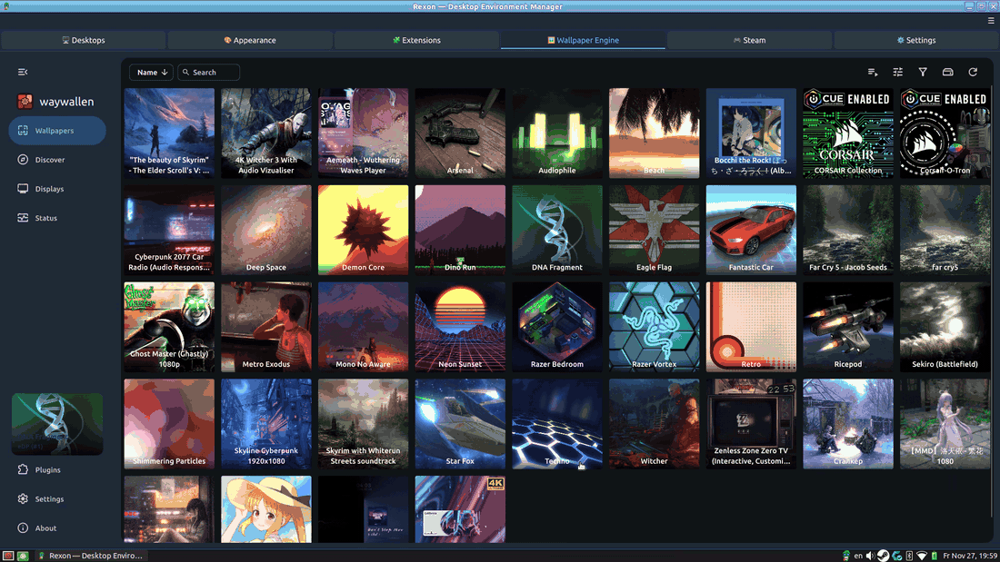
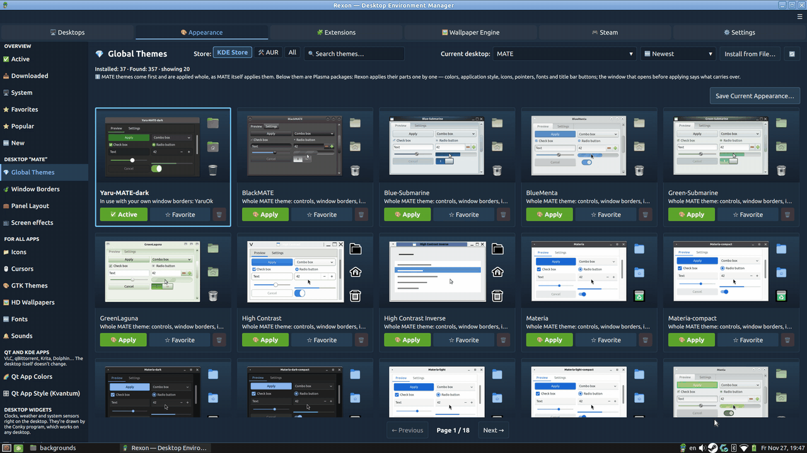
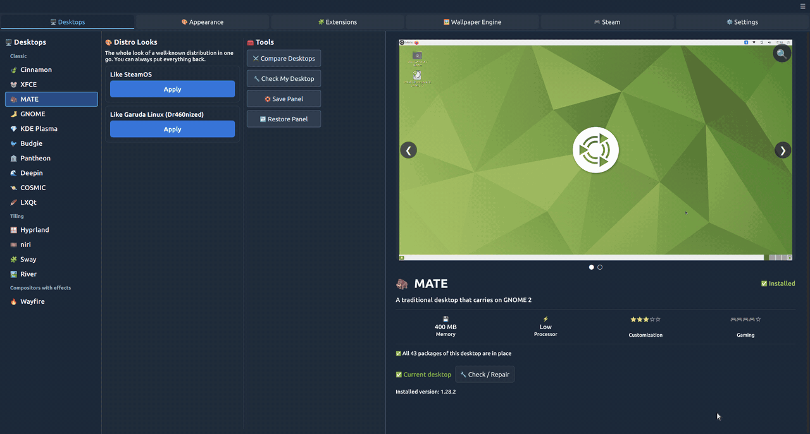
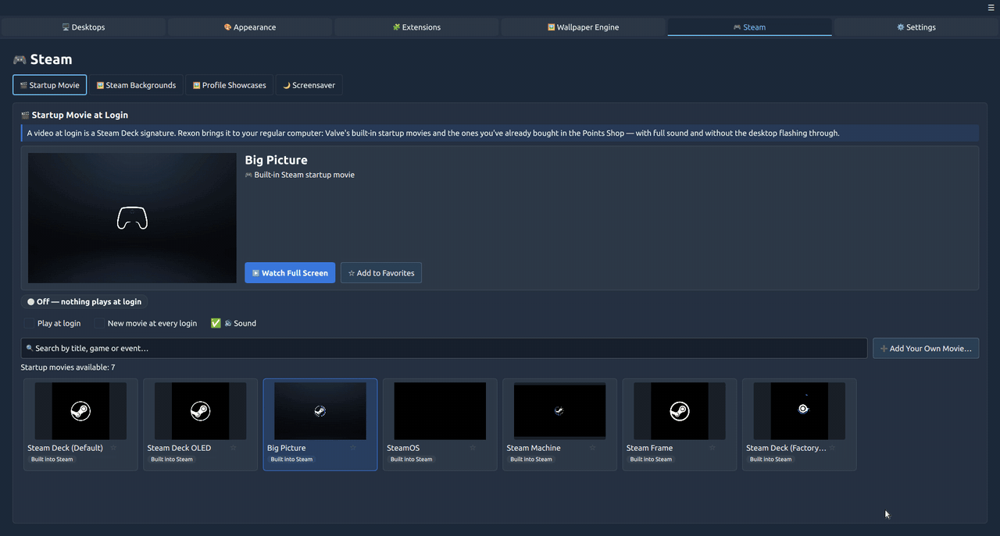
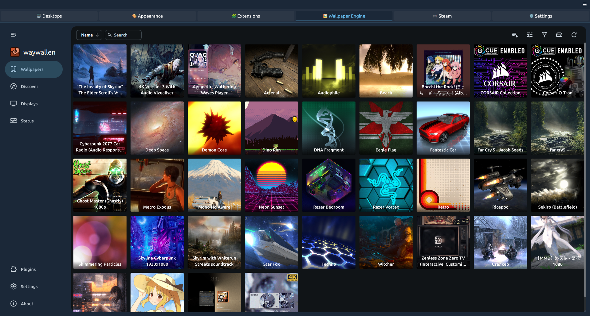
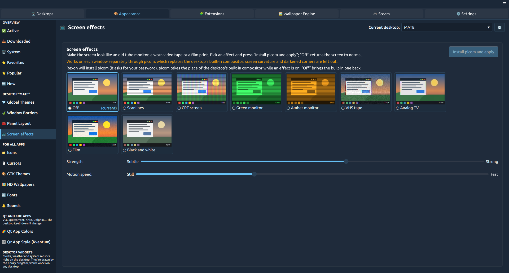
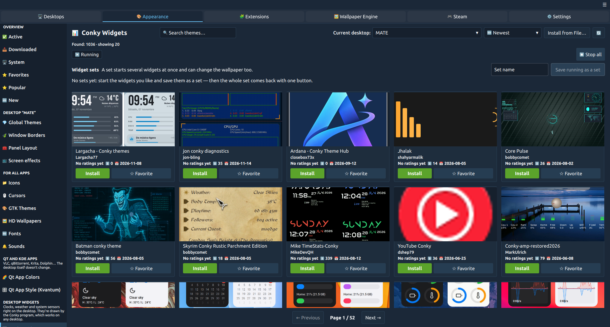
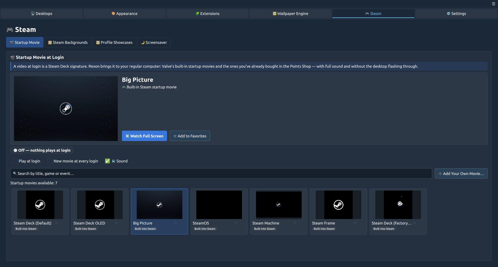

[English](README.md) | Русский | [Deutsch](README.de.md) | [简体中文](README.zh-CN.md) | [Français](README.fr.md) | [Español](README.es.md) | [Українська](README.uk.md)

# Rexon

Rexon — бесплатный менеджер рабочих столов для Linux. В одном окне он ставит,
переключает и удаляет рабочие столы, а также применяет к ним темы, расширения и
живые обои.

Он для тех, кто хочет попробовать другой рабочий стол — KDE Plasma, GNOME,
Cinnamon, Hyprland и другие — или поменять вид нынешнего и при этом не
разбираться сперва, как у каждого из них называются пакеты, где лежат файлы
настроек и папки тем.

Rexon написан на Rust, интерфейс — на Qt 6 / QML (через [cxx-qt](https://github.com/KDAB/cxx-qt)).
Программа молодая: номер версии пока 0.x, а основная платформа разработки и
проверки — Arch Linux / CachyOS.





<details>
<summary>▶ Вкладка «Рабочие столы» в движении</summary>

</details>

<details>
<summary>▶ Вкладка Steam в движении</summary>

</details>

<table>
  <tr>
    <td></td>
    <td></td>
    <td></td>
  </tr>
  <tr>
    <td></td>
    <td></td>
    <td></td>
  </tr>
  <tr>
    <td></td>
    <td></td>
    <td></td>
  </tr>
</table>

## Руководство

Пошаговое руководство по всем вкладкам — «Рабочие столы», «Оформление»,
«Расширения», Wallpaper Engine, Steam и «Настройки» — на русском, английском,
немецком, китайском, французском, испанском и украинском: [guide/](guide/README.md).

## Возможности

**Рабочие столы**

- Установка, переключение и удаление рабочих столов: KDE Plasma, GNOME, Cinnamon,
  Xfce, MATE, Budgie, Pantheon, COSMIC, LXQt, Deepin (только сеанс Treeland,
  экспериментально, на системах на базе Arch), Hyprland, Sway, niri, River и Wayfire.
- Нельзя удалить рабочий стол, в котором вы сейчас работаете, и всё, без чего
  система не загрузится (см. [Что Rexon делает с правами root](#что-rexon-делает-с-правами-root)).
- Менеджер входа: установка, включение и переключение между SDDM, Plasma Login
  Manager, GDM, LightDM, LXDM, COSMIC Greeter и другими — с записанным способом
  вернуть всё как было.
- Сравнение рабочих столов бок о бок (расход памяти, библиотека интерфейса,
  композитор, настройки по умолчанию).
- Проверка текущего рабочего стола (недостающие пакеты, настройки) с починкой в
  один щелчок.
- «Как в дистрибутиве»: готовый набор оформления целиком (сейчас SteamOS и Garuda
  Dr460nized) с возможностью вернуть прежний вид.
- Защита ваших приложений по умолчанию (браузер, терминал, просмотрщик), которые
  рабочие столы любят сбрасывать при переключении. Включена по умолчанию.

**Оформление**

- Настройки оформления из «Параметров системы» KDE Plasma — на каждом
  поддерживаемом рабочем столе, с записью в его собственные настройки: глобальные темы
  (целиком или по частям, а «Сохранить текущее оформление…» сохраняет нынешний вид
  как тему), цветовые схемы с редактором схем, цвет акцента, смена светлой и тёмной
  темы по расписанию, стиль приложений, декорации окон и кнопки заголовка окна,
  шрифты и управление шрифтами с группами шрифтов, размытие обоев, звуки
  событий и фоновые звуки.
- Темы GTK переносятся и на приложения GTK 4 / libadwaita, если у темы есть версия
  для GTK 4, а на плитках тем видны настоящие элементы управления, нарисованные в
  этой теме.
- Темы для GTK, Qt / Kvantum, значков, курсоров, шрифтов, кнопок окон, анимаций,
  KDE Plasma, Cinnamon, раскладок панели MATE и Deepin — из каталога OpenDesktop /
  Pling, Cinnamon Spices и AUR (у пакетов AUR до установки показываются признаки
  риска).
- Курсоры Windows (`.cur` / `.ani`) с переводом в Xcursor.
- Темы экрана входа (SDDM) и загрузочного экрана (Plymouth).
- Виджеты Conky с предпросмотром.
- Эффекты экрана (строки развёртки, кинескоп, видеокассета, киноплёнка и другие) с живым
  предпросмотром. Rexon включает их на весь экран в Hyprland, GNOME и Cinnamon, а в KDE Plasma,
  Pantheon и COSMIC — штатный чёрно-белый фильтр; в других
  окружениях раздел честно говорит, что там позволяет композитор.
- Резервные копии настроек рабочего стола и аварийный пункт меню «Восстановить
  оформление рабочего стола» (KDE) на случай, если тема сломала рабочий стол.
- Расширения GNOME Shell и Cinnamon.

**Расширения**

- Собственные пакеты Rexon `.rxn` (темы, наборы обоев, шрифты, инструменты для
  рабочего стола и модули): установка из файла или перетаскиванием в окно,
  включение и выключение, удаление.
- Темы Windows (`.themepack`, `.msstyles`), курсоры и наборы значков при
  установке переводятся для Linux.

**Живые обои**

- Видео-, веб- и сценовые обои, в том числе купленные вами в Steam обои Wallpaper
  Engine; отрисовывает их движок [waywallen](https://github.com/hypengw/waywallen).
- Работают в KDE Plasma (модуль обоев), в композиторах на манер wlroots — Hyprland,
  Sway, niri (layer-shell), — а также в GNOME и Cinnamon (расширения оболочки). На
  рабочих столах X11, куда waywallen выводить не умеет, видео- и веб-обои
  показывает собственный проигрыватель обоев Rexon.
- Обои Flash (`.swf`) через встроенный проигрыватель [Ruffle](https://ruffle.rs).
- Видео с YouTube и похожих сайтов в качестве обоев (по желанию, нужен `yt-dlp`).

**Steam**

- Видеозаставка после входа в систему, как на Steam Deck, — на выбор из роликов
  вашей библиотеки Steam.
- Ваши фоны профиля Steam в качестве обоев.

**Настройки**

- Язык и оформление окна Rexon, значок в трее, библиотека обоев.
- Сохранённые копии панели KDE Plasma, переключатель защиты приложений по
  умолчанию и импорт тем Windows.

**Безопасность системы**

- Перед обновлением системы Rexon предупреждает, если обновление поставит
  несогласованный набор пакетов Qt (из-за такого частичного обновления экран входа
  остаётся чёрным).
- Если экран входа всё же не запустился, вместо чёрного экрана в консоли
  появляется текстовое объяснение; тот же отчёт выводит `rexon doctor`.

## Поддерживаемые системы

| Платформа | Состояние |
|---|---|
| Arch Linux, CachyOS и другие дистрибутивы на базе Arch | Основная платформа: здесь Rexon разрабатывается и проверяется. См. [Установка](#установка). |
| SteamOS (Steam Deck, Steam Machine) | Рабочие столы ставятся образами `systemd-sysext`, потому что `/usr` доступен только для чтения и заменяется при каждом обновлении ОС. |
| Debian / Ubuntu, Fedora, openSUSE, Gentoo, Alpine, Void, Solus, Clear Linux, ALT | Таблицы пакетов для этих семейств в Rexon есть, но проверены они гораздо меньше. |
| NixOS | Rexon не ставит рабочие столы сам, а выдаёт фрагмент для `configuration.nix`. |

Пакет собирается для x86_64. Нужен Qt 6.6 или новее.

## Установка

Для Arch Linux / CachyOS в этом репозитории два пакета:

- [`packaging/rexon/`](packaging/rexon/) — выпуск. Собирается из подписанной метки
  выпуска (`v0.1.2`), и `makepkg` сверяет подпись метки с ключом
  `B4505C7C7841ECC12D7A0E9D0083083C32159A72`. Импортируйте ключ один раз:
  `curl -s https://github.com/wehrwolfmann.gpg | gpg --import`.
- [`packaging/aur/`](packaging/aur/) — `rexon-git`, свежий код из `main`.

Движок обоев ставится отдельными пакетами из AUR: демон `waywallen` и его
плагин `open-wallpaper-engine`; для сборки нужен ещё `lito` (AUR). Сначала
поставьте их, потом соберите Rexon:

```sh
paru -S waywallen open-wallpaper-engine lito
git clone https://github.com/wehrwolfmann/rexon.git
cd rexon/packaging/rexon
makepkg -si
```

Без помощника AUR соберите каждый из трёх так же, `waywallen` раньше
`open-wallpaper-engine`:
`git clone https://aur.archlinux.org/<имя>.git && cd <имя> && makepkg -si`.
`waywallen-bin` (готовый AppImage) пока не подходит: он объявляет `waywallen`
без версии, и pacman не засчитывает его для зависимости `waywallen>=0.6.3`
у Rexon и у `open-wallpaper-engine`. В Plasma модуль обоев
`plasma-wallpaper-waywallen` Rexon ставит сам.

## Сборка из исходников

В Arch Linux / CachyOS поставьте зависимости сборки (список повторяет
`makedepends` и `depends` из [`packaging/aur/PKGBUILD`](packaging/aur/PKGBUILD)):

```sh
sudo pacman -S --needed base-devel git rust protobuf gettext \
    qt6-base qt6-declarative qt6-websockets qt6-multimedia qt6-svg qt6-webengine \
    qt6-grpc qt6-shadertools layer-shell-qt wayland libglvnd mpv alsa-lib \
    vulkan-icd-loader openssl polkit pacman-contrib cmake ninja \
    jre-openjdk-headless
```

Java нужна только при сборке: ею проигрыватель Flash компилирует свои классы
ActionScript.

Затем соберите. Все команды cargo запускаются из каталога `rust/`:

```sh
git clone https://github.com/wehrwolfmann/rexon.git
cd rexon/rust
cargo build-app       # ядро + окно + его библиотеки QML (release)
cargo build-splash    # проигрыватель видеозаставки при входе (отдельно намеренно)
cargo test-core       # тесты ядра, Qt не нужен
```

> **Не используйте просто `cargo build --release`.** В рабочем пространстве задано
> `default-members = ["rexon-core"]`, чтобы тестам ядра не требовался Qt, поэтому
> обычный `cargo build` собирает только ядро. Псевдонимы выше определены в
> [`rust/.cargo/config.toml`](rust/.cargo/config.toml) (их показывает `cargo --list`)
> и работают, только если cargo запущен из `rust/`.

Вкладке «Живые обои» нужны ещё три модуля QML, которые собираются через CMake.
Скрипты в `tools/` кладут их в `~/.local/share/rexon/qml_modules`:

```sh
tools/build_qml_material.sh
tools/build_qml_control.sh
tools/build_qml_qextra.sh    # нужны lito >= 0.8.11, clang, lld (AUR: lito или lito-bin)
```

Чтобы получить всё разом — модули, привилегированных помощников и их
политики polkit, — соберите лучше пакет (пакеты движка выше нужны и здесь):

```sh
cd packaging/aur
makepkg -si
```

## Запуск

Из дерева исходников:

```sh
rust/target/release/rexon-main-window
```

После установки из пакета команда — `rexon`. Полезные параметры:

- `rexon --tray` — запуск в системном лотке, без окна;
- `rexon --page=<name>` — открыть нужную страницу;
- `rexon doctor` — вывести отчёт об экране входа и сеансе, без Qt (пригодится в
  текстовой консоли).

Чтобы запустить Rexon на другом языке, задайте `LANGUAGE`, например
`LANGUAGE=de rust/target/release/rexon-main-window`, или выберите язык в
«Настройках».

При запуске из дерева исходников привилегированные помощники не установлены,
поэтому системные изменения идут через обычный `pkexec` и пароль спрашивается
каждый раз.

## Что Rexon делает с правами root

Сам Rexon всегда работает от вашего пользователя. Всё, что требует root, проходит
через небольшой набор программ-помощников: они запускаются через `pkexec` под
именованными действиями polkit и выполняют только операции из закрытого списка.
В этом разделе точно описано, что это за помощники и от чего они отказываются.

### Помощник сеанса: один пароль на окно

Основной путь — `rexon-priv-helper` (действие polkit `org.rexon.session`).

- Когда вы впервые делаете что-то, для чего нужен root, Rexon один раз запускает
  помощника через `pkexec`. Политика — `auth_admin` **без** «keep»: polkit пароль
  не запоминает. Зато сам помощник живёт, пока открыто окно, так что пароль
  вводится один раз за сеанс окна, а не перед каждой операцией.
- Пока помощник работает, в «Настройках» и в меню лотка видна надпись
  «Rexon может изменять систему до закрытия окна» и кнопка
  **«Запретить сейчас»**.
- Право изменять систему пропадает, когда:
  1. окно Rexon закрыто (в том числе свёрнуто в лоток) или Rexon завершился;
  2. 15 минут не было ни одного привилегированного действия;
  3. экран заблокирован (это проверяется через `loginctl`);
  4. компьютер уходит в сон.

  Уже идущая операция доводится до конца, новые отклоняются, и следующая снова
  спросит пароль.
- Окно и помощник общаются через закрытую пару сокетов. Помощник проверяет, что на
  другом конце тот же пользователь, который подтвердил пароль (`PKEXEC_UID`), а окно
  отказывается запускать помощника, если его файл или каталог доступен для записи
  кому-то, кроме root.
- Окно передаёт **операции, а не команды**: например, «установить эти пакеты из
  таблицы рабочих столов» или «положить эту папку темы в каталог тем экрана входа».
  Команду помощник строит сам — по таблицам, вшитым в его собственный исполняемый
  файл. Ни один аргумент не может начинаться с `-` или содержать синтаксис
  оболочки, а файлы из вашей домашней папки передаются уже открытыми файловыми
  дескрипторами, а не путями, которые открывал бы root. Каталоги назначения
  заданы в помощнике константами.
- Сборка помощника должна совпадать со сборкой окна: после обновления Rexon
  попросит перезапустить себя, а не станет общаться с другой версией.
- Если помощник отклонил операцию, ничего не делается, и Rexon **не** пытается
  повторить её через обычный `pkexec`.
- Каждая операция записывается в системный журнал (`journalctl -t rexon-priv-helper`).

### Прежние помощники под отдельные задачи

Некоторые операции помощник сеанса пока не выполняет (например, оверлеи Gentoo,
сброс форков Plasma, сброс темы Plymouth или SDDM). Они идут через четыре прежних
помощника, у каждого своё действие polkit и политика `auth_admin_keep` (polkit
несколько минут помнит пароль для этого процесса Rexon):

| Помощник | Действие | Назначение |
|---|---|---|
| `rexon-de-helper` | `org.rexon.de-install` | установка рабочего стола из таблицы Rexon |
| `rexon-pkg-helper` | `org.rexon.pkg` | операции менеджера пакетов |
| `rexon-stage-helper` | `org.rexon.stage` | копирование папок тем в `/usr/share` |
| `rexon-system-helper` | `org.rexon.system-install` | темы экрана входа и загрузочного экрана |

У них те же разрешённые списки и тот же список «никогда не удалять», что и у
помощника сеанса. Пакет ставит их в `/usr/lib`, политики — в
`/usr/share/polkit-1/actions/`.

**По желанию: совсем без пароля.** Мастер первого запуска предлагает правило polkit
(`/etc/polkit-1/rules.d/49-rexon-nopasswd.rules`), которое позволяет
администраторам в активном локальном сеансе ставить рабочие столы из списка
Rexon без пароля. Оно **по умолчанию выключено**, касается только
`org.rexon.de-install`, и пакет его никогда не устанавливает. Темы входа и
загрузки и любые другие программы по-прежнему спрашивают пароль. Действие сеанса
`org.rexon.session` в это правило не входит никогда.

### Что можно установить

Пакеты ставятся только из таблиц, встроенных в Rexon: рабочие столы и их части,
менеджеры входа, зависимости видеообоев, оболочки, Conky, части панели MATE, темы
значков и курсоров, наборы «Как в дистрибутиве». Окно называет таблицу, а помощник
сверяет каждое имя пакета со своей копией этой таблицы.

**Пакеты AUR никогда не ставятся автоматически.** Каждую сборку из AUR вы
запускаете сами; она идёт от вашего пользователя через `paru` или `yay`. Их `sudo`
внутри Rexon подменяется на `rexon-sudo-shim`, у которого своих прав нет: он лишь
передаёт вызов `pacman` помощнику сеанса. Помощник ставит только те зависимости
сборки, что есть в официальных репозиториях, и только те пакеты, которые вы
попросили собрать (имя пакета он читает из каждого собранного пакета).

Rexon никогда не запускает от root сторонние установочные скрипты. `install.sh`,
который прикладывают некоторые авторы тем, игнорируется. Единственные сторонние
скрипты, которые Rexon вообще запускает, — скрипты установки и удаления пакетов
расширений `.rxn` типов `desktop-tool` и `plugin`, и выполняются они от вашего
пользователя.

### Что никогда не удаляется

- **Рабочий стол, в котором вы сейчас работаете.** Кнопка в окне неактивна, и
  помощник тоже откажет.
- **Всё, что нужно для загрузки и управления системой**: ядра и их заголовки,
  прошивки и микрокод, загрузчики (GRUB, systemd-boot, Limine), генераторы
  initramfs (mkinitcpio, dracut, booster), модули DKMS, графические драйверы
  (NVIDIA, Mesa, Vulkan, `xf86-video-*`), `glibc`, `systemd`, `dbus`, `bash`,
  `coreutils`, менеджеры пакетов, `sudo`, `polkit`, `openssl` — и сам Rexon.
- При удалении рабочего стола его зависимости удаляются, только если они больше
  ничему в системе не нужны.
- Тема экрана входа или загрузочного экрана, которая несёт собственный двоичный код
  (например, тема Plymouth, указывающая на свой модуль `.so`), отклоняется ещё до
  запроса пароля.
- На системах только для чтения Rexon не трогает менеджер пакетов. На SteamOS
  рабочие столы собираются образами `systemd-sysext` в `/home/.rexon/sysext`, а
  помощник для этого лежит в `/var/lib/rexon/bin`, потому что `/usr` доступен
  только для чтения.

### Отмена и восстановление

- **Смена менеджера входа:** если новый менеджер входа не удалось включить,
  возвращается прежний. Кроме того, Rexon записывает команду, которой прежний можно
  вернуть из текстовой консоли.
- **Сбой экрана входа:** пока Rexon установлен, у каждого менеджера входа есть
  дополнение systemd `OnFailure=` (`rexon-login-rescue`), которое вместо чёрного
  экрана показывает в консоли объяснение простым текстом.
- **Оформление:** то, что изменил Rexon, отменяется кнопкой «Вернуть как было», а
  раскладку панели KDE можно сохранить и вернуть во вкладке «Рабочие столы» →
  «Инструменты» («Сохранить панель» / «Вернуть панель»). В KDE есть
  аварийный пункт меню «Восстановить оформление рабочего стола», который работает,
  даже если окно Rexon не запускается.
- **Наборы «Как в дистрибутиве»** запоминают, что изменили, и их можно откатить.
- **Темы экрана входа и загрузочного экрана** можно сбросить к стандартным для
  дистрибутива.
- **Тематические форки Plasma** (например, AeroThemePlasma) можно заменить
  обычными пакетами, а после обновления Plasma, которое их ломает, Rexon может один
  раз впустить вас в систему без них.

При удалении пакета Rexon удаляются и его помощники, политики и юниты
восстановления входа (это файлы, принадлежащие пакету).

## Переводы

Интерфейс переводится через GNU gettext: один каталог и для кода на Rust, и для
страниц QML. Шаблон — [`po/rexon.pot`](po/rexon.pot), каждый язык — один файл в
[`po/`](po/). Базовый язык — английский, есть переводы на русский, немецкий,
упрощённый китайский, французский, испанский и украинский. Как
добавить язык, описано в [`po/README.md`](po/README.md); код менять не нужно.

## Благодарности

Живые обои Rexon построены на чужой работе:

- **[waywallen](https://github.com/hypengw/waywallen)** от hypengw — MIT. Движок
  обоев (отдельная служба); пакет Rexon зависит от пакета
  `waywallen`, а сборка со встроенным движком поставляет его официальный выпуск без изменений.
  Страница «Живые обои» использует QML-интерфейс waywallen с небольшими правками,
  которые лежат в `data/qt_wallpaper_engine/qml_ui/waywallen/patches/`.
- **[Open Wallpaper Engine](https://github.com/waywallen/open-wallpaper-engine)** —
  GPL-2.0-only. Модуль waywallen, который отрисовывает сценовые и веб-обои. Он
  работает отдельными процессами, которые запускает служба waywallen; Rexon с ним не
  компонуется. Пакет Rexon
  зависит от пакета `open-wallpaper-engine`; сборка со встроенным движком поставляет
  официальный выпуск без изменений вместе с полным исходным кодом.
- **[waywallen-display](https://github.com/waywallen/waywallen-display)** — модуль
  обоев для KDE Plasma, поставляется без изменений.
- **[Ruffle](https://github.com/ruffle-rs/ruffle)** (MIT / Apache-2.0) — обои Flash;
  **[QmlMaterial](https://github.com/hypengw/QmlMaterial)** и
  **[QExtra](https://github.com/hypengw/QExtra)** (MIT) — модули QML страницы обоев;
  модели **[Mozilla Translations](https://github.com/mozilla/translations)** с
  крейтом `fxtranslate` (MPL-2.0) — перевод описаний обоев без интернета;
  **mpv** — проигрыватель видеозаставки.

Полный список сторонних компонентов, их лицензий и того, что в них изменено, — в
файле [`NOTICE`](NOTICE).

Rexon не связан с Wallpaper Engine, его разработчиками или Valve, не одобрен и не
спонсируется ими. «Steam», «Steam Deck» и «SteamOS» — товарные знаки Valve
Corporation; все остальные названия продуктов принадлежат их владельцам.

## Лицензия

Rexon распространяется по [лицензии Apache 2.0](LICENSE). Copyright 2026
Wehrwolfmann.

Сторонние компоненты сохраняют собственные лицензии (см. [`NOTICE`](NOTICE));
перечисленные там компоненты под GPL — отдельные программы, которые поставляются
вместе с Rexon, и лицензия Apache на них не распространяется.

«Rexon» и логотип Rexon — товарные знаки Wehrwolfmann; лицензия не даёт права их
использовать (Apache License 2.0, раздел 6).

## Участие и безопасность

Как собирать, проверять и переводить — в [CONTRIBUTING.md](CONTRIBUTING.md); как
сообщить об уязвимости закрыто — в [SECURITY.md](SECURITY.md).
