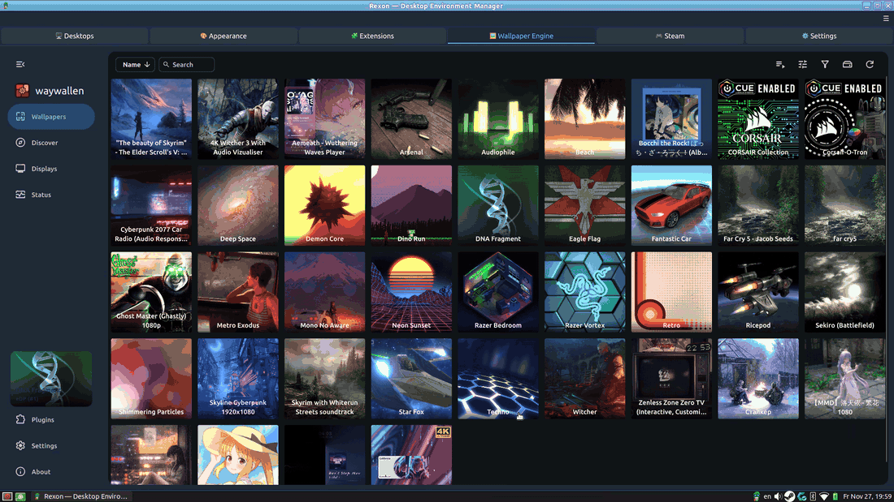
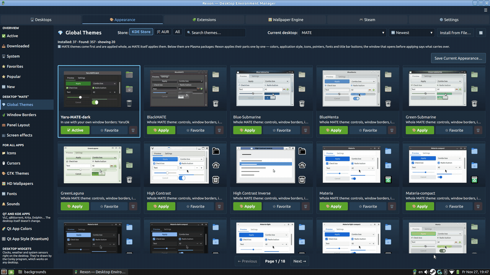
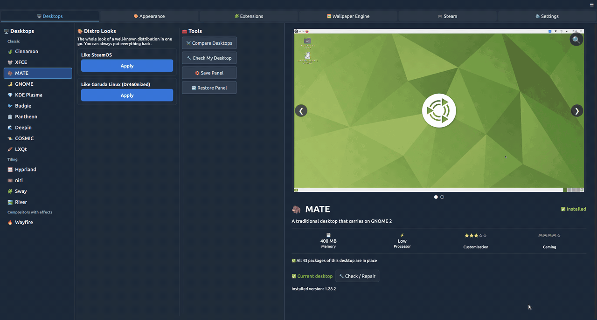
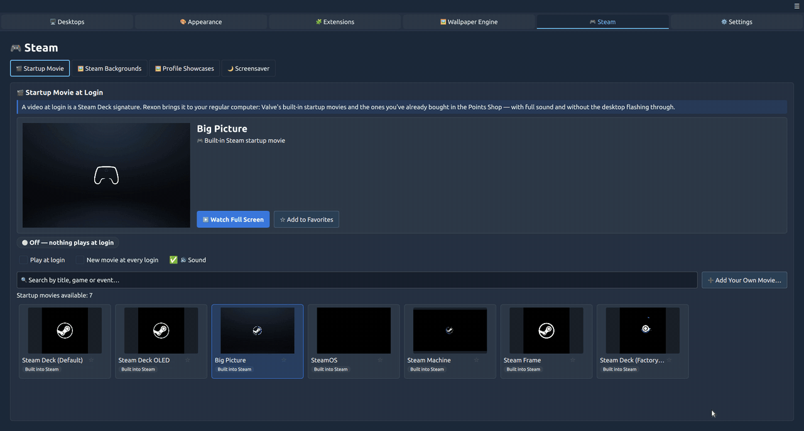
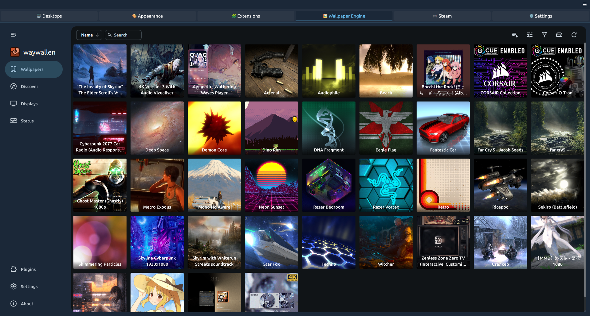
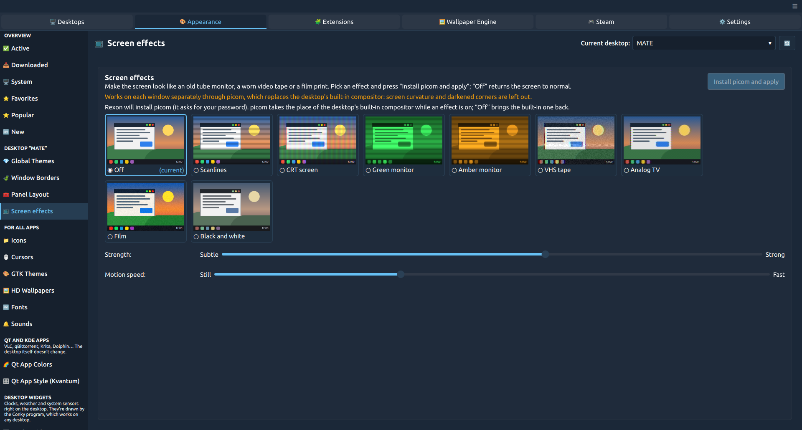
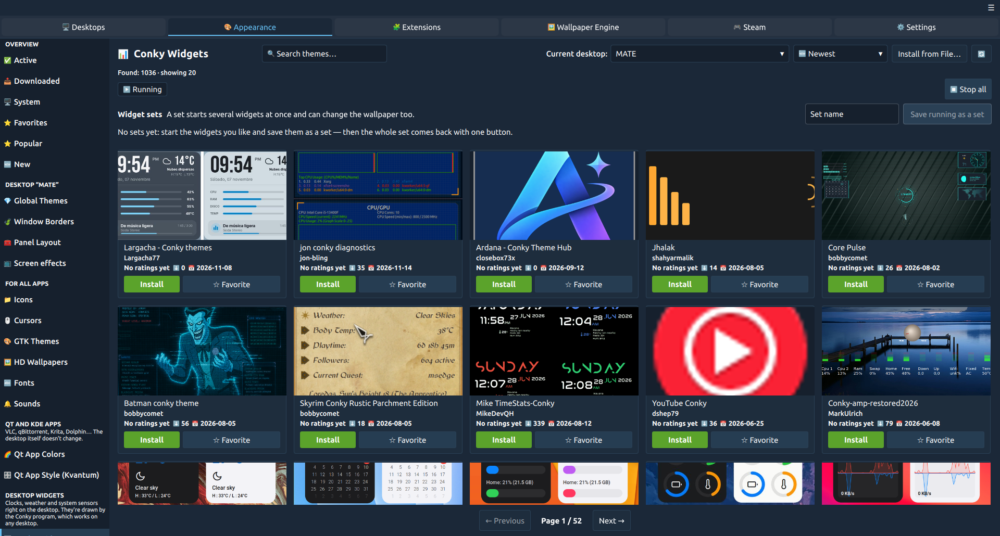
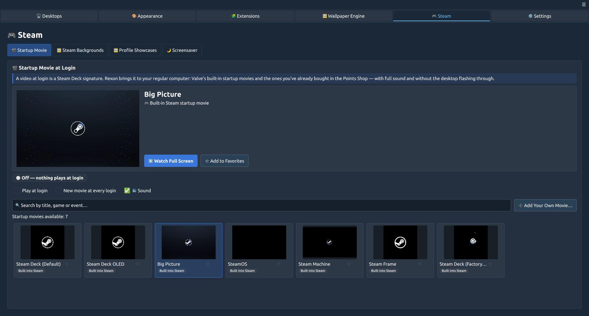

[English](README.md) | [Русский](README.ru.md) | [Deutsch](README.de.md) | [简体中文](README.zh-CN.md) | [Français](README.fr.md) | [Español](README.es.md) | Українська

# Rexon

Rexon — безкоштовний менеджер стільниць для Linux. В одному вікні він встановлює,
перемикає та вилучає стільниці, а також застосовує до них теми, розширення й
живі шпалери.

Він для тих, хто хоче спробувати іншу стільницю — KDE Plasma, GNOME,
Cinnamon, Hyprland та інші — або змінити вигляд поточної і при цьому не
з’ясовувати спершу, як у кожної з них називаються пакунки, де лежать файли
налаштувань і теки тем.

Rexon написано мовою Rust, інтерфейс — на Qt 6 / QML (через [cxx-qt](https://github.com/KDAB/cxx-qt)).
Програма молода: номер версії поки що 0.x, а основна платформа розробки й
перевірки — Arch Linux / CachyOS.





<details>
<summary>▶ Вкладка «Стільниці» в русі</summary>

</details>

<details>
<summary>▶ Вкладка Steam у русі</summary>

</details>

<table>
  <tr>
    <td></td>
    <td></td>
    <td></td>
  </tr>
  <tr>
    <td></td>
    <td></td>
    <td></td>
  </tr>
  <tr>
    <td></td>
    <td></td>
    <td></td>
  </tr>
</table>

## Посібник

Покроковий посібник з усіх вкладок — «Стільниці», «Вигляд»,
«Розширення», Wallpaper Engine, Steam і «Налаштування» — українською, англійською,
російською, німецькою, китайською, французькою та іспанською: [guide/](guide/README.md).

Українська версія: [Стільниці](guide/uk/desktops.md) · [Вигляд](guide/uk/appearance.md) · [Розширення](guide/uk/extensions.md) · [Wallpaper Engine](guide/uk/wallpaper-engine.md) · [Steam](guide/uk/steam.md) · [Налаштування](guide/uk/settings.md).

## Можливості

**Стільниці**

- Встановлення, перемикання та вилучення стільниць: KDE Plasma, GNOME, Cinnamon,
  Xfce, MATE, Budgie, Pantheon, COSMIC, LXQt, Deepin (лише сеанс Treeland,
  експериментально, на системах на основі Arch), Hyprland, Sway, niri, River і Wayfire.
- Не можна вилучити стільницю, у якій ви зараз працюєте, і все, без чого
  система не завантажиться (див. [Що Rexon робить із правами root](#що-rexon-робить-із-правами-root)).
- Менеджер входу: встановлення, увімкнення та перемикання між SDDM, Plasma Login
  Manager, GDM, LightDM, LXDM, COSMIC Greeter та іншими — із записаним способом
  повернути все як було.
- Порівняння стільниць пліч-о-пліч (витрата пам’яті, бібліотека інтерфейсу,
  композитор, типові налаштування).
- Перевірка поточної стільниці (відсутні пакунки, налаштування) з виправленням
  одним клацанням.
- «Як у дистрибутиві»: готовий набір оформлення цілком (зараз SteamOS і Garuda
  Dr460nized) з можливістю повернути попередній вигляд.
- Захист ваших типових програм (браузер, термінал, переглядач), які
  стільниці полюбляють скидати під час перемикання. Типово увімкнено.

**Вигляд**

- Налаштування вигляду із «Системних параметрів» KDE Plasma — на кожній
  підтримуваній стільниці, із записом у її власні налаштування: глобальні теми
  (цілком або частинами, а «Зберегти поточний вигляд…» зберігає поточний вигляд
  як тему), схеми кольорів із редактором схем, колір акценту, зміна світлої й темної
  теми за розкладом, стиль програм, обрамлення вікон і кнопки заголовка вікна,
  шрифти та керування шрифтами з групами шрифтів, розмиття шпалер, звуки
  подій і фонові звуки.
- Теми GTK переносяться й на програми GTK 4 / libadwaita, якщо тема має версію
  для GTK 4, а на плитках тем видно справжні елементи керування, намальовані в
  цій темі.
- Теми для GTK, Qt / Kvantum, піктограм, курсорів, шрифтів, кнопок вікон, анімацій,
  KDE Plasma, Cinnamon, компонувань панелі MATE і Deepin — з каталогу OpenDesktop /
  Pling, Cinnamon Spices і AUR (для пакунків AUR до встановлення показуються ознаки
  ризику).
- Курсори Windows (`.cur` / `.ani`) з перетворенням на Xcursor.
- Теми екрана входу (SDDM) і екрана завантаження (Plymouth).
- Віджети Conky з попереднім переглядом.
- Ефекти екрана (рядки розгортки, кінескоп, відеокасета, кіноплівка та інші) з живим
  попереднім переглядом. Rexon вмикає їх на весь екран у Hyprland, GNOME і Cinnamon, а в KDE Plasma,
  Pantheon і COSMIC — штатний чорно-білий фільтр; в інших
  середовищах розділ чесно каже, що там дозволяє композитор.
- Резервні копії налаштувань стільниці та аварійний пункт меню «Відновити
  вигляд стільниці» (KDE) на випадок, якщо тема зламала стільницю.
- Розширення GNOME Shell і Cinnamon.

**Розширення**

- Власні пакунки Rexon `.rxn` (теми, набори шпалер, шрифти, інструменти для
  стільниці та модулі): встановлення з файлу або перетягуванням у вікно,
  увімкнення й вимкнення, вилучення.
- Теми Windows (`.themepack`, `.msstyles`), курсори та набори піктограм під час
  встановлення перетворюються для Linux.

**Живі шпалери**

- Відео-, веб- і сценові шпалери, зокрема придбані вами в Steam шпалери Wallpaper
  Engine; малює їх рушій [waywallen](https://github.com/hypengw/waywallen).
- Працюють у KDE Plasma (модуль шпалер), у композиторах на кшталт wlroots — Hyprland,
  Sway, niri (layer-shell), — а також у GNOME і Cinnamon (розширення оболонки). На
  стільницях X11, куди waywallen виводити не вміє, відео- та вебшпалери
  показує власний програвач шпалер Rexon.
- Flash-шпалери (`.swf`) через вбудований програвач [Ruffle](https://ruffle.rs).
- Відео з YouTube та подібних сайтів як шпалери (за бажанням, потрібен `yt-dlp`).

**Steam**

- Відеозаставка після входу в систему, як на Steam Deck, — на вибір із роликів
  вашої бібліотеки Steam.
- Ваші фони профілю Steam як шпалери.

**Налаштування**

- Мова й вигляд вікна Rexon, піктограма в системному лотку, бібліотека шпалер.
- Збережені копії панелі KDE Plasma, перемикач захисту типових
  програм та імпорт тем Windows.

**Безпека системи**

- Перед оновленням системи Rexon попереджає, якщо оновлення встановить
  неузгоджений набір пакунків Qt (через таке часткове оновлення екран входу
  лишається чорним).
- Якщо екран входу все ж не запустився, замість чорного екрана в консолі
  з’являється текстове пояснення; той самий звіт виводить `rexon doctor`.

## Підтримувані системи

| Платформа | Стан |
|---|---|
| Arch Linux, CachyOS та інші дистрибутиви на основі Arch | Основна платформа: тут Rexon розробляють і перевіряють. Див. [Встановлення](#встановлення). |
| SteamOS (Steam Deck, Steam Machine) | Стільниці встановлюються образами `systemd-sysext`, бо `/usr` доступний лише для читання й замінюється під час кожного оновлення ОС. |
| Debian / Ubuntu, Fedora, openSUSE, Gentoo, Alpine, Void, Solus, Clear Linux, ALT | Таблиці пакунків для цих родин у Rexon є, але перевірено їх значно менше. |
| NixOS | Rexon не встановлює стільниці сам, а видає фрагмент для `configuration.nix`. |

Пакунок збирається для x86_64. Потрібен Qt 6.6 або новіший.

## Встановлення

Для Arch Linux / CachyOS у цьому репозиторії два пакунки:

- [`packaging/rexon/`](packaging/rexon/) — випуск. Збирається з підписаної мітки
  випуску (`v0.1.2`), і `makepkg` звіряє підпис мітки з ключем
  `B4505C7C7841ECC12D7A0E9D0083083C32159A72`. Імпортуйте ключ один раз:
  `curl -s https://github.com/wehrwolfmann.gpg | gpg --import`.
- [`packaging/aur/`](packaging/aur/) — `rexon-git`, свіжий код із `main`.

Рушій шпалер встановлюється окремими пакунками з AUR: демон `waywallen` і
його плагін `open-wallpaper-engine`; для збирання потрібен ще `lito` (AUR).
Спершу встановіть їх, потім зберіть Rexon:

```sh
paru -S waywallen open-wallpaper-engine lito
git clone https://github.com/wehrwolfmann/rexon.git
cd rexon/packaging/rexon
makepkg -si
```

Без помічника AUR зберіть кожен із трьох так само, `waywallen` раніше за
`open-wallpaper-engine`:
`git clone https://aur.archlinux.org/<назва>.git && cd <назва> && makepkg -si`.
`waywallen-bin` (готовий AppImage) поки не підходить: він оголошує `waywallen`
без версії, і pacman не зараховує його для залежності `waywallen>=0.6.3` у
Rexon і в `open-wallpaper-engine`. У Plasma модуль шпалер
`plasma-wallpaper-waywallen` Rexon встановлює сам.

## Збирання з початкового коду

В Arch Linux / CachyOS встановіть залежності збирання (список повторює
`makedepends` і `depends` з [`packaging/aur/PKGBUILD`](packaging/aur/PKGBUILD)):

```sh
sudo pacman -S --needed base-devel git rust protobuf gettext \
    qt6-base qt6-declarative qt6-websockets qt6-multimedia qt6-svg qt6-webengine \
    qt6-grpc qt6-shadertools layer-shell-qt wayland libglvnd mpv alsa-lib \
    vulkan-icd-loader openssl polkit pacman-contrib cmake ninja \
    jre-openjdk-headless
```

Java потрібна лише під час збирання: нею програвач Flash компілює свої класи
ActionScript.

Потім зберіть. Усі команди cargo запускаються з каталогу `rust/`:

```sh
git clone https://github.com/wehrwolfmann/rexon.git
cd rexon/rust
cargo build-app       # ядро + вікно + його бібліотеки QML (release)
cargo build-splash    # програвач відеозаставки під час входу (окремо навмисно)
cargo test-core       # тести ядра, Qt не потрібен
```

> **Не використовуйте просто `cargo build --release`.** У робочому просторі задано
> `default-members = ["rexon-core"]`, щоб тестам ядра не був потрібен Qt, тому
> звичайний `cargo build` збирає лише ядро. Псевдоніми вище визначено в
> [`rust/.cargo/config.toml`](rust/.cargo/config.toml) (їх показує `cargo --list`)
> і працюють вони, лише якщо cargo запущено з `rust/`.

Вкладці «Живі шпалери» потрібні ще три модулі QML, які збираються через CMake.
Скрипти в `tools/` кладуть їх у `~/.local/share/rexon/qml_modules`:

```sh
tools/build_qml_material.sh
tools/build_qml_control.sh
tools/build_qml_qextra.sh    # потрібні lito >= 0.8.11, clang, lld (AUR: lito або lito-bin)
```

Щоб отримати все одразу — модулі, привілейованих помічників та їхні
політики polkit, — краще зберіть пакунок (пакунки рушія вище потрібні й тут):

```sh
cd packaging/aur
makepkg -si
```

## Запуск

З дерева початкового коду:

```sh
rust/target/release/rexon-main-window
```

Після встановлення з пакунка команда — `rexon`. Корисні параметри:

- `rexon --tray` — запуск у системному лотку, без вікна;
- `rexon --page=<name>` — відкрити потрібну сторінку;
- `rexon doctor` — вивести звіт про екран входу й сеанс, без Qt (стане в пригоді в
  текстовій консолі).

Щоб запустити Rexon іншою мовою, задайте `LANGUAGE`, наприклад
`LANGUAGE=de rust/target/release/rexon-main-window`, або виберіть мову в
«Налаштуваннях».

Під час запуску з дерева початкового коду привілейовані помічники не встановлені,
тому системні зміни йдуть через звичайний `pkexec` і пароль запитується
щоразу.

## Що Rexon робить із правами root

Сам Rexon завжди працює від імені вашого користувача. Усе, що потребує root, проходить
через невеликий набір програм-помічників: вони запускаються через `pkexec` під
іменованими діями polkit і виконують лише операції із закритого списку.
У цьому розділі точно описано, що це за помічники і від чого вони відмовляються.

### Помічник сеансу: один пароль на вікно

Основний шлях — `rexon-priv-helper` (дія polkit `org.rexon.session`).

- Коли ви вперше робите щось, для чого потрібен root, Rexon один раз запускає
  помічника через `pkexec`. Політика — `auth_admin` **без** «keep»: polkit пароль
  не запам’ятовує. Натомість сам помічник живе, доки відкрите вікно, тож пароль
  вводиться один раз за сеанс вікна, а не перед кожною операцією.
- Доки помічник працює, у «Налаштуваннях» і в меню системного лотка видно напис
  «Rexon може змінювати систему, доки вікно не закрито» і кнопку
  **«Заборонити зараз»**.
- Право змінювати систему зникає, коли:
  1. вікно Rexon закрито (зокрема згорнуто в системний лоток) або Rexon завершив роботу;
  2. 15 хвилин не було жодної привілейованої дії;
  3. екран заблоковано (це перевіряється через `loginctl`);
  4. комп’ютер переходить у режим сну.

  Операцію, що вже триває, буде доведено до кінця, нові відхиляються, і наступна знову
  запитає пароль.
- Вікно й помічник спілкуються через закриту пару сокетів. Помічник перевіряє, що на
  іншому кінці той самий користувач, який підтвердив пароль (`PKEXEC_UID`), а вікно
  відмовляється запускати помічника, якщо його файл або каталог доступний для запису
  комусь, крім root.
- Вікно передає **операції, а не команди**: наприклад, «встановити ці пакунки з
  таблиці стільниць» або «покласти цю теку теми в каталог тем екрана входу».
  Команду помічник будує сам — за таблицями, вшитими в його власний виконуваний
  файл. Жоден аргумент не може починатися з `-` або містити синтаксис
  оболонки, а файли з вашої домашньої теки передаються вже відкритими файловими
  дескрипторами, а не шляхами, які відкривав би root. Каталоги призначення
  задано в помічнику константами.
- Збірка помічника має збігатися зі збіркою вікна: після оновлення Rexon
  попросить перезапустити себе, а не спілкуватиметься з іншою версією.
- Якщо помічник відхилив операцію, нічого не відбувається, і Rexon **не** намагається
  повторити її через звичайний `pkexec`.
- Кожна операція записується в системний журнал (`journalctl -t rexon-priv-helper`).

### Колишні помічники для окремих завдань

Деякі операції помічник сеансу поки що не виконує (наприклад, оверлеї Gentoo,
скидання форків Plasma, скидання теми Plymouth або SDDM). Вони йдуть через чотирьох колишніх
помічників, кожен має власну дію polkit і політику `auth_admin_keep` (polkit
кілька хвилин пам’ятає пароль для цього процесу Rexon):

| Помічник | Дія | Призначення |
|---|---|---|
| `rexon-de-helper` | `org.rexon.de-install` | встановлення стільниці з таблиці Rexon |
| `rexon-pkg-helper` | `org.rexon.pkg` | операції менеджера пакунків |
| `rexon-stage-helper` | `org.rexon.stage` | копіювання тек тем у `/usr/share` |
| `rexon-system-helper` | `org.rexon.system-install` | теми екрана входу й екрана завантаження |

Вони мають ті самі дозволені списки й той самий список «ніколи не вилучати», що й
помічник сеансу. Пакунок встановлює їх у `/usr/lib`, політики — у
`/usr/share/polkit-1/actions/`.

**За бажанням: зовсім без пароля.** Майстер першого запуску пропонує правило polkit
(`/etc/polkit-1/rules.d/49-rexon-nopasswd.rules`), яке дозволяє
адміністраторам в активному локальному сеансі встановлювати стільниці зі списку
Rexon без пароля. Його **типово вимкнено**, воно стосується лише
`org.rexon.de-install`, і пакунок його ніколи не встановлює. Теми входу й
завантаження та будь-які інші програми, як і раніше, запитують пароль. Дія сеансу
`org.rexon.session` до цього правила не входить ніколи.

### Що можна встановити

Пакунки встановлюються лише з таблиць, вбудованих у Rexon: стільниці та їхні частини,
менеджери входу, залежності відеошпалер, оболонки, Conky, частини панелі MATE, теми
піктограм і курсорів, набори «Як у дистрибутиві». Вікно називає таблицю, а помічник
звіряє кожну назву пакунка зі своєю копією цієї таблиці.

**Пакунки AUR ніколи не встановлюються автоматично.** Кожне збирання з AUR ви
запускаєте самі; воно йде від імені вашого користувача через `paru` або `yay`. Їхній `sudo`
усередині Rexon підмінюється на `rexon-sudo-shim`, який власних прав не має: він лише
передає виклик `pacman` помічникові сеансу. Помічник встановлює лише ті залежності
збирання, що є в офіційних репозиторіях, і лише ті пакунки, які ви
попросили зібрати (назву пакунка він читає з кожного зібраного пакунка).

Rexon ніколи не запускає від root сторонні скрипти встановлення. `install.sh`,
який додають деякі автори тем, ігнорується. Єдині сторонні
скрипти, які Rexon узагалі запускає, — скрипти встановлення та вилучення пакунків
розширень `.rxn` типів `desktop-tool` і `plugin`, і виконуються вони від імені вашого
користувача.

### Що ніколи не вилучається

- **Стільниця, у якій ви зараз працюєте.** Кнопка у вікні неактивна, і
  помічник теж відмовить.
- **Усе, що потрібно для завантаження системи й керування нею**: ядра та їхні заголовки,
  мікропрограми й мікрокод, завантажувачі (GRUB, systemd-boot, Limine), генератори
  initramfs (mkinitcpio, dracut, booster), модулі DKMS, графічні драйвери
  (NVIDIA, Mesa, Vulkan, `xf86-video-*`), `glibc`, `systemd`, `dbus`, `bash`,
  `coreutils`, менеджери пакунків, `sudo`, `polkit`, `openssl` — і сам Rexon.
- Під час вилучення стільниці її залежності вилучаються, лише якщо вони більше
  нічому в системі не потрібні.
- Тема екрана входу або екрана завантаження, яка містить власний двійковий код
  (наприклад, тема Plymouth, що вказує на свій модуль `.so`), відхиляється ще до
  запиту пароля.
- На системах лише для читання Rexon не чіпає менеджер пакунків. На SteamOS
  стільниці збираються образами `systemd-sysext` у `/home/.rexon/sysext`, а
  помічник для цього лежить у `/var/lib/rexon/bin`, бо `/usr` доступний
  лише для читання.

### Скасування та відновлення

- **Зміна менеджера входу:** якщо новий менеджер входу не вдалося увімкнути,
  повертається попередній. Крім того, Rexon записує команду, якою попередній можна
  повернути з текстової консолі.
- **Збій екрана входу:** доки Rexon встановлено, кожен менеджер входу має
  доповнення systemd `OnFailure=` (`rexon-login-rescue`), яке замість чорного
  екрана показує в консолі пояснення простим текстом.
- **Вигляд:** те, що змінив Rexon, скасовується кнопкою «Повернути як було», а
  компонування панелі KDE можна зберегти й повернути у вкладці «Стільниці» →
  «Інструменти» («Зберегти панель» / «Повернути панель»). У KDE є
  аварійний пункт меню «Відновити вигляд стільниці», який працює,
  навіть якщо вікно Rexon не запускається.
- **Набори «Як у дистрибутиві»** запам’ятовують, що змінили, і їх можна відкотити.
- **Теми екрана входу й екрана завантаження** можна скинути до стандартних для
  дистрибутива.
- **Тематичні форки Plasma** (наприклад, AeroThemePlasma) можна замінити
  звичайними пакунками, а після оновлення Plasma, яке їх ламає, Rexon може один
  раз впустити вас у систему без них.

Під час вилучення пакунка Rexon вилучаються також його помічники, політики й юніти
відновлення входу (це файли, що належать пакунку).

## Переклади

Інтерфейс перекладається через GNU gettext: один каталог і для коду на Rust, і для
сторінок QML. Шаблон — [`po/rexon.pot`](po/rexon.pot), кожна мова — один файл у
[`po/`](po/). Базова мова — англійська, є переклади російською, німецькою,
спрощеною китайською, французькою, іспанською та українською. Як
додати мову, описано в [`po/README.md`](po/README.md); змінювати код не потрібно.

## Подяки

Живі шпалери Rexon побудовано на чужій праці:

- **[waywallen](https://github.com/hypengw/waywallen)** від hypengw — MIT. Рушій
  шпалер (окрема служба); пакунок Rexon залежить від пакунка
  `waywallen`, а збірка з вбудованим рушієм постачає його офіційний випуск без змін.
  Сторінка «Живі шпалери» використовує QML-інтерфейс waywallen з невеликими правками,
  які лежать у `data/qt_wallpaper_engine/qml_ui/waywallen/patches/`.
- **[Open Wallpaper Engine](https://github.com/waywallen/open-wallpaper-engine)** —
  GPL-2.0-only. Модуль waywallen, який малює сценові та вебшпалери. Він
  працює окремими процесами, які запускає служба waywallen; Rexon із ним не
  компонується. Пакунок
  Rexon залежить від пакунка `open-wallpaper-engine`; збірка з вбудованим рушієм постачає
  офіційний випуск без змін разом із повним початковим кодом.
- **[waywallen-display](https://github.com/waywallen/waywallen-display)** — модуль
  шпалер для KDE Plasma, постачається без змін.
- **[Ruffle](https://github.com/ruffle-rs/ruffle)** (MIT / Apache-2.0) — Flash-шпалери;
  **[QmlMaterial](https://github.com/hypengw/QmlMaterial)** і
  **[QExtra](https://github.com/hypengw/QExtra)** (MIT) — модулі QML сторінки шпалер;
  моделі **[Mozilla Translations](https://github.com/mozilla/translations)** з
  крейтом `fxtranslate` (MPL-2.0) — переклад описів шпалер без інтернету;
  **mpv** — програвач відеозаставки.

Повний список сторонніх компонентів, їхніх ліцензій і того, що в них змінено, — у
файлі [`NOTICE`](NOTICE).

Rexon не пов’язаний із Wallpaper Engine, його розробниками чи Valve, не схвалений і не
спонсорований ними. «Steam», «Steam Deck» і «SteamOS» — торговельні марки Valve
Corporation; усі інші назви продуктів належать їхнім власникам.

## Ліцензія

Rexon поширюється за [ліцензією Apache 2.0](LICENSE). Copyright 2026
Wehrwolfmann.

Сторонні компоненти зберігають власні ліцензії (див. [`NOTICE`](NOTICE));
перелічені там компоненти під GPL — окремі програми, які постачаються
разом із Rexon, і ліцензія Apache на них не поширюється.

«Rexon» і логотип Rexon — торговельні марки Wehrwolfmann; ліцензія не дає права їх
використовувати (Apache License 2.0, розділ 6).

## Участь і безпека

Як збирати, перевіряти й перекладати — у [CONTRIBUTING.md](CONTRIBUTING.md); як
конфіденційно повідомити про вразливість — у [SECURITY.md](SECURITY.md).
