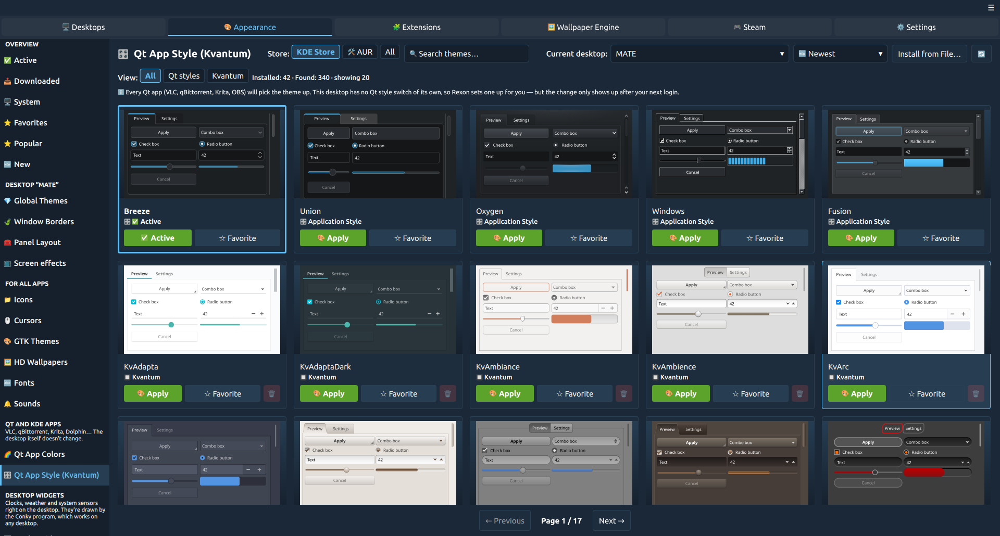
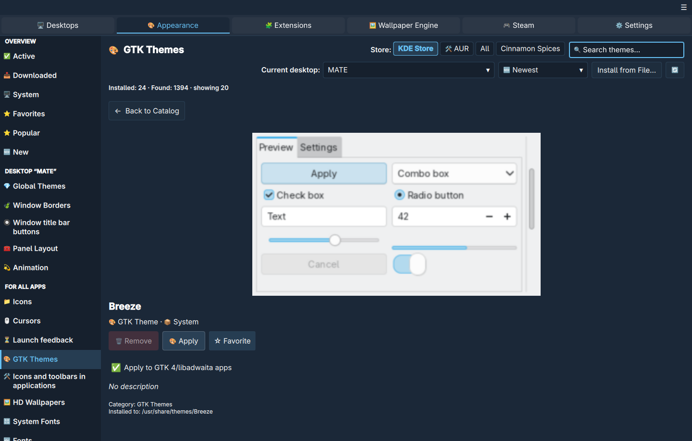
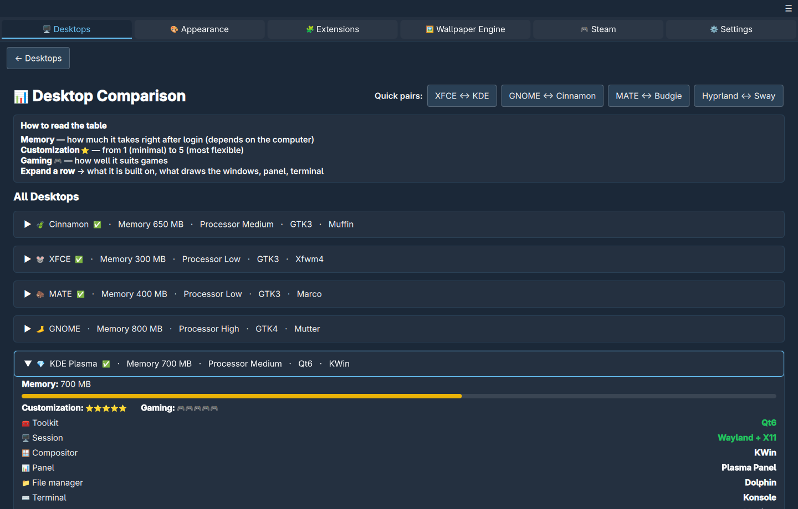

[English](README.md) | [Русский](README.ru.md) | [Deutsch](README.de.md) | 简体中文 | [Français](README.fr.md)

# Rexon

Rexon 是一款免费的 Linux 桌面环境管理器。在同一个窗口里，它可以安装、切换和卸载桌面环境，并为它们应用主题、扩展和动态壁纸。

它面向想尝试其他桌面（KDE Plasma、GNOME、Cinnamon、Hyprland 等）或想改变当前桌面外观的用户，不需要事先了解每个桌面的软件包名、配置文件和主题目录。

Rexon 使用 Rust 编写，界面基于 Qt 6 / QML（通过 [cxx-qt](https://github.com/KDAB/cxx-qt)）。目前仍处于早期阶段：版本号还是 0.x，主要的开发和测试平台是 Arch Linux / CachyOS。


<table>
  <tr>
    <td></td>
    <td></td>
    <td></td>
  </tr>
</table>

## 使用指南

所有标签页（“桌面环境”、“外观”、“扩展”、Wallpaper Engine、Steam 和“设置”）的分步指南，提供中文、英文、俄文、德文和法文版本：[guide/](guide/README.md)。中文版：[桌面环境](guide/zh-CN/desktops.md) · [外观](guide/zh-CN/appearance.md) · [扩展](guide/zh-CN/extensions.md) · [Wallpaper Engine](guide/zh-CN/wallpaper-engine.md) · [Steam](guide/zh-CN/steam.md) · [设置](guide/zh-CN/settings.md)。

## 功能

**桌面环境**

- 安装、切换和卸载桌面环境：KDE Plasma、GNOME、Cinnamon、Xfce、MATE、Budgie、Pantheon、COSMIC、LXQt、Deepin（仅 Treeland 会话，实验性，仅限基于 Arch 的系统）、Hyprland、Sway、niri、River 和 Wayfire。
- 当前登录的桌面无法被卸载，系统启动所必需的组件也无法被卸载（参见 [Rexon 如何使用 root 权限](#rexon-如何使用-root-权限)）。
- 登录管理器：安装、启用 SDDM、Plasma Login Manager、GDM、LightDM、LXDM、COSMIC Greeter 等，或在它们之间切换，并且会记录下恢复原状的方法。
- 桌面并排对比（内存占用、界面工具包、合成器、默认设置）。
- 检查当前桌面（缺少的软件包、设置），一键修复。
- “发行版风格”：一次性应用一整套外观（目前有 SteamOS 和 Garuda Dr460nized），也可以恢复到原来的样子。
- 保护你的默认应用（浏览器、终端、查看器）：桌面在切换时经常会把它们重置。默认开启。

**外观**

- 在每个受支持的桌面上提供 KDE Plasma“系统设置”中的外观设置，并写入该桌面自己的设置：全局主题（可整体应用，也可逐项应用；“保存当前外观…”可以把当前外观保存为主题）、带编辑器的配色方案、强调色、按计划切换浅色和深色、应用程序样式、窗口装饰和标题栏按钮、字体、支持字体分组的字体管理器、壁纸模糊、事件声音和环境音。
- 如果 GTK 主题带有 GTK 4 版本，它也会应用到 GTK 4 / libadwaita 应用上；主题卡片上显示的是用该主题实际绘制的控件。
- 来自 OpenDesktop / Pling 目录、Cinnamon Spices 和 AUR 的主题，涵盖 GTK、Qt / Kvantum、图标、光标、字体、窗口按钮、动画、KDE Plasma、Cinnamon、MATE 面板布局和 Deepin（AUR 软件包在安装前会显示风险提示）。
- Windows 光标（`.cur` / `.ani`）自动转换为 Xcursor。
- 登录界面（SDDM）和开机动画（Plymouth）主题。
- 带预览的 Conky 小部件。
- 屏幕特效（扫描线、CRT、VHS、胶片等），带实时预览。在 Hyprland、GNOME 和 Cinnamon 上，Rexon 会把特效应用到整个屏幕；在其他桌面上，该页面会如实说明合成器在那里允许做什么。
- 桌面设置的备份，以及紧急菜单项“恢复桌面外观”（KDE），用于主题弄坏桌面时恢复。
- GNOME Shell 和 Cinnamon 扩展。

**扩展**

- Rexon 自己的 `.rxn` 软件包（主题、壁纸包、字体、桌面工具和插件）：可以从文件安装，或直接拖进窗口安装，也可以启用、停用和卸载。
- Windows 主题（`.themepack`、`.msstyles`）、光标和图标包在安装时会被转换为 Linux 可用的格式。

**动态壁纸**

- 视频、网页和场景壁纸，包括你在 Steam 上拥有的 Wallpaper Engine 壁纸，由 [waywallen](https://github.com/hypengw/waywallen) 引擎渲染。
- 支持 KDE Plasma（壁纸插件）、Hyprland、Sway、niri 等 wlroots 类合成器（layer-shell），以及 GNOME 和 Cinnamon（Shell 扩展）。在 waywallen 无法输出的 X11 桌面上，由 Rexon 自己的壁纸宿主程序播放视频和网页壁纸。
- 通过内置的 [Ruffle](https://ruffle.rs) 播放器支持 Flash（`.swf`）壁纸。
- 把 YouTube 等网站上的视频设为壁纸（可选，需要 `yt-dlp`）。

**Steam**

- 像 Steam Deck 一样，登录后播放开场动画，可从你 Steam 库中的视频里选择。
- 把你拥有的 Steam 个人资料背景用作壁纸。

**设置**

- 界面语言和皮肤、托盘图标、壁纸库。
- KDE Plasma 面板的保存副本、默认应用保护开关，以及导入 Windows 主题。

**系统安全**

- 在系统更新之前，如果更新会装上一组版本不匹配的 Qt 软件包（这种部分更新会导致登录界面黑屏），Rexon 会发出警告。
- 如果登录界面仍然启动失败，控制台上会显示文字说明，而不是黑屏；`rexon doctor` 会输出同样的报告。

## 支持的系统

| 平台 | 状态 |
|---|---|
| Arch Linux、CachyOS 及其他基于 Arch 的发行版 | 主要平台：在这里开发和测试。参见 [安装](#安装)。 |
| SteamOS（Steam Deck、Steam Machine） | 由于 `/usr` 是只读的，且每次系统更新都会被替换，桌面以 `systemd-sysext` 镜像的形式安装。 |
| Debian / Ubuntu、Fedora、openSUSE、Gentoo、Alpine、Void、Solus、Clear Linux、ALT | Rexon 内置了这些发行版家族的软件包表，但测试要少得多。 |
| NixOS | Rexon 不会自己安装桌面，而是给出一段 `configuration.nix` 配置片段。 |

软件包面向 x86_64 构建。需要 Qt 6.6 或更高版本。

## 安装

在 Arch Linux / CachyOS 上，本仓库提供两个软件包：

- [`packaging/rexon/`](packaging/rexon/)：正式版。它从带签名的发布标签（`v0.1.1`）构建，`makepkg` 会用密钥 `B4505C7C7841ECC12D7A0E9D0083083C32159A72` 校验标签签名。只需导入一次：`curl -s https://github.com/wehrwolfmann.gpg | gpg --import`。
- [`packaging/aur/`](packaging/aur/)：`rexon-git`，即 `main` 分支上的最新代码。

```sh
git clone https://github.com/wehrwolfmann/rexon.git
cd rexon/packaging/rexon
makepkg -si
```

## 从源码构建

在 Arch Linux / CachyOS 上安装构建依赖（列表与 [`packaging/aur/PKGBUILD`](packaging/aur/PKGBUILD) 中的 `makedepends` 和 `depends` 一致）：

```sh
sudo pacman -S --needed base-devel git rust protobuf gettext \
    qt6-base qt6-declarative qt6-websockets qt6-multimedia qt6-svg qt6-webengine \
    qt6-grpc qt6-shadertools layer-shell-qt wayland libglvnd mpv alsa-lib \
    vulkan-icd-loader openssl polkit pacman-contrib cmake ninja \
    jre-openjdk-headless
```

Java 只在构建时需要：Flash 播放器用它来编译自己的 ActionScript 类。

然后开始构建。所有 cargo 命令都要在 `rust/` 目录下运行：

```sh
git clone https://github.com/wehrwolfmann/rexon.git
cd rexon/rust
cargo build-app       # 核心 + 窗口 + 窗口的 QML 库（release）
cargo build-splash    # 登录启动影片播放器（特意单独构建）
cargo test-core       # 核心测试，不需要 Qt
```

> **不要直接使用 `cargo build --release`。** 工作区设置了 `default-members = ["rexon-core"]`，这样核心测试就不需要 Qt，因此直接运行 `cargo build` 只会构建核心部分。上面的别名定义在 [`rust/.cargo/config.toml`](rust/.cargo/config.toml) 中（`cargo --list` 可以列出它们），并且只有在 `rust/` 目录下运行 cargo 时才生效。

动态壁纸标签页还需要三个用 CMake 构建的 QML 插件。`tools/` 中的脚本会把它们放到 `~/.local/share/rexon/qml_modules`：

```sh
tools/build_qml_material.sh
tools/build_qml_control.sh
tools/build_qml_qextra.sh    # 需要 lito >= 0.8.7、clang、lld（AUR：lito 或 lito-bin）
```

如果想一次性得到全部内容（插件、waywallen 引擎、特权辅助程序及其 polkit 策略），请直接构建软件包：

```sh
cd packaging/aur
makepkg -si
```

## 运行

从源码目录运行：

```sh
rust/target/release/rexon-main-window
```

通过软件包安装后，命令是 `rexon`。常用选项：

- `rexon --tray`：只在系统托盘中启动，不打开窗口；
- `rexon --page=<name>`：打开指定页面；
- `rexon doctor`：输出关于登录界面和会话的报告，不需要 Qt（在文字控制台中很有用）。

要以其他语言运行 Rexon，可以设置 `LANGUAGE`，例如 `LANGUAGE=de rust/target/release/rexon-main-window`，也可以在“设置”中选择语言。

从源码目录运行时没有安装特权辅助程序，因此系统更改会退回到直接使用 `pkexec`，每次都会要求输入密码。

## Rexon 如何使用 root 权限

Rexon 本身始终以你的用户身份运行。所有需要 root 的操作都交给一小组辅助程序完成：它们通过 `pkexec` 在具名的 polkit 动作下启动，并且只执行一份封闭清单中的操作。本节准确说明这些操作是什么，以及辅助程序会拒绝做什么。

### 会话辅助程序：每个窗口只需输入一次密码

`rexon-priv-helper`（polkit 动作 `org.rexon.session`）是主要途径。

- 第一次执行需要 root 的操作时，Rexon 会用 `pkexec` 启动一次辅助程序。策略是 `auth_admin`，**不带** “keep”：polkit 不会记住密码。辅助程序本身会在窗口存在期间一直运行，所以每个窗口会话只需输入一次密码，而不是每次操作都输入。
- 在它运行期间，“设置”和托盘菜单中会显示“在关闭窗口前，Rexon 可以更改系统”，并带有 **“立即撤销”** 按钮。
- 修改系统的权限会在以下情况下结束：
  1. Rexon 窗口被关闭（包括最小化到托盘），或 Rexon 退出；
  2. 15 分钟内没有任何特权操作；
  3. 屏幕被锁定（通过 `loginctl` 检查）；
  4. 计算机进入睡眠。

  正在进行的操作会执行完毕；新的操作会被拒绝，下一次操作会再次要求输入密码。
- 窗口通过一对私有套接字与辅助程序通信。辅助程序会检查另一端是否就是确认密码的那个用户（`PKEXEC_UID`）；如果辅助程序的文件或所在目录可被 root 以外的任何人写入，窗口会拒绝启动它。
- 窗口发送的是 **操作，而不是命令**：例如“从桌面表中安装这些软件包”或“把这个主题目录放进登录界面主题目录”。命令由辅助程序根据编译进它自身二进制文件的表自行构造。任何参数都不能以 `-` 开头，也不能包含 shell 语法；来自你主目录的文件以已打开的文件描述符传递，绝不会以路径的形式交给 root 去打开。目标目录是辅助程序中的常量。
- 辅助程序的构建版本必须与窗口一致；更新之后，Rexon 会请你重启它，而不是与不同版本的辅助程序通信。
- 如果辅助程序拒绝了某个操作，就什么也不会做，Rexon **不会** 改用直接的 `pkexec` 重试。
- 每个操作都会记录到系统日志中（`journalctl -t rexon-priv-helper`）。

### 旧的专用辅助程序

有些操作目前还不由会话辅助程序处理（例如 Gentoo overlay、重置 Plasma 分支版本、重置 Plymouth 或 SDDM 主题）。它们经由四个旧的辅助程序完成，每个都有自己的 polkit 动作，策略为 `auth_admin_keep`（polkit 会为该 Rexon 进程记住密码几分钟）：

| 辅助程序 | 动作 | 用途 |
|---|---|---|
| `rexon-de-helper` | `org.rexon.de-install` | 从 Rexon 的表中安装桌面 |
| `rexon-pkg-helper` | `org.rexon.pkg` | 包管理器操作 |
| `rexon-stage-helper` | `org.rexon.stage` | 把主题目录复制到 `/usr/share` |
| `rexon-system-helper` | `org.rexon.system-install` | 登录界面和开机动画主题 |

它们使用与会话辅助程序相同的允许清单和相同的“永不删除”清单。软件包会把它们安装到 `/usr/lib`；策略文件放在 `/usr/share/polkit-1/actions/`。

**可选：完全免密码。** 首次运行向导会提供一条 polkit 规则（`/etc/polkit-1/rules.d/49-rexon-nopasswd.rules`），允许处于活动本地会话中的管理员无需密码即可安装 Rexon 列表中的桌面。它 **默认关闭**，只覆盖 `org.rexon.de-install`，软件包也永远不会自动安装它。登录界面和开机主题以及其他任何软件仍会要求输入密码。会话动作 `org.rexon.session` 永远不属于这条规则。

### 可以安装什么

软件包只会从 Rexon 内置的表中安装：桌面及其组件、登录管理器、视频壁纸依赖、Shell、Conky、MATE 面板组件、图标和光标主题，以及“发行版风格”。窗口只给出表的名称；辅助程序会对照自己的那份表检查每一个软件包名。

**AUR 软件包永远不会被自动安装。** 每次 AUR 构建都由你自己发起，以你的用户身份通过 `paru` 或 `yay` 运行。在 Rexon 内部，它们调用的 `sudo` 会被替换为 `rexon-sudo-shim`；它自身没有任何权限，只是把 `pacman` 调用转交给会话辅助程序。辅助程序只安装官方仓库中存在的构建依赖，以及你要求构建的软件包（软件包名从每个构建出的软件包中读取）。

Rexon 从不以 root 身份运行第三方安装脚本。有些主题作者附带的 `install.sh` 会被忽略。Rexon 唯一会运行的第三方脚本，是 `desktop-tool` 和 `plugin` 类型的 `.rxn` 扩展包中的安装和卸载脚本，而且它们以你的用户身份运行。

### 永远不会删除的内容

- **你当前登录的桌面。** 窗口中的按钮是禁用的，辅助程序也会拒绝。
- **启动和管理系统所需的一切**：内核及其头文件、固件和微码、引导加载程序（GRUB、systemd-boot、Limine）、initramfs 生成器（mkinitcpio、dracut、booster）、DKMS 模块、显卡驱动（NVIDIA、Mesa、Vulkan、`xf86-video-*`）、`glibc`、`systemd`、`dbus`、`bash`、`coreutils`、包管理器、`sudo`、`polkit`、`openssl`，以及 Rexon 本身。
- 卸载桌面时，只有在系统中没有其他软件还需要其依赖时，这些依赖才会被删除。
- 自带二进制代码的登录界面或开机动画主题（例如指向自己 `.so` 模块的 Plymouth 主题）会在要求输入密码之前就被拒绝。
- 在只读系统上，Rexon 不会触碰包管理器。在 SteamOS 上，桌面会被构建为 `/home/.rexon/sysext` 下的 `systemd-sysext` 镜像；由于 `/usr` 是只读的，相应的辅助程序放在 `/var/lib/rexon/bin`。

### 撤销与恢复

- **切换登录管理器：** 如果启用新的登录管理器失败，会恢复之前的那个。Rexon 还会记下一条命令，方便你在文字控制台中恢复之前的登录管理器。
- **登录界面故障：** 只要安装了 Rexon，每个登录管理器都会带有一个 systemd `OnFailure=` 附加配置（`rexon-login-rescue`），在控制台上显示纯文字说明，而不是黑屏。
- **外观：** Rexon 所做的更改可以通过“还原”按钮撤销；KDE 面板布局可以在“桌面环境”→“工具”中保存和恢复（“保存面板” / “恢复面板”）。KDE 有一个紧急菜单项“恢复桌面外观”，即使 Rexon 窗口无法启动也能使用。
- **“发行版风格”** 会记住它们改动了什么，并且可以还原。
- **登录界面和开机动画** 主题可以重置为发行版默认值。
- **Plasma 的主题分支版本**（例如 AeroThemePlasma）可以替换回官方软件包；如果某次 Plasma 更新把它们弄坏了，Rexon 可以让你在不加载它们的情况下登录一次。

卸载 Rexon 软件包会一并删除它的辅助程序、策略和登录救援单元（它们都是属于该软件包的文件）。

## 翻译

界面使用 GNU gettext 翻译：Rust 代码和 QML 页面共用一个翻译目录。模板是 [`po/rexon.pot`](po/rexon.pot)，每种语言对应 [`po/`](po/) 中的一个文件。基础语言是英语，目前已有俄语、德语、简体中文和法语翻译。要添加新语言，请参阅 [`po/README.md`](po/README.md)，无需修改代码。

## 致谢

Rexon 的动态壁纸建立在他人的工作之上：

- **[waywallen](https://github.com/hypengw/waywallen)**，作者 hypengw，MIT 许可证。壁纸引擎（一个独立的守护进程）；软件包附带其未经修改的官方发布版本。动态壁纸页面使用 waywallen 的 QML 界面，并带有少量补丁，存放在 `data/qt_wallpaper_engine/qml_ui/waywallen/patches/`。
- **[Open Wallpaper Engine](https://github.com/waywallen/open-wallpaper-engine)**，GPL-2.0-only。渲染场景和网页壁纸的 waywallen 插件。它作为由 waywallen 守护进程启动的独立进程运行，Rexon 不与它链接。软件包附带其未经修改的官方发布版本及完整源代码。
- **[waywallen-display](https://github.com/waywallen/waywallen-display)**：KDE Plasma 壁纸插件，未经修改随附。
- **[Ruffle](https://github.com/ruffle-rs/ruffle)**（MIT / Apache-2.0）：Flash 壁纸；**[QmlMaterial](https://github.com/hypengw/QmlMaterial)** 和 **[QExtra](https://github.com/hypengw/QExtra)**（MIT）：壁纸页面的 QML 插件；**[Mozilla Translations](https://github.com/mozilla/translations)** 模型配合 `fxtranslate` crate（MPL-2.0）：离线翻译壁纸描述；**mpv**：开场动画播放器。

第三方组件的完整列表、它们的许可证以及所做的修改，请见 [`NOTICE`](NOTICE)。

Rexon 与 Wallpaper Engine、其开发者或 Valve 没有任何关联，也未获得其认可或赞助。“Steam”、“Steam Deck”和“SteamOS”是 Valve Corporation 的商标；其他所有产品名称归其各自所有者所有。

## 许可证

Rexon 采用 [Apache License 2.0](LICENSE) 许可证。Copyright 2026 Wehrwolfmann。

第三方组件保留各自的许可证（参见 [`NOTICE`](NOTICE)）；其中列出的 GPL 组件是与 Rexon 一同分发的独立程序，不受 Apache License 约束。

“Rexon”及 Rexon 标志是 Wehrwolfmann 的商标；本许可证不授予使用它们的权利（Apache License 2.0 第 6 条）。

## 参与贡献与安全

构建、测试和翻译相关内容请参阅 [CONTRIBUTING.md](CONTRIBUTING.md)；如需私下报告安全漏洞，请参阅 [SECURITY.md](SECURITY.md)。
