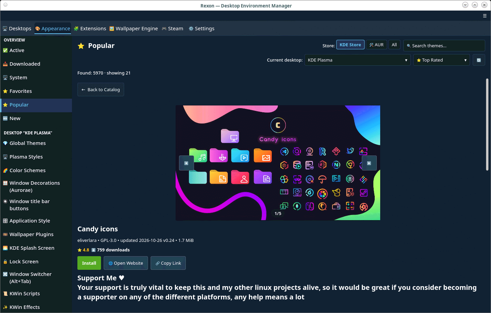
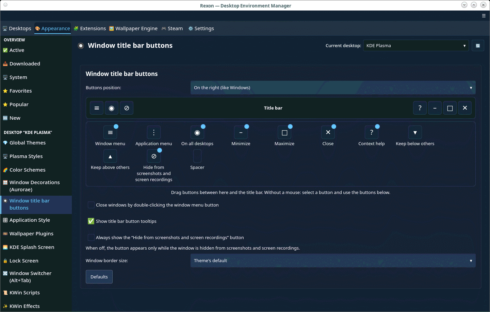

[English](../en/appearance.md) | [Русский](../ru/appearance.md) | Deutsch | [简体中文](../zh-CN/appearance.md) | [Français](../fr/appearance.md) | [Español](../es/appearance.md)

# Erscheinungsbild

Hier ändern Sie, wie Ihr Computer aussieht: Designs, Farben, Symbole,
Mauszeiger, Schriftarten, Fensterrahmen, Animationen, den Anmeldebildschirm
und den Startbildschirm. Rexon zeigt nur, was auf Ihrem Desktop wirklich
funktioniert, und sagt offen, worauf jeder Bereich wirkt — auf den Desktop
selbst, auf alle Programme oder nur auf einige. Neue Designs kommen aus dem
KDE Store, aus dem AUR, von Cinnamon Spices oder aus einer Datei, die schon
auf dem Computer liegt.

## Wie der Reiter aufgebaut ist

Links steht die Seitenleiste mit den Bereichen, rechts der Inhalt des
gewählten Bereichs. Oberhalb des Inhalts:

- **Suche** — sucht nach Name, Autor und Schlagwörtern.
- **Store:** — woher neue Designs kommen: **KDE Store**, **AUR** oder
  **Alle** (beide in einer Liste). Die Cinnamon-Bereiche nutzen stattdessen
  den Katalog von Cinnamon Spices, denselben wie die Einstellungen von
  Cinnamon selbst.
- **Aktueller Desktop:** — für welchen Desktop Designs gezeigt werden.
  Normalerweise wird er anhand der aktuellen Sitzung erkannt. Sie können
  einen anderen Desktop wählen, etwa um vorab Designs für einen Desktop
  auszusuchen, zu dem Sie wechseln möchten. Die Kachel-Desktops (Hyprland,
  Sway, niri) sind zu einem Eintrag zusammengefasst: Ihre Auswahl an Designs
  ist dieselbe.
- **Sortierung** — „🆕 Neu“, „⬇️ Downloads“, „⭐ Bewertung“,
  „🔤 Alphabetisch“.
- **Aus Datei installieren …** — ein Design installieren, das schon auf dem
  Computer liegt.
- **🔄 Katalog aktualisieren** — die Liste neu laden.

Im Bereich stehen zuerst die bereits installierten Designs, darunter die
Angebote aus dem Store. Mit „← Zurück“ und „Weiter →“ unten blättern Sie
die Seiten um.

### Übersicht

Die erste Gruppe der Seitenleiste ist „Übersicht“. Diese Bereiche gehören
zu keiner bestimmten Art von Design:

- **Aktiv** — alles, was gerade eingeschaltet ist: Design, Symbole,
  Mauszeiger, Startbildschirm, Fenstereffekte und so weiter.
- **Heruntergeladen** — was Sie selbst installiert haben.
- **System** — was mit dem System und seinen Paketen gekommen ist.
- **Favoriten** — Designs, die Sie mit „☆ Favorit“ markiert haben.
- **Beliebt** und **Neu** — ein Schaufenster des Stores mit dem, was für
  Ihren Desktop am meisten installiert wird: Symbole, Mauszeiger,
  GTK-Designs, Hintergrundbilder und mehr.

### Gruppen von Bereichen

Die übrigen Bereiche sind in Gruppen eingeteilt. Die Überschrift einer
Gruppe beantwortet die Frage „worauf wirkt das“:

- **Arbeitsfläche „…“** — das eigene Aussehen des Desktops, der unter
  „Aktueller Desktop“ gewählt ist.
- **Für alle Programme** — was alle Programme übernehmen: Symbole,
  Mauszeiger, GTK-Designs, Schriftarten, Klänge, Hintergrundbilder.
- **Qt- und KDE-Programme** — erscheint außerhalb von KDE und LXQt. Hier
  geht es um Farben und Stil von Programmen wie VLC, qBittorrent, Krita,
  Dolphin. Der Desktop selbst ändert sich dabei nicht.
- **Widgets auf der Arbeitsfläche** — Plasma-Miniprogramme,
  Cinnamon-Desklets und Conky-Widgets (Uhr, Wetter, Systemsensoren; Conky
  funktioniert auf jedem Desktop).
- **System: Start und Anmeldung** — der Anmeldebildschirm und der
  Startbildschirm beim Einschalten des Computers. Sie gelten für alle
  Desktops auf diesem Computer.

Gibt es einen Bereich für Ihren Desktop nicht, zeigt Rexon ihn nicht an.
Öffnen Sie einen Bereich, der auf dem gewählten Desktop nicht funktioniert,
sehen Sie statt eines leeren Regals eine Erklärung, warum, und den Hinweis,
links einen anderen Bereich zu wählen.

### Die Kachel eines Designs

Jedes Design hat eine Kachel mit Bild, Namen und Knöpfen:

- **Installieren** — das Design aus dem Store herunterladen und
  installieren;
- **🎨 Anwenden** — ein bereits heruntergeladenes Design einschalten;
- **✅ Angewendet** — das Design ist gerade aktiv (ein Klick wendet es
  erneut an);
- **▶️ Aktivieren** / **⏸️ Deaktivieren** — bei Erweiterungen:
  KWin-Effekte und -Skripte, Erweiterungen und Applets;
- **▶️ Starten** / **⏹️ Beenden** — bei Conky-Widgets;
- **☆ Favorit** — das Design markieren;
- **🗑️** — entfernen.

Ein Klick auf das Bild öffnet die Seite des Designs: Bildschirmfotos (die
Pfeile ◀️ ▶️ blättern, ein Klick zeigt das Bild im Vollbild), Beschreibung,
Bewertung, Zahl der Downloads, Kommentare und die Knöpfe
**🌐 Website öffnen** und **🔗 Link kopieren**. Zurück geht es mit
**← Zurück zum Katalog**.

## Bereiche

### Globale Designs

Ein globales Design ist ein fertiges Paket aus allem auf einmal: Farben,
Anwendungsstil, Fensterrahmen, Symbole, Mauszeiger, Startbildschirm und
manchmal die Anordnung der Leisten. Über den Kacheln stehen der Knopf
**Aktuelles Erscheinungsbild speichern…** und der Block **Hell und dunkel**
(dazu unten mehr).

Klicken Sie bei einem Design auf „🎨 Anwenden“ — es öffnet sich das Fenster
„„…“ anwenden?“. Dort sehen Sie, was das Design genau setzt. Der Knopf
**Bestandteile auswählen …** klappt die ausführliche Liste auf: Dort
entfernen Sie die Haken bei allem, was sich nicht ändern soll.

Der Punkt **Anordnung von Arbeitsfläche und Miniprogrammen** ist anfangs
ausgeschaltet. Schalten Sie ihn ein, warnt Rexon: Die Anordnung löscht die
aktuellen Arbeitsflächen, Leisten, Docks und Miniprogramme und ersetzt sie
durch die aus dem Design.

Globale Designs sind für KDE Plasma gemacht, aber Rexon kann sie auch auf
anderen Desktops anwenden — in Teilen, nur das, was es auf diesem Desktop
gibt: Farben (für Qt-Programme), Anwendungsstil, Symbole, Mauszeiger,
Schriftarten und Titelleistenknöpfe. Was es nur in Plasma gibt (Leisten,
Plasma-Stil, Plasma-Startbildschirm), ist in der Liste ausgeschaltet, und
daneben steht der Grund.

### Farben: Farbschemata, Akzentfarbe, hell und dunkel

In KDE heißt der Bereich **Farbschemata**, auf anderen Desktops **Farben für
Qt-Programme** (dort färbt ein Schema nur Qt- und KDE-Programme). Über den
Kacheln gibt es den Umschalter **Ansicht:** — „Alle“, „Helle“, „Dunkle“.

**Akzentfarbe** — die Farbe von Auswahl, Ankreuzfeldern und aktiven
Knöpfen. Zur Wahl stehen:

- **Aus dem Farbschema** (oder **Wie im Design** auf anderen Desktops) —
  die Farbe, die das Schema festlegt;
- **Aus dem Hintergrundbild** — die Farbe wird aus dem Bild auf der
  Arbeitsfläche genommen. Rexon aktualisiert sie, wenn es das
  Hintergrundbild selbst wechselt; wurde das Hintergrundbild anderswo
  geändert, wählen Sie erneut „Aus dem Hintergrundbild“;
- **Eigene Farbe** — einer der vorgegebenen Kreise oder eine beliebige
  Farbe über **Farbe auswählen …**.

Unter den Knöpfen steht, wer die Farbe auf Ihrem Desktop erhält. GNOME
kennt zum Beispiel nur neun Akzentfarben, GTK-4-Programme erhalten die
nächstliegende. **Wiederherstellen wie zuvor** holt die Farbe zurück, die
vor Rexon eingestellt war.

**Hell und dunkel** — Paare von Designs für Tag und Nacht. Der Block steht
in KDE in „Globale Designs“ und „Farbschemata“, auf anderen Desktops in
„Farbschemata“ und „GTK-Designs“.

1. Haken Sie die Teile an, die wechseln sollen: globales Design (nur KDE),
   Farbschema, GTK-Design, Symbole, Hintergrundbild.
2. Wählen Sie für jeden Teil eine helle und eine dunkle Variante.
3. Klicken Sie auf **Hell**, **Dunkel** oder **Automatisch**. Im Modus
   „Automatisch“ wählen Sie **Von Sonnenuntergang bis Sonnenaufgang** (der
   Ort wird anhand der Zeitzone bestimmt oder als Breiten- und Längengrad
   eingegeben) oder **Zu festen Zeiten** — „Hell ab“ und „Dunkel ab“.
4. Klicken Sie auf **Speichern**.

Das Kästchen **Heller oder dunkler Modus der Anwendungen** schaltet dabei
auch den Modus der Programme um, die dem System folgen können. In der
Überschrift des eingeklappten Blocks sehen Sie, was eingeschaltet ist, zum
Beispiel „Hell und dunkel: nach Zeitplan 07:00–19:00“.

Auf der Seite eines installierten Farbschemas gibt es die Knöpfe
**Bearbeiten …** (die Grundfarben des Schemas; ist der KDE-Editor
installiert, öffnet sich dieser) und **Auf dieser Grundlage erstellen …**
(ein neues Schema aus diesem; das Original bleibt, wie es ist).

### Fensterrahmen und Titelleistenknöpfe

Fensterrahmen hat jeder Desktop seine eigenen: in KDE **Fenster
(Aurorae)**, in XFCE, MATE und LXQt (Openbox, labwc) **Fensterrahmen**. In
Cinnamon zeichnet das GTK-Design die Rahmen.

Die Knöpfe der Titelleiste stellen Sie gleich dort ein, im Bereich der
Rahmen: mit dem Knopf **⚙️ Einstellungen** oben darin (wie der Reiter
„Titelleistenknöpfe“ des KDE-Moduls „Fensterdekorationen“), zurück geht es
mit **←  Zurück zum Katalog**. In Cinnamon ist das der Bereich
**Cinnamon-Design**; auf Desktops ohne eigenen Rahmenbereich (GNOME,
Budgie, Pantheon, COSMIC, Deepin, Kachel-Fenstermanager) der Bereich
**GTK-Designs**: Dort zeichnet das GTK-Design oder das GTK-Programm selbst
die Titelleiste. In den Einstellungen:

- **Position der Knöpfe:** — „Rechts (wie in Windows)“ oder „Links (wie in
  macOS)“;
- Knöpfe lassen sich zwischen der Ablage und dem Streifen „Titelleiste“ hin
  und her ziehen; ohne Maus wählen Sie einen Knopf und nutzen „Weiter
  links“, „Weiter rechts“, „Aus der Titelleiste entfernen“, „Links
  hinzufügen“, „Rechts hinzufügen“;
- **Größe der Fensterumrandung:** — von „Keine Umrandungen“ bis „Übergroß“;
- in KDE gibt es drei weitere Kästchen: Fenster durch Doppelklick auf die
  Schaltfläche des Fenstermenüs schließen, Kurzinfos zu den Schaltflächen der
  Titelleiste anzeigen und die Schaltfläche „Vor Bildschirmfotos und
  Bildschirmaufnahmen verbergen“ immer anzeigen;
- **Standard** — zur ursprünglichen Anordnung zurückkehren.

Hat der Fenstermanager Ihres Desktops einen Knopf nicht, sagt Rexon das.

### Anwendungsstil

**Anwendungsstil** (außerhalb von KDE und LXQt **Stil für Qt-Programme
(Kvantum)**) zeigt Qt-Stile und Kvantum-Designs in einem Raster. Der
Umschalter darüber: „Alle“, „Qt-Stile“, „Kvantum“. Neue Kvantum-Designs
kommen aus dem KDE Store, fertige Qt-Stile (Darkly, Lightly, Klassy) aus dem
AUR.

### Symbole, Mauszeiger, Startrückmeldung

- **Symbole** und **Mauszeiger** — Designs für Symbole und Zeiger. Der Knopf
  **⚙️ Einstellungen** oben im Bereich „Symbole“ öffnet an Ort und Stelle
  Symbole in Menüs und auf Knöpfen und die Beschriftung der Werkzeugleisten
  in Programmen („Nur Symbole“, „Nur Text“, „Text neben Symbolen“, „Text
  unter Symbolen“); **←  Zurück zum Katalog** führt zu den Designs zurück. Im
  Bereich der Mauszeiger gibt es das Feld **Größe:** — die Zeigergröße in
  Pixeln. Rexon wendet sie in den Einstellungen des Desktops, in GTK- und
  Qt-Programmen und in der Konfiguration von sway, niri oder Hyprland an.
- **Startrückmeldung** (nur KDE) — der Knopf **⚙️ Einstellungen** oben im
  Bereich „Mauszeiger“: wie Zeiger und Taskleiste zeigen, dass ein
  Programm startet: Zeiger „Keine“, „Unbewegt“, „Blinkend“ oder „Hüpfend“,
  Animation der Schaltfläche in der Taskleiste und nach welcher Zeit sie
  endet. Wo der Desktop diese Einstellung nicht hat, fehlt der Knopf.

### GTK-Designs

Designs für GTK-Programme (Firefox, GIMP, die meisten Programme von GNOME,
XFCE, MATE und Cinnamon). GNOME, Cinnamon, MATE und XFCE haben daneben
eigene Bereiche: **GNOME-Shell-Design**, **Cinnamon-Design**, **LXQt-Design**
und weitere. Auf Desktops ohne Fensteranimationen öffnet der Knopf
**⚙️ Einstellungen** oben im Bereich das Kästchen **Keine Animationen** —
Animationen in Programmen.

### Schriftarten und Schriftverwaltung

Der Bereich **Schriftarten** (mit dem Symbol 🔤 in der Gruppe „Für alle
Programme“) enthält Schriften aus dem KDE Store. Der Knopf
**⚙️ Einstellungen** oben darin öffnet an Ort und Stelle die
Systemschriftarten: die Schriften der Oberfläche, des Terminals, kleiner
Beschriftungen, der Werkzeugleisten, Menüs und Fenstertitel;
**←  Zurück zum Katalog** führt zum Store zurück. Klicken
Sie auf den Knopf einer Schrift, um Schriftfamilie und Größe zu wählen, oder
auf **🔤 Alle Schriften ändern …**, um allen auf einmal dieselbe Schrift zu
geben. Darunter stehen **Textglättung** (Kantenglättung,
Subpixel-Darstellung, Hinting) und **Schrift-DPI erzwingen:**.

**🗂️ Schriften verwalten …** öffnet die Liste aller Schriften auf dem
Computer:

- ein Muster jeder Schrift und eine Tabelle ihrer Zeichen;
- **➕ Aus Datei installieren …** — für Sie selbst oder für alle Benutzer
  (im zweiten Fall fragt Rexon nach dem Administratorpasswort);
- **Entfernen** — nur Schriften, die Sie selbst installiert haben.
  Systemschriften können Sie nur ansehen;
- **Ausschalten** / **Einschalten** — eine Schrift vor allen Programmen
  verbergen, ohne die Datei zu löschen;
- **🔍 Duplikate suchen** — Schriftschnitte, die in mehr als einer Datei
  installiert sind;
- eigene Schriftgruppen (**➕ Neue Gruppe …**), eine ganze Gruppe ein- oder
  ausschalten, eine Gruppe als ZIP-Archiv exportieren.

### Hintergrundbilder und Klänge

- **HD-Hintergründe** — Bilder für die Arbeitsfläche aus dem Store. Der
  Knopf **⚙️ Einstellungen** oben im Bereich ist **🌫️ Hintergrund
  weichzeichnen**: Er zeichnet einen Bild-Hintergrund weich, damit Symbole
  und Fenster darauf besser lesbar sind; das Original bleibt erhalten.
  Ist Razer Axon auf dem Rechner (unter Wine), gibt es unter **Store:**
  auch **Razer Axon** — die darin heruntergeladenen Hintergründe: Suche
  nach Titeln oder Tags, Sortierung und Filter wie in Axon selbst;
  Rechtsklick auf eine Kachel — **Anwenden** (auf allen Bildschirmen),
  **Datei-Speicherort öffnen** und **Details**. In **⚙️ Einstellungen** gibt
  es dann den Block **Razer Axon**: **Hintergründe im Voraus vorbereiten**
  und **Ursprüngliche Beschreibungen wiederherstellen**.
- **Hintergrund-Plugins** (nur KDE) — lebendige Plasma-Hintergründe.
- **Klänge** — Klangthemen. Die Klänge eines Themas können Sie vor der
  Installation anhören (**🔊 Vor der Installation anhören**): Das Thema wird
  in einen temporären Ordner heruntergeladen, installiert wird nichts. Sind
  die Systemklänge ausgeschaltet, bietet Rexon an, sie **einzuschalten**.
  Der Knopf **⚙️ Einstellungen** oben im Bereich enthält **🔔 Systemklänge**
  (Klangdesign des Desktops, Systemklänge einschalten, Probehören) und
  **🔊 Hintergrundgeräusche** (**➕ Datei hinzufügen …** spielt einen Klang in
  Endlosschleife, Lautstärke, **⏹️ Alle stoppen**, Liste der laufenden
  Klänge). Hintergrundgeräusche spielen weiter, wenn Sie den Bereich
  verlassen.

Bewegte Hintergründe finden Sie im Reiter Wallpaper Engine.

### Animationen und Bildschirmeffekte

Das sind die letzten Bereiche der Desktop-Gruppe.

- **Animationen** — **Keine Animationen** oder
  **Animationsgeschwindigkeit:** von „Langsam“ bis „Schnell“, dazu die Wahl
  der Effekte: Öffnen und Schließen von Fenstern, Minimieren, Wechsel der
  virtuellen Arbeitsflächen, Aufklappfenster und so weiter. Wo der
  Fenstermanager keine Fensteranimationen hat (MATE, Xfce, LXQt, Deepin,
  sway und andere Kachel-Fenstermanager außer Hyprland und niri), gibt es
  den Bereich nicht: das Kästchen **Keine Animationen** für Programme ist
  der Knopf **⚙️ Einstellungen** im Bereich „GTK-Designs“.
- **Bildschirmeffekte** — der Bildschirm wie ein alter Röhrenmonitor, eine
  abgenutzte Videokassette oder ein Filmstreifen: „Bildzeilen“,
  „Röhrenbildschirm“, „Grüner Monitor“, „Bernsteinfarbener Monitor“,
  „Videokassette“, „Analoges Fernsehen“, „Filmstreifen“, „Schwarzweiß“.
  Schieberegler **Stärke:** und **Bewegungstempo:**. Wie der Bereich auf
  Ihrem Desktop funktioniert und was er dafür braucht, steht oben (Zeile
  „Benötigt: …“). Wo sich die Effekte gar nicht einschalten lassen (sway,
  river, labwc, niri, Budgie, Deepin), gibt es den Bereich nicht; in MATE,
  Xfce und LXQt fehlt er in einer Wayland-Sitzung — dort gehen die Effekte
  nur unter X11.

### Widgets

- **Miniprogramme** (KDE) — Plasma-Miniprogramme aus dem Store.
- **Cinnamon-Desklets**, **Cinnamon-Applets**, **Cinnamon-Erweiterungen**,
  **Nemo-Aktionen** — von Cinnamon Spices.
- **Conky-Widgets** — Uhr, Wetter, Systemsensoren. Ihr Knopf ist
  **▶️ Starten** / **⏹️ Beenden**, und auf der Seite eines Widgets gibt es
  das Kästchen **Bei der Anmeldung starten**.

### Anmeldebildschirm, Sperrbildschirm, Startbildschirme

- **Anmeldebildschirm** — SDDM-Designs. Darüber steht der Block
  **Anmeldemanager**: welches Programm den Anmeldebildschirm zeigt und
  welches der Standard ist (ein neuer Standard erscheint nach einem
  Neustart, die laufende Sitzung wird nicht unterbrochen). Zeichnet Plasma
  Login Manager den Anmeldebildschirm, gibt es keine Designs von
  Drittanbietern — Rexon bietet **Anmeldebildschirm einrichten** an.
- **Startbildschirm (Plymouth)** — was Sie beim Einschalten des Computers
  sehen, vor der Anmeldung.
- **Sperrbildschirm** (KDE und Deepin) — zwei Modi: **🔒 Komplette
  Designs** (angewendet wird nur der Sperrbildschirm-Teil des Designs) und
  **🖼️ Sperrbildschirm-Hintergrund** (ein Bild als Hintergrund, das
  Aussehen des Bildschirms bleibt).
- **KDE-Startbildschirm** — der Startbildschirm beim Anmelden in Plasma.

Anmeldebildschirm und Startbildschirm sind systemweit: Beim Installieren
fragt Rexon nach dem Administratorpasswort. Unter SteamOS (Steam Deck,
Steam Machine) sind diese Bereiche gesperrt, und Rexon erklärt gleich,
warum.

### Bereiche einzelner Desktops

- KDE: **Plasma-Stile**, **Fensterwechsler (Alt+Tab)**, **KWin-Skripte**,
  **KWin-Effekte** — neue Effekte aus dem KDE Store; der Knopf
  **⚙️ Einstellungen** oben im Bereich schaltet die Effekte ein, die KWin
  schon hat (Wunderlampe, Transparenz, Unschärfe und andere), und richtet
  sie ein — mit Suche und einem Knopf „Einrichten …“ bei jedem Effekt.
- GNOME: **GNOME-Shell-Design**, **GNOME-Erweiterungen**.
- MATE: **Leisten-Layout** — fertige Leisten-Anordnungen mit einem Klick.

## So geht’s

### Ein globales Design in Teilen anwenden

1. Öffnen Sie **Globale Designs**.
2. Klicken Sie beim gewünschten Design auf **🎨 Anwenden** (oder auf
   **Installieren**, falls Sie es noch nicht haben, und danach auf
   „Anwenden“).
3. Klicken Sie im Fenster auf **Bestandteile auswählen …**.
4. Entfernen Sie die Haken bei allem, was sich nicht ändern soll, zum
   Beispiel „Symbole“ oder „Zeiger“.
5. Klicken Sie auf **Anwenden**.

Auf anderen Desktops öffnet sich das Fenster gleich ausführlich, und
ausgegraute Punkte erklären, warum sie sich nicht übertragen lassen.

### Das aktuelle Erscheinungsbild speichern

1. Öffnen Sie **Globale Designs**.
2. Klicken Sie auf **Aktuelles Erscheinungsbild speichern…**.
3. Geben Sie einen **Name:** ein (und auf Wunsch einen **Autor:**).
4. Lassen Sie unter **Was gespeichert wird:** angehakt, was Sie brauchen.
5. Wählen Sie ein Bild für die Kachel: **Bildschirmfoto aufnehmen…**,
   **Bild auswählen…** oder **Kachel in den Farben des Designs**.
6. Klicken Sie auf **Speichern**.

Das neue Design erscheint sofort unter den Kacheln. Sie können es hier oder
auf jedem anderen Desktop anwenden — ganz oder in Teilen — und auch in
Plasma.

### Farben, Akzent, hell und dunkel ändern

1. Öffnen Sie **Farbschemata** (oder **Farben für Qt-Programme**).
2. Klicken Sie beim gewünschten Schema auf **🎨 Anwenden**.
3. Wählen Sie im Block **Akzentfarbe** **Aus dem Farbschema**, **Aus dem
   Hintergrundbild** oder **Eigene Farbe**.
4. Soll das Erscheinungsbild Tag und Nacht von selbst wechseln, klappen Sie
   **Hell und dunkel** auf, wählen die Paare von Designs und klicken auf
   **Automatisch** und **Speichern**.

### Ein Design aus dem Store, aus dem AUR oder aus einer Datei installieren

**Aus dem Store:**

1. Öffnen Sie den gewünschten Bereich, zum Beispiel **Symbole**.
2. Lassen Sie unter **Store:** den **KDE Store** eingestellt.
3. Suchen Sie das Design über die Suche oder in der Liste und klicken Sie auf
   **Installieren**.
4. Ist die Installation fertig, klicken Sie auf **🎨 Anwenden**.

**Aus dem AUR** (Arch-basierte Distributionen):

1. Wählen Sie unter **Store:** **AUR** (oder **Alle**).
2. Geben Sie in die Suche mindestens ein paar Buchstaben ein.
3. Öffnen Sie die Seite des Pakets. Rexon zeigt, ob mit ihm etwas nicht
   stimmt: verwaist, als veraltet markiert, neuer Betreuer, sehr wenige
   Stimmen. **📄 PKGBUILD anzeigen** zeigt das Bau-Rezept.
4. Klicken Sie auf **Installieren**. Das Paket wird aus dem Quellcode gebaut
   — das kann eine Weile dauern. Zum Bauen braucht es paru oder yay.

**Aus einer Datei:**

1. Klicken Sie auf **Aus Datei installieren …**.
2. Klicken Sie auf **Dateien auswählen …** oder **Ordner auswählen …**.
3. Wählen Sie ein Archiv, einen Ordner oder einzelne Dateien — Schriften,
   Mauszeiger und Symbole aus Windows, Farbschemata, Hintergrundbilder.

Rexon erkennt die Art am Inhalt und installiert sie in den passenden
Bereich. Ändert das Design einen Systembildschirm (Anmeldung, Start), bittet
Rexon, es aus diesem Bereich zu installieren — dort wird nach dem
Administratorpasswort gefragt.

### Alles zurückholen, wie es war

- Nach dem Anwenden eines Designs erscheint über den Kacheln die Leiste
  **„Zurück wie vor „…““**: Vor dem Anwenden hat Rexon gesichert, was da
  war. Bereits geöffnete Programme zeigen das eventuell erst nach einem
  Neustart oder der nächsten Anmeldung.
- Außerhalb von Plasma haben Farbschemata **Farben wie vorher**.
- Akzentfarbe und Bildschirmeffekte haben **Wiederherstellen wie zuvor**.
- In Bereichen mit dem Knopf **Standard** („Knöpfe der Titelleiste“,
  „Startrückmeldung“, „Animationen“ und andere) stellt er die
  ursprünglichen Einstellungen wieder her.
- Ein mit 🗑️ entferntes Design wird zuerst nur markiert: Unten steht ein
  paar Sekunden lang eine Leiste mit dem Knopf **Rückgängig**.

### Einen Bildschirmeffekt einschalten

1. Öffnen Sie **Bildschirmeffekte**.
2. Wählen Sie einen Effekt, zum Beispiel **Röhrenbildschirm**.
3. Stellen Sie **Stärke:** und **Bewegungstempo:** ein. Bewegte Effekte
   belasten die Grafikkarte ständig; bei **Stillstand** bleibt das Bild
   unverändert und kostet fast nichts.
4. Klicken Sie auf **Anwenden**.
5. Es erscheint die Frage „Diesen Effekt behalten? Sonst wird der
   Bildschirm in 15 s wieder wie zuvor.“ Klicken Sie auf **Behalten**. Ist
   der Bildschirm dunkel oder unverständlich geworden, klicken Sie nichts:
   Nach 15 Sekunden kehrt alles von selbst zurück. **Zurücksetzen** kehrt
   sofort zurück.

Zum Ausschalten wählen Sie **Aus** und klicken auf „Anwenden“ oder klicken
auf **Wiederherstellen wie zuvor**.

## Wenn etwas schiefgeht

- **Ein Bereich fehlt in der Seitenleiste.** Dann funktioniert er auf dem
  gewählten Desktop nicht. Prüfen Sie **Aktueller Desktop:** — vielleicht
  ist der falsche Desktop gewählt.
- **Das Design ist angewendet, aber ein Programm sieht noch aus wie
  vorher.** Bereits geöffnete Programme übernehmen ein neues Aussehen oft
  erst nach einem Neustart oder der nächsten Anmeldung.
- **Das Farbschema kommt außerhalb von KDE nicht bei den Qt-Programmen
  an.** Rexon sagt Bescheid, wenn qt6ct nicht installiert ist: Ohne qt6ct
  erhalten nur KDE-Programme (Dolphin, Kate, Okular) die Farben.
- **„Der KDE Store antwortet gerade nicht“.** Die Störung liegt beim Store;
  versuchen Sie es später noch einmal oder klicken Sie auf
  **🔄 Katalog aktualisieren**.
- **Installation aus dem AUR klappt nicht.** Sie brauchen den Paketbauer
  paru oder yay. Die AUR-Suche beginnt erst ab ein paar Buchstaben.
- **„Veraltetes Plasma-5-Format“.** Plasma 6 wendet ein solches Design nicht
  an — Sie benötigen eine Version des Designs für Plasma 6.
- **Das aktive Design lässt sich nicht entfernen.** Schalten Sie zuerst ein
  anderes ein. Systemdesigns (aus Paketen) entfernt Rexon ebenfalls nicht —
  sie verschwinden zusammen mit ihrem Paket.
- **Nach einem Bildschirmeffekt stimmt etwas nicht.** Klicken Sie 15
  Sekunden lang nichts — der Effekt schaltet sich von selbst ab. Später
  hilft **Wiederherstellen wie zuvor** im Bereich „Bildschirmeffekte“.
- **Ein Design für den Anmeldebildschirm wirkt nicht.** Die Designs dieses
  Bereichs sind für SDDM. Zeigt ein anderes Programm den
  Anmeldebildschirm, schreibt Rexon das über den Kacheln; den Standard
  wählen Sie im Block **Anmeldemanager**.
- **Nach einem globalen Design sind die Leisten kaputt.** Das passiert nur,
  wenn „Anordnung von Arbeitsfläche und Miniprogrammen“ angehakt war.
  Klicken Sie auf **Zurück wie vor „…“**; in KDE Plasma, MATE und XFCE
  können Sie im Reiter „Desktops“ vorab eine Kopie der Leiste anlegen
  („🛟 Leiste sichern“).
