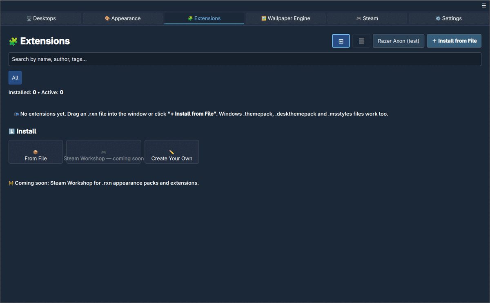

[English](../en/extensions.md) | [Русский](../ru/extensions.md) | Deutsch | [简体中文](../zh-CN/extensions.md) | [Français](../fr/extensions.md) | [Español](../es/extensions.md)

# Erweiterungen

In diesem Reiter liegen `.rxn`-Pakete — das eigene Erweiterungsformat von
Rexon: Designs, Hintergrundsammlungen, Schriften, Desktop-Werkzeuge und
Plugins. Hierher können Sie auch ein Windows-Design oder Windows-Zeiger
ziehen — Rexon wandelt sie für Linux um.

Erweiterungen für die GNOME Shell und für Cinnamon werden nicht hier
installiert, sondern im Reiter [Erscheinungsbild](appearance.md), in den
Abschnitten „GNOME-Erweiterungen“ und „Cinnamon-Erweiterungen“.

## Was der Reiter enthält

- **Ansichtsumschalter** „Raster“ (⊞) und „Liste“ (☰) — Kacheln mit Bild
  oder kompakte Zeilen.
- **＋ Aus Datei installieren** — eine Datei auf dem Datenträger wählen.
- **Suche** — nach Name, Autor und Tags.
- **Typfilter** — „Alle“ und je eine Schaltfläche für jeden Typ, den Sie
  schon installiert haben (zum Beispiel nur GTK-Designs oder nur Werkzeuge).
- **Die Zählzeile** — „Installiert“ und „Aktiv“.
- **Meine Erweiterungen** — die installierten Pakete. Jedes hat:
  - **▶️ Aktivieren** / **⏸️ Deaktivieren** — bei Werkzeugen, Plugins und
    Desktop-Erweiterungen (KWin-Skripte und -Effekte, GNOME-Erweiterungen,
    Cinnamon-Applets und -Desklets, Nemo-Aktionen). Nach der Installation
    sind sie aus — einschalten tun Sie sie selbst;
  - **Anwenden** — bei Hintergrundsammlungen;
  - **🗑️ Entfernen**.

  Ein Klick auf die Kachel öffnet das Fenster „Erweiterung“ mit der
  Beschreibung und der Schaltfläche **📁 Ordner öffnen**.
- **⬇️ Installieren** — drei Wege:
  - **Aus Datei** — eine `.rxn`, ein `.themepack` oder ein Windows-Design
    öffnen;
  - **Steam Workshop – demnächst** — noch nicht verfügbar, kommt später;
  - **Selbst erstellen** — eine kurze Anleitung für die eigene Erweiterung.

## So geht's

### Eine Erweiterung installieren

1. Klicken Sie auf **＋ Aus Datei installieren** (oder unter „⬇️ Installieren“
   auf **Aus Datei**).
2. Wählen Sie eine `.rxn`-Datei.
3. Warten Sie, bis unten im Fenster „✅ Installiert: …“ erscheint.

Noch einfacher: Ziehen Sie die Datei direkt in das Rexon-Fenster.

### Ein Windows-Design oder Windows-Zeiger installieren

In das Fenster ziehen oder über **Aus Datei** öffnen:

- Designs: `.themepack`, `.deskthemepack`, `.theme`, `.msstyles`;
- Zeiger: `.cur`, `.ani`, `.inf`, `.curxptheme`;
- Symbolpakete: `.7tsp`.

Rexon wandelt sie in ein `.rxn`-Paket um und installiert es: Das Paket
erscheint unter „Meine Erweiterungen“, das Design selbst im
[Erscheinungsbild](appearance.md) im Abschnitt seiner Art. Angewendet wird es
dort.

### Eine Erweiterung finden

Tippen Sie einen Namen, einen Autor oder ein Tag in das Suchfeld. Um nur
eine Art von Paketen zu zeigen, klicken Sie auf die Schaltfläche des Typs
unter dem Suchfeld; „Alle“ hebt den Filter auf.

### Aktivieren oder deaktivieren

Klicken Sie auf der Kachel auf **▶️ Aktivieren** — unten erscheint
„▶️ Aktiviert: …“. Ausschalten mit **⏸️ Deaktivieren**. Designs und Schriften
haben keine solche Schaltfläche: Sie bleiben einfach installiert und werden
im [Erscheinungsbild](appearance.md) angewendet.

### Entfernen

1. Klicken Sie auf der Kachel oder im Fenster „Erweiterung“ auf
   **🗑️ Entfernen**.
2. Bestätigen Sie im Fenster „Entfernen?“. Die Dateien der Erweiterung
   werden endgültig gelöscht.

### Eine eigene `.rxn`-Erweiterung erstellen

Klicken Sie auf **Selbst erstellen**. Rexon zeigt eine kurze Anleitung: Eine
`.rxn` ist ein gewöhnliches ZIP-Archiv mit einer Datei `manifest.json` (Name,
Version, Autor, Typ), einem Bild für den Katalog und den eigentlichen
Dateien der Erweiterung. Die Anleitung enthält ein Beispiel für
`manifest.json` und die Liste der Typen.

## Wenn etwas schiefgeht

- **„⚠️ Eine Installation läuft bereits“.** Warten Sie, bis die vorige
  Installation oder Entfernung fertig ist, und versuchen Sie es erneut.
- **„⚠️ Fehler: …“.** Die Datei ist beschädigt oder keine Rexon-Erweiterung.
  Der Text nach dem Doppelpunkt nennt den Grund. Steht in der Zeile
  „Installiert“ ein Hinweis (zum Beispiel, dass ein Programm zum Umwandeln
  eines Windows-Designs fehlt), wurde die Erweiterung installiert, aber nicht
  vollständig.
- **„⚠️ Fehler beim Umschalten: …“.** Die Erweiterung ließ sich nicht ein-
  oder ausschalten. Oft hilft es, sich ab- und wieder anzumelden — vor allem
  bei GNOME- und Cinnamon-Erweiterungen.
- **Nach dem Aktivieren verhält sich der Desktop seltsam.** Schalten Sie die
  Erweiterung mit **⏸️ Deaktivieren** aus oder entfernen Sie sie. Ist der
  Desktop ganz kaputt, melden Sie sich an einem anderen Desktop an und
  klicken im Reiter [Desktops](desktops.md) auf der Karte des betroffenen
  Desktops auf **🔧 Prüfen / Reparieren**.
- **Vorsicht bei Werkzeugen und Plugins.** Pakete dieser beiden Typen führen
  eigene Installations- und Deinstallationsskripte aus (unter Ihrem Konto,
  ohne Administratorrechte). Installieren Sie sie nur von Leuten, denen Sie
  vertrauen.

## Siehe auch

- [Desktops](desktops.md)
- [Erscheinungsbild](appearance.md) — wo Designs angewendet werden und wo
  GNOME- und Cinnamon-Erweiterungen liegen
- [Wallpaper Engine](wallpaper-engine.md)
- [Steam](steam.md)
- [Einstellungen](settings.md)
- [Inhalt des Handbuchs](../README.md)
