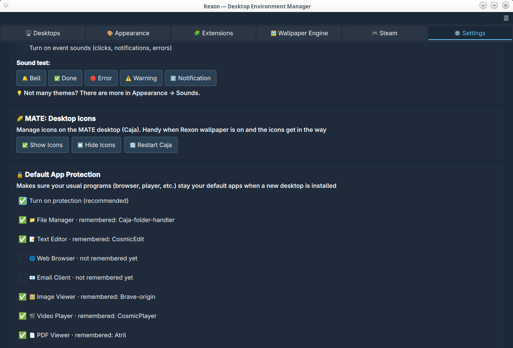

[English](../en/settings.md) | [Русский](../ru/settings.md) | Deutsch | [简体中文](../zh-CN/settings.md) | [Français](../fr/settings.md) | [Español](../es/settings.md) | [Українська](../uk/settings.md)

# Einstellungen

Hier stellen Sie Rexon selbst ein (Sprache, Aussehen des Fensters, Symbol im
Infobereich) und einige Dinge für den ganzen Computer: welcher Dateimanager
Ordner öffnet, welche Programme Dateien standardmäßig öffnen, Hintergründe
aus einem Bild oder Video, Hintergrundgeräusche und Systemklänge. Die
Abschnitte stehen untereinander in einer Liste; manche erscheinen nur dort,
wo sie Sinn ergeben (zum Beispiel der Leistenschutz nur mit KDE Plasma).

## Was der Reiter enthält

| Abschnitt | Wofür |
| --- | --- |
| 🌐 **Sprache** | Sprache der Fenster, Menüs und Meldungen von Rexon |
| 🎨 **Oberflächen-Skin** | Farben des Rexon-Fensters selbst |
| **Einführung beim ersten Start** | Kurze Hinweise über dem Fenster |
| 🔔 **Symbol im Infobereich** | Das Symbol neben der Uhr und der Autostart |
| 📁 **Dateimanager** | Welches Programm Ordner öffnet |
| 🔧 **Anwendungen schnell wiederherstellen** | Die eigenen Programme der aktuellen Arbeitsfläche zurückholen |
| 🧩 **Vollständigkeit der Desktop-Umgebung** | Prüfen, ob alles installiert ist, was die Arbeitsfläche braucht |
| 🎬 **Hintergrundbild (Bild / Video / YouTube / Web)** | Hintergrund aus einer Datei, einem YouTube- oder Vimeo-Video, einer Webseite |
| 📚 **Hintergrundbibliothek** | Hintergrundpakete von Rexon (.rxn) |
| 🪟 **Windows-Designs importieren** | Das Aussehen des alten Windows-PCs übernehmen |
| 🔒 **Schutz der Standardanwendungen** | Verhindert, dass eine neue Arbeitsfläche Ihre Programme ersetzt |
| 🛡️ **Schutz der KDE-Plasma-Leiste** | Nur mit Plasma: Sicherungen von Leiste, Widgets und Tastenkürzeln |
| 🪟 **Erscheinungsbild der Desktop-Umgebung** | Nur mit einem installierten Plasma-Ableger (AeroShell u. Ä.) |

Animation, Schriftarten, Titelleistenknöpfe, Startrückmeldung, Symbole
in Anwendungen, das Weichzeichnen des Hintergrunds, Hintergrundgeräusche
und Systemklänge finden Sie im Reiter „Erscheinungsbild“ – dort, wo sie auch
die KDE-Systemeinstellungen führen.

Haben Sie Ihr Passwort bereits eingegeben, steht oben im Reiter der Streifen
„🔓 Rexon darf das System ändern, bis das Fenster geschlossen wird“.
**„Jetzt entziehen“** nimmt diese Erlaubnis zurück: Beim nächsten Mal fragt
Rexon wieder nach dem Passwort.

## Sprache und Skin ändern

1. Wählen Sie unter **🌐 Sprache** eine Sprache aus der Liste. Der erste
   Eintrag ist „Wie im System“.
2. Die Sprache ändert sich nach einem Neustart von Rexon: Klicken Sie auf
   **„Rexon neu starten“**.
3. Wählen Sie unter **🎨 Oberflächen-Skin** das Aussehen des Fensters:
   „Dunkel (Steam)“ — die Voreinstellung, „Hell“, „Dunkel (Material)“,
   „Synthwave / Neon Space Retro“ oder „System (wie im System)“. Der Skin
   wechselt sofort.

Der Skin ändert nur die Farben des Rexon-Fensters, nicht das Design der
ganzen Arbeitsfläche. Das Design der Arbeitsfläche ändern Sie im Reiter
„Erscheinungsbild“.

## Einführung beim ersten Start

Beim ersten Start fragt Rexon „Kurze Einführung anzeigen?“. Die Einführung
dauert etwa eine Minute und zeigt, wo Sie Designs, Hintergründe und das
Erscheinungsbild ändern.

- **„Einführung beim ersten Start anzeigen“** schaltet diese Frage ein und
  aus.
- **„Einführung erneut ansehen“** startet die Einführung jederzeit.

## Symbol im Infobereich und Autostart

Rexon hält ein Symbol neben der Uhr bereit: Hintergründe, Bereiche und
Beenden — ohne das Fenster zu öffnen. Solange das Symbol da ist, versteckt
die Schließen-Schaltfläche Rexon im Infobereich, statt es zu beenden.

- **„Bei der Anmeldung starten“** — Rexon startet bei der Anmeldung im
  Infobereich, ohne das Fenster anzuzeigen.
- **„Symbole und Mauszeiger zum Thema automatisch herunterladen“** — braucht
  ein gewähltes Design Symbole oder einen Mauszeiger, die nicht installiert
  sind, lädt Rexon sie in Ihren Home-Ordner und wendet sie an. Ist die
  Option aus, fragt es vorher. Bei Sätzen, die es nur als Systempakete gibt,
  fragt Rexon immer.

Hat die Sitzung keinen Infobereich, sagt Rexon das: Das Symbol wurde nicht
hinzugefügt, und die Schließen-Schaltfläche beendet das Programm wie gewohnt.

## Dateimanager

Wählen Sie, welches Programm Ordner öffnet — in Rexon und im ganzen System.
**„Automatisch (nach Desktop)“** nimmt den eigenen Dateimanager der
aktuellen Arbeitsfläche. Neben jedem steht, ob er installiert ist. Klicken
Sie auf **„Dateimanager-Einstellungen anwenden“**. Hyprland und andere
Fenstermanager haben keinen eigenen Dateimanager — jeder aus der Liste
passt.

## Standardanwendungen zurückholen

Nach der Installation einer anderen Arbeitsfläche können Terminal,
Dateimanager und Texteditor auf deren eigene umgestellt sein.

**Schnell:** Klicken Sie unter **🔧 Anwendungen schnell wiederherstellen** auf
**„…-Anwendungen wiederherstellen“** (dort steht der Name Ihrer
Arbeitsfläche, zum Beispiel „MATE-Anwendungen wiederherstellen“).

**Ihre eigenen Programme:** unter **🔒 Schutz der Standardanwendungen**:

1. Setzen Sie **„Schutz aktivieren (empfohlen)“**.
2. Haken Sie an, was geschützt werden soll: Dateimanager, Browser, E-Mail,
   Bildbetrachter, Video, PDF, Archive, Musik, Terminal. Daneben steht,
   welches Programm gemerkt ist.
3. Klicken Sie auf **„📌 Jetzt merken“** — Rexon merkt sich Ihre aktuelle
   Auswahl.
4. Wurden Ihre Programme trotzdem ersetzt, klicken Sie auf
   **„↩️ Zurücksetzen“**.

## Terminalfarben nach einem Designwechsel

Manche Terminals übernehmen Text- und Hintergrundfarbe standardmäßig aus dem
Design. Bei einem ungünstigen dunklen Design kann der Text dunkelgrau auf
Schwarz werden. Deshalb gibt Rexon solchen Terminals nach einem Wechsel von
GTK-Design, globalem Design, Farbschema, hellem/dunklem Modus, Akzentfarbe
oder einem Aussehen „Wie in einer Distribution“ ein eigenes gut lesbares
Farbpaar: hellen Text auf dunklem Grund bei einem dunklen Design, dunklen auf
hellem bei einem hellen.

- **Welche Terminals:** mate-terminal, gnome-terminal und Tilix (sie
  übernehmen standardmäßig die Designfarben), außerdem xfce4-terminal und
  Terminator, wenn dort Farben aus dem Design eingeschaltet sind. Konsole,
  Console, Ptyxis, kitty, Alacritty und andere Terminals mit eigenen Schemata
  bleiben unberührt.
- **Eigene Farben bleiben.** Haben Sie die Farben im Profil selbst gewählt
  und sind sie gut lesbar, behält Rexon sie.
- **Ausschalten:** Entfernen Sie unter **🔒 Schutz der Standardanwendungen**
  den Haken bei **„Themes dürfen die Terminalfarben nicht verderben
  (empfohlen)“**. Standardmäßig ist er gesetzt.
- **Rückgängig machen:** Die alten Terminalfarben merkt sich Rexon zusammen
  mit dem Design. **„Zurück wie vor „…““** im Reiter „Erscheinungsbild“ (oder
  **„↩️ Zurücksetzen“** bei einem Aussehen „Wie in einer Distribution“)
  holt auch sie zurück.

## Sicherungen der KDE-Plasma-Leiste

**🛡️ Schutz der KDE-Plasma-Leiste** erscheint, wenn Plasma läuft oder
Sicherungen davon vorhanden sind.

1. Klicken Sie auf **„📦 Sicherung erstellen“** — Rexon sichert Aussehen der
   Leiste, Widgets und Tastenkürzel.
2. Die Sicherungen erscheinen in der Liste „Gespeicherte Sicherungen“.
3. Ist die Leiste nach der Installation einer anderen Arbeitsfläche kaputt,
   klicken Sie bei der gewünschten Sicherung auf **„Wiederherstellen“** und
   bestätigen. Das aktuelle Aussehen der Leiste wird ersetzt.

## Hintergrund, Klänge und mehr

- **🎬 Hintergrundbild** — **„🖼️ Bild …“** und **„🎬 Video …“** setzen einen
  Hintergrund aus einer Datei (Bilder JPG, PNG, WebP; Videos MP4, WebM, MKV
  und weitere; Flash SWF). Darunter ein YouTube- oder Vimeo-Link
  (**Qualität**, **Modus**: „Online“ oder „Herunterladen“) und
  Web-Hintergründe aus einem Link oder einer HTML-Datei. YouTube braucht das
  Programm yt-dlp: Fehlt es, bietet Rexon die Installation an.
  **„⏹️ Live-Hintergrund stoppen“** entfernt den Live-Hintergrund.
- An derselben Stelle der Hintergrundton: Lautstärke, „Stummschalten, wenn
  eine andere Anwendung Ton abspielt“ und „Hintergrund anhalten, wenn er von
  Fenstern verdeckt ist“. Der Ton ändert sich sofort, der Hintergrund muss
  nicht neu angewendet werden.

  

- **🪟 Windows-Designs importieren** — **„📥 Designdatei auswählen …“**:
  Designs (.themepack, .theme), visuelle Stile (.msstyles), Symbole,
  Mauszeiger und DreamScene-Videohintergründe. Das fertige Design erscheint
  im Reiter „Erweiterungen“.
- **🧩 Vollständigkeit der Desktop-Umgebung** — **„Prüfen und
  nachinstallieren“** prüft, ob alles installiert ist, was die Arbeitsfläche
  braucht (Designs, Schriftarten, Erweiterungen), und installiert Fehlendes.
  Das System fragt nach dem Passwort.

## Wenn etwas nicht klappt

- **Die Sprache hat sich nicht geändert.** Klicken Sie auf **„Rexon neu
  starten“** — die Sprache ändert sich erst nach einem Neustart.
- **Kein Symbol neben der Uhr.** Diese Sitzung hat keinen Infobereich. Rexon
  arbeitet als normales Fenster; „Bei der Anmeldung starten“ startet es
  trotzdem bei der Anmeldung.
- **„Autostart konnte nicht geändert werden“.** Die Details stehen im
  Protokoll von Rexon.
- **Nach der Installation einer Arbeitsfläche sind die Standardprogramme
  andere.** Klicken Sie auf **„…-Anwendungen wiederherstellen“** oder im
  Schutz der Standardanwendungen auf **„↩️ Zurücksetzen“**.
- **„⚠️ Die Hintergrund-Engine wurde nicht geladen – dieser Abschnitt ist
  nicht verfügbar“.** Der Abschnitt Hintergrundbild funktioniert erst, wenn
  die Hintergrund-Engine läuft; öffnen Sie den Reiter Wallpaper Engine und
  sehen Sie nach, was er meldet.
- **Animation oder Schriftarten fehlen.** Sie stehen jetzt im Reiter
  „Erscheinungsbild“ — die Links unten in diesem Reiter führen direkt dorthin.
