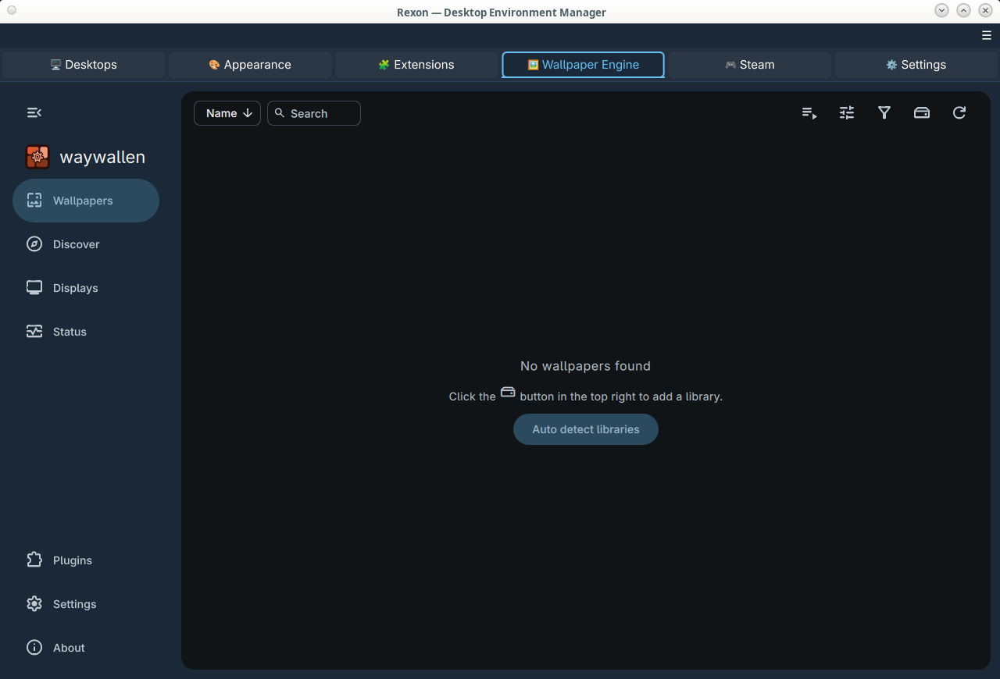
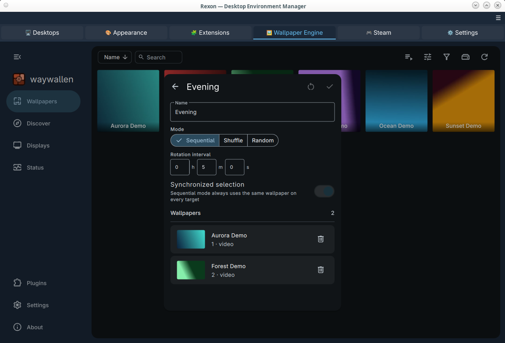
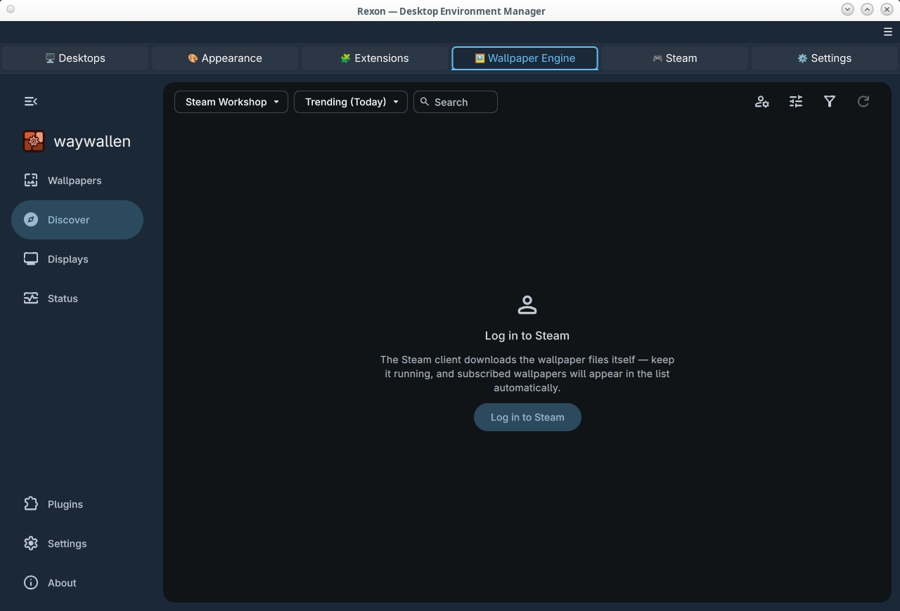

[English](../en/wallpaper-engine.md) | [Русский](../ru/wallpaper-engine.md) | Deutsch | [简体中文](../zh-CN/wallpaper-engine.md) | [Français](../fr/wallpaper-engine.md) | [Español](../es/wallpaper-engine.md)

# Wallpaper Engine

Hier wohnen die Live-Hintergründe: Szenen, Videos und Web-Hintergründe aus
Wallpaper Engine sowie Bilder aus dem kostenlosen Katalog Wallhaven. Einen
Hintergrund können Sie auf die ganze Arbeitsfläche oder auf einen einzelnen
Bildschirm legen, mehrere zu einer Wiedergabeliste zusammenfassen, die sie
nach Zeit wechselt, und neue Hintergründe im Steam Workshop direkt aus Rexon
abonnieren.

Den Reiter zeichnet die Hintergrund-Engine
[waywallen](https://github.com/hypengw/waywallen): Ihre Fenster sind
unverändert in Rexon eingebaut, deshalb sehen Aussehen und Beschriftungen hier
etwas anders aus als in den übrigen Reitern. Rexon ergänzt eigene Hinweise
und legt die Hintergründe selbst auf Ihre Arbeitsfläche.

> Für Hintergründe aus dem Steam Workshop müssen Sie **Wallpaper Engine auf
> Steam gekauft haben**: Der Workshop gibt seine Hintergründe nur an
> Besitzer heraus. Videos und Bilder aus eigenen Ordnern und der Katalog
> Wallhaven funktionieren auch ohne Kauf.

## Was der Reiter enthält

Links ist die Bereichsleiste (die Schaltfläche „☰“ oben klappt sie auf
Symbole zusammen):

- **Hintergründe** — Ihre Bibliothek: alles, was auf diesem Computer liegt.
- **Entdecken** — Kataloge im Netz: **Steam Workshop** und **Wallhaven**.
- **Bildschirme** — Ihre Bildschirme und was auf jedem gezeigt wird.
- **Status** — ob die Hintergrund-Engine läuft und was sie gerade zeichnet.
- Unten: **Plugins**, **Einstellungen** (Verhalten der Hintergründe) und
  **Über**.

Über der Bibliothek stehen die Sortierung (nach Name, Größe, Änderungsdatum),
die Suche und rechts die Schaltflächen **Wiedergabelisten**, **Ansicht**
(Kartengröße), **Filter** (nach Typ, Schlagwörtern, Altersfreigabe),
**Bibliotheksverwaltung** (welche Ordner durchsucht werden) und
**Aktualisieren**.

## Auf welchen Arbeitsflächen es funktioniert

Rexon wählt selbst, wie der Hintergrund auf Ihre Arbeitsfläche kommt —
einzurichten ist nichts:

- **KDE Plasma** — der Hintergrund wird in die Plasma-Arbeitsfläche
  eingebaut: Symbole und Klicks auf der Arbeitsfläche funktionieren wie
  gewohnt.
- **Hyprland, Sway, niri, river, COSMIC, Wayfire** — die Engine zeigt den
  Hintergrund selbst.
- **GNOME und Cinnamon in einer Wayland-Sitzung** — die Shell-Erweiterung von
  Rexon zeigt den Hintergrund. Erscheint er nicht, schalten Sie die
  Erweiterung ein und melden Sie sich neu an.
- **MATE, Xfce, Cinnamon, Budgie, LXQt, LXDE, Pantheon, Deepin und andere
  Arbeitsflächen in einer X11-Sitzung** — der eigene Hintergrund-Player von
  Rexon zeigt ihn. Ein Teil der Engine-Funktionen kann hier fehlen. In MATE
  bleiben die Arbeitsflächensymbole über dem Live-Hintergrund, wenn Caja einen
  durchsichtigen Arbeitsflächenhintergrund kann — Rexon schaltet ihn selbst
  ein. Kann Caja das nicht, sind die Symbole ausgeblendet, solange der
  Live-Hintergrund läuft (der Reiter sagt das in einer Zeile), und kommen
  zurück, sobald er angehalten wird.

Auf einem Wayland-Compositor, den Rexon nicht kennt, gibt es keine
Live-Hintergründe.

Zeichnet Ihre Arbeitsfläche den Hintergrund selbst (etwa die Shells Noctalia
oder DankMaterialShell), erscheint oben im Reiter ein Streifen mit einer
Erklärung und den Schaltflächen **„Hintergrund an Rexon übergeben“** (den
Hintergrund der Shell ausschalten) und **„An die Shell zurückgeben“** (ihn
mit der bisherigen Einstellung wieder einschalten).

## Hintergrund finden und anwenden

1. Öffnen Sie den Reiter **Wallpaper Engine** → **Hintergründe**.
2. Ist die Bibliothek leer, klicken Sie auf **„Bibliotheken automatisch
   erkennen“**: Rexon findet den Steam-Ordner und die bereits
   heruntergeladenen Wallpaper-Engine-Hintergründe. Einen anderen Ordner
   fügen Sie über **Bibliotheksverwaltung** → **„Bibliothek hinzufügen“**
   hinzu.

   

3. Klicken Sie auf eine Hintergrundkarte. Rechts öffnet sich die
   Detailansicht: Vorschau, Beschreibung, **Füllmodus** (zuschneiden,
   einpassen, strecken, zentrieren), Drehung, Spiegelung und die
   **Eigenschaften**, die der Autor vorgesehen hat (Farbe, Ton, Tempo usw.).
4. Bei mehreren Bildschirmen gibt es die Zeile **„Anwenden auf“** — wählen
   Sie einen Bildschirm oder **„Alle“**.
5. Klicken Sie auf **„Anwenden“**. Rexon legt den Hintergrund selbst auf die
   Arbeitsfläche.

Solange noch nichts auf der Arbeitsfläche gezeigt wird, kann **Bildschirme**
leer sein und „Wallpaper Engine-Hintergründe sind noch nicht auf der
Arbeitsfläche …“ melden. Das ist normal: Nach dem ersten „Anwenden“
erscheinen die Bildschirme.

## Bildschirme

Unter **Bildschirme** sehen Sie jeden Bildschirm und seinen Hintergrund.
Hier können Sie:

- einen Bildschirm umbenennen (**„Bildschirm bearbeiten“**) und seinen
  Füllmodus wählen;
- den Hintergrund auf einem Bildschirm anhalten (**„Bildschirm anhalten“**);
- mehrere Bildschirme zu einer **Leinwand** verbinden (**„Leinwand
  erstellen“**), damit sich ein Hintergrund über alle erstreckt.

## Wiedergabelisten: Hintergründe wechseln von selbst

1. Markieren Sie unter **Hintergründe** mehrere Karten: mit der rechten
   Maustaste (oder mit gedrückter Strg-Taste oder durch langes Drücken).
2. Unten erscheint eine Leiste — klicken Sie auf **„Neue Wiedergabeliste“**,
   geben Sie einen Namen ein und klicken Sie auf **„Erstellen“**. Mit **„Zur
   Wiedergabeliste hinzufügen“** ergänzen Sie eine bestehende Liste.

   

3. Öffnen Sie die Liste mit **Wiedergabelisten** (rechts über der
   Bibliothek). Jede Wiedergabeliste hat die Schaltflächen
   **„Wiedergabeliste abspielen“**, **„Wiedergabeliste bearbeiten“**,
   **„Hintergrundbilder bearbeiten“** und **„Wiedergabeliste löschen“**. Über
   der Liste wählen Sie, auf welchen Bildschirmen gespielt wird (**„Alle“**
   gilt auch für später angeschlossene Bildschirme).

   

4. Wählen Sie in **„Wiedergabeliste bearbeiten“** den **Modus** — **Der
   Reihe nach**, **Mischen** oder **Zufällig** — und das **Wechselintervall**
   (Stunden, Minuten, Sekunden). Speichern Sie mit dem Häkchen oben.

## Steam Workshop: neue Hintergründe abonnieren

Sie brauchen Wallpaper Engine, gekauft auf Steam, und einen laufenden
Steam-Client.

1. Öffnen Sie **Entdecken** und wählen Sie in der ersten Liste **Steam
   Workshop**.
2. Klicken Sie auf **„Bei Steam anmelden“** und scannen Sie den QR-Code mit
   der Steam-App auf dem Handy. Ihr Steam-Passwort sieht und erfragt Rexon
   nicht.

   

3. Nach der Anmeldung erscheint der Katalog. Sortieren lässt er sich nach
   „Beliebt (heute)“, „Beliebt (Woche)“ usw., „Kürzlich hinzugefügt“ oder
   „Am besten bewertet“; es gibt eine Suche und **Filter**. **„Meine
   Abonnements“** zeigt, was Sie bereits abonniert haben.
4. Öffnen Sie einen Hintergrund und klicken Sie auf **„Abonnieren“**. Die
   Dateien lädt der Steam-Client selbst herunter — lassen Sie ihn laufen,
   dann erscheint der Hintergrund automatisch unter **Hintergründe**.
5. Kündigen können Sie an derselben Stelle (**„Abo beenden“**) oder in der
   Detailansicht in der Bibliothek.

Hintergründe mit der Kennzeichnung 18+ bleiben verborgen, bis Sie diesen
Filter selbst einschalten (Rexon fragt noch einmal nach).

**Wallhaven** ist die zweite Quelle unter **Entdecken**: kostenlose Bilder,
ohne Anmeldung. Ein Bild, das Ihnen gefällt, speichern Sie mit
**„Herunterladen“**.

## Hintergrund-Einstellungen

**Einstellungen** unten in der Bereichsleiste öffnet die Einstellungen der
Engine selbst:

- **Automatische Wiedergabesteuerung** — was mit dem Hintergrund geschieht,
  wenn ein beliebiges, aktives, maximiertes oder Vollbildfenster offen ist,
  die Sitzung gesperrt ist oder der Computer im Akkubetrieb läuft: nichts,
  stummschalten, anhalten oder stoppen. So teilen sich Spiele und Filme die
  Grafikkarte nicht mit dem Hintergrund.
- **Audio** — Lautstärke und „Stummschalten, wenn andere Programme Ton
  wiedergeben“.
- **Übergangseffekt** und seine Dauer, **Ausgenommene Fenster** und der
  Zwischenspeicher für Bilder aus dem Netz.

## Wenn etwas nicht klappt

- **„Die Hintergrund-Engine waywallen wird gestartet …“ dauert lange.** Der
  erste Start nach der Installation kann ein bis zwei Minuten dauern, während
  sich die Engine entpackt. Bitte warten.
- **„Die Hintergrund-Engine waywallen wurde nicht gestartet“.** Klicken Sie
  auf **„Erneut starten“**. Hilft das nicht, sehen Sie unter **Status** →
  **Protokolle** nach.
- **Die Bibliothek ist leer, obwohl Sie Hintergründe besitzen.** Prüfen Sie,
  ob Steam sie heruntergeladen hat (sie liegen in
  `steamapps/workshop/content/431960`), und klicken Sie auf **„Bibliotheken
  automatisch erkennen“** oder **Aktualisieren**. Liegt Steam an einem
  ungewöhnlichen Ort, fügen Sie seinen Ordner in der
  **Bibliotheksverwaltung** hinzu — den Ordner, in dem `steamapps` liegt.
- **Abonniert, aber der Hintergrund erscheint nicht.** Der Steam-Client muss
  laufen — er lädt die Hintergründe herunter, nicht Rexon.
- **In KDE Plasma oben eine Warnung zum Plasma-Hintergrundmodul.** Klicken
  Sie auf **„Rexon-Version installieren“** — Rexon installiert ein passendes
  Modul.
- **Unter GNOME oder Cinnamon ist kein Hintergrund zu sehen.** Schalten Sie
  die Rexon-Erweiterung ein und melden Sie sich neu an.
- **Die Shell zeichnet den Hintergrund statt Rexon.** Klicken Sie im
  Streifen oben im Reiter auf **„Hintergrund an Rexon übergeben“**.
