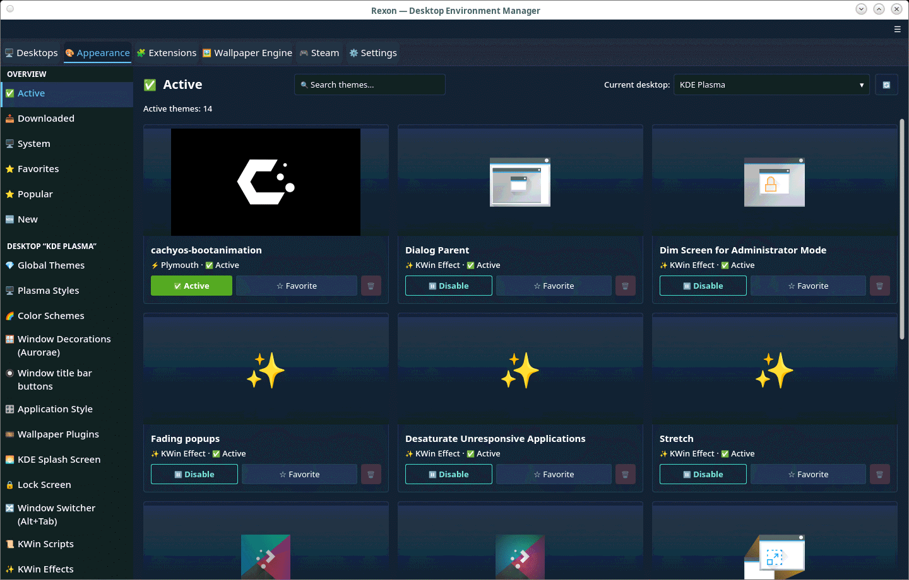

English | [Русский](../ru/appearance.md) | [Deutsch](../de/appearance.md) | [简体中文](../zh-CN/appearance.md) | [Français](../fr/appearance.md)

# Appearance

This tab changes how your computer looks: themes, colors, icons, cursors,
fonts, window borders, animation, the login screen and the boot splash. Rexon
only shows what actually works on your desktop, and it tells you what each
section affects — the desktop itself, all apps, or only some of them. New
themes come from the KDE Store, the AUR, Cinnamon Spices, or a file that is
already on your computer.

## How the tab is organized

The sidebar with sections is on the left, the selected section is on the
right. Above the content:

- **Search** — looks through names, authors and tags.
- **Store:** — where new themes come from: **KDE Store**, **AUR** or
  **All** (both in one list). Cinnamon sections use the Cinnamon Spices
  catalog instead, the same one Cinnamon's own settings use.
- **Current desktop:** — which desktop the themes are shown for. It is
  normally detected from the current session. You can pick another desktop,
  for example to choose themes in advance for a desktop you are about to
  switch to. Tiling desktops (Hyprland, Sway, niri) share one entry: their
  set of themes is the same.
- **Sorting** — “🆕 Newest”, “⬇️ Most Downloaded”, “⭐ Top Rated”,
  “🔤 Alphabetical”.
- **Install from File…** — install a theme that is already on your computer.
- **🔄 Refresh catalog** — load the list again.

A section first shows the themes you already have, then the items from the
store. The “← Previous” and “Next →” buttons at the bottom turn the pages.

### Overview

The first sidebar group is “Overview”. These sections are not tied to one
kind of theme:

- **Active** — everything that is on right now: theme, icons, cursor, boot
  splash, window effects and so on.
- **Downloaded** — what you installed yourself.
- **System** — what came with the system and its packages.
- **Favorites** — themes marked with the “☆ Favorite” button.
- **Popular** and **New** — a store showcase with what people install most
  for your desktop: icons, cursors, GTK themes, wallpapers and more.

### Section groups

The other sections are grouped. Each group heading answers the question
“what will this affect”:

- **Desktop “…”** — the native look of the desktop selected in “Current
  desktop”.
- **For all apps** — what every app picks up: icons, cursors, GTK themes,
  fonts, sounds, wallpapers.
- **Qt and KDE apps** — appears outside KDE and LXQt. Colors and style of
  apps such as VLC, qBittorrent, Krita, Dolphin. The desktop itself doesn't
  change.
- **Desktop widgets** — Plasma widgets, Cinnamon desklets and Conky widgets
  (clocks, weather, system sensors; Conky works on any desktop).
- **System: startup and login** — the login screen and the splash shown
  when the computer starts. They are shared by all desktops on this
  computer.

If a section doesn't exist for your desktop, Rexon doesn't show it. And if
you open a section that doesn't work on the selected desktop, you get an
explanation instead of an empty shelf, plus a hint to pick another section
on the left.

### A theme tile

Every theme has a tile with a picture, a name and buttons:

- **Install** — download and install the theme from the store;
- **🎨 Apply** — turn on a theme you already have;
- **✅ Applied** — the theme is on now (clicking applies it again);
- **▶️ Enable** / **⏸️ Disable** — for add-ons: KWin effects and scripts,
  extensions and applets;
- **▶️ Start** / **⏹️ Stop** — for Conky widgets;
- **☆ Favorite** — mark the theme;
- **🗑️** — remove.

Clicking the picture opens the theme's page: screenshots (the ◀️ ▶️ arrows
turn them, a click opens the picture full screen), description, rating,
number of downloads, comments, and the **🌐 Open Website** and
**🔗 Copy Link** buttons. **← Back to Catalog** takes you back.

## Sections

### Global Themes

A global theme is a ready-made set of everything at once: colors,
application style, window borders, icons, cursors, splash screen and
sometimes the panel layout. Above the tiles are the **Save Current
Appearance…** button and the **Light and dark** block (see below).

Press “🎨 Apply” on a theme, and the “Apply “…”?” window opens. It shows
what exactly the theme will set. **Choose what to apply…** opens the
detailed list, where you can uncheck what you don't want changed.

**Desktop and widget layout** is off by default. If you turn it on, Rexon
warns you: applying the layout will delete the current desktops, panels,
docks and widgets and replace them with the ones from the theme.

Global themes are made for KDE Plasma, but Rexon can apply them on other
desktops too — part by part, only what that desktop has: colors (for Qt
apps), application style, icons, cursors, fonts and title bar buttons.
Things that exist only in Plasma (panels, Plasma style, Plasma splash) are
turned off in the list, with the reason next to them.

### Colors: color schemes, accent color, light and dark

In KDE the section is called **Color Schemes**, on other desktops **Qt App
Colors** (there a scheme only colors Qt and KDE apps). Above the tiles is the
**View:** switch — “All”, “Light”, “Dark”.

**Accent color** — the color of selections, checkboxes and active buttons.
Choices:

- **From the color scheme** (or **From the theme** on other desktops) —
  whatever the scheme sets;
- **From the wallpaper** — the color is taken from your desktop picture.
  Rexon updates it when it changes the wallpaper itself; if the wallpaper was
  changed elsewhere, press “From the wallpaper” again;
- **Custom color** — one of the ready-made circles, or any color through
  **Choose a color…**.

Below the buttons it says who gets the color on your desktop. For example,
GNOME offers only nine accent colors, so GTK 4 apps get the closest one.
**Restore as it was** brings back the color you had before Rexon.

**Light and dark** — pairs of themes for day and night. The block sits in
“Global Themes” and “Color Schemes” in KDE, and in “Color Schemes” and “GTK
Themes” on other desktops.

1. Check the parts to switch: global theme (KDE only), color scheme, GTK
   theme, icons, wallpaper.
2. Pick a light and a dark variant for each.
3. Press **Light**, **Dark** or **Automatically**. In “Automatically” mode
   choose **Sunset to sunrise** (the location comes from the time zone, or
   you enter latitude and longitude) or **At set times** — “Light from” and
   “Dark from”.
4. Press **Save**.

The **Light or dark mode of applications** checkbox also switches the mode of
apps that can follow the system. The heading of the collapsed block shows
what is on, for example “Light and dark: on schedule 07:00–19:00”.

An installed color scheme's page has the **Edit…** button (the main colors
of the scheme; if the KDE editor is installed, it opens instead) and **New
Based on This…** (a new scheme made from this one; the original stays as it
is).

### Window borders and title bar buttons

Each desktop has its own window borders: in KDE **Window Decorations
(Aurorae)**, in XFCE, MATE and LXQt (Openbox, labwc) **Window Borders**. In
Cinnamon the borders are drawn by the GTK theme.

Window title bar buttons are set up right there, in the borders section:
the **⚙️ Settings** button at its top (like the “Titlebar Buttons” tab of
the KDE “Window Decorations” module), and **←  Back to Catalog** to return.
In Cinnamon it is the **Cinnamon Theme** section; on desktops without a
borders section of their own (GNOME, Budgie, Pantheon, COSMIC, Deepin,
tiling ones) it is **GTK Themes**: there title bars are drawn by the GTK
theme or by GTK apps themselves. In the settings:

- **Buttons position:** — “On the right (like Windows)” or “On the left
  (like macOS)”;
- drag buttons between the shelf and the “Title bar” strip; without a
  mouse, select a button and use “Move left”, “Move right”, “Remove from the
  title bar”, “Add on the left”, “Add on the right”;
- **Window border size:** — from “No borders” to “Oversized”;
- in KDE there are three more checkboxes: close windows by double-clicking
  the window menu button, show title bar button tooltips, and always show
  the “Hide from screenshots and screen recordings” button;
- **Defaults** — go back to the original layout.

If your desktop's window manager has no such button, Rexon says so.

### Application Style

**Application Style** (outside KDE and LXQt — **Qt App Style (Kvantum)**)
shows Qt styles and Kvantum themes in one grid. The switch above the grid:
“All”, “Qt styles”, “Kvantum”. New Kvantum themes come from the KDE Store,
ready-made Qt styles (Darkly, Lightly, Klassy) from the AUR.

### Icons, cursors, launch feedback

- **Icons** and **Cursors** — icon and pointer themes. The **⚙️ Settings**
  button at the top of the Icons section opens, right there, icons in menus
  and on buttons and toolbar labels in applications (“Icons only”, “Text
  only”, “Text beside icons”, “Text below icons”); **←  Back to Catalog**
  returns to the themes. The cursors section
  has the **Size:** field — pointer size in pixels. Rexon applies it in the
  desktop's own settings, in GTK and Qt apps, and in the config of sway,
  niri or Hyprland.
- **Launch feedback** (KDE only) — the **⚙️ Settings** button at the top
  of the Cursors section: how the pointer and the task bar show that an
  application is starting: pointer “No feedback”, “Static”, “Blinking” or
  “Bouncing”, task bar button animation, and when to stop it. Where the
  desktop has no such setting, there is no button.

### GTK Themes

Themes for GTK apps (Firefox, GIMP, most GNOME, XFCE, MATE and Cinnamon
apps). GNOME, Cinnamon, MATE and XFCE also have their own sections next to
it: **GNOME Shell Theme**, **Cinnamon Theme**, **LXQt Theme** and others.
On desktops without window animations, the **⚙️ Settings** button at the
top of the section opens the **No animations** check box — animations
inside applications.

### Fonts and font management

The **Fonts** section (with the 🔤 icon in the “For all apps” group) holds
fonts from the KDE Store. The **⚙️ Settings** button at its top opens, right
there, the system fonts: fonts of the interface, the terminal, small
captions, toolbars, menus and window titles; **←  Back to Catalog** returns
to the store. Press a font's button to choose its
family and size, or **🔤 Change All Fonts…** to set one font for all of
them. Below are **Text smoothing** (anti-aliasing, sub-pixel rendering,
hinting) and **Force font DPI:**.

**🗂️ Manage Fonts…** opens the list of all fonts on the computer:

- a sample of each font and a table of its characters;
- **➕ Install from File…** — for yourself or for everyone on this computer
  (for everyone, Rexon asks for the administrator password);
- **Remove** — only fonts you installed. System fonts are view only;
- **Disable** / **Enable** — hide a font from all apps without deleting the
  file;
- **🔍 Find Duplicates** — font styles installed in more than one file;
- your own font groups (**➕ New Group…**), turning a whole group on or off,
  exporting a group to a ZIP archive.

### Wallpapers and sounds

- **HD Wallpapers** — desktop pictures from the store. The **⚙️ Settings**
  button at the top of the section is **🌫️ Wallpaper Blur**: it blurs a
  picture wallpaper so icons and windows on top read easier (the
  **Strength** slider, **Blur Wallpaper**, **Remove Blur**); the original is
  kept.
- **Wallpaper Plugins** (KDE only) — live Plasma wallpapers.
- **Sounds** — sound themes. You can listen to a theme's sounds before
  installing it (**🔊 Preview Before Installing**): the theme is downloaded
  to a temporary folder and nothing is installed. If system sounds are off,
  Rexon offers to **Turn on** them. The **⚙️ Settings** button at the top of
  the section holds **🔔 Event Sounds** (the desktop's sound theme, turning
  event sounds on, testing the sound) and **🔊 Ambient Sounds** (**➕ Add
  File…** plays a sound on a loop, volume, **⏹️ Stop All**, the list of
  what is playing). Ambient sounds keep playing after you leave the section.

Moving wallpapers live in the Wallpaper Engine tab.

### Animation and screen effects

These are the last sections of the desktop group.

- **Animation** — **No animations** or **Animation speed:** from “Slow” to
  “Fast”, plus a choice of effects: opening and closing windows,
  minimizing, switching virtual desktops, popups and so on. Where the
  window manager has no window animations (MATE, Xfce, LXQt, Deepin, sway
  and other tiling ones except Hyprland and niri), there is no such
  section: the **No animations** check box for applications is the
  **⚙️ Settings** button in the GTK Themes section.
- **Screen effects** — the screen as an old tube monitor, a worn video tape
  or a film print: “Scanlines”, “CRT screen”, “Green monitor”, “Amber
  monitor”, “VHS tape”, “Analog TV”, “Film”, “Black and white”. Sliders
  **Strength:** and **Motion speed:**. How the section works on your desktop
  and what it needs is written at the top (the “Needs: …” line). Where the
  effects can't be turned on at all (sway, river, labwc, niri, Budgie,
  Deepin), there is no such section; in MATE, Xfce and LXQt it is missing in
  a Wayland session — there the effects work only on X11.

### Widgets

- **Widgets** (KDE) — Plasma widgets from the store.
- **Cinnamon Desklets**, **Cinnamon Applets**, **Cinnamon Extensions**,
  **Nemo Actions** — from Cinnamon Spices.
- **Conky Widgets** — clocks, weather, system sensors. Their button is
  **▶️ Start** / **⏹️ Stop**, and a widget's page has the **Start at login**
  checkbox.

### Login screen, lock screen, splash screens

- **Login Screen** — SDDM themes. Above them is the **Login manager**
  block: which program shows the sign-in screen and which one is the
  default (a new default appears after a restart; your current session isn't
  interrupted). If the login screen is drawn by Plasma Login Manager, it has
  no third-party themes — Rexon offers **Open Login Screen Settings**.
- **Boot Splash (Plymouth)** — what you see when the computer starts,
  before you log in.
- **Lock Screen** (KDE and Deepin) — two modes: **🔒 Full Themes** (only
  the lock screen part of the theme is applied) and **🖼️ Lock Screen
  Wallpaper** (a picture as the background, the screen itself stays the
  same).
- **KDE Splash Screen** — the splash shown when Plasma starts.

The login screen and the boot splash are system-wide: Rexon asks for the
administrator password when installing them. On SteamOS (Steam Deck, Steam
Machine) these sections are closed, and Rexon explains why right away.

### Sections of particular desktops

- KDE: **Plasma Styles**, **Window Switcher (Alt+Tab)**, **KWin Scripts**,
  **KWin Effects** — new effects from the KDE Store; the **⚙️ Settings**
  button at the top of the section turns on and sets up the effects KWin
  already has (Magic Lamp, translucency, blur and others), with search and a
  “Configure…” button for each.
- GNOME: **GNOME Shell Theme**, **GNOME Extensions**.
- MATE: **Panel Layout** — ready-made panel layouts with one button.

## How to…

### Apply a global theme part by part

1. Open **Global Themes**.
2. Press **🎨 Apply** on the theme you want (or **Install** if you don't
   have it yet, then “Apply”).
3. In the window, press **Choose what to apply…**.
4. Uncheck what you don't want changed, for example “Icons” or
   “Pointers”.
5. Press **Apply**.

On other desktops the window opens in the detailed view right away, and the
greyed-out items explain why they can't be carried over.

### Save your current appearance

1. Open **Global Themes**.
2. Press **Save Current Appearance…**.
3. Type a **Name:** (and, if you like, an **Author:**).
4. In **What to save:** keep checked what you need.
5. Pick a picture for the tile: **Take a screenshot…**, **Choose an
   image…** or **Tile in the theme colors**.
6. Press **Save**.

The new theme shows up among the tiles right away. You can apply it here or
on any other desktop — whole or part by part — and in Plasma too.

### Change colors, accent, light and dark

1. Open **Color Schemes** (or **Qt App Colors**).
2. Press **🎨 Apply** on the scheme you want.
3. In the **Accent color** block choose **From the color scheme**, **From
   the wallpaper** or **Custom color**.
4. To have the look switch by itself between day and night, expand **Light
   and dark**, pick the pairs of themes, press **Automatically** and
   **Save**.

### Install a theme from the store, the AUR or a file

**From the store:**

1. Open the section you need, for example **Icons**.
2. Leave **Store:** set to **KDE Store**.
3. Find the theme with search or in the list and press **Install**.
4. When the installation finishes, press **🎨 Apply**.

**From the AUR** (Arch-based distributions):

1. Set **Store:** to **AUR** (or **All**).
2. Type at least a few letters into search.
3. Open the package page. Rexon shows whether something is off with it:
   orphaned, flagged out of date, a new maintainer, very few votes.
   **📄 Show PKGBUILD** shows the build recipe.
4. Press **Install**. The package is built from source — this can take a
   while. Building needs paru or yay.

**From a file:**

1. Press **Install from File…**.
2. Press **Choose Files…** or **Choose a Folder…**.
3. Pick an archive, a folder or single files — fonts, cursors and icons from
   Windows, color schemes, wallpapers.

Rexon recognizes the kind by the contents and installs it into the right
section. If the theme changes a system screen (login, boot), Rexon asks you
to install it from that section — it asks for the administrator password
there.

### Return things as they were

- After you apply a theme, a **Return as It Was Before “…”** bar appears
  above the tiles: Rexon saved what was there before. Programs that are
  already open may show it only after a restart or the next login.
- Outside Plasma, color schemes have **Return Colors as They Were**.
- The accent color and screen effects have **Restore as it was**.
- Sections with a **Defaults** button (“Window title bar buttons”, “Launch
  feedback”, “Animation” and others) go back to the original settings with
  it.
- A theme removed with 🗑️ is only marked at first: a bar with an **Undo**
  button stays at the bottom for a few seconds.

### Turn on a screen effect

1. Open **Screen effects**.
2. Pick an effect, for example **CRT screen**.
3. Adjust **Strength:** and **Motion speed:**. Moving effects keep the
   graphics card busy all the time; at **Still** the picture stays the same
   and costs almost nothing.
4. Press **Apply**.
5. You are asked “Keep this effect? Otherwise the screen goes back as it was
   in 15 s.” Press **Keep**. If the screen went dark or looks wrong, don't
   press anything: after 15 seconds everything goes back by itself.
   **Revert** goes back immediately.

To turn the effect off, choose **Off** and press “Apply”, or press
**Restore as it was**.

## If something goes wrong

- **A section is missing from the sidebar.** It doesn't work on the selected
  desktop. Check **Current desktop:** — maybe the wrong desktop is selected.
- **The theme was applied, but an app still looks the old way.** Apps that
  are already open often pick up a new look only after a restart or the next
  login.
- **The color scheme didn't reach Qt apps outside KDE.** Rexon tells you if
  qt6ct isn't installed: without it only KDE apps (Dolphin, Kate, Okular) get
  the colors.
- **“The KDE Store isn't responding right now”.** The problem is on the
  store's side; try again later or press **🔄 Refresh catalog**.
- **Installing from the AUR doesn't work.** You need the paru or yay package
  builder. AUR search starts working from a few letters.
- **“The theme uses the old Plasma 5 format”.** Plasma 6 can't apply it —
  you need a version of the theme made for Plasma 6.
- **The active theme can't be removed.** Switch to another theme first.
  Rexon doesn't remove system themes (from packages) either — they go away
  together with their package.
- **Something is wrong after a screen effect.** Don't press anything for 15
  seconds — the effect turns itself off. Later, use **Restore as it was** in
  “Screen effects”.
- **A login screen theme has no effect.** The themes in this section are for
  SDDM. If another program shows the login screen, Rexon says so above the
  tiles; you can choose the default one in the **Login manager** block.
- **Panels broke after a global theme.** That only happens if “Desktop and
  widget layout” was checked. Press **Return as It Was Before “…”**; in KDE
  Plasma, MATE and XFCE you can make a copy of the panel beforehand in the
  Desktops tab (“🛟 Save Panel”).
