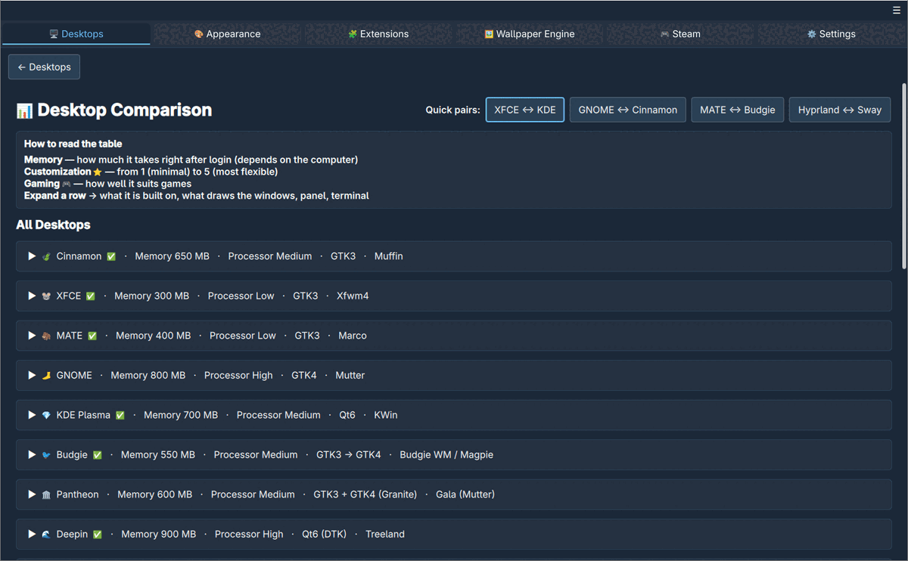

English | [Русский](../ru/desktops.md) | [Deutsch](../de/desktops.md) | [简体中文](../zh-CN/desktops.md) | [Français](../fr/desktops.md) | [Español](../es/desktops.md)

# Desktops

This tab installs, switches and removes desktop environments. Here you can
also check that your desktop has everything it needs, compare desktops side
by side, and make your desktop look like a well-known distribution in one go.

## What's on the tab

**The list of desktops (left).** Desktops are grouped: "Classic" (Cinnamon,
XFCE, MATE, GNOME, KDE Plasma, Budgie, Pantheon, Deepin, COSMIC, LXQt),
"Tiling" (Hyprland, niri, Sway, River) and "Compositors with effects"
(Wayfire). If a desktop can't be installed on your distribution, the list
says so.

**The desktop card (right)** — everything about the selected desktop:

- screenshots (the arrows page through them; the magnifier or a click on
  the picture opens it full screen);
- the state: "Installed", "Not installed", "Current desktop";
- a short description and four ratings: "Memory" (how much it takes right
  after login), "Processor", "Customization" and "Gaming";
- how many of the desktop's packages are installed, which are missing and
  which have updates;
- the installed version and, if there is one, a newer version in the
  repositories;
- action buttons:
  - **📦 Install** — for a desktop you don't have yet;
  - **🔄 Switch** — log out and log in to this desktop;
  - **🔧 Check / Repair** — find and install missing packages;
  - **🗑️ Remove** — remove the desktop. The current desktop has no such
    button;
  - **➕ Add the Wayland version** — for an installed desktop that can run on
    both X11 and Wayland, when the Wayland version isn't installed yet.
- for Hyprland, niri and Sway, a **Shells** block: ready-made panels with a
  launcher and notifications (Noctalia, DankMaterialShell). You can install
  them, log in with them or remove them.

**🎨 Distro Looks (middle).** The whole look of a well-known distribution in
one go: currently "Like SteamOS" and "Like Garuda Linux (Dr460nized)". An
applied look gets a **↩️ Put Back as It Was** button.

**🧰 Tools (below it):**

- **⚔️ Compare Desktops** — a table of all desktops side by side;
- **🔧 Check My Desktop** — the same as "Check / Repair", but for the desktop
  you are using right now;
- **🛟 Save Panel** and **↩️ Restore Panel** — a copy of your panel settings,
  in case experimenting with themes breaks the panel. These buttons exist
  only on KDE Plasma, MATE and XFCE.

## How to

### Install a desktop

1. Select the desktop in the list on the left.
2. Click **📦 Install**.
3. In the "Install?" window, check what will be installed. If the desktop
   offers "How the desktop will run", pick an option (see below).
4. Confirm and enter the administrator password when the system asks for it.
5. When "Installation Complete" appears, log out and choose the new desktop
   on the login screen. If the desktop needs a restart, Rexon says so in the
   same window.

### Choose X11 or Wayland

Cinnamon, XFCE, MATE and LXQt can run in two ways. The choice appears right
in the "Install?" window, under "How the desktop will run":

- **X11 — proven** — the way the desktop has worked for years; all programs
  and settings behave as expected;
- **Wayland — newer** — the picture is smoother and sharper on
  high-resolution screens. For some desktops it is still experimental: some
  programs, panel applets and settings may not work;
- **Wayland — experimental, from the AUR** — this is how MATE's Wayland
  version is marked: it is built from the AUR on your computer, and Rexon
  warns you about that in the same window.

The recommended option is marked "(recommended)". If you choose Wayland, the
X11 version stays too — both appear on the login screen. At the end Rexon
tells you which session to choose at login. You can also add the Wayland
version later with the **➕ Add the Wayland version** button on the card.

### Switch to another desktop

1. Select an installed desktop in the list.
2. Click **🔄 Switch**.
3. Save your open documents and confirm. Rexon saves a copy of the current
   desktop's settings and logs you out.
4. Choose the new desktop on the login screen.

### Remove a desktop

1. Select the desktop and click **🗑️ Remove**.
2. The "Remove?" window shows which desktop is current — it won't be
   affected. Confirm and enter the password.

You can't remove:

- **the current desktop** — otherwise you would get a black screen at the
  next login. Switch to another desktop first, log in to it, and only then
  remove this one;
- **the last installed desktop** — install another one first.

Packages shared with other programs stay: only what nothing else needs is
removed.

### Check and repair a desktop

If a desktop behaves oddly (the panel is gone, settings won't open), click
**🔧 Check My Desktop** under Tools, or **🔧 Check / Repair** on the card of
any installed desktop. Rexon compares the desktop's package list with what is
installed and installs whatever is missing. If the card already reports
missing packages, this button installs them.

### Compare desktops

Click **⚔️ Compare Desktops**. A table, "All Desktops", opens: memory,
processor load, what the desktop is built on and what draws the windows. Rows
can be expanded. The "Quick pairs" buttons put common matchups side by side
(for example XFCE ↔ KDE). To go back, click **← Desktops**.

### Make your desktop look like a distribution

1. Under **🎨 Distro Looks**, click **Apply** on the look you want.
2. Rexon checks what is needed and shows a window: what will change, what
   applies only partly on your desktop, and what won't apply at all. For the
   SteamOS look you can pick a style and, if you like, turn on game mode.
3. Click **Apply**. If the look needs programs, Rexon installs them and asks
   for the password.
4. Changed your mind? Click **↩️ Put Back as It Was**: the previous look and
   settings come back. Programs installed for the look stay; you can remove
   them yourself.

## If something goes wrong

- **The new desktop isn't on the login screen.** Log out once more. If Rexon
  said a restart is needed, restart the computer. For Cinnamon, XFCE, MATE
  and LXQt, check which session (X11 or Wayland) you are choosing.
- **The desktop starts without a panel or with errors.** Log in to any other
  desktop, or stay in this one, and click **🔧 Check My Desktop**.
- **A theme broke the panel.** If you clicked **🛟 Save Panel** beforehand,
  click **↩️ Restore Panel**.
- **You don't like a distro look.** Use **↩️ Put Back as It Was** on its tile.
- **"A Package No Longer Gets Updates" window.** A package that was dropped
  from the repositories is still installed. If you don't use it, Rexon can
  remove it; otherwise click "Not Now".
- **"Desktop Not Detected".** Rexon didn't recognise the desktop you are
  using. Select it in the list on the left and click **🔧 Check / Repair** on
  its card.
- **The KDE Plasma panel is gone after switching.** Before switching away
  from Plasma, Rexon saves its panel; you can bring it back in **Settings →
  🛡️ KDE Plasma Panel Protection**. If the new desktop took over your default
  browser or player, look at **Settings → 🔒 Default App Protection**.
- **You need to roll back the whole system.** Rexon itself doesn't take
  system snapshots. If you have snapper with snap-pac set up (common on
  CachyOS and other distributions on Btrfs), a snapshot is taken
  automatically before every package installation and removal, and you can
  go back to it with snapper's tools (for example, Btrfs Assistant).

## See also

- [Appearance](appearance.md) — themes, icons, cursors, fonts, login screen
- [Extensions](extensions.md) — `.rxn` packages and Windows themes
- [Wallpaper Engine](wallpaper-engine.md) — live wallpapers
- [Steam](steam.md) — startup movie and profile backgrounds
- [Settings](settings.md) — backups and Rexon options
- [Guide contents](../README.md)
