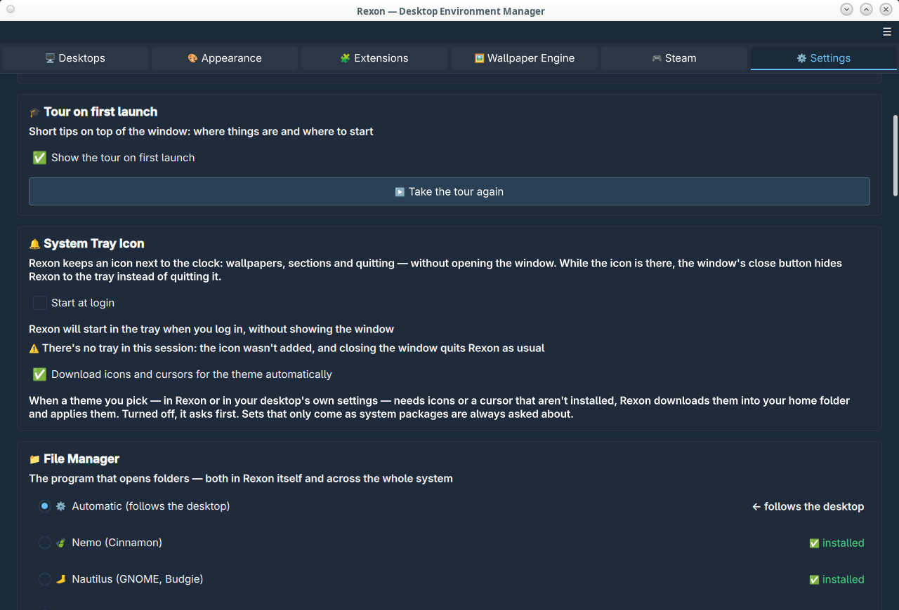

English | [Русский](../ru/settings.md) | [Deutsch](../de/settings.md)

# Settings

This tab sets up Rexon itself (language, window look, tray icon) and a few
things for the whole computer: which file manager opens folders, which
programs open files by default, wallpapers from a picture or a video, ambient
sounds and event sounds. The sections run top to bottom in one list; some of
them only appear where they make sense (for example, the desktop icons
section only in MATE).

## What's on the tab

| Section | What it's for |
| --- | --- |
| 🌐 **Language** | The language of Rexon's windows, menus and messages |
| 🎨 **Interface Skin** | The colors of the Rexon window itself |
| **Tour on first launch** | Short tips on top of the window |
| 🔔 **System Tray Icon** | The icon next to the clock and autostart |
| 📁 **File Manager** | Which program opens folders |
| 🔧 **Quick App Restore** | Bring back the native apps of the current desktop |
| 🧩 **Desktop Completeness** | Check that everything the desktop needs is installed |
| 🎬 **Wallpaper (image / video / YouTube / web)** | Wallpaper from a file, a YouTube or Vimeo video, a web page |
| 📚 **Wallpaper Library** | Rexon wallpaper packs (.rxn) |
| 🪟 **Import Windows Themes** | Bring over the look of your old Windows PC |
| 🌫️ **Wallpaper Blur** | Blur a picture wallpaper so text on the desktop reads easier |
| 🔊 **Ambient Sounds** | Rain, wind, music on a loop |
| 🔔 **Event Sounds** | System sound theme: clicks, notifications, errors |
| 🌽 **MATE: Desktop Icons** | MATE only: show or hide icons on the desktop |
| 🔒 **Default App Protection** | Keep a new desktop from replacing your programs |
| 🛡️ **KDE Plasma Panel Protection** | With Plasma only: copies of the panel, widgets and shortcuts |
| 🪟 **Desktop Appearance** | Only with a Plasma look fork installed (AeroShell and similar) |

At the very bottom are links "Appearance → …". Animation, fonts, window title
bar buttons, launch feedback and icons in applications have moved to the
Appearance tab — where KDE System Settings keeps them too.

If you have already entered your password, a strip "🔓 Rexon can change the
system until the window is closed" shows at the top. **"Revoke Now"** takes
that permission back: next time Rexon asks for the password again.

## How to change the language and the skin

1. In **🌐 Language**, pick a language from the list. The first entry is
   "Same as system".
2. The language changes after Rexon restarts: press **"Restart Rexon"**.
3. In **🎨 Interface Skin**, pick the window look: "Dark (Steam)" — the
   default, "Light", "Dark (Material)", "Synthwave / Neon Space Retro" or
   "System (follow the system theme)". The skin changes right away.

The skin only changes the colors of the Rexon window, not the theme of the
whole desktop. The desktop theme is changed on the Appearance tab.

## Tour on first launch

On first launch Rexon asks "Show a short tour?". The tour takes about a
minute and shows where to change themes, wallpapers and appearance.

- **"Show the tour on first launch"** turns this question on and off.
- **"Take the tour again"** starts the tour at any time.

## Tray icon and autostart

Rexon keeps an icon next to the clock: wallpapers, sections and quitting —
without opening the window. While the icon is there, the window's close
button hides Rexon to the tray instead of quitting it.

- **"Start at login"** — Rexon starts in the tray when you log in, without
  showing the window.
- **"Download icons and cursors for the theme automatically"** — when a theme
  you pick needs icons or a cursor that aren't installed, Rexon downloads them
  into your home folder and applies them. Turned off, it asks first. Sets that
  only come as system packages are always asked about.

If the session has no tray, Rexon says so: the icon wasn't added, and the
close button quits the program as usual.

## File manager

Choose which program opens folders — both in Rexon and across the whole
system. **"Automatic (follows the desktop)"** uses the native file manager of
the current desktop. Next to each one you see whether it is installed. Press
**"Apply File Manager Settings"**. Hyprland and other window managers have no
file manager of their own — any one from the list will do.

## How to get your default apps back

After you install another desktop, your terminal, file manager and text
editor may be switched to its own.

**Quick way:** in **🔧 Quick App Restore** press **"Restore … Apps"** (it
carries the name of your desktop, for example "Restore MATE Apps").

**Your own programs:** in **🔒 Default App Protection**:

1. Tick **"Turn on protection (recommended)"**.
2. Tick what to protect: file manager, browser, email, image viewer, video,
   PDF, archives, music, terminal. Next to each you see which program is
   remembered.
3. Press **"📌 Remember Now"** — Rexon remembers your current choice.
4. If your programs got replaced anyway, press **"↩️ Restore Previous"**.

## Terminal colors after a theme change

Some terminals take their text and background colors from the theme by
default. With an unlucky dark theme their text can turn dark gray on black.
So after you change the GTK theme, the global theme, the color scheme, light
or dark mode, the accent color or a Distro Look, Rexon gives
such terminals a readable pair of colors of its own: light text on a dark
background for a dark theme, dark on light for a light one.

- **Which terminals:** mate-terminal, gnome-terminal and Tilix (they take the
  theme colors by default), plus xfce4-terminal and Terminator if theme
  colors are turned on in them. Konsole, Console, Ptyxis, kitty, Alacritty
  and other terminals with their own schemes are left alone.
- **Your own colors stay.** If you picked the colors in a profile yourself
  and they are readable, Rexon keeps them.
- **How to turn it off:** in **🔒 Default App Protection** untick
  **"Don't let themes spoil terminal colors (recommended)"**. It is on by
  default.
- **How to undo it:** Rexon remembers the old terminal colors together with
  the theme. **Return as It Was Before “…”** on the Appearance tab (or
  **"↩️ Put Back as It Was"** for a Distro Look) brings them back too.

## Backups of the KDE Plasma panel

**🛡️ KDE Plasma Panel Protection** appears when Plasma is running or copies
of it are left.

1. Press **"📦 Save Copy"** — Rexon saves the panel layout, widgets and
   keyboard shortcuts.
2. The copies appear in the "Saved copies" list.
3. If the panel broke after installing another desktop, press **"Restore"**
   next to the copy you want and confirm. The current panel layout will be
   replaced.

## Wallpaper, sounds and more

- **🎬 Wallpaper** — **"🖼️ Image…"** and **"🎬 Video…"** set a wallpaper from
  a file (images JPG, PNG, WebP; videos MP4, WebM, MKV and more; Flash SWF).
  Below is a YouTube or Vimeo link (**Quality**, **Mode**: "Stream" or
  "Download") and web wallpapers from a link or an HTML file. YouTube needs
  the yt-dlp program: if it's missing, Rexon offers to install it.
  **"⏹️ Stop Live Wallpaper"** removes the live wallpaper.
- In the same place is the wallpaper sound: volume, "Mute when another app is
  playing sound" and "Pause the wallpaper when windows hide it". The sound
  changes on the fly, no need to reapply the wallpaper.

  

- **🌫️ Wallpaper Blur** — blurs a picture wallpaper; the original is kept and
  the blur comes off with one click.
- **🔊 Ambient Sounds** — **"➕ Add File…"** plays a sound on a loop;
  **"⏹️ Stop All"** turns them all off.
- **🔔 Event Sounds** — the sound theme, turning event sounds on, and buttons
  to test the sounds.
- **🪟 Import Windows Themes** — **"📥 Choose Theme File…"**: themes
  (.themepack, .theme), visual styles (.msstyles), icons, cursors and
  DreamScene video wallpapers. The finished theme shows up on the Extensions
  tab.
- **🧩 Desktop Completeness** — **"Check and Install Missing"** checks that
  everything the desktop needs is installed (themes, fonts, add-ons) and
  installs what's missing. The system asks for a password.

## If something goes wrong

- **The language didn't change.** Press **"Restart Rexon"** — the language
  only changes after a restart.
- **No icon next to the clock.** This session has no system tray. Rexon works
  as a normal window; "Start at login" still starts it when you log in.
- **Could not change autostart.** The details are in Rexon's log.
- **Default programs changed after installing a desktop.** Press **"Restore …
  Apps"** or **"↩️ Restore Previous"** in the app protection.
- **"⚠️ The wallpaper engine didn't load — this section is unavailable".**
  The wallpaper section won't work until the wallpaper engine starts; open the
  Wallpaper Engine tab and see what it says.
- **Animation or fonts are gone.** They are on the Appearance tab now — the
  links at the bottom of this tab take you straight there.
