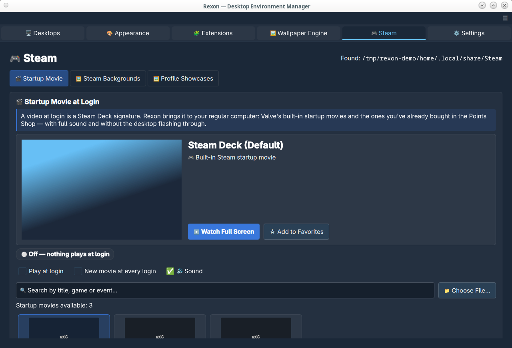
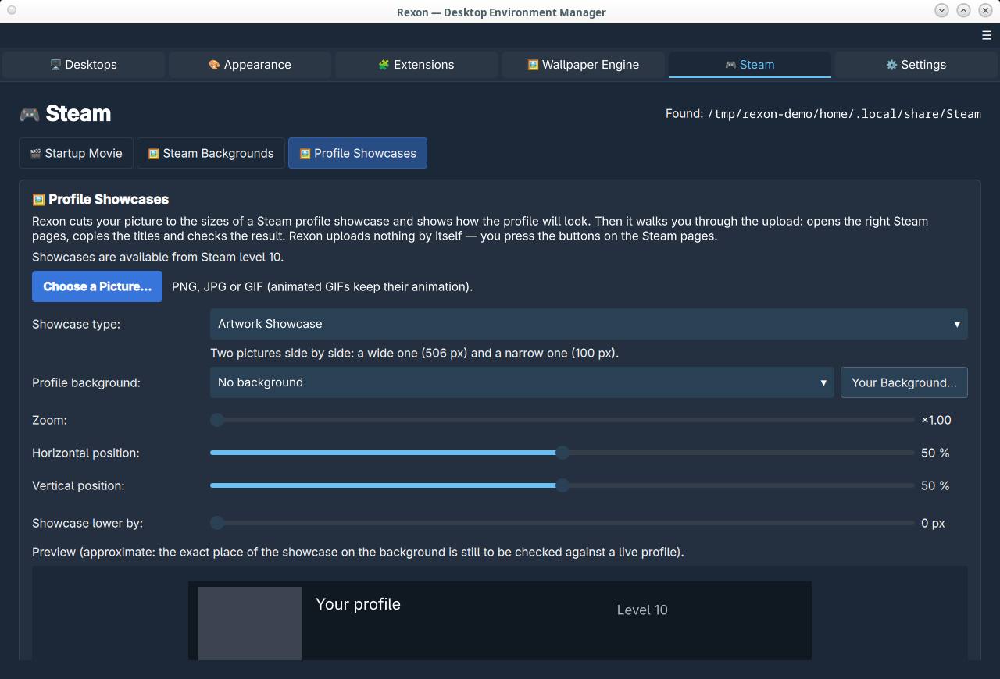

English | [Русский](../ru/steam.md) | [Deutsch](../de/steam.md) | [简体中文](../zh-CN/steam.md) | [Français](../fr/steam.md)

# Steam

This tab connects your desktop with Steam: a startup movie when you log in,
like on the Steam Deck, your Steam profile backgrounds as wallpapers, and a
helper that prepares a picture for a Steam profile showcase.

The tab needs Steam installed. In the top right corner Rexon shows where it
found the Steam folder, or "Steam not found — install Steam to use startup
movies and backgrounds".

At the top are four sub-tabs: **🎬 Startup Movie**, **🖼️ Steam
Backgrounds**, **🖼️ Profile Showcases** and **🌙 Screensaver**.

## Startup movie at login

A video at login is a Steam Deck signature. Rexon brings it to your regular
computer: Valve's built-in startup movies and the ones you've already bought
in the Points Shop — with full sound and without the desktop flashing
through.

What's on the screen:

- A **large preview** of the selected movie, its name and where it comes
  from: "Built into Steam", the Points Shop or "Your own file".
- **▶️ Watch Full Screen** — play the movie right now, exactly as it will look
  at login.
- **☆ Add to Favorites** — star the movie.
- A status line under the preview: "⚪ Off — nothing plays at login" or
  "✅ Ready: the next login plays "…"".
- The check boxes **Play at login**, **New movie at every login** and
  **🔊 Sound**.
- Search by title, game or event, and **📁 Choose File…** to pick your own
  video (webm, mp4, mkv).
- Below, all movies found, as cards.

*The screenshots show demo movies; you will see the startup movies from your
own Steam.*

### How to turn on the startup movie

1. Open **Steam** → **🎬 Startup Movie**.
2. Click a movie card — it shows up in the large preview. To use your own
   video, press **📁 Choose File…**.
3. If you like, check it with **▶️ Watch Full Screen**.
4. Tick **Play at login**. Under the preview you'll see "✅ Ready: the next
   login plays "…"".
5. For a new movie every time, tick **New movie at every login**. If at least
   two movies are starred, only those take turns; otherwise all found ones do.

To turn the startup movie off, untick **Play at login**.

## Steam Backgrounds

Steam profile backgrounds from your inventory as desktop wallpapers: static
ones as a picture, animated ones as live wallpapers.

*The screenshot shows a computer where nobody has logged in to Steam yet.
After you log in, your backgrounds appear here.*

What you need:

- log in to the Steam client on this computer at least once;
- make your inventory public in Steam's privacy settings.

### How to apply a profile background

1. Open **Steam** → **🖼️ Steam Backgrounds** and wait for your inventory to
   load.
2. Find a background with the search field or the **All / Still / Animated**
   switch. The background currently on your profile is marked "🎮 equipped".
   Flip pages with **‹ Prev** and **Next ›**.
3. Press **"Apply"** on the card. An animated background becomes a video
   wallpaper; the **🔊 Live wallpaper sound** check box decides whether it
   has sound.

## Profile Showcases

Rexon cuts your picture to the sizes of a Steam profile showcase and shows
how the profile will look. Then it walks you through the upload: opens the
right Steam pages, copies the titles and checks the result. Rexon uploads
nothing by itself — you press the buttons on the Steam pages.

Showcases are available from Steam level 10.

### How to make a showcase

1. Press **"Choose a Picture…"** — PNG, JPG or GIF work (an animated GIF
   keeps its animation).
2. Choose the **Showcase type**: **Artwork Showcase** (two pictures side by
   side: a wide one and a narrow one) or **Featured Artwork Showcase** (one
   wide picture).
3. For an accurate preview pick a **Profile background** — one of your Steam
   backgrounds or **"Your Background…"**. Fit the frame with the **Zoom**,
   **Horizontal position** and **Vertical position** sliders.
4. Press **"Save Parts"**. The files go to the "Pictures/Rexon/steam-showcase"
   folder; **"Open Folder"** opens it.
5. Follow the three steps that appear below:
   - **Step 1. Upload the parts** — **"Open the upload page"** opens the Steam
     page and the folder with the parts. Upload the parts one by one, the
     main one first; **"Copy the title"** copies the title for each. Leave
     visibility "Public". After each upload tick **"Uploaded"** here — Rexon
     remembers where you stopped.
   - **Step 2. Put them into the showcase** — **"Open the profile editor"**,
     choose the showcase, put the parts into their slots, save and tick
     **"Done — the parts are in the showcase"**.
   - **Step 3. Check** — **"Check my profile"**: Rexon reads your public
     profile page and compares it with your parts. The profile has to be
     public.

Tick "I certify that I created this piece of art" on the Steam page only if
the picture is really yours.

## Screensaver

Rexon makes a screensaver for Steam Big Picture: Steam shows it when your
Steam Deck, Steam Machine, TV or computer is idle for a while. It shows the
artwork of your recently played games and your screenshots, or a bouncing
logo. Rexon only puts the screensaver into the Steam folder — you switch it
on yourself in the Steam settings.

What's on screen:

- The status line: "⚪ Not installed yet" or "✅ Installed — … pictures".
- **Show**: **Slideshow** (artwork of your recent games and your screenshots
  take turns) or **Bouncing logo**.
- For the slideshow — the **Game artwork** and **My screenshots** checkboxes
  and the **Next picture every** slider (4 to 60 seconds). Below them Rexon
  says how many pictures it found in your Steam.
- For the bouncing logo — **Logo**: **Rexon logo** (changes colour every
  time it hits an edge) or **Logos of your games**.
- The **Show the clock** checkbox.

### How to set up the screensaver

1. Open **Steam** → **🌙 Screensaver** and choose what to show.
2. Press **"Install Screensaver"**. After a few seconds the status line says
   "✅ Installed". **"👁️ Preview"** opens the screensaver in your browser.
3. Switch it on in Steam: in Steam Big Picture open Settings →
   Customization → Screensaver and choose "Rexon (User Created)".

Played new games or took new screenshots? Press **"Update Screensaver"** and
Rexon collects the pictures again. The same button applies changed
settings. To take the screensaver out of Steam, press **"Remove"** and then
**"Click again to remove"**.

## If something goes wrong

- **"Steam not found…".** Install Steam and start it at least once.
- **"No startup movies found".** Steam isn't installed or the movies haven't
  been downloaded yet. You can pick your own video with **📁 Choose File…**.
- **"Choose a startup movie first".** Click a movie card first, then tick
  **Play at login** or press **Watch Full Screen**.
- **"mpv isn't installed (it's needed for playback)".** Install the mpv
  program from your distribution.
- **"Taking turns needs at least two videos".** **New movie at every login**
  works when there is more than one movie.
- **"Couldn't find your Steam account (no userdata folder)".** Log in to the
  Steam client on this computer.
- **Backgrounds don't load.** Make your inventory public in Steam's privacy
  settings and press **"Retry"**.
- **The profile check says "The profile is private — there is nothing to
  read".** In Steam open Edit Profile → Privacy Settings and make your
  profile public.
- **The Rexon screensaver isn't in Steam's list.** Close Steam completely
  and start it again.
