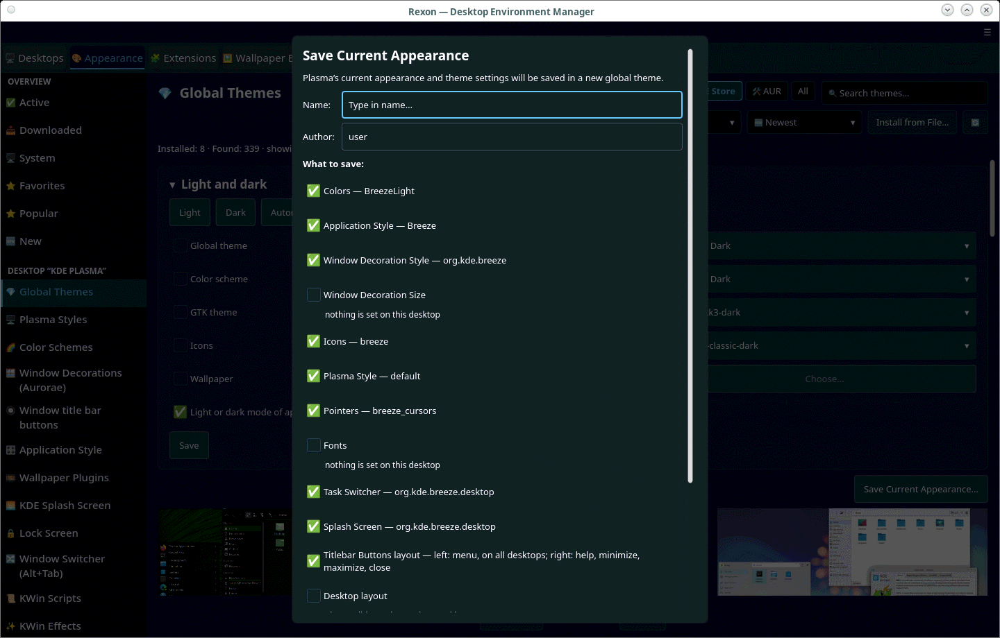

[English](../en/appearance.md) | [Русский](../ru/appearance.md) | [Deutsch](../de/appearance.md) | [简体中文](../zh-CN/appearance.md) | [Français](../fr/appearance.md) | Español

# Apariencia

Aquí se cambia el aspecto del ordenador: temas, colores, iconos, cursores,
tipos de letra, decoración de ventanas, animaciones, pantalla de inicio de
sesión y pantalla de arranque. Rexon solo muestra lo que de verdad funciona
en tu escritorio y te dice claramente a qué afectará cada sección: al propio
escritorio, a todas las aplicaciones o solo a algunas. Los temas nuevos se
pueden sacar de la KDE Store, del AUR o de Cinnamon Spices, o instalar desde
un archivo que ya tengas en el ordenador.

## Cómo está organizada la pestaña

A la izquierda está la barra lateral con las secciones; a la derecha, el
contenido de la sección elegida. Encima del contenido:

- **Buscar** — busca por nombre, autor y etiquetas.
- **Tienda:** — de dónde sacar los temas nuevos: **KDE Store**, **AUR** o
  **Todo** (los dos en una sola lista). Las secciones de Cinnamon usan en su
  lugar el catálogo de Cinnamon Spices, el mismo que en los ajustes del
  propio Cinnamon.
- **Entorno actual:** — para qué escritorio mostrar la apariencia. Normalmente
  se detecta solo a partir de la sesión actual. Puedes elegir otro
  escritorio, por ejemplo para preparar con antelación los temas de un
  escritorio al que piensas cambiarte. Los escritorios en mosaico (Hyprland,
  Sway, niri) están agrupados en un solo elemento: tienen el mismo conjunto
  de temas.
- **Ordenación** — «🆕 Novedades», «⬇️ Descargas», «⭐ Valoración»,
  «🔤 Alfabético».
- **Instalar desde archivo…** — instalar un tema que ya está en el ordenador.
- **🔄 Recargar el catálogo** — volver a cargar la lista.

En cada sección aparecen primero los temas ya instalados y, debajo, los
artículos de la tienda. Abajo están los botones «← Atrás» y «Adelante →» para
pasar de página.

### Vista general

El primer grupo de la barra lateral es «Vista general». Estas secciones no
están ligadas a un solo tipo de apariencia:

- **Activos** — todo lo que está activado ahora mismo: tema, iconos, cursor,
  pantalla de arranque, efectos de ventanas, etc.
- **Descargados** — lo que has instalado tú.
- **Del sistema** — lo que vino con el sistema y con los paquetes.
- **Favoritos** — los temas marcados con el botón «☆ Favorito».
- **Populares** y **Nuevos** — el escaparate de la tienda con lo más
  descargado para tu escritorio: iconos, cursores, temas GTK, fondos de
  pantalla y demás.

### Grupos de secciones

El resto de secciones está repartido en grupos. El título del grupo responde
a la pregunta «¿a qué afectará esto?»:

- **Escritorio «…»** — la apariencia propia del escritorio elegido en el
  campo «Entorno actual».
- **Para todas las aplicaciones** — lo que usan todas las aplicaciones:
  iconos, cursores, temas GTK, tipos de letra, sonidos, fondos de pantalla.
- **Aplicaciones Qt y KDE** — aparece fuera de KDE y LXQt. Aquí están los
  colores y el estilo de aplicaciones como VLC, qBittorrent, Krita o Dolphin.
  El escritorio en sí no cambia.
- **Widgets del escritorio** — widgets de Plasma, desklets de Cinnamon y
  widgets de Conky (reloj, tiempo, sensores del sistema; Conky funciona en
  cualquier escritorio).
- **Sistema: arranque e inicio de sesión** — la pantalla de inicio de sesión
  y la pantalla que se ve al encender el ordenador. Son comunes a todos los
  escritorios de este ordenador.

Si no hay sección para tu escritorio, Rexon no la muestra. Y si abres una
sección que no funciona en el escritorio elegido, en lugar de una estantería
vacía verás una explicación de por qué y el consejo de elegir otra sección a
la izquierda.

### Mosaico del tema

Cada tema tiene un mosaico con una imagen, un nombre y botones:

- **Instalar** — descargar e instalar el tema desde la tienda;
- **🎨 Aplicar** — activar un tema ya descargado;
- **✅ Aplicado** — el tema está activo ahora (al pulsarlo se vuelve a
  aplicar);
- **▶️ Activar** / **⏸️ Desactivar** — en los complementos: efectos y scripts
  de KWin, extensiones y applets;
- **▶️ Iniciar** / **⏹️ Detener** — en los widgets de Conky;
- **☆ Favorito** — marcar el tema;
- **🗑️** — eliminar.

Al hacer clic en la imagen se abre la página del tema: capturas de pantalla
(las flechas ◀️ ▶️ pasan de una a otra y un clic abre la imagen a pantalla
completa), descripción, valoración, número de descargas, comentarios y los
botones **🌐 Abrir en el sitio web** y **🔗 Copiar enlace**. Para volver,
**← Volver al catálogo**.

## Secciones

### Temas globales

Un tema global es un conjunto listo de todo a la vez: colores, estilo de las
aplicaciones, decoración de ventanas, iconos, cursores, pantalla de
bienvenida y a veces la disposición de los paneles. Encima de los mosaicos
están el botón **Guardar la apariencia actual…** y el bloque **Claro y
oscuro** (más abajo se explica).

Pulsa «🎨 Aplicar» en un tema y se abrirá la ventana «¿Aplicar «…»?». En ella
se ve qué instalará exactamente el tema. El botón **Elegir los componentes de
la apariencia…** despliega la lista detallada: puedes desmarcar lo que no
quieras cambiar.

El elemento **Disposición del escritorio y de los widgets** está desactivado
por defecto. Si lo activas, Rexon te avisará: la disposición eliminará los
escritorios, paneles, docks y widgets actuales y los sustituirá por los que
define el tema.

Los temas globales están hechos para KDE Plasma, pero Rexon sabe aplicarlos
también en otros escritorios: por partes, solo lo que existe en ese
escritorio: colores (para las aplicaciones Qt), estilo de las aplicaciones,
iconos, cursores, tipos de letra y botones de la barra de título. Lo que solo
existe en Plasma (paneles, estilo de Plasma, pantalla de bienvenida de
Plasma) aparece desactivado en la lista, con la explicación al lado.

### Colores: esquemas de color, color de acento, claro y oscuro

En KDE la sección se llama **Esquemas de color**; en otros escritorios,
**Colores de las aplicaciones Qt** (allí el esquema solo colorea las
aplicaciones Qt y KDE). Encima de los mosaicos hay un selector **Vista:** —
«Todos», «Claros», «Oscuros».

**Color de acento** — el color de la selección, de las casillas y de los
botones activos. Opciones:

- **Del esquema de color** (o **Como en el tema** en otros escritorios) — el
  que define el esquema;
- **Del fondo de pantalla** — el color se toma de la imagen del escritorio.
  Rexon lo actualiza cuando él mismo cambia el fondo; si el fondo se ha
  cambiado sin pasar por Rexon, vuelve a pulsar «Del fondo de pantalla»;
- **Color personalizado** — uno de los círculos predefinidos o cualquiera con
  **Elegir color…**.

Debajo de los botones se indica quién recibirá el color en tu escritorio. Por
ejemplo, GNOME solo tiene nueve colores de acento, y las aplicaciones GTK 4
recibirán el más cercano. El botón **Restaurar como estaba** devuelve el color
que había antes de Rexon.

**Claro y oscuro** — parejas de temas para el día y la noche. El bloque está
en las secciones «Temas globales» y «Esquemas de color» en KDE, y en
«Esquemas de color» y «Temas GTK» en otros escritorios.

1. Marca las partes que quieres cambiar: tema global (solo KDE), esquema de
   color, tema GTK, iconos, fondo de pantalla.
2. Para cada una, elige la variante clara y la oscura.
3. Pulsa **Claro**, **Oscuro** o **Automático**. En el modo «Automático»
   elige **Del atardecer al amanecer** (la ubicación se determina por la zona
   horaria o se introduce con latitud y longitud) o **Por horario** —
   «Claro desde las» y «Oscuro desde las».
4. Pulsa **Guardar**.

La casilla **Modo claro u oscuro de las aplicaciones** cambia además el modo
de las aplicaciones que saben seguir al sistema. En el título del bloque
plegado se ve lo que está activo, por ejemplo «Claro y oscuro: programado
07:00–19:00».

Un esquema de color instalado tiene en su página los botones **Editar…** (los
colores principales del esquema; si está instalado el editor de KDE, se abre
ese) y **Crear a partir de…** (un esquema nuevo a partir de este; el original
se queda como está).

### Decoración de ventanas y botones de la barra de título

Cada entorno tiene su propia decoración de ventanas: en KDE es **Ventanas
(Aurorae)**; en XFCE, MATE y LXQt (Openbox, labwc), **Decoración de
ventanas**. En Cinnamon la decoración la dibuja el tema GTK.

Los botones de la barra de título se configuran ahí mismo, en la sección de
decoración: con el botón **⚙️ Ajustes** de su cabecera (como la pestaña
«Botones de la barra de título» del módulo «Decoración de ventanas» de KDE);
para volver, **←  Volver al catálogo**. En Cinnamon es la sección **Tema de
Cinnamon**; en los escritorios sin sección de decoración propia (GNOME,
Budgie, Pantheon, COSMIC, Deepin, en mosaico), la sección **Temas GTK**: allí
las barras de título las dibuja el tema GTK o las propias aplicaciones GTK.
En los ajustes:

- **Posición de los botones:** — «A la derecha (como en Windows)» o «A la
  izquierda (como en macOS)»;
- los botones se pueden arrastrar entre la estantería y la franja «Barra de
  título»; sin ratón, elige un botón y pulsa «Más a la izquierda», «Más a la
  derecha», «Quitar de la barra de título», «Añadir a la izquierda», «Añadir a
  la derecha»;
- **Tamaño del borde de la ventana:** — de «Sin bordes» a «Colosales»;
- en KDE hay además tres casillas: cerrar las ventanas con doble clic en el
  botón de menú, mostrar los consejos de los botones y mostrar siempre el
  botón «Ocultar de capturas y grabaciones de pantalla»;
- **Predeterminados** — volver a la disposición original.

Si el gestor de ventanas de tu escritorio no tiene algún botón, Rexon te lo
dirá.

### Estilo de las aplicaciones

**Estilo de las aplicaciones** (fuera de KDE y LXQt, **Estilo de las
aplicaciones Qt (Kvantum)**) muestra en una sola cuadrícula los estilos de Qt
y los temas de Kvantum. El selector encima de la cuadrícula: «Todos»,
«Estilos de Qt», «Kvantum». Los temas nuevos de Kvantum salen de la KDE
Store; los estilos de Qt ya hechos (Darkly, Lightly, Klassy), del AUR.

### Iconos, cursores, notificación de inicio

- **Iconos** y **Cursores** — temas de iconos y del puntero. El botón
  **⚙️ Ajustes** de la cabecera de la sección «Iconos» abre ahí mismo los
  iconos en los menús y en los botones y las etiquetas de las barras de
  herramientas de las aplicaciones («Solo iconos», «Solo texto», «Texto junto
  a los iconos», «Texto debajo de los iconos»); **←  Volver al catálogo**
  vuelve a los temas. En la sección de cursores hay un campo **Tamaño:** — el
  tamaño del puntero en píxeles. Rexon lo aplica en los ajustes del
  escritorio, en las aplicaciones GTK y Qt y en la configuración de sway, niri
  o Hyprland.
- **Notificación de inicio** (solo KDE) — el botón **⚙️ Ajustes** de la
  cabecera de la sección «Cursores»: cómo indican el puntero y la barra de
  tareas que una aplicación se está iniciando: puntero «Ninguno», «Estático»,
  «Parpadeante» o «Rebotando», la animación del botón en la barra de tareas y
  al cabo de cuánto tiempo detenerla. Donde el escritorio no tiene este
  ajuste, tampoco hay botón.

### Temas GTK

Temas de las aplicaciones GTK (Firefox, GIMP, la mayoría de las aplicaciones
de GNOME, XFCE, MATE, Cinnamon). En los escritorios GNOME, Cinnamon, MATE y
XFCE hay además secciones propias: **Tema de la shell de GNOME**, **Tema de
Cinnamon**, **Tema de LXQt** y otras. En los escritorios sin animaciones de
ventanas, el botón **⚙️ Ajustes** de la cabecera de la sección abre la
casilla **Sin animaciones**: las animaciones dentro de las aplicaciones.

### Tipos de letra y gestión de tipos de letra

La sección **Tipos de letra** (con el icono 🔤 en el grupo «Para todas las
aplicaciones») contiene tipos de letra de la KDE Store. El botón
**⚙️ Ajustes** de su cabecera abre ahí mismo los tipos de letra del sistema:
los de la interfaz, el terminal, las etiquetas pequeñas, las barras de
herramientas, los menús y los títulos de ventana; **←  Volver al catálogo**
vuelve a la tienda. Pulsa el botón del tipo de letra que quieras para elegir
la familia y el tamaño, o **🔤 Cambiar todos los tipos de letra…** para poner
uno solo a todos a la vez. Más abajo están **Suavizado de texto** (suavizado,
renderizado subpíxel, hinting) y **Forzar los DPI de los tipos de letra**.

El botón **🗂️ Gestionar tipos de letra…** abre la lista de todos los tipos de
letra del ordenador:

- una muestra de cada tipo de letra y su tabla de caracteres;
- **➕ Instalar desde archivo…** — para ti o para todos los usuarios (en el
  segundo caso Rexon te pedirá la contraseña de administrador);
- **Eliminar** — solo los tipos de letra que has instalado tú. Los del
  sistema solo se pueden ver;
- **Desactivar** / **Activar** — ocultar un tipo de letra a todas las
  aplicaciones sin borrar el archivo;
- **🔍 Buscar duplicados** — estilos que están instalados en varios
  archivos;
- grupos de tipos de letra propios (**➕ Nuevo grupo…**), activar y desactivar
  un grupo entero, exportar un grupo a un archivo ZIP.

### Fondos de pantalla y sonidos

- **Fondos de pantalla HD** — imágenes para el escritorio sacadas de la
  tienda. El botón **⚙️ Ajustes** de la cabecera de la sección es
  **🌫️ Desenfoque del fondo de pantalla**: desenfoca el fondo de imagen para
  que los iconos y las ventanas de encima se lean mejor (control deslizante
  **Intensidad**, **Desenfocar el fondo de pantalla**, **Quitar el
  desenfoque**); el original se conserva. Si Razer Axon está en el equipo
  (con Wine), el campo **Tienda:** también ofrece **Razer Axon** — los fondos
  de pantalla descargados en él: búsqueda por títulos o etiquetas, orden y
  filtros, como en el propio Axon; clic derecho en una miniatura —
  **Aplicar** (en todas las pantallas), **Abrir la ubicación del archivo** y
  **Más información**. Entonces **⚙️ Ajustes** tiene además el bloque
  **Razer Axon**: **Preparar los fondos de pantalla por adelantado** y
  **Restaurar las descripciones originales**.
- **Plugins de fondos de pantalla** (solo KDE) — fondos de pantalla animados
  de Plasma.
- **Sonidos** — temas de sonido. Puedes escuchar los sonidos de un tema antes
  de instalarlo (**🔊 Escuchar antes de instalar**): el tema se descarga en una
  carpeta temporal y no se instala nada. Si los sonidos del sistema están
  desactivados, Rexon te ofrecerá **Activar**. El botón **⚙️ Ajustes** de
  la cabecera de la sección es **🔔 Sonidos de eventos** (el tema de sonido del
  escritorio, activar los sonidos de eventos, probar el sonido) y
  **🔊 Sonidos ambientales** (**➕ Añadir archivo…** reproduce un sonido en
  bucle, volumen, **⏹️ Detener todos**, lista de lo que suena). Los sonidos
  ambientales siguen sonando después de salir de la sección.

Los fondos de pantalla en movimiento están en la pestaña Wallpaper Engine.

### Animaciones y efectos de pantalla

Estas secciones son las últimas del grupo del escritorio.

- **Animaciones** — **Sin animaciones** o **Velocidad de las animaciones:**
  de «Lenta» a «Rápida», además de la elección de efectos: abrir y cerrar
  ventanas, minimizar, cambiar de escritorio, ventanas emergentes, etc. Donde
  el gestor de ventanas no tiene animaciones de ventanas (MATE, Xfce, LXQt,
  Deepin, sway y otros en mosaico, salvo Hyprland y niri), la sección no
  existe: la casilla **Sin animaciones** para las aplicaciones está en el
  botón **⚙️ Ajustes** de la sección «Temas GTK».
- **Efectos de pantalla** — la pantalla como un viejo monitor de tubo, una
  cinta de vídeo gastada o una película de cine: «Líneas de barrido», «Tubo de
  rayos catódicos», «Monitor verde», «Monitor ámbar», «Cinta de vídeo», «TV
  analógica», «Película de cine», «Blanco y negro». Controles deslizantes
  **Intensidad:** y **Velocidad de movimiento:**. Cómo funciona la sección en
  tu escritorio y qué hace falta para ello se indica arriba (la línea
  «Necesita: …»). Donde los efectos no se pueden activar de ninguna manera
  (sway, river, labwc, niri, Budgie, Deepin), la sección no existe; en MATE,
  Xfce y LXQt no aparece en la sesión Wayland: allí los efectos solo
  funcionan en X11.

### Widgets

- **Widgets** (KDE) — widgets de Plasma de la tienda.
- **Desklets de Cinnamon**, **Applets de Cinnamon**, **Extensiones de
  Cinnamon**, **Acciones de Nemo** — de Cinnamon Spices.
- **Widgets de Conky** — reloj, tiempo, sensores del sistema. Su botón es
  **▶️ Iniciar** / **⏹️ Detener**, y en la página del widget hay una casilla
  **Iniciar al iniciar sesión**.

### Pantalla de inicio de sesión, pantalla de bloqueo, pantallas de bienvenida

- **Pantalla de inicio de sesión** — temas de SDDM. Encima de ellos está el
  bloque **Gestor de inicio de sesión**: qué programa muestra la pantalla de
  inicio de sesión y cuál será el principal (el nuevo principal aparecerá
  tras reiniciar; la sesión actual no se interrumpe). Si la pantalla de
  inicio de sesión la dibuja Plasma Login Manager, no tiene temas de
  terceros: Rexon te ofrecerá **Abrir los ajustes de la pantalla de inicio de
  sesión**.
- **Pantalla de arranque (Plymouth)** — lo que se ve al encender el
  ordenador, antes de iniciar sesión.
- **Pantalla de bloqueo** (KDE y Deepin) — dos modos: **🔒 Temas completos**
  (solo se aplica la parte del tema que se encarga del bloqueo) y
  **🖼️ Fondos de bloqueo** (una imagen de fondo; el aspecto de la pantalla no
  cambia).
- **Pantalla de bienvenida de KDE** — la pantalla que se ve al iniciar sesión
  en Plasma.

La pantalla de inicio de sesión y la pantalla de arranque son del sistema: al
instalarlas, Rexon te pedirá la contraseña de administrador. En SteamOS
(Steam Deck, Steam Machine) estas secciones están cerradas, y Rexon explica
enseguida por qué.

### Secciones de escritorios concretos

- KDE: **Estilos de Plasma**, **Selector de ventanas (Alt+Tab)**, **Scripts
  de KWin**, **Efectos de KWin** — efectos nuevos de la KDE Store; el botón
  **⚙️ Ajustes** de la parte superior de la sección activa y configura los
  efectos que ya trae KWin («Lámpara mágica», transparencia, desenfoque y
  otros), con búsqueda y un botón «Configurar…» en cada uno.
- GNOME: **Tema de la shell de GNOME**, **Extensiones de GNOME**.
- MATE: **Disposición del panel** — disposiciones de panel listas con un solo
  botón.

## Cómo hacerlo

### Aplicar un tema global por partes

1. Abre **Temas globales**.
2. Pulsa **🎨 Aplicar** en el tema que quieras (o **Instalar**, si aún no lo
   tienes, y después «Aplicar»).
3. En la ventana, pulsa **Elegir los componentes de la apariencia…**.
4. Desmarca lo que no quieras cambiar, por ejemplo «Iconos» o «Cursores».
5. Pulsa **Aplicar**.

En otros escritorios la ventana se abre directamente en modo detallado, y los
elementos desactivados explican por qué no se trasladan aquí.

### Guardar la apariencia actual

1. Abre **Temas globales**.
2. Pulsa **Guardar la apariencia actual…**.
3. Escribe el **Nombre:** (y, si quieres, el **Autor:**).
4. En la lista **Qué guardar:** deja marcado lo que necesites.
5. Elige la imagen del mosaico: **Hacer una captura de pantalla…**, **Elegir
   una imagen…** o **Mosaico con los colores del tema**.
6. Pulsa **Guardar**.

El tema nuevo aparecerá enseguida entre los mosaicos. Puedes aplicarlo aquí o
en cualquier otro escritorio —entero o por partes—, y también en Plasma.

### Cambiar los colores, el acento, el modo claro y oscuro

1. Abre **Esquemas de color** (o **Colores de las aplicaciones Qt**).
2. Pulsa **🎨 Aplicar** en el esquema que quieras.
3. En el bloque **Color de acento**, elige **Del esquema de color**, **Del
   fondo de pantalla** o **Color personalizado**.
4. Para que la apariencia cambie sola de día y de noche, despliega **Claro y
   oscuro**, elige las parejas de temas y pulsa **Automático** y **Guardar**.

### Instalar un tema desde la tienda, desde el AUR o desde un archivo

**Desde la tienda:**

1. Abre la sección que quieras, por ejemplo **Iconos**.
2. En el campo **Tienda:** deja **KDE Store**.
3. Busca el tema con la búsqueda o en la lista y pulsa **Instalar**.
4. Cuando termine la instalación, pulsa **🎨 Aplicar**.

**Desde el AUR** (distribuciones basadas en Arch):

1. En el campo **Tienda:** elige **AUR** (o **Todo**).
2. Escribe en la búsqueda al menos unas cuantas letras.
3. Abre la página del paquete. Rexon muestra si todo está en orden con él: si
   el paquete está abandonado, si está marcado como desactualizado, si ha
   cambiado el mantenedor, si tiene pocos votos. El botón **📄 Mostrar
   PKGBUILD** muestra la receta de compilación.
4. Pulsa **Instalar**. El paquete se compila desde el código fuente, y eso
   puede llevar un rato. Para compilarlo hace falta paru o yay.

**Desde un archivo:**

1. Pulsa **Instalar desde archivo…**.
2. Pulsa **Elegir archivos…** o **Elegir carpeta…**.
3. Indica un archivo comprimido, una carpeta o archivos sueltos: tipos de
   letra, cursores e iconos de Windows, esquemas de color, fondos de
   pantalla.

Rexon detectará por sí mismo qué es y lo instalará en la sección adecuada. Si
el tema cambia una pantalla del sistema (inicio de sesión, arranque), Rexon te
pedirá que lo instales desde esa sección: allí se te pedirá la contraseña de
administrador.

### Restaurar como estaba

- Después de aplicar un tema, encima de los mosaicos aparece la línea
  **«Restaurar como estaba antes de «…»»**: antes de aplicarlo, Rexon guardó
  lo que había. Las aplicaciones ya abiertas puede que solo muestren la
  restauración después de reiniciarlas o de volver a iniciar sesión.
- Fuera de Plasma, los esquemas de color tienen **Restaurar los colores como
  estaban**.
- El color de acento y los efectos de pantalla tienen **Restaurar como
  estaba**.
- En las secciones con el botón **Predeterminados** («Botones de la barra de
  título», «Notificación de inicio», «Animaciones», etc.), este devuelve los
  ajustes originales.
- Un tema eliminado con el botón 🗑️ al principio solo se marca: abajo se
  queda unos segundos una línea con el botón **Deshacer**.

### Activar un efecto de pantalla

1. Abre **Efectos de pantalla**.
2. Elige un efecto, por ejemplo **Tubo de rayos catódicos**.
3. Ajusta **Intensidad:** y **Velocidad de movimiento:**. Los efectos en
   movimiento cargan la tarjeta gráfica todo el tiempo; en la marca
   **Inmóvil** la imagen no cambia y casi no cuesta nada.
4. Pulsa **Aplicar**.
5. Aparecerá la pregunta «¿Mantener este efecto? Si no, la pantalla volverá a
   como estaba en 15 s.». Pulsa **Mantener**. Si la pantalla se ha quedado
   oscura o no se entiende nada, no pulses nada: a los 15 segundos todo
   volverá a como estaba. El botón **Deshacer** lo devuelve al momento.

Para desactivar el efecto, elige **Desactivado** y pulsa «Aplicar», o pulsa
**Restaurar como estaba**.

## Si algo sale mal

- **La sección no aparece en la barra lateral.** Significa que no funciona en
  el escritorio elegido. Revisa el campo **Entorno actual:**; puede que esté
  elegido otro escritorio.
- **El tema se ha aplicado, pero la aplicación se ve como antes.** Las
  aplicaciones ya abiertas a menudo solo cogen la nueva apariencia después de
  reiniciarlas o de volver a iniciar sesión.
- **El esquema de color no llega a las aplicaciones Qt fuera de KDE.** Rexon
  te avisará si no está instalado qt6ct: sin él, solo las aplicaciones de KDE
  (Dolphin, Kate, Okular) recibirán los colores.
- **«La KDE Store no responde ahora mismo».** Es un fallo del lado de la
  tienda; inténtalo más tarde o pulsa **🔄 Recargar el catálogo**.
- **No se instala desde el AUR.** Hace falta un compilador de paquetes, paru
  o yay. La búsqueda en el AUR empieza a funcionar a partir de unas cuantas
  letras.
- **«El tema tiene el formato antiguo de Plasma 5».** Plasma 6 no aplica un
  tema así: hace falta una versión del tema para Plasma 6.
- **No se puede eliminar el tema activo.** Activa otro primero. Rexon tampoco
  elimina los temas del sistema (de paquetes): se van junto con su paquete.
- **Algo va mal después de un efecto de pantalla.** No pulses nada durante 15
  segundos: el efecto se quitará solo. Más tarde, **Restaurar como estaba** en
  la sección «Efectos de pantalla».
- **El tema de la pantalla de inicio de sesión no tiene efecto.** Los temas de
  esta sección son para SDDM. Si la pantalla de inicio de sesión la muestra
  otro programa, Rexon lo indicará encima de los mosaicos; el principal se
  puede elegir en el bloque **Gestor de inicio de sesión**.
- **Los paneles se han estropeado después de un tema global.** Solo pasa si
  estaba activado el elemento «Disposición del escritorio y de los widgets».
  Pulsa **Restaurar como estaba antes de «…»**; en KDE Plasma, MATE y XFCE
  puedes hacer antes una copia del panel en la pestaña «Escritorios»
  («🛟 Guardar el panel»).
