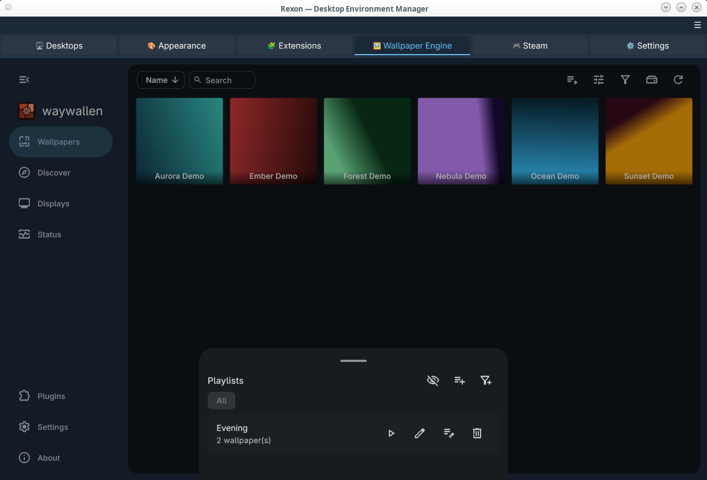

[English](../en/wallpaper-engine.md) | [Русский](../ru/wallpaper-engine.md) | [Deutsch](../de/wallpaper-engine.md) | [简体中文](../zh-CN/wallpaper-engine.md) | [Français](../fr/wallpaper-engine.md) | Español

# Wallpaper Engine

Aquí están los fondos de pantalla animados: escenas, vídeos y fondos web de
Wallpaper Engine, además de imágenes del catálogo gratuito Wallhaven. Puedes
poner un fondo en todo el escritorio o en un monitor concreto, reunirlos en
una lista de reproducción que cambia el fondo sola cada cierto tiempo y
suscribirte a fondos nuevos del Workshop de Steam directamente desde Rexon.

La pestaña la dibuja el motor de fondos de pantalla animados [waywallen](https://github.com/hypengw/waywallen):
sus ventanas están integradas en Rexon tal cual, por eso el aspecto y los
textos de aquí son un poco distintos de los de las demás pestañas. Rexon le
añade sus propias indicaciones y lleva él mismo los fondos a tu escritorio.

> Para usar fondos del Workshop de Steam tienes que haber **comprado
> Wallpaper Engine en Steam**: el Workshop solo entrega sus fondos a quienes
> lo tienen. Sin comprarlo funcionan los vídeos y las imágenes de tus propias
> carpetas y el catálogo Wallhaven.

## Qué hay en la pestaña

A la izquierda está el panel de secciones (el botón «☰» de arriba lo reduce
a iconos):

- **Fondos de pantalla**: tu biblioteca, todo lo que hay en el ordenador.
- **Descubrir**: los catálogos en línea, **Workshop de Steam** y **Wallhaven**.
- **Pantallas**: tus pantallas y lo que se muestra en cada una.
- **Estado**: si el motor de fondos funciona y qué está dibujando ahora.
- Abajo: **Plugins**, **Ajustes** (el comportamiento de los propios fondos) y
  **Acerca de**.

Sobre la biblioteca están la ordenación (por nombre, tamaño o fecha de
modificación), la búsqueda y, a la derecha, los botones **Listas de
reproducción**, **Personalizar** (tamaño de las tarjetas), **Filtros** (por
tipo, etiquetas o clasificación de contenido), **Gestor de bibliotecas** (qué
carpetas explorar) y **Recargar**.

## En qué escritorios funciona

Rexon elige por sí solo cómo llevar los fondos a tu escritorio; no tienes que
configurar nada:

- **KDE Plasma**: los fondos se integran en el escritorio de Plasma; los
  iconos y los clics en el escritorio funcionan como siempre.
- **Hyprland, Sway, niri, river, COSMIC, Wayfire**: los fondos los muestra el
  propio motor.
- **GNOME y Cinnamon en una sesión Wayland**: los fondos los muestra la
  extensión de Rexon. Si no aparecen, activa la extensión y vuelve a iniciar
  sesión.
- **MATE, Xfce, Cinnamon, Budgie, LXQt, LXDE, Pantheon, Deepin y otros
  escritorios en una sesión X11**: los fondos los muestra el reproductor
  propio de Rexon. Puede que aquí no estén disponibles algunas funciones del
  motor. En MATE, los iconos del escritorio se quedan por encima de los fondos
  animados si Caja admite el fondo de escritorio transparente; Rexon lo activa
  por sí solo. Si no lo admite, los iconos se ocultan mientras hay fondos
  animados (la pestaña lo avisa en una línea) y vuelven cuando los fondos se
  detienen.

En un compositor Wayland que Rexon no conozca no habrá fondos animados.

Si tu escritorio dibuja el fondo por su cuenta (por ejemplo, las shells
Noctalia o DankMaterialShell), arriba de la pestaña aparecerá una barra con
una explicación y los botones **«Ceder el fondo a Rexon»** (desactiva el
fondo de la shell) y **«Devolver a la shell»** (lo vuelve a activar con el
ajuste que tenía).

## Cómo encontrar y poner un fondo

1. Abre la pestaña **Wallpaper Engine** → sección **Fondos de pantalla**.
2. Si la biblioteca está vacía, pulsa **«Detectar bibliotecas
   automáticamente»**: Rexon encontrará la carpeta de Steam y los fondos de
   Wallpaper Engine que ya estén descargados. Puedes añadir otra carpeta con
   **Gestor de bibliotecas** → **«Añadir biblioteca»**.

   

3. Haz clic en la tarjeta de un fondo. A la derecha se abrirá el panel de
   detalles: vista previa, descripción, **Modo de relleno** (recortar,
   ajustar, estirar, centrar), rotación, volteo y las **Propiedades** que ha
   definido el autor del fondo (color, sonido, velocidad, etc.).
4. Si tienes varios monitores, el panel tiene la fila **«Aplicar a»**: elige
   un monitor o **«Todos»**.
5. Pulsa **«Aplicar»**. Rexon llevará él mismo el fondo al escritorio.

Mientras todavía no se muestra nada en el escritorio, la sección
**Pantallas** puede estar vacía y decir «Los fondos de pantalla de Wallpaper
Engine aún no se muestran en el escritorio…». Es normal: después del primer
«Aplicar», los monitores aparecerán.

## Pantallas

En la sección **Pantallas** se ve cada pantalla y el fondo que tiene. Aquí
puedes:

- cambiar el nombre de un monitor (**«Editar pantalla»**) y elegir su modo de
  relleno;
- pausar el fondo en un solo monitor (**«Pausar pantalla»**);
- unir varios monitores en un **lienzo** (**«Crear lienzo»**) para que un
  mismo fondo se extienda por todas las pantallas a la vez.

## Listas de reproducción: los fondos cambian solos

1. En la sección **Fondos de pantalla**, selecciona varias tarjetas: haz clic
   con el botón derecho del ratón (o con Ctrl pulsado, o con una pulsación
   larga).
2. Abajo aparecerá un panel: pulsa **«Nueva lista de reproducción»**, escribe
   un nombre y pulsa **«Crear»**. Para añadir fondos a una lista que ya
   existe, usa el botón **«Añadir a una lista de reproducción»**.

   

3. Abre la lista con el botón **Listas de reproducción** (a la derecha, sobre
   la biblioteca). Cada lista tiene los botones **«Reproducir lista de
   reproducción»**, **«Editar lista de reproducción»**, **«Editar fondos de
   pantalla»** y **«Eliminar lista de reproducción»**. Sobre la lista puedes
   elegir en qué monitores se reproduce (**«Todos»** incluye también los
   monitores que se conecten después).

   

4. En **«Editar lista de reproducción»**, elige el **Modo** (**Secuencial**,
   **Barajar** o **Aleatorio**) y el **Intervalo de rotación** (horas,
   minutos, segundos). Guarda con la marca de verificación de arriba.

## Workshop de Steam: suscribirse a fondos nuevos

Hace falta haber comprado Wallpaper Engine en Steam y tener el cliente de
Steam abierto.

1. Abre la sección **Descubrir** y, en la primera lista, elige **Workshop de
   Steam**.
2. Pulsa **«Iniciar sesión en Steam»** y escanea el código QR con la
   aplicación móvil de Steam. Rexon no ve ni pide tu contraseña de Steam.

   

3. Después de iniciar sesión aparecerá el catálogo. Para ordenar tienes «Más
   populares (hoy)», «Más populares (semana)», etc., «Añadidos recientemente»
   y «Mejor valorados»; también hay búsqueda y **Filtros**. La opción **«Mis
   suscripciones»** muestra aquello a lo que ya estás suscrito.
4. Abre un fondo y pulsa **«Suscribirse»**. Los archivos los descarga el
   propio cliente de Steam: déjalo abierto y el fondo aparecerá en la sección
   **Fondos de pantalla** automáticamente.
5. Puedes cancelar la suscripción en el mismo sitio (**«Cancelar
   suscripción»**) o en el panel de detalles del fondo en la biblioteca.

Los fondos marcados como 18+ están ocultos hasta que actives tú ese filtro
(Rexon te lo volverá a preguntar).

**Wallhaven** es la segunda fuente de **Descubrir**: imágenes gratuitas, sin
necesidad de iniciar sesión. Puedes descargar la imagen que te guste con el
botón **«Descargar»**.

## Ajustes de los fondos

El botón **Ajustes**, abajo en el panel de secciones, abre los ajustes del
propio motor:

- **Repetición automática**: qué hacer con los fondos cuando hay abierta
  cualquier ventana, la ventana con el foco, una ventana maximizada o a
  pantalla completa, cuando la sesión está bloqueada o cuando el equipo
  funciona con batería: nada, silenciar el sonido, pausar o detener. Así los
  juegos y las películas no comparten la tarjeta gráfica con los fondos.
- **Audio**: el volumen y «Silenciar cuando haya otras reproducciones
  activas».
- **Transición de fondo de pantalla** y su duración, **Ventanas excluidas**
  y la caché de las imágenes de la red.

## Si algo sale mal

- **«Iniciando el motor de fondos de pantalla waywallen…» dura mucho.** El
  primer inicio después de la instalación puede tardar uno o dos minutos: el
  motor se está descomprimiendo. Espera.
- **«El motor de fondos de pantalla waywallen no se ha iniciado».** Pulsa
  **«Reintentar el inicio»**. Si no sirve, mira en la sección **Estado** →
  **Registros**.
- **La biblioteca está vacía aunque has comprado fondos.** Comprueba que
  Steam ya los ha descargado (están en `steamapps/workshop/content/431960`) y
  pulsa **«Detectar bibliotecas automáticamente»** o **Recargar**. Si Steam
  está instalado en un sitio poco habitual, añade su carpeta en el **Gestor
  de bibliotecas**: hace falta la carpeta que contiene `steamapps`.
- **Me he suscrito, pero el fondo no aparece.** El cliente de Steam tiene que
  estar abierto: los fondos los descarga él, no Rexon.
- **En KDE Plasma aparece arriba un aviso sobre el módulo de fondos de
  Plasma.** Pulsa **«Instalar la versión de Rexon»**: Rexon instalará el
  módulo adecuado.
- **En GNOME o Cinnamon no se ven los fondos.** Activa la extensión de Rexon
  y vuelve a iniciar sesión.
- **El fondo lo dibuja la shell y no Rexon.** Pulsa **«Ceder el fondo a
  Rexon»** en la barra de arriba de la pestaña.
