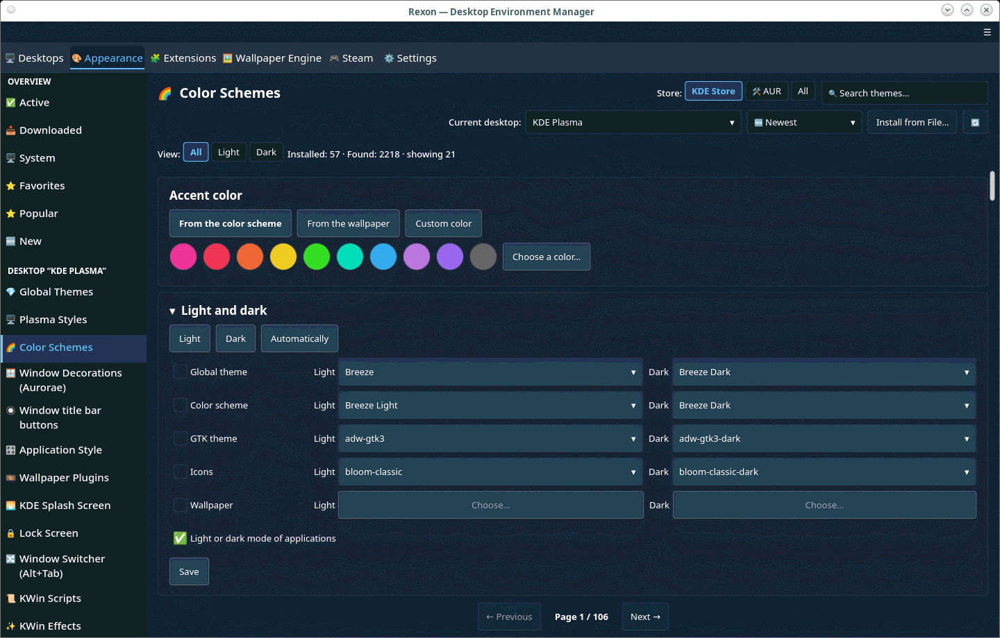

[English](../en/appearance.md) | [Русский](../ru/appearance.md) | [Deutsch](../de/appearance.md) | [简体中文](../zh-CN/appearance.md) | Français | [Español](../es/appearance.md)

# Apparence

C'est ici que l'on change l'aspect de l'ordinateur : thèmes, couleurs,
icônes, curseurs, polices, décorations de fenêtres, animations, écran de
connexion et écran d'amorçage. Rexon n'affiche que ce qui fonctionne
réellement sur votre environnement de bureau et dit clairement sur quoi
chaque section agira : sur le bureau lui-même, sur toutes les applications
ou seulement sur certaines. Les nouveaux thèmes peuvent venir du KDE Store,
de l'AUR, de Cinnamon Spices, ou d'un fichier déjà présent sur l'ordinateur.

## Organisation de l'onglet

À gauche, la barre latérale avec les sections ; à droite, le contenu de la
section choisie. Au-dessus du contenu :

- **Rechercher** — cherche par nom, auteur et étiquettes.
- **Boutique :** — d'où viennent les nouveaux thèmes : **KDE Store**,
  **AUR** ou **Tous** (les deux dans une seule liste). Les sections Cinnamon
  utilisent à la place le catalogue Cinnamon Spices, le même que dans les
  paramètres de Cinnamon.
- **Environnement actuel :** — pour quel environnement de bureau afficher
  l'apparence. En général, il est détecté tout seul d'après la session en
  cours. Vous pouvez choisir un autre bureau, par exemple pour préparer à
  l'avance les thèmes d'un bureau vers lequel vous comptez passer. Les
  bureaux en mosaïque (Hyprland, Sway, niri) sont réunis en un seul
  élément : ils ont le même ensemble de thèmes.
- **Tri** — « 🆕 Nouveautés », « ⬇️ Téléchargements », « ⭐ Mieux notés »,
  « 🔤 Alphabétique ».
- **Installer depuis un fichier…** — installer un thème déjà présent sur
  l'ordinateur.
- **🔄 Actualiser le catalogue** — recharger la liste.

Dans une section viennent d'abord les thèmes déjà installés, puis les
articles de la boutique. En bas, les boutons « ← Précédent » et
« Suivant → » permettent de changer de page.

### Vue d'ensemble

Le premier groupe de la barre latérale est « Vue d'ensemble ». Ces sections
ne sont pas liées à un seul type d'apparence :

- **Actifs** — tout ce qui est activé en ce moment : thème, icônes,
  curseur, écran d'amorçage, effets de fenêtres, etc.
- **Téléchargés** — ce que vous avez installé vous-même.
- **Système** — ce qui est arrivé avec le système et les paquets.
- **Favoris** — les thèmes marqués avec le bouton « ☆ Favori ».
- **Populaires** et **Nouveautés** — la vitrine de la boutique avec ce qui
  est le plus demandé pour votre bureau : icônes, curseurs, thèmes GTK,
  fonds d'écran et le reste.

### Groupes de sections

Les autres sections sont réparties en groupes. Le titre du groupe répond à
la question « sur quoi cela agira-t-il » :

- **Bureau « … »** — l'apparence propre du bureau choisi dans le champ
  « Environnement actuel ».
- **Pour toutes les applications** — ce que toutes les applications
  reprennent : icônes, curseurs, thèmes GTK, polices, sons, fonds d'écran.
- **Applications Qt et KDE** — apparaît hors de KDE et LXQt. On y règle les
  couleurs et le style d'applications comme VLC, qBittorrent, Krita,
  Dolphin. Le bureau lui-même ne change pas.
- **Widgets du bureau** — widgets Plasma, desklets Cinnamon et widgets
  Conky (horloge, météo, capteurs du système ; Conky fonctionne sur
  n'importe quel bureau).
- **Système : démarrage et connexion** — l'écran de connexion et l'écran
  d'amorçage à l'allumage de l'ordinateur. Ils sont communs à tous les
  environnements de bureau de cet ordinateur.

S'il n'existe pas de section pour votre bureau, Rexon ne l'affiche pas. Et
si vous ouvrez une section qui ne fonctionne pas sur le bureau choisi, vous
verrez, au lieu d'une étagère vide, une explication et le conseil de
choisir une autre section à gauche.

### Vignette d'un thème

Chaque thème a une vignette avec une image, un nom et des boutons :

- **Installer** — télécharger et installer le thème depuis la boutique ;
- **🎨 Appliquer** — activer un thème déjà téléchargé ;
- **✅ Appliqué** — le thème est actif (un clic l'applique à nouveau) ;
- **▶️ Activer** / **⏸️ Désactiver** — pour les modules : effets et
  scripts KWin, extensions et applets ;
- **▶️ Lancer** / **⏹️ Arrêter** — pour les widgets Conky ;
- **☆ Favori** — marquer le thème ;
- **🗑️** — supprimer.

Un clic sur l'image ouvre la page du thème : captures d'écran (les flèches
◀️ ▶️ les font défiler, un clic ouvre l'image en plein écran), description,
note, nombre de téléchargements, commentaires et les boutons
**🌐 Ouvrir le site** et **🔗 Copier le lien**. Pour revenir :
**← Retour au catalogue**.

## Sections

### Thèmes globaux

Un thème global est un ensemble complet prêt à l'emploi : couleurs, style
des applications, décorations de fenêtres, icônes, curseurs, écran de
démarrage et parfois disposition des panneaux. Au-dessus des vignettes se
trouvent le bouton **Enregistrer l'apparence actuelle…** et le bloc
**Clair et sombre** (voir plus bas).

Cliquez sur « 🎨 Appliquer » sur un thème : la fenêtre « Appliquer « … » ? »
s'ouvre. Elle montre ce que le thème va installer exactement. Le bouton
**Choisir les éléments à appliquer…** déploie une liste détaillée : vous
pouvez décocher ce qui ne doit pas changer.

L'élément **Disposition du bureau et des widgets** est désactivé par
défaut. Si vous l'activez, Rexon vous prévient : la disposition supprimera
les bureaux, panneaux, docks et widgets actuels et les remplacera par ceux
définis dans le thème.

Les thèmes globaux sont faits pour KDE Plasma, mais Rexon sait aussi les
appliquer sur d'autres bureaux, par morceaux, avec seulement ce qui existe
sur ce bureau : couleurs (pour les applications Qt), style des
applications, icônes, curseurs, polices et boutons de la barre de titre. Ce
qui n'existe que dans Plasma (panneaux, style Plasma, écran de démarrage
Plasma) est désactivé dans la liste, avec la raison à côté.

### Couleurs : jeux de couleurs, couleur d'accentuation, clair et sombre

Dans KDE, la section s'appelle **Jeux de couleurs** ; sur les autres
bureaux, **Couleurs des applications Qt** (le jeu n'y colore que les
applications Qt et KDE). Au-dessus des vignettes se trouve le sélecteur
**Affichage :** — « Tous », « Clairs », « Sombres ».

**Couleur d'accentuation** — la couleur de la sélection, des cases à
cocher et des boutons actifs. Options :

- **Depuis le jeu de couleurs** (ou **Comme dans le thème** sur les autres
  bureaux) — celle définie dans le jeu ;
- **Depuis le fond d'écran** — la couleur est prise dans l'image du
  bureau. Rexon la met à jour quand il change lui-même le fond d'écran ; si
  le fond d'écran a été changé autrement qu'avec Rexon, cliquez de nouveau
  sur « Depuis le fond d'écran » ;
- **Couleur personnalisée** — l'une des pastilles proposées, ou n'importe
  quelle couleur via **Choisir une couleur…**.

Sous les boutons, il est indiqué qui recevra la couleur sur votre bureau.
Par exemple, GNOME ne propose que neuf couleurs d'accentuation, et les
applications GTK 4 recevront la plus proche. Le bouton
**Rétablir comme avant** remet la couleur qui était là avant Rexon.

**Clair et sombre** — des paires de thèmes pour le jour et la nuit. Le bloc
se trouve dans les sections « Thèmes globaux » et « Jeux de couleurs » sous
KDE, « Jeux de couleurs » et « Thèmes GTK » sur les autres bureaux.

1. Cochez les éléments à changer : thème global (KDE uniquement), jeu de
   couleurs, thème GTK, icônes, fond d'écran.
2. Pour chacun, choisissez une variante claire et une variante sombre.
3. Cliquez sur **Clair**, **Sombre** ou **Automatiquement**. En mode
   « Automatiquement », choisissez **Du coucher au lever du soleil** (le
   lieu est déterminé d'après le fuseau horaire ou saisi en latitude et
   longitude) ou **À heures fixes** — « Clair à partir de » et « Sombre à
   partir de ».
4. Cliquez sur **Enregistrer**.

La case **Mode clair ou sombre des applications** bascule en même temps le
mode des applications qui savent suivre le système. Le titre du bloc replié
indique ce qui est actif, par exemple « Clair et sombre : programmé
07:00–19:00 ».

Sur sa page, un jeu de couleurs installé a les boutons **Modifier…** (les
couleurs principales du jeu ; si l'éditeur de KDE est installé, c'est lui
qui s'ouvre) et **Créer à partir de celui-ci…** (un nouveau jeu tiré de
celui-ci, l'original reste tel quel).

### Décorations de fenêtres et boutons de la barre de titre

Chaque environnement a ses propres décorations de fenêtres : dans KDE,
**Fenêtres (Aurorae)** ; dans XFCE, MATE et LXQt (Openbox, labwc),
**Décorations de fenêtres**. Sous Cinnamon, les décorations sont dessinées
par le thème GTK.

Les boutons de la barre de titre se règlent au même endroit, dans la
section des décorations : le bouton **⚙️ Paramètres** dans son en-tête
(comme l'onglet « Boutons de la barre de titre » du module « Décorations de
fenêtres » de KDE) ; pour revenir, **←  Retour au catalogue**. Sous
Cinnamon, c'est la section **Thème Cinnamon** ; sur les bureaux sans
section de décorations propre (GNOME, Budgie, Pantheon, COSMIC, Deepin,
bureaux en mosaïque), c'est la section **Thèmes GTK** : les barres de titre
y sont dessinées par le thème GTK ou par les applications GTK elles-mêmes.
Dans les paramètres :

- **Position des boutons :** — « À droite (comme sous Windows) » ou « À
  gauche (comme sous macOS) » ;
- les boutons se glissent entre l'étagère et la bande « Titre de la
  fenêtre » ; sans souris, sélectionnez un bouton et utilisez « Vers la
  gauche », « Vers la droite », « Retirer de la barre de titre », « Ajouter
  à gauche », « Ajouter à droite » ;
- **Taille de la bordure des fenêtres :** — de « Sans bordures » à
  « Colossales » ;
- dans KDE, trois cases en plus : fermer les fenêtres par un double-clic
  sur le bouton du menu, afficher les infobulles des boutons et toujours
  afficher le bouton « Masquer des captures et enregistrements d'écran » ;
- **Par défaut** — revenir à la disposition d'origine.

Si le gestionnaire de fenêtres de votre bureau n'a pas l'un des boutons,
Rexon vous le dira.

### Style des applications

**Style des applications** (hors de KDE et LXQt : **Style des applications
Qt (Kvantum)**) présente dans une seule grille les styles Qt et les thèmes
Kvantum. Sélecteur au-dessus de la grille : « Tous », « Styles Qt »,
« Kvantum ». Les nouveaux thèmes Kvantum viennent du KDE Store, les styles
Qt prêts à l'emploi (Darkly, Lightly, Klassy) de l'AUR.

### Icônes, curseurs, retour visuel au lancement

- **Icônes** et **Curseurs** — thèmes d'icônes et de pointeur. Le bouton
  **⚙️ Paramètres** dans l'en-tête de la section « Icônes » ouvre, au même
  endroit, les icônes dans les menus et sur les boutons ainsi que les
  libellés des barres d'outils des applications (« Icônes seules », « Texte
  seul », « Texte à côté des icônes », « Texte sous les icônes ») ;
  **←  Retour au catalogue** ramène aux thèmes. La section des curseurs a le
  champ **Taille :** — la taille du pointeur en pixels. Rexon l'applique
  dans les paramètres du bureau, dans les applications GTK et Qt et dans la
  configuration de sway, niri ou Hyprland.
- **Retour visuel au lancement** (KDE uniquement) — le bouton
  **⚙️ Paramètres** dans l'en-tête de la section « Curseurs » : comment le
  pointeur et la barre des tâches montrent qu'une application démarre :
  pointeur « Aucun », « Fixe », « Clignotant » ou « Rebondissant »,
  animation du bouton dans la barre des tâches et délai au bout duquel
  l'arrêter. Là où le bureau n'a pas ce réglage, le bouton n'existe pas non
  plus.

### Thèmes GTK

Thèmes des applications GTK (Firefox, GIMP, la plupart des applications
GNOME, XFCE, MATE, Cinnamon). Sur les bureaux GNOME, Cinnamon, MATE et XFCE,
il existe aussi des sections propres à côté : **Thème de GNOME Shell**,
**Thème Cinnamon**, **Thème LXQt** et d'autres. Sur les bureaux sans
animations de fenêtres, le bouton **⚙️ Paramètres** dans l'en-tête de la
section ouvre la case **Sans animations** — les animations à l'intérieur
des applications.

### Polices et gestion des polices

La section **Polices** (avec l'icône 🔤 dans le groupe « Pour toutes les
applications ») propose les polices du KDE Store. Le bouton
**⚙️ Paramètres** dans son en-tête ouvre, au même endroit, les polices du
système : polices de l'interface, du terminal, des petits libellés, des
barres d'outils, des menus et des titres de fenêtres ;
**←  Retour au catalogue** ramène à la boutique. Cliquez sur le bouton de
la police voulue pour choisir la famille et la taille, ou sur
**🔤 Modifier toutes les polices…** pour définir une seule police partout
d'un coup. En dessous : **Lissage du texte** (lissage, rendu
sous-pixel, hinting) et **Forcer le DPI des polices**.

Le bouton **🗂️ Gérer les polices…** ouvre la liste de toutes les polices de
l'ordinateur :

- un échantillon de chaque police et la table de ses caractères ;
- **➕ Installer depuis un fichier…** — pour vous seul ou pour tous les
  utilisateurs (dans ce second cas, Rexon demandera le mot de passe
  administrateur) ;
- **Retirer** — uniquement les polices que vous avez installées. Les
  polices du système peuvent seulement être consultées ;
- **Désactiver** / **Activer** — cacher une police à toutes les
  applications sans supprimer le fichier ;
- **🔍 Rechercher les doublons** — les styles présents dans plusieurs
  fichiers ;
- vos propres groupes de polices (**➕ Nouveau groupe…**), activation et
  désactivation d'un groupe entier, export d'un groupe en archive ZIP.

### Fonds d'écran et sons

- **Fonds d'écran HD** — des images pour le bureau depuis la boutique. Le
  bouton **⚙️ Paramètres** dans l'en-tête de la section donne
  **🌫️ Flou du fond d'écran** : il floute l'image de fond pour que les
  icônes et les fenêtres posées dessus se lisent mieux (curseur
  **Intensité**, **Flouter le fond d'écran**, **Retirer le flou**) ;
  l'original est conservé. Si Razer Axon est sur l'ordinateur (sous Wine),
  la rangée **Boutique :** propose aussi **Razer Axon** — les fonds d'écran
  téléchargés dans Axon : recherche par titres ou par tags, tri et filtres
  comme dans Axon ; clic droit sur une vignette — **Appliquer** (sur tous
  les écrans), **Ouvrir l’emplacement du fichier** et **Détails**. Les
  **⚙️ Paramètres** de la section ont alors un bloc **Razer Axon** :
  **Préparer les fonds d'écran à l'avance** et **Rétablir les descriptions
  d'origine**.
- **Fonds d'écran (greffons)** (KDE uniquement) — fonds d'écran animés de
  Plasma.
- **Sons** — thèmes sonores. Les sons d'un thème peuvent être écoutés avant
  l'installation (**🔊 Écouter avant d'installer**) : le thème est
  téléchargé dans un dossier temporaire, et rien n'est installé. Si les
  sons du système sont coupés, Rexon proposera de les **Activer**. Le
  bouton **⚙️ Paramètres** dans l'en-tête de la section donne
  **🔔 Sons des événements** (thème sonore du bureau, activation des sons
  d'événements, test du son) et **🔊 Sons d'ambiance**
  (**➕ Ajouter un fichier…** joue un son en boucle, volume,
  **⏹️ Tout arrêter**, liste des sons en cours). Les sons d'ambiance
  continuent de jouer après avoir quitté la section.

Les fonds d'écran animés se trouvent dans l'onglet Wallpaper Engine.

### Animation et effets d'écran

Ces sections sont les dernières du groupe du bureau.

- **Animation** — **Sans animations** ou **Vitesse des animations :** de
  « Lente » à « Rapide », plus le choix des effets : ouverture et
  fermeture des fenêtres, réduction, changement de bureau virtuel, fenêtres
  surgissantes, etc. Là où le gestionnaire de fenêtres n'a pas d'animations
  de fenêtres (MATE, Xfce, LXQt, Deepin, sway et les autres bureaux en
  mosaïque, sauf Hyprland et niri), la section n'existe pas : la case
  **Sans animations** pour les applications se trouve sous le bouton
  **⚙️ Paramètres** de la section « Thèmes GTK ».
- **Effets d'écran** — l'écran comme un vieux moniteur à tube, une
  cassette vidéo usée ou une pellicule de cinéma : « Lignes de balayage »,
  « Tube cathodique », « Moniteur vert », « Moniteur ambre », « Cassette
  vidéo », « TV analogique », « Pellicule », « Noir et blanc ». Curseurs
  **Intensité :** et **Vitesse du mouvement :**. Comment la section
  fonctionne sur votre bureau et ce qu'il faut pour cela est indiqué en
  haut (ligne « Nécessite : … »). Là où les effets ne peuvent pas être
  activés du tout (sway, river, labwc, niri, Budgie, Deepin), la section
  n'existe pas ; dans MATE, Xfce et LXQt, elle est absente en session
  Wayland — les effets n'y fonctionnent que sous X11.

### Widgets

- **Widgets** (KDE) — widgets Plasma depuis la boutique.
- **Desklets Cinnamon**, **Applets Cinnamon**, **Extensions Cinnamon**,
  **Actions Nemo** — depuis Cinnamon Spices.
- **Widgets Conky** — horloge, météo, capteurs du système. Leur bouton est
  **▶️ Lancer** / **⏹️ Arrêter**, et la page du widget a la case
  **Lancer à la connexion**.

### Écran de connexion, écran de verrouillage, écrans de démarrage

- **Écran de connexion** — thèmes SDDM. Au-dessus se trouve le bloc
  **Gestionnaire de connexion** : quel programme affiche l'écran de
  connexion et lequel sera le principal (le nouveau principal apparaîtra
  après un redémarrage, la session en cours n'est pas interrompue). Si
  l'écran de connexion est affiché par Plasma Login Manager, il n'a pas de
  thèmes tiers — Rexon proposera **Ouvrir les réglages de l'écran de
  connexion**.
- **Écran d'amorçage (Plymouth)** — ce que l'on voit à l'allumage de
  l'ordinateur, avant la connexion.
- **Écran de verrouillage** (KDE et Deepin) — deux modes :
  **🔒 Thèmes complets** (seule la partie du thème qui gère le
  verrouillage est appliquée) et **🖼️ Fond d'écran de verrouillage**
  (une image en arrière-plan, l'aspect de l'écran ne change pas).
- **Écran de démarrage KDE** — l'écran affiché à la connexion à Plasma.

L'écran de connexion et l'écran d'amorçage sont des éléments du système :
lors de l'installation, Rexon demandera le mot de passe administrateur. Sur
SteamOS (Steam Deck, Steam Machine), ces sections sont fermées, et Rexon
explique tout de suite pourquoi.

### Sections propres à certains bureaux

- KDE : **Styles Plasma**, **Sélecteur de fenêtres (Alt+Tab)**,
  **Scripts KWin**, **Effets KWin** — de nouveaux effets depuis le KDE
  Store ; le bouton **⚙️ Paramètres** en haut de la section active et règle
  les effets que KWin possède déjà (lampe magique, transparence, flou et
  autres), avec une recherche et un bouton « Configurer… » pour chacun.
- GNOME : **Thème de GNOME Shell**, **Extensions GNOME**.
- MATE : **Disposition du panneau** — des dispositions de panneau prêtes à
  l'emploi en un clic.

## Comment faire

### Appliquer un thème global par morceaux

1. Ouvrez **Thèmes globaux**.
2. Cliquez sur **🎨 Appliquer** sur le thème voulu (ou sur **Installer**
   s'il n'est pas encore là, puis sur « Appliquer »).
3. Dans la fenêtre, cliquez sur **Choisir les éléments à appliquer…**.
4. Décochez ce qui ne doit pas changer, par exemple « Icônes » ou
   « Curseurs ».
5. Cliquez sur **Appliquer**.

Sur les autres bureaux, la fenêtre s'ouvre directement en mode détaillé, et
les éléments désactivés expliquent pourquoi ils ne peuvent pas être
transposés.

### Enregistrer l'apparence actuelle

1. Ouvrez **Thèmes globaux**.
2. Cliquez sur **Enregistrer l'apparence actuelle…**.
3. Saisissez le **Nom :** (et, si vous le souhaitez, l'**Auteur :**).
4. Dans la liste **Éléments à enregistrer :**, laissez coché ce qu'il vous
   faut.
5. Choisissez l'image de la vignette : **Faire une capture d'écran…**,
   **Choisir une image…** ou **Vignette aux couleurs du thème**.
6. Cliquez sur **Enregistrer**.

Le nouveau thème apparaît aussitôt parmi les vignettes. Vous pouvez
l'appliquer ici ou sur n'importe quel autre environnement de bureau, en
entier ou par morceaux, et dans Plasma aussi.

### Changer les couleurs, l'accentuation, le clair et le sombre

1. Ouvrez **Jeux de couleurs** (ou **Couleurs des applications Qt**).
2. Cliquez sur **🎨 Appliquer** sur le jeu voulu.
3. Dans le bloc **Couleur d'accentuation**, choisissez **Depuis le jeu de
   couleurs**, **Depuis le fond d'écran** ou **Couleur personnalisée**.
4. Pour que l'apparence change toute seule entre le jour et la nuit,
   déployez **Clair et sombre**, choisissez les paires de thèmes, cliquez
   sur **Automatiquement** puis sur **Enregistrer**.

### Installer un thème depuis la boutique, l'AUR ou un fichier

**Depuis la boutique :**

1. Ouvrez la section voulue, par exemple **Icônes**.
2. Dans le champ **Boutique :**, laissez **KDE Store**.
3. Trouvez le thème avec la recherche ou dans la liste, puis cliquez sur
   **Installer**.
4. Une fois l'installation terminée, cliquez sur **🎨 Appliquer**.

**Depuis l'AUR** (distributions basées sur Arch) :

1. Dans le champ **Boutique :**, choisissez **AUR** (ou **Tous**).
2. Tapez au moins quelques lettres dans la recherche.
3. Ouvrez la page du paquet. Rexon indique si tout va bien avec lui : s'il
   est abandonné, marqué comme obsolète, si son mainteneur a changé, s'il a
   peu de votes. Le bouton **📄 Afficher le PKGBUILD** montre la recette de
   compilation.
4. Cliquez sur **Installer**. Le paquet est compilé depuis les sources,
   cela peut prendre du temps. Il faut paru ou yay pour la compilation.

**Depuis un fichier :**

1. Cliquez sur **Installer depuis un fichier…**.
2. Cliquez sur **Choisir des fichiers…** ou **Choisir un dossier…**.
3. Indiquez une archive, un dossier ou des fichiers isolés : polices,
   curseurs et icônes de Windows, jeux de couleurs, fonds d'écran.

Rexon détermine lui-même de quoi il s'agit et l'installe dans la bonne
section. Si le thème modifie un écran du système (connexion, amorçage),
Rexon vous demandera de l'installer depuis la section correspondante — le
mot de passe administrateur y sera demandé.

### Rétablir comme avant

- Après l'application d'un thème, une ligne
  **« Rétablir comme avant « … » »** apparaît au-dessus des vignettes :
  avant d'appliquer, Rexon a enregistré ce qui était en place. Les
  applications déjà ouvertes peuvent n'afficher le retour en arrière
  qu'après un redémarrage ou une nouvelle connexion.
- Hors de Plasma, les jeux de couleurs ont **Rétablir les couleurs
  d'avant**.
- La couleur d'accentuation et les effets d'écran ont **Rétablir comme
  avant**.
- Dans les sections qui ont un bouton **Par défaut** (« Boutons de la
  barre de titre », « Retour visuel au lancement », « Animation », etc.),
  il remet les réglages d'origine.
- Un thème supprimé avec le bouton 🗑️ est d'abord seulement marqué : en
  bas, une ligne avec le bouton **Annuler** reste affichée quelques
  secondes.

### Activer un effet d'écran

1. Ouvrez **Effets d'écran**.
2. Choisissez un effet, par exemple **Tube cathodique**.
3. Réglez **Intensité :** et **Vitesse du mouvement :**. Les effets en
   mouvement sollicitent la carte graphique en permanence ; sur la
   position **Figé**, l'image ne change pas et ne coûte presque rien.
4. Cliquez sur **Appliquer**.
5. La question « Garder cet effet ? Sinon, l'écran reviendra à son état
   précédent dans 15 s. » apparaît. Cliquez sur **Garder**. Si l'écran est
   devenu sombre ou illisible, ne touchez à rien : au bout de 15 secondes,
   tout reviendra de lui-même. Le bouton **Annuler** revient en arrière
   immédiatement.

Pour désactiver l'effet, choisissez **Désactivé** et cliquez sur
« Appliquer », ou cliquez sur **Rétablir comme avant**.

## En cas de problème

- **Une section manque dans la barre latérale.** Cela signifie qu'elle ne
  fonctionne pas sur le bureau choisi. Vérifiez le champ
  **Environnement actuel :** — le mauvais bureau est peut-être
  sélectionné.
- **Le thème est appliqué, mais une application garde son ancien
  aspect.** Les applications déjà ouvertes ne reprennent souvent la
  nouvelle apparence qu'après un redémarrage ou une nouvelle connexion.
- **Le jeu de couleurs n'atteint pas les applications Qt hors de KDE.**
  Rexon vous le dira si qt6ct n'est pas installé : sans lui, seules les
  applications KDE (Dolphin, Kate, Okular) reçoivent les couleurs.
- **« Le KDE Store ne répond pas en ce moment ».** C'est une panne du côté
  de la boutique ; réessayez plus tard ou cliquez sur
  **🔄 Actualiser le catalogue**.
- **L'installation depuis l'AUR ne fonctionne pas.** Il faut un outil de
  compilation de paquets, paru ou yay. La recherche dans l'AUR commence à
  fonctionner à partir de quelques lettres.
- **« Le thème utilise l'ancien format de Plasma 5 ».** Plasma 6 n'applique
  pas un tel thème — il faut une version du thème faite pour Plasma 6.
- **Le thème actif ne peut pas être supprimé.** Activez d'abord un autre
  thème. Rexon ne supprime pas non plus les thèmes du système (issus de
  paquets) — ils partent avec leur paquet.
- **Quelque chose ne va pas après un effet d'écran.** Ne touchez à rien
  pendant 15 secondes — l'effet se retirera de lui-même. Plus tard :
  **Rétablir comme avant** dans la section « Effets d'écran ».
- **Le thème de l'écran de connexion n'a aucun effet.** Les thèmes de
  cette section sont pour SDDM. Si l'écran de connexion est affiché par un
  autre programme, Rexon l'indique au-dessus des vignettes ; vous pouvez
  choisir le principal dans le bloc **Gestionnaire de connexion**.
- **Les panneaux sont cassés après un thème global.** Cela n'arrive que si
  l'élément « Disposition du bureau et des widgets » était activé. Cliquez
  sur **Rétablir comme avant « … »** ; sous KDE Plasma, MATE et XFCE, vous
  pouvez faire à l'avance une copie du panneau dans l'onglet « Bureaux »
  (« 🛟 Sauvegarder le panneau »).
