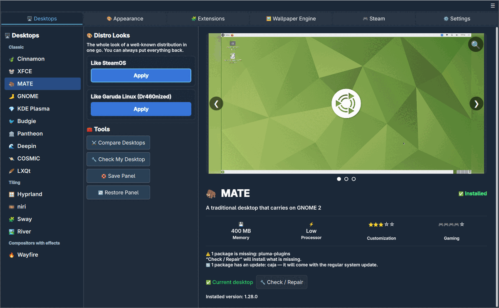

[English](../en/desktops.md) | [Русский](../ru/desktops.md) | [Deutsch](../de/desktops.md) | [简体中文](../zh-CN/desktops.md) | Français | [Español](../es/desktops.md) | [Українська](../uk/desktops.md)

# Bureaux

Cet onglet sert à installer, changer et supprimer des environnements de
bureau. Vous pouvez aussi y vérifier qu'il ne manque rien à votre bureau,
comparer les bureaux entre eux et, d'un clic, donner à votre bureau l'allure
d'une distribution connue.

## Ce que contient l'onglet

**La liste des bureaux (à gauche).** Les bureaux sont répartis en groupes :
« Classiques » (Cinnamon, XFCE, MATE, GNOME, KDE Plasma, Budgie, Pantheon,
Deepin, COSMIC, LXQt), « En mosaïque » (Hyprland, niri, Sway, River) et
« Compositeurs à effets » (Wayfire). Si un bureau ne peut pas être installé
sur votre distribution, la liste le dit directement.

**La fiche du bureau (à droite)** rassemble tout sur le bureau choisi :

- des captures d'écran (les flèches les font défiler, la loupe ou un clic sur
  l'image l'ouvrent en plein écran) ;
- l'état : « Installé », « Non installé », « Bureau actuel » ;
- une courte description et quatre notes : « Mémoire » (ce qu'il occupe juste
  après la connexion), « Charge du processeur », « Personnalisation » et
  « Jeux » ;
- combien de paquets du bureau sont déjà installés, lesquels manquent et
  lesquels ont des mises à jour ;
- la version installée et, s'il y en a une, la version plus récente des
  dépôts ;
- les boutons d'action :
  - **📦 Installer** — pour un bureau qui n'est pas encore là ;
  - **🔄 Basculer** — fermer la session et ouvrir ce bureau ;
  - **🔧 Vérifier / Réparer** — trouver et installer les paquets manquants ;
  - **🗑️ Supprimer** — retirer le bureau. Le bureau actuel n'a pas ce
    bouton ;
  - **➕ Ajouter la version Wayland** — pour un bureau installé qui sait
    fonctionner sous X11 comme sous Wayland, si la version Wayland n'est pas
    encore installée.
- pour Hyprland, niri et Sway, un bloc **« Shells »** : des panneaux prêts à
  l'emploi avec menu de lancement et notifications (Noctalia,
  DankMaterialShell). Vous pouvez les installer, ouvrir une session avec eux
  ou les supprimer.

**🎨 Comme dans une distribution (au milieu).** L'allure complète d'une
distribution connue : pour l'instant « Comme SteamOS » et « Comme Garuda
Linux (Dr460nized) ». Une fois une allure appliquée, le bouton
**↩️ Rétablir comme avant** apparaît.

**🧰 Outils (en dessous) :**

- **⚔️ Comparer les bureaux** — un tableau de tous les bureaux côte à côte ;
- **🔧 Vérifier mon bureau** — comme « Vérifier / Réparer », mais pour le
  bureau dans lequel vous travaillez en ce moment ;
- **🛟 Sauvegarder le panneau** et **↩️ Rétablir le panneau** — une copie des
  réglages du panneau, au cas où vos essais de thèmes le casseraient. Toutes
  les copies sont dans **Paramètres → 🛡️ Protection du panneau**.

## Comment faire

### Installer un environnement de bureau

1. Choisissez le bureau dans la liste de gauche.
2. Cliquez sur **📦 Installer**.
3. Dans la fenêtre « Installer ? », vérifiez ce qui va être installé. Si le
   bureau propose le choix « Comment le bureau fonctionnera », choisissez une
   variante (voir plus bas).
4. Confirmez et saisissez le mot de passe administrateur quand le système le
   demande.
5. Quand « Installation terminée » s'affiche, fermez la session et choisissez
   le nouveau bureau sur l'écran de connexion. Si le bureau a besoin d'un
   redémarrage, Rexon l'indique dans la même fenêtre.

### Choisir X11 ou Wayland

Cinnamon, XFCE, MATE et LXQt peuvent fonctionner de deux façons. Le choix
apparaît directement dans la fenêtre « Installer ? », sur la ligne « Comment
le bureau fonctionnera » :

- **X11 — éprouvé** — c'est ainsi que le bureau fonctionne depuis des années,
  tous les programmes et réglages se comportent comme prévu ;
- **Wayland — plus récent** — l'image est plus fluide et plus nette sur les
  écrans à haute résolution. Pour certains bureaux, il est encore
  expérimental : une partie des programmes, des applets du panneau et des
  réglages peut ne pas fonctionner ;
- **Wayland — expérimental, depuis l'AUR** — c'est ainsi qu'est marqué le
  Wayland de MATE : il est compilé depuis l'AUR sur votre ordinateur, et Rexon
  vous en avertit directement dans la fenêtre.

La variante conseillée est marquée « (recommandé) ». Si vous choisissez
Wayland, la variante X11 reste aussi : l'écran de connexion proposera les
deux. À la fin, Rexon vous indique quelle session choisir à la connexion. La
variante Wayland peut aussi être ajoutée plus tard, avec le bouton
**➕ Ajouter la version Wayland** de la fiche.

### Passer à un autre bureau

1. Choisissez un bureau installé dans la liste.
2. Cliquez sur **🔄 Basculer**.
3. Enregistrez vos documents ouverts et confirmez. Rexon garde une copie des
   réglages du bureau actuel et ferme la session.
4. Sur l'écran de connexion, choisissez le nouveau bureau.

### Supprimer un environnement de bureau

1. Choisissez le bureau et cliquez sur **🗑️ Supprimer**.
2. Dans la fenêtre « Supprimer ? », Rexon montre quel bureau est le bureau
   actuel : il ne sera pas touché. Confirmez et saisissez le mot de passe.

Impossible de supprimer :

- **le bureau actuel** — sinon l'écran resterait noir à la prochaine
  connexion. Passez d'abord à un autre bureau, ouvrez une session dans
  celui-ci, et seulement ensuite supprimez ;
- **le dernier bureau installé** — installez-en d'abord un autre.

Les paquets partagés avec d'autres programmes restent : seul ce dont plus
rien n'a besoin est supprimé.

### Vérifier et réparer un bureau

Si le bureau se comporte bizarrement (le panneau a disparu, les réglages ne
s'ouvrent pas), cliquez sur **🔧 Vérifier mon bureau** dans « Outils » ou sur
**🔧 Vérifier / Réparer** sur la fiche de n'importe quel bureau installé.
Rexon compare la liste des paquets du bureau et installe ceux qui manquent.
Si la fiche signale déjà des paquets manquants, c'est ce bouton qui les
installera.

### Comparer les bureaux

Cliquez sur **⚔️ Comparer les bureaux**. Le tableau « Tous les bureaux »
s'ouvre : mémoire, charge du processeur, ce sur quoi le bureau est construit
et ce qui dessine les fenêtres. Chaque ligne peut être dépliée. Les boutons
« Duels rapides » montrent côte à côte les comparaisons fréquentes (par
exemple XFCE ↔ KDE). Pour revenir, utilisez le bouton **← Bureaux**.

### Donner au bureau l'allure d'une distribution

1. Dans le bloc **🎨 Comme dans une distribution**, cliquez sur
   **Appliquer** sous l'allure voulue.
2. Rexon vérifie ce qu'il faut pour cela et affiche une fenêtre : ce qui va
   changer, ce qui ne s'appliquera que partiellement sur votre bureau et ce
   qui ne s'appliquera pas du tout. Pour l'allure SteamOS, vous pouvez
   choisir le style et, si vous le souhaitez, activer le mode jeu.
3. Cliquez sur **Appliquer**. Si l'allure a besoin de programmes, Rexon les
   installe et demande le mot de passe.
4. Vous changez d'avis ? Cliquez sur **↩️ Rétablir comme avant** : l'aspect et
   les réglages précédents reviennent. Les programmes installés pour l'allure
   restent ; vous pouvez les supprimer vous-même.

## En cas de problème

- **Après l'installation, le bureau n'apparaît pas sur l'écran de
  connexion.** Fermez encore une fois la session. Si Rexon a indiqué qu'un
  redémarrage est nécessaire, redémarrez l'ordinateur. Pour Cinnamon, XFCE,
  MATE et LXQt, vérifiez quelle session (X11 ou Wayland) vous choisissez.
- **Le bureau démarre sans panneau ou avec des erreurs.** Ouvrez une session
  dans n'importe quel autre bureau, ou restez dans celui-ci, et cliquez sur
  **🔧 Vérifier mon bureau**.
- **Un thème a cassé le panneau.** Si vous aviez cliqué auparavant sur
  **🛟 Sauvegarder le panneau**, cliquez sur **↩️ Rétablir le panneau**.
- **L'allure « comme dans une distribution » ne vous plaît pas.** Utilisez le
  bouton **↩️ Rétablir comme avant** sur sa vignette.
- **La fenêtre « Un paquet n'est plus mis à jour ».** Il reste dans le
  système un paquet retiré des dépôts. Si vous ne vous en servez pas, Rexon
  peut le supprimer ; sinon, cliquez sur « Pas maintenant ».
- **« Bureau non détecté ».** Rexon n'a pas reconnu le bureau dans lequel vous
  travaillez. Choisissez-le dans la liste de gauche et cliquez sur
  **🔧 Vérifier / Réparer** sur sa fiche.
- **Il faut revenir en arrière pour tout le système.** Rexon ne fait pas
  lui-même d'instantanés du système. Si snapper est configuré avec snap-pac
  chez vous (c'est le cas sur CachyOS et d'autres distributions sur Btrfs),
  un instantané est créé automatiquement avant chaque installation et
  suppression de paquets, et vous pouvez y revenir avec les outils de
  snapper (par exemple Btrfs Assistant).
- **Après un changement de bureau, le panneau de KDE Plasma a disparu.**
  Avant de quitter Plasma, Rexon sauvegarde son panneau ; vous pouvez le
  rétablir dans **Paramètres → 🛡️ Protection du panneau**. Si le
  nouveau bureau s'est approprié le navigateur ou le lecteur par défaut,
  regardez dans **Paramètres → 🔒 Protection des applications par défaut**.

## Voir aussi

- [Apparence](appearance.md) — thèmes, icônes, curseurs, polices, écran de
  connexion
- [Extensions](extensions.md) — paquets `.rxn` et thèmes Windows
- [Wallpaper Engine](wallpaper-engine.md) — fonds d'écran animés
- [Steam](steam.md) — vidéo de démarrage à la connexion et arrière-plans de
  profil
- [Paramètres](settings.md) — sauvegardes et réglages de Rexon
- [Sommaire du guide](../README.md)
