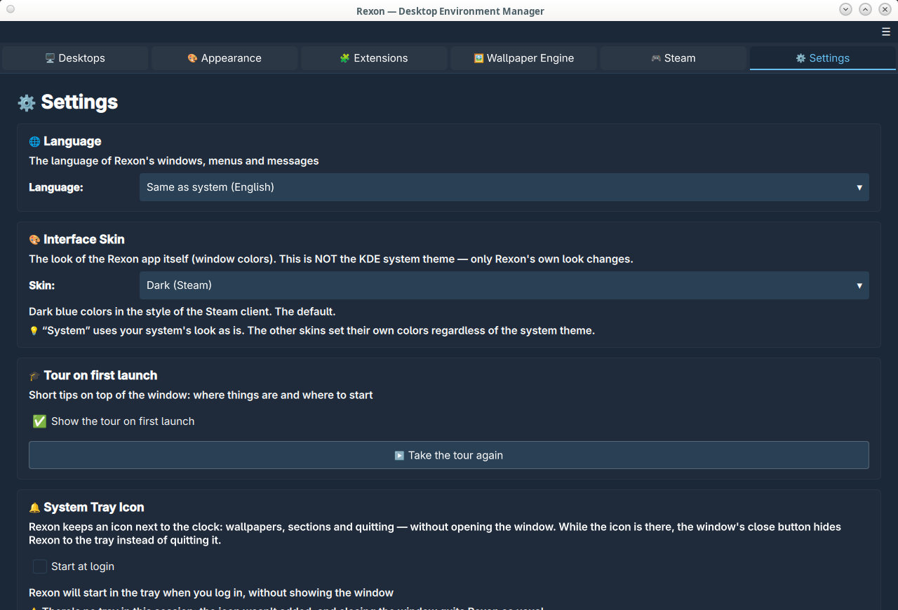
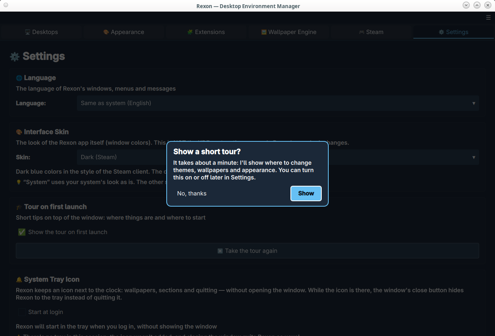

[English](../en/settings.md) | [Русский](../ru/settings.md) | [Deutsch](../de/settings.md) | [简体中文](../zh-CN/settings.md) | Français | [Español](../es/settings.md)

# Paramètres

Ici se règlent Rexon lui-même (langue, aspect de la fenêtre, icône dans la
zone de notification) et quelques éléments communs à tout l'ordinateur :
quel gestionnaire de fichiers ouvre les dossiers, quels programmes ouvrent
les fichiers par défaut, le fond d'écran à partir d'une image ou d'une vidéo,
les sons d'ambiance et les sons d'événements. Les sections se suivent de haut
en bas sur une seule page ; certaines n'apparaissent que là où elles ont un
sens (par exemple la protection du panneau, seulement avec KDE Plasma).

## Ce que contient l'onglet

| Section | À quoi elle sert |
| --- | --- |
| 🌐 **Langue** | La langue des fenêtres, menus et messages de Rexon |
| 🎨 **Habillage de l'interface** | Les couleurs de la fenêtre de Rexon lui-même |
| **Visite guidée au premier lancement** | De courtes indications par-dessus la fenêtre |
| 🔔 **Icône dans la zone de notification** | L'icône près de l'horloge et le lancement automatique |
| 📁 **Gestionnaire de fichiers** | Quel programme ouvre les dossiers |
| 🔧 **Restauration rapide des applications** | Retrouver les programmes d'origine du bureau actuel |
| 🧩 **Bureau au complet** | Vérifier que tout ce dont le bureau a besoin est installé |
| 🎬 **Fond d'écran (image / vidéo / YouTube / web)** | Un fond d'écran depuis un fichier, une vidéo YouTube ou Vimeo, une page web |
| 📚 **Bibliothèque de fonds d'écran** | Les paquets de fonds d'écran Rexon (.rxn) |
| 🪟 **Importer des thèmes Windows** | Reprendre l'apparence de votre ancien ordinateur sous Windows |
| 🔒 **Protection des applications par défaut** | Empêcher un nouveau bureau de remplacer vos programmes |
| 🛡️ **Protection du panneau KDE Plasma** | Seulement avec Plasma : copies du panneau, des widgets et des raccourcis clavier |
| 🪟 **Apparence du bureau** | Seulement si une apparence dérivée de Plasma est installée (AeroShell, etc.) |

L'animation, les polices, les boutons de la barre de titre, le retour visuel
au lancement des programmes, les icônes dans les programmes, le flou du fond
d'écran, les sons d'ambiance et les sons d'événements se trouvent dans
l'onglet « Apparence », là où les Paramètres du système de KDE les rangent
aussi.

Si vous avez déjà saisi votre mot de passe, une bande « 🔓 Rexon peut
modifier le système jusqu'à la fermeture de la fenêtre » apparaît en haut de
l'onglet. Le bouton **« Retirer maintenant »** révoque cette autorisation : la
prochaine fois, Rexon redemandera le mot de passe.

## Changer la langue et l'habillage

1. Dans la section **🌐 Langue**, choisissez une langue dans la liste. Le
   premier élément est « Comme le système ».
2. La langue change après le redémarrage de Rexon : cliquez sur
   **« Redémarrer Rexon »**.
3. Dans la section **🎨 Habillage de l'interface**, choisissez l'aspect de la
   fenêtre : « Sombre (Steam) » (par défaut), « Clair », « Sombre
   (Material) », « Synthwave / Neon Space Retro » ou « Système (comme le
   système) ». L'habillage change immédiatement.

L'habillage ne concerne que les couleurs de la fenêtre de Rexon, pas le thème
de tout le bureau. Le thème du bureau se change dans l'onglet « Apparence ».

## Visite guidée au premier lancement

Au premier lancement, Rexon demande « Afficher une courte visite guidée ? ».
La visite dure environ une minute et montre où changer les thèmes, les fonds
d'écran et l'apparence.

- La case **« Afficher la visite guidée au premier lancement »** active ou
  désactive cette question.
- Le bouton **« Refaire la visite guidée »** lance la visite à tout moment.

## Icône dans la zone de notification et lancement automatique

Rexon garde une icône près de l'horloge : elle donne accès aux fonds d'écran,
aux sections et à la fermeture, sans ouvrir la fenêtre. Tant que l'icône est
là, la croix de la fenêtre cache Rexon dans la zone de notification au lieu
de le fermer.

- **« Lancer à la connexion »** — Rexon démarre dans la zone de notification
  à l'ouverture de session, sans afficher la fenêtre.
- **« Télécharger automatiquement les icônes et curseurs du thème »** — s'il
  manque des icônes ou un curseur au thème choisi, Rexon les télécharge dans
  votre dossier personnel et les applique. Si l'option est désactivée, il
  demande d'abord. Pour les jeux d'icônes ou de curseurs qui ne s'installent que par des paquets
  système, Rexon demande toujours.

S'il n'y a pas de zone de notification dans la session, Rexon le dit :
l'icône n'est pas installée et la croix ferme le programme normalement.

## Gestionnaire de fichiers

Choisissez quel programme ouvre les dossiers, dans Rexon comme dans tout le
système. **« Automatique (selon le bureau) »** prend le gestionnaire
d'origine du bureau actuel. À côté de chacun, vous voyez s'il est installé ou
non. Cliquez sur **« Appliquer les réglages du gestionnaire de fichiers »**.
Hyprland et les autres gestionnaires de fenêtres n'ont pas de gestionnaire de
fichiers à eux : n'importe lequel de la liste convient.

## Retrouver les applications par défaut

Après l'installation d'un autre bureau, le terminal, le gestionnaire de
fichiers et l'éditeur de texte peuvent être remplacés par ceux de ce bureau.

**Rapidement :** dans la section **🔧 Restauration rapide des applications**,
cliquez sur **« Restaurer les applications de … »** (le nom de votre bureau y
figure, par exemple « Restaurer les applications de MATE »).

**Vos propres programmes :** dans la section **🔒 Protection des applications
par défaut** :

1. Cochez **« Activer la protection (recommandé) »**.
2. Cochez ce qu'il faut protéger : gestionnaire de fichiers, navigateur,
   courrier, visionneuse d'images, vidéo, PDF, archives, musique, terminal. À
   côté, vous voyez quel programme est mémorisé.
3. Cliquez sur **« 📌 Mémoriser maintenant »** : Rexon retient votre choix
   actuel.
4. Si des programmes ont quand même été remplacés, cliquez sur
   **« ↩️ Rétablir comme avant »**.

## Couleurs du terminal après un changement de thème

Certains terminaux prennent par défaut les couleurs du texte et du fond dans
le thème. Avec un thème sombre mal fait, leur texte peut devenir gris foncé
sur noir. C'est pourquoi, après un changement de thème GTK, de thème global,
de jeu de couleurs, de mode clair/sombre, de couleur d'accentuation ou
d'allure « Comme dans une distribution », Rexon donne lui-même à ces
terminaux sa propre paire de couleurs lisible : texte clair sur fond sombre
pour un thème sombre, texte foncé sur fond clair pour un thème clair.

- **Terminaux concernés :** mate-terminal, gnome-terminal et Tilix (ils
  prennent les couleurs du thème par défaut), ainsi que xfce4-terminal et
  Terminator si les couleurs du thème y sont activées. Konsole, Console,
  Ptyxis, kitty, Alacritty et les autres terminaux qui ont leurs propres
  jeux de couleurs ne sont pas touchés.
- **Vos propres couleurs ne sont pas touchées.** Si vous avez choisi
  vous-même les couleurs dans le profil et qu'elles sont lisibles, Rexon les
  laisse.
- **Pour désactiver :** dans la section **🔒 Protection des applications par
  défaut**, décochez **« Empêcher les thèmes d'abîmer les couleurs du
  terminal (recommandé) »**. Elle est cochée par défaut.
- **Pour revenir en arrière :** Rexon mémorise les anciennes couleurs du
  terminal avec le thème. Le bouton **« Rétablir comme avant « … » »** de
  l'onglet « Apparence » (ou **« ↩️ Rétablir comme avant »** pour une allure
  « Comme dans une distribution ») les rétablit aussi.

## Sauvegardes du panneau KDE Plasma

La section **🛡️ Protection du panneau KDE Plasma** est visible quand Plasma
fonctionne ou qu'il en reste des copies.

1. Cliquez sur **« 📦 Enregistrer une copie »** : Rexon sauvegarde l'aspect du
   panneau, les widgets et les raccourcis clavier.
2. Les copies apparaissent dans la liste « Copies enregistrées ».
3. Si le panneau est cassé après l'installation d'un autre bureau, cliquez
   sur **« Restaurer »** à côté de la copie voulue et confirmez. L'aspect
   actuel du panneau sera remplacé.

## Fond d'écran, sons et le reste

- **🎬 Fond d'écran** — **« 🖼️ Image… »** et **« 🎬 Vidéo… »** posent un fond
  d'écran depuis un fichier (images JPG, PNG, WebP ; vidéos MP4, WebM, MKV
  et autres ; Flash SWF). En dessous : un lien YouTube ou Vimeo
  (**Qualité**, **Mode** : « En ligne » ou « Télécharger ») et un fond
  d'écran web depuis un lien ou un fichier HTML. YouTube a besoin du
  programme yt-dlp : s'il manque, Rexon propose de l'installer.
  **« ⏹️ Arrêter le fond d'écran animé »** retire le fond d'écran animé.
- Au même endroit, le son du fond d'écran : le volume, « Baisser le son
  quand une autre application joue du son » et « Mettre le fond d'écran en
  pause quand les fenêtres le cachent ». Le son change immédiatement, inutile
  de reposer le fond d'écran.

  

- **🪟 Importer des thèmes Windows** — **« 📥 Choisir un fichier de
  thème… »** : thèmes (.themepack, .theme), styles visuels (.msstyles),
  icônes, curseurs et fonds d'écran vidéo DreamScene. Le thème prêt apparaît
  dans l'onglet « Extensions ».
- **🧩 Bureau au complet** — **« Vérifier et installer ce qui manque »**
  vérifie que tout ce dont le bureau a besoin est installé (thèmes, polices,
  compléments) et installe ce qui manque. Le système demande le mot de
  passe.

## En cas de problème

- **La langue n'a pas changé.** Cliquez sur **« Redémarrer Rexon »** : la
  langue ne change qu'après un redémarrage.
- **Pas d'icône près de l'horloge.** Cette session n'a pas de zone de
  notification. Rexon fonctionne comme une fenêtre ordinaire ; « Lancer à la
  connexion » le démarre quand même à l'ouverture de session.
- **Impossible de modifier le lancement automatique.** Les détails sont dans
  le journal de Rexon.
- **Les programmes par défaut ont changé après l'installation d'un
  bureau.** Cliquez sur **« Restaurer les applications de … »** ou sur
  **« ↩️ Rétablir comme avant »** dans la protection des applications.
- **« ⚠️ Le moteur de fonds d'écran ne s'est pas chargé — cette section est
  indisponible ».** La section des fonds d'écran ne fonctionnera pas tant que
  le moteur de fonds d'écran n'aura pas démarré ; ouvrez l'onglet Wallpaper
  Engine et regardez ce qu'il indique.
- **L'animation ou les polices ont disparu.** Elles se trouvent désormais
  dans l'onglet « Apparence » : en bas de cet onglet-ci, des liens y mènent
  directement.
