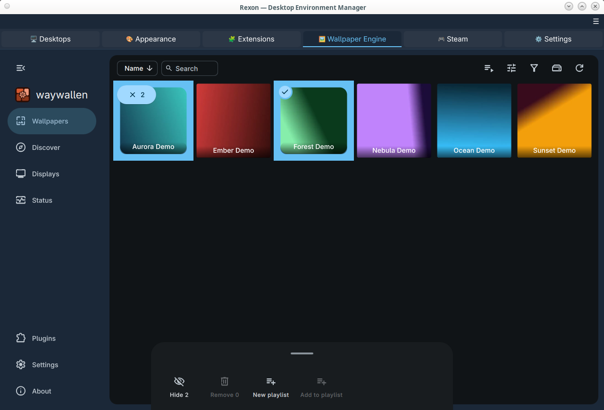

[English](../en/wallpaper-engine.md) | [Русский](../ru/wallpaper-engine.md) | [Deutsch](../de/wallpaper-engine.md) | [简体中文](../zh-CN/wallpaper-engine.md) | Français | [Español](../es/wallpaper-engine.md) | [Українська](../uk/wallpaper-engine.md)

# Wallpaper Engine

Ici se trouvent les fonds d'écran animés : scènes, vidéos et fonds d'écran
web de Wallpaper Engine, ainsi que les images du catalogue gratuit
Wallhaven. Vous pouvez mettre un fond d'écran sur tout le bureau ou sur un
seul écran, réunir des fonds d'écran dans une liste de lecture qui les change
d'elle-même au fil du temps et vous abonner à de nouveaux fonds d'écran du
Workshop Steam directement depuis Rexon.

L'onglet est affiché par le moteur de fonds d'écran animés
[waywallen](https://github.com/hypengw/waywallen) : ses fenêtres sont
intégrées telles quelles dans Rexon, c'est pourquoi l'apparence et les
libellés diffèrent un peu des autres onglets. Rexon y ajoute ses propres
indications et affiche lui-même les fonds d'écran sur votre bureau.

> Pour utiliser les fonds d'écran du Workshop Steam, vous devez avoir
> **acheté Wallpaper Engine sur Steam** : le Workshop ne fournit ses fonds
> d'écran qu'aux propriétaires du jeu. Sans achat, les vidéos et images de vos
> propres dossiers et le catalogue Wallhaven fonctionnent.

## Ce que contient l'onglet

À gauche, le panneau des sections (le bouton « ☰ » en haut le réduit à des
icônes) :

- **Fonds d'écran** — votre bibliothèque : tout ce qui se trouve sur
  l'ordinateur.
- **Découvrir** — les catalogues en ligne : **Workshop Steam** et
  **Wallhaven**.
- **Écrans** — vos écrans et ce que chacun affiche.
- **État** — si le moteur de fonds d'écran fonctionne et ce qu'il affiche en
  ce moment.
- En bas : **Greffons**, **Paramètres** (le comportement des fonds d'écran
  eux-mêmes) et **À propos**.

Au-dessus de la bibliothèque : le tri (par nom, taille, date de
modification), la recherche et, à droite, les boutons **Listes de lecture**,
**Ajustements** (taille des cartes), **Filtres** (par type, mots-clés,
classification par âge), **Gestionnaire de bibliothèques** (les dossiers à
parcourir) et **Actualiser**.

## Sur quels bureaux cela fonctionne

Rexon choisit lui-même comment afficher les fonds d'écran sur votre bureau,
vous n'avez rien à régler :

- **KDE Plasma** — les fonds d'écran s'intègrent au bureau Plasma : les
  icônes et les clics sur le bureau fonctionnent comme d'habitude.
- **Hyprland, Sway, niri, river, COSMIC, Wayfire** — le moteur affiche
  lui-même les fonds d'écran.
- **GNOME et Cinnamon en session Wayland** — les fonds d'écran sont affichés
  par l'extension Rexon. S'ils n'apparaissent pas, activez l'extension et
  reconnectez-vous.
- **MATE, Xfce, Cinnamon, Budgie, LXQt, LXDE, Pantheon, Deepin et les autres
  bureaux en session X11** — les fonds d'écran sont affichés par le lecteur
  de Rexon. Une partie des fonctions du moteur peut ne pas y être disponible.
  Sous MATE, les icônes du bureau restent au-dessus du fond d'écran animé si
  Caja sait rendre le fond du bureau transparent ; Rexon l'active lui-même.
  Sinon, les icônes sont masquées tant que le fond d'écran animé tourne
  (l'onglet le signale en une ligne) et reviennent quand il est arrêté.

Sur un compositeur Wayland que Rexon ne connaît pas, il n'y aura pas de fond
d'écran animé.

Si votre bureau dessine lui-même son arrière-plan (par exemple les shells
Noctalia ou DankMaterialShell), une bande apparaît en haut de l'onglet avec
une explication et les boutons **« Confier le fond d'écran à Rexon »**
(désactive l'arrière-plan du shell) et **« Rendre au shell »** (le réactive
avec son réglage précédent).

## Trouver et appliquer un fond d'écran

1. Ouvrez l'onglet **Wallpaper Engine** → section **Fonds d'écran**.
2. Si la bibliothèque est vide, cliquez sur **« Détecter automatiquement les
   bibliothèques »** : Rexon trouve le dossier de Steam et les fonds d'écran
   Wallpaper Engine déjà téléchargés. Vous pouvez ajouter un autre dossier
   avec **Gestionnaire de bibliothèques** → **« Ajouter une
   bibliothèque »**.

   

3. Cliquez sur la carte d'un fond d'écran. Le panneau de détails s'ouvre à
   droite : aperçu, description, **Mode de remplissage** (rogner, ajuster,
   étirer, centrer), rotation, retournement et les **Propriétés** définies par
   l'auteur du fond d'écran (couleur, son, vitesse, etc.).
4. Si vous avez plusieurs écrans, le panneau contient la ligne
   **« Appliquer à »** : choisissez un écran ou **« Tous »**.
5. Cliquez sur **« Appliquer »**. Rexon affiche lui-même le fond d'écran sur
   le bureau.

Tant que rien n'est encore affiché sur le bureau, la section **Écrans** peut
être vide et indiquer « Les fonds d'écran Wallpaper Engine ne sont pas encore
affichés sur le bureau… ». C'est normal : les écrans apparaissent après le
premier « Appliquer ».

## Écrans

La section **Écrans** montre chaque écran et le fond d'écran qu'il affiche.
Vous pouvez y :

- renommer un écran (**« Modifier l'écran »**) et choisir son mode de
  remplissage ;
- mettre en pause le fond d'écran d'un seul écran (**« Mettre l'écran en
  pause »**) ;
- réunir plusieurs écrans en un **canevas** (**« Créer un canevas »**) pour
  qu'un même fond d'écran s'étende sur tous les écrans à la fois.

## Listes de lecture : les fonds d'écran changent d'eux-mêmes

1. Dans la section **Fonds d'écran**, sélectionnez plusieurs cartes : clic
   droit (ou clic avec Ctrl enfoncé, ou appui long).
2. Un panneau apparaît en bas : cliquez sur **« Nouvelle liste de lecture »**,
   saisissez un nom puis **« Créer »**. Vous pouvez compléter une liste
   existante avec **« Ajouter à la liste de lecture »**.

   

3. Ouvrez la liste avec le bouton **Listes de lecture** (à droite, au-dessus
   de la bibliothèque). Chaque liste a ses boutons : **« Lire la liste de
   lecture »**, **« Modifier la liste de lecture »**, **« Modifier les fonds
   d'écran »** et **« Supprimer la liste de lecture »**. Au-dessus de la liste,
   vous pouvez choisir sur quels écrans la lire (**« Tous »** inclut aussi les
   écrans branchés plus tard).

   

4. Dans **« Modifier la liste de lecture »**, choisissez le **Mode** —
   **Séquentiel**, **Aléatoire sans répétition** ou **Aléatoire** — et
   l'**Intervalle de rotation** (heures, minutes, secondes). Enregistrez avec
   la coche en haut.

## Workshop Steam : s'abonner à de nouveaux fonds d'écran

Il faut avoir acheté Wallpaper Engine sur Steam et que le client Steam soit
lancé.

1. Ouvrez la section **Découvrir** et choisissez **Workshop Steam** dans la
   première liste.
2. Cliquez sur **« Se connecter à Steam »** et scannez le code QR avec
   l'application mobile Steam. Rexon ne voit pas et ne demande pas votre mot
   de passe Steam.

   

3. Après la connexion, le catalogue apparaît. Tri : « Tendances
   (aujourd'hui) », « Tendances (semaine) » et ainsi de suite, « Ajoutés
   récemment », « Les mieux notés » ; il y a une recherche et des
   **Filtres**. L'élément **« Mes abonnements »** montre ce à quoi vous êtes
   déjà abonné.
4. Ouvrez un fond d'écran et cliquez sur **« S'abonner »**. C'est le client
   Steam qui télécharge les fichiers : laissez-le lancé, et le fond d'écran
   apparaîtra automatiquement dans la section **Fonds d'écran**.
5. Pour vous désabonner, même endroit (**« Se désabonner »**) ou panneau de
   détails du fond d'écran dans la bibliothèque.

Les fonds d'écran marqués 18+ sont masqués tant que vous n'activez pas
vous-même ce filtre (Rexon vous redemande confirmation).

**Wallhaven** est la seconde source de **Découvrir** : des images gratuites,
sans connexion. Une image qui vous plaît s'enregistre avec le bouton
**« Télécharger »**.

## Paramètres des fonds d'écran

Le bouton **Paramètres** en bas du panneau des sections ouvre les paramètres
du moteur lui-même :

- **Relecture automatique** (la pause automatique) — que faire du fond
  d'écran quand une fenêtre quelconque, active, maximisée ou en plein écran
  est ouverte, que la session est verrouillée ou que l'ordinateur fonctionne
  sur batterie : rien, couper le son, mettre en pause ou arrêter. Ainsi, les
  jeux et les films ne partagent pas la carte graphique avec le fond d'écran.
- **Audio** — le volume et « Couper le son des autres flux en cours »
  (couper le son du fond d'écran quand d'autres applications jouent du son).
- **Transition des fonds d'écran** et sa durée, **Fenêtres exclues**, le cache
  des images venues du réseau.

## En cas de problème

- **« Lancement du moteur de fonds d'écran waywallen… » dure longtemps.** Le
  premier lancement après l'installation peut prendre une minute ou deux : le
  moteur se décompresse. Patientez.
- **« Le moteur de fonds d'écran waywallen n'a pas démarré ».** Cliquez sur
  **« Relancer »**. Si cela ne suffit pas, regardez la section **État** →
  **Journaux**.
- **La bibliothèque est vide alors que vous avez acheté des fonds d'écran.**
  Vérifiez que Steam les a déjà téléchargés (ils se trouvent dans
  `steamapps/workshop/content/431960`), puis cliquez sur **« Détecter
  automatiquement les bibliothèques »** ou **Actualiser**. Si Steam est
  installé à un emplacement inhabituel, ajoutez son dossier dans le
  **Gestionnaire de bibliothèques** : il faut le dossier qui contient
  `steamapps`.
- **Abonné, mais le fond d'écran n'apparaît pas.** Le client Steam doit être
  lancé : c'est lui qui télécharge les fonds d'écran, pas Rexon.
- **Sous KDE Plasma, un avertissement en haut parle du greffon de fond d'écran
  de Plasma.** Cliquez sur **« Installer la version de Rexon »** : Rexon
  installe le greffon qui convient.
- **Aucun fond d'écran visible sous GNOME ou Cinnamon.** Activez l'extension
  Rexon et reconnectez-vous.
- **C'est le shell qui dessine l'arrière-plan, pas Rexon.** Cliquez sur
  **« Confier le fond d'écran à Rexon »** dans la bande en haut de l'onglet.
