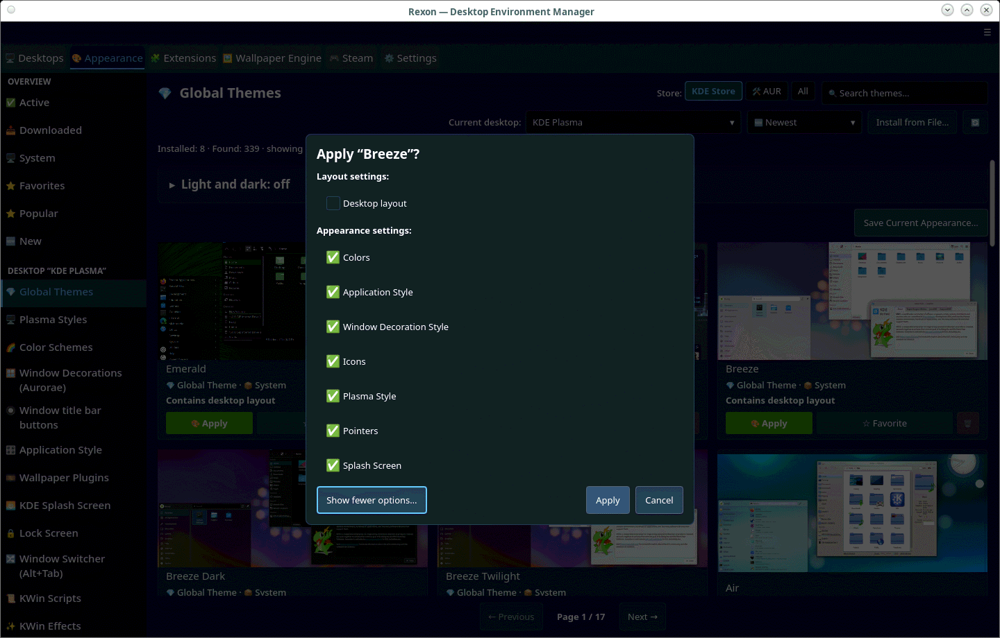
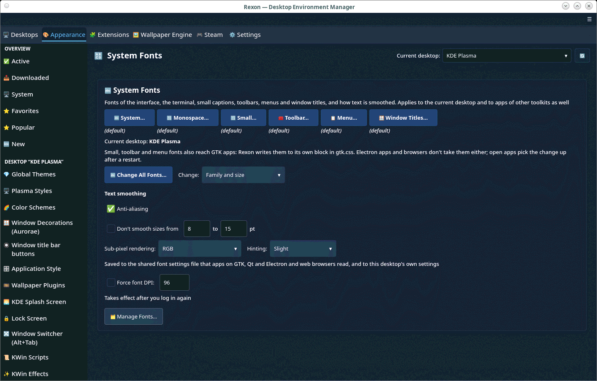
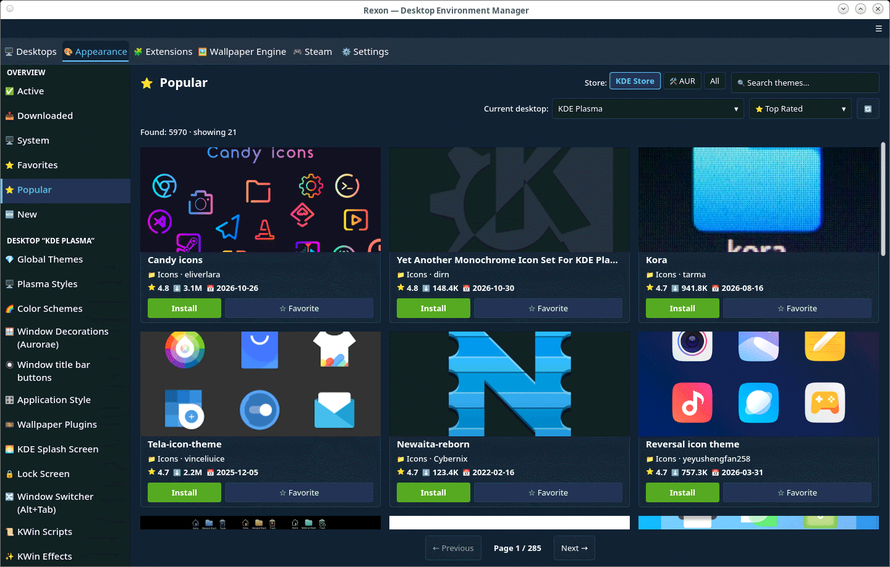

[English](../en/appearance.md) | Русский | [Deutsch](../de/appearance.md) | [简体中文](../zh-CN/appearance.md) | [Français](../fr/appearance.md) | [Español](../es/appearance.md) | [Українська](../uk/appearance.md)

# Оформление

Здесь меняют вид компьютера: темы, цвета, значки, курсоры, шрифты, рамки
окон, анимацию, экран входа и заставку загрузки. Rexon показывает только то,
что действительно работает на вашем рабочем столе, и прямо говорит, на что
подействует каждый раздел — на сам стол, на все программы или только на
некоторые. Новые темы можно взять из магазина KDE Store, из AUR, из
Cinnamon Spices или поставить из файла, который уже лежит на компьютере.

## Как устроена вкладка

Слева — боковая панель с разделами, справа — содержимое выбранного раздела.
Сверху над содержимым:

- **Поиск** — ищет по названию, автору и меткам.
- **Магазин:** — откуда брать новые темы: **KDE Store**, **AUR** или
  **Все** (оба в одном списке). У разделов Cinnamon вместо этого — каталог
  Cinnamon Spices, тот же, что в настройках самого Cinnamon.
- **Текущее окружение:** — для какого рабочего стола показывать оформление.
  Обычно оно определяется само по текущему сеансу. Можно выбрать другой стол,
  например чтобы заранее подобрать темы для стола, в который вы собираетесь
  перейти. Тайловые столы (Hyprland, Sway, niri) сведены в один пункт: набор
  тем у них одинаковый.
- **Сортировка** — «🆕 Новые», «⬇️ Скачивания», «⭐ Рейтинг», «🔤 Алфавит».
- **Установить из файла…** — поставить тему, которая уже есть на компьютере.
- **🔄 Обновить каталог** — заново загрузить список.

В разделе сначала идут уже установленные темы, ниже — товары из магазина.
Внизу — кнопки «← Назад» и «Вперёд →» для листания страниц.

### Обзор

Первая группа боковой панели — «Обзор». Эти разделы не привязаны к одному
виду оформления:

- **Активные** — всё, что включено прямо сейчас: тема, значки, курсор,
  заставка загрузки, эффекты окон и так далее.
- **Загруженные** — то, что вы поставили сами.
- **Системные** — то, что пришло вместе с системой и пакетами.
- **Избранное** — темы, отмеченные кнопкой «☆ Избранное».
- **Популярные** и **Новые** — витрина магазина с самым ходовым для вашего
  стола: значками, курсорами, темами GTK, обоями и прочим.

### Группы разделов

Остальные разделы разложены по группам. Заголовок группы отвечает на вопрос
«на что это подействует»:

- **Рабочий стол «…»** — родное оформление стола, который выбран в поле
  «Текущее окружение».
- **Для всех программ** — то, что подхватывают все программы: значки,
  курсоры, GTK-темы, шрифты, звуки, обои.
- **Программы Qt и KDE** — появляется вне KDE и LXQt. Здесь цвета и стиль
  программ вроде VLC, qBittorrent, Krita, Dolphin. Сам стол при этом не
  меняется.
- **Виджеты рабочего стола** — виджеты Plasma, десклеты Cinnamon и виджеты
  Conky (часы, погода, датчики системы; Conky работает на любом столе).
- **Система: загрузка и вход** — экран входа и заставка при включении
  компьютера. Они общие для всех рабочих столов на этом компьютере.

Если раздела для вашего стола нет, Rexon его не показывает. А если вы
открыли раздел, который на выбранном столе не работает, вместо пустой полки
будет объяснение, почему, и совет выбрать другой раздел слева.

### Плитка темы

У каждой темы есть плитка с картинкой, названием и кнопками:

- **Установить** — скачать и поставить тему из магазина;
- **🎨 Применить** — включить уже скачанную тему;
- **✅ Применено** — тема включена сейчас (нажатие применит её заново);
- **▶️ Включить** / **⏸️ Выключить** — у дополнений: эффектов и скриптов
  KWin, расширений и апплетов;
- **▶️ Запустить** / **⏹️ Остановить** — у виджетов Conky;
- **☆ Избранное** — отметить тему;
- **🗑️** — удалить.

Щелчок по картинке открывает страницу темы: снимки экрана (стрелки ◀️ ▶️
листают, щелчок открывает картинку на весь экран), описание, оценку, число
скачиваний, комментарии и кнопки **🌐 Открыть на сайте** и
**🔗 Копировать ссылку**. Обратно — **← Назад к каталогу**.

## Разделы

### Глобальные темы

Глобальная тема — готовый набор всего сразу: цвета, стиль приложений, рамки
окон, значки, курсоры, заставка и иногда расположение панелей. Над плитками
стоят кнопка **Сохранить текущее оформление…** и блок **Светлое и тёмное**
(о нём ниже).

Нажмите «🎨 Применить» у темы — откроется окно «Применить «…»?». Там видно,
что именно поставит тема. Кнопка **Выбрать компоненты оформления…** раскрывает
подробный список: можно снять галочки с того, что менять не нужно.

Пункт **Расположение рабочего стола и виджетов** по умолчанию выключен. Если
его включить, Rexon предупредит: расположение удалит нынешние рабочие столы,
панели, доки и виджеты и заменит их теми, что заданы в теме.

Глобальные темы сделаны для KDE Plasma, но Rexon умеет применять их и на
других столах — по частям, только то, что на этом столе есть: цвета
(для программ Qt), стиль приложений, значки, курсоры, шрифты и кнопки
заголовка. То, что существует только в Plasma (панели, стиль Plasma,
заставка Plasma), в списке выключено, и рядом сказано почему.

### Цвета: цветовые схемы, цвет акцента, светлое и тёмное

В KDE раздел называется **Цветовые схемы**, на других столах — **Цвета
Qt-программ** (там схема красит только программы Qt и KDE). Над плитками
есть переключатель **Вид:** — «Все», «Светлые», «Тёмные».

**Цвет акцента** — цвет выделения, флажков и активных кнопок. Варианты:

- **Из цветовой схемы** (или **Как в теме** на других столах) — какой задан
  в схеме;
- **Из обоев** — цвет берётся с картинки на рабочем столе. Rexon обновляет
  его, когда сам меняет обои; если обои сменили не через Rexon, снова нажмите
  «Из обоев»;
- **Свой цвет** — один из готовых кружков или любой через **Выбрать цвет…**.

Под кнопками написано, кто получит цвет на вашем столе. Например, в GNOME
всего девять цветов акцента, и программы GTK 4 получат ближайший. Кнопка
**Вернуть как было** возвращает цвет, который стоял до Rexon.

**Светлое и тёмное** — пары тем на день и на ночь. Блок стоит в разделах
«Глобальные темы» и «Цветовые схемы» в KDE, «Цветовые схемы» и «GTK-темы»
на других столах.

1. Отметьте части, которые нужно менять: глобальная тема (только KDE),
   цветовая схема, тема GTK, значки, обои.
2. Для каждой выберите светлый и тёмный вариант.
3. Нажмите **Светлое**, **Тёмное** или **Автоматически**. В режиме
   «Автоматически» выберите **От заката до рассвета** (место определяется по
   часовому поясу или вводится широтой и долготой) или **По времени** —
   «Светлое с» и «Тёмное с».
4. Нажмите **Сохранить**.

Флажок **Светлый или тёмный режим программ** заодно переключает режим
программ, которые умеют следовать системе. В заголовке свёрнутого блока
видно, что сейчас включено, например «Светлое и тёмное: по расписанию
07:00–19:00».

У установленной цветовой схемы на её странице есть кнопки **Изменить…**
(основные цвета схемы; если стоит редактор KDE — открывается он) и
**Создать на основе…** (новая схема из этой, исходная остаётся как есть).

### Рамки окон и кнопки заголовка

Рамки окон в каждом окружении свои: в KDE — **Окна (Aurorae)**, в XFCE,
MATE и LXQt (Openbox, labwc) — **Рамки окон**. У Cinnamon рамки рисует
тема GTK.

Кнопки заголовка окна настраиваются там же, в разделе рамок: кнопка
**⚙️ Настройки** в его шапке (как вкладка «Кнопки заголовка» модуля
«Оформление окон» KDE), обратно — **←  Назад к каталогу**. У Cinnamon это
раздел **Тема Cinnamon**; у столов без своего раздела рамок (GNOME, Budgie,
Pantheon, COSMIC, Deepin, тайловые) — раздел **GTK-темы**: там заголовки
рисует тема GTK или сами программы GTK. В настройках:

- **Расположение кнопок:** — «Справа (как в Windows)» или «Слева (как в
  macOS)»;
- кнопки можно перетаскивать между полкой и полосой «Заголовок окна»; без
  мыши — выберите кнопку и нажимайте «Левее», «Правее», «Убрать из
  заголовка», «Добавить слева», «Добавить справа»;
- **Размер рамки окна:** — от «Без рамок» до «Колоссальные»;
- в KDE ещё три флажка: закрывать окна двойным щелчком по кнопке меню,
  показывать подсказки кнопок и всегда показывать кнопку «Скрыть от снимков и
  записи экрана»;
- **По умолчанию** — вернуть исходную раскладку.

Если какой-то кнопки у оконного менеджера вашего стола нет, Rexon об этом
скажет.

### Стиль приложений

**Стиль приложений** (вне KDE и LXQt — **Стиль Qt-программ (Kvantum)**)
показывает одной сеткой стили Qt и темы Kvantum. Переключатель над сеткой:
«Все», «Стили Qt», «Kvantum». Новые темы Kvantum берутся из KDE Store,
готовые стили Qt (Darkly, Lightly, Klassy) — из AUR.

### Значки, курсоры, отклик при запуске

- **Значки** и **Курсоры** — темы значков и указателя. Кнопка
  **⚙️ Настройки** в шапке раздела «Значки» открывает там же значки в меню и
  на кнопках и подписи на панелях инструментов в программах («Только
  значки», «Только текст», «Текст рядом со значками», «Текст под значками»);
  **←  Назад к каталогу** возвращает к темам. В разделе курсоров
  есть поле **Размер:** — размер указателя в пикселях. Rexon применяет его в
  настройках стола, в программах GTK и Qt и в конфиге sway, niri или Hyprland.
- **Отклик при запуске** (только KDE) — кнопка **⚙️ Настройки** в шапке
  раздела «Курсоры»: как указатель и панель задач показывают, что
  программа запускается: указатель «Нет», «Неподвижный», «Мигающий» или
  «Прыгающий», анимация кнопки на панели задач и через сколько её
  остановить. Где у стола такой настройки нет, нет и кнопки.

### GTK-темы

Темы программ на GTK (Firefox, GIMP, большинство программ GNOME, XFCE, MATE,
Cinnamon). На столах GNOME, Cinnamon, MATE и XFCE рядом есть и свои разделы:
**Тема оболочки GNOME**, **Тема Cinnamon**, **Тема LXQt** и другие. На
столах без анимаций окон кнопка **⚙️ Настройки** в шапке раздела открывает
галочку **Без анимаций** — анимация внутри программ.

### Шрифты и управление шрифтами

Раздел **Шрифты** (со значком 🔤 в группе «Для всех программ») — шрифты из
магазина KDE Store. Кнопка **⚙️ Настройки** в его шапке открывает там же
системные шрифты: шрифты интерфейса, терминала, мелких подписей, панелей
инструментов, меню и заголовков окон; **←  Назад к каталогу** возвращает к
магазину. Нажмите кнопку нужного шрифта, чтобы
выбрать семейство и кегль, или **🔤 Изменить все шрифты…**, чтобы задать один
шрифт всем сразу. Ниже — **Сглаживание текста** (сглаживание, субпиксельная
отрисовка, хинтинг) и **Принудительное DPI шрифтов**.

Кнопка **🗂️ Управление шрифтами…** открывает список всех шрифтов на
компьютере:

- образец каждого шрифта и таблица его символов;
- **➕ Установить из файла…** — для себя или для всех пользователей (во
  втором случае Rexon спросит пароль администратора);
- **Удалить** — только шрифты, которые поставили вы. Системные шрифты можно
  лишь посмотреть;
- **Выключить** / **Включить** — спрятать шрифт от всех программ, не удаляя
  файл;
- **🔍 Найти дубликаты** — начертания, которые стоят в нескольких файлах;
- свои группы шрифтов (**➕ Новая группа…**), включение и выключение всей
  группы, выгрузка группы в ZIP-архив.

### Обои и звуки

- **Обои HD** — картинки для рабочего стола из магазина. Кнопка
  **⚙️ Настройки** в шапке раздела — **🌫️ Размытие обоев**: размывает
  обои-картинку, чтобы значки и окна поверх читались легче (ползунок
  **Сила**, **Размыть обои**, **Убрать размытие**); оригинал сохраняется.
  Если на компьютере есть Razer Axon (под Wine), в поле **Магазин:** есть и
  **Razer Axon** — скачанные в нём обои: поиск по названиям или тегам,
  сортировка и фильтры, как в самом Axon; правый щелчок по плитке —
  **Применить** (на все экраны), **Перейти к расположению файла** и
  **Подробнее**. В **⚙️ Настройках** раздела тогда есть блок **Razer Axon**:
  **Подготавливать обои заранее** и **Вернуть оригинальные описания**.
- **Обои-плагины** (только KDE) — живые обои Plasma.
- **Звуки** — звуковые темы. Звуки темы можно прослушать до установки
  (**🔊 Прослушать до установки**): тема скачивается во временную папку, и
  ничего не устанавливается. Если системные звуки выключены, Rexon предложит
  их **Включить**. Кнопка **⚙️ Настройки** в шапке раздела — **🔔 Звуки
  событий** (звуковая тема стола, включение звуков событий, проверка звука)
  и **🔊 Фоновые звуки** (**➕ Добавить файл…** играет звук по кругу,
  громкость, **⏹️ Остановить все**, список играющих). Фоновые звуки играют и
  после ухода из раздела.

Движущиеся обои — на вкладке Wallpaper Engine.

### Анимация и эффекты экрана

Эти разделы — последние в группе рабочего стола.

- **Анимация** — **Без анимаций** или **Скорость анимаций:** от «Медленно»
  до «Быстро», плюс выбор эффектов: открытие и закрытие окон, сворачивание,
  переключение рабочих столов, всплывающие окна и так далее. Где у
  оконного менеджера нет анимаций окон (MATE, Xfce, LXQt, Deepin, sway и
  другие тайловые, кроме Hyprland и niri), раздела нет: галочка **Без
  анимаций** для программ — кнопка **⚙️ Настройки** в разделе «GTK-темы».
- **Эффекты экрана** — экран как старый кинескопный монитор, затёртая
  видеокассета или киноплёнка: «Строки развёртки», «Кинескоп», «Зелёный
  монитор», «Янтарный монитор», «Видеокассета», «Аналоговое ТВ»,
  «Киноплёнка», «Чёрно-белый». Ползунки **Сила:** и **Скорость движения:**.
  Как раздел работает на вашем столе и что для этого нужно, написано сверху
  (строка «Нужно: …»). Там, где эффекты включить нельзя никак (sway, river,
  labwc, niri, Budgie, Deepin), раздела нет; в MATE, Xfce и LXQt его нет в
  сеансе Wayland — там эффекты работают только на X11.

### Виджеты

- **Виджеты** (KDE) — виджеты Plasma из магазина.
- **Десклеты Cinnamon**, **Апплеты Cinnamon**, **Расширения Cinnamon**,
  **Действия Nemo** — из Cinnamon Spices.
- **Виджеты Conky** — часы, погода, датчики системы. Их кнопка —
  **▶️ Запустить** / **⏹️ Остановить**, а на странице виджета есть флажок
  **Запускать при входе в систему**.

### Экран входа, экран блокировки, заставки

- **Экран входа в систему** — темы SDDM. Над ними блок **Менеджер входа**:
  какая программа показывает экран входа и какая будет основной (новая
  основная появится после перезагрузки, текущий сеанс не прерывается). Если
  экран входа рисует Plasma Login Manager, сторонних тем у него нет — Rexon
  предложит **Открыть настройки экрана входа**.
- **Заставка загрузки (Plymouth)** — то, что видно при включении компьютера,
  до входа в систему.
- **Экран блокировки** (KDE и Deepin) — два режима: **🔒 Полные темы**
  (применяется только часть темы, отвечающая за блокировку) и
  **🖼️ Обои блокировки** (картинка на фоне, вид экрана не меняется).
- **Сплэш-экран KDE** — заставка при входе в Plasma.

Экран входа и заставка загрузки — системные: при установке Rexon спросит
пароль администратора. На SteamOS (Steam Deck, Steam Machine) эти разделы
закрыты, и Rexon сразу объясняет почему.

### Разделы отдельных столов

- KDE: **Стили Plasma**, **Переключатель окон (Alt+Tab)**, **Скрипты
  KWin**, **Эффекты KWin** — новые эффекты из KDE Store; кнопка
  **⚙️ Настройки** наверху раздела включает и настраивает эффекты, которые
  уже есть в KWin («Волшебная лампа», прозрачность, размытие и другие), —
  с поиском и кнопкой «Настроить…» у каждого.
- GNOME: **Тема оболочки GNOME**, **Расширения GNOME**.
- MATE: **Раскладка панели** — готовые раскладки панели одной кнопкой.

## Как сделать

### Применить глобальную тему по частям

1. Откройте **Глобальные темы**.
2. Нажмите **🎨 Применить** у нужной темы (или **Установить**, если её ещё
   нет, и потом «Применить»).
3. В окне нажмите **Выбрать компоненты оформления…**.
4. Снимите галочки с того, что менять не нужно, например «Значки» или
   «Курсоры».
5. Нажмите **Применить**.

На других столах окно сразу открывается подробным, и выключенные пункты
объясняют, почему они сюда не переносятся.

### Сохранить текущее оформление

1. Откройте **Глобальные темы**.
2. Нажмите **Сохранить текущее оформление…**.
3. Введите **Имя:** (и при желании **Автор:**).
4. В списке **Что сохранить:** оставьте отмеченным то, что нужно.
5. Выберите картинку для плитки: **Сделать скриншот…**, **Выбрать
   картинку…** или **Плитка в цветах темы**.
6. Нажмите **Сохранить**.

Новая тема сразу появится среди плиток. Её можно применить здесь или на
любом другом рабочем столе — целиком или по частям, — и в Plasma тоже.

### Поменять цвета, акцент, светлое и тёмное

1. Откройте **Цветовые схемы** (или **Цвета Qt-программ**).
2. Нажмите **🎨 Применить** у нужной схемы.
3. В блоке **Цвет акцента** выберите **Из цветовой схемы**, **Из обоев**
   или **Свой цвет**.
4. Чтобы оформление само менялось днём и ночью, раскройте **Светлое и
   тёмное**, выберите пары тем, нажмите **Автоматически** и **Сохранить**.

### Поставить тему из магазина, из AUR или из файла

**Из магазина:**

1. Откройте нужный раздел, например **Значки**.
2. В поле **Магазин:** оставьте **KDE Store**.
3. Найдите тему поиском или в списке и нажмите **Установить**.
4. Когда установка закончится, нажмите **🎨 Применить**.

**Из AUR** (дистрибутивы на основе Arch):

1. В поле **Магазин:** выберите **AUR** (или **Все**).
2. Введите в поиск хотя бы несколько букв.
3. Откройте страницу пакета. Rexon показывает, всё ли с ним в порядке: брошен
   ли пакет, помечен ли устаревшим, сменился ли сопровождающий, мало ли у
   него голосов. Кнопка **📄 Показать PKGBUILD** показывает рецепт сборки.
4. Нажмите **Установить**. Пакет собирается из исходников — это может
   занять время. Для сборки нужен paru или yay.

**Из файла:**

1. Нажмите **Установить из файла…**.
2. Нажмите **Выбрать файлы…** или **Выбрать папку…**.
3. Укажите архив, папку или отдельные файлы — шрифты, курсоры и значки из
   Windows, цветовые схемы, обои.

Rexon сам определит, что это, и поставит в нужный раздел. Если тема меняет
системный экран (вход, загрузка), Rexon попросит поставить её из того
раздела — там спросят пароль администратора.

### Вернуть как было

- После применения темы над плитками появляется строка
  **«Вернуть как было до «…»»**: до применения Rexon сохранил то, что было.
  Уже открытые программы могут показать возврат только после перезапуска
  или нового входа.
- Вне Plasma у цветовых схем есть **Вернуть цвета как были**.
- У цвета акцента и эффектов экрана — **Вернуть как было**.
- В разделах с кнопкой **По умолчанию** («Кнопки заголовка окна», «Отклик
  при запуске», «Анимация» и др.) она возвращает исходные настройки.
- Тема, удалённая кнопкой 🗑️, сначала только помечается: внизу несколько
  секунд висит строка с кнопкой **Вернуть**.

### Включить эффект экрана

1. Откройте **Эффекты экрана**.
2. Выберите эффект, например **Кинескоп**.
3. Настройте **Сила:** и **Скорость движения:**. Движущиеся эффекты всё
   время нагружают видеокарту; на отметке **Замерло** картинка не меняется и
   почти ничего не стоит.
4. Нажмите **Применить**.
5. Появится вопрос «Оставить этот эффект? Иначе через 15 с экран вернётся
   как был». Нажмите **Оставить**. Если экран стал тёмным или непонятным,
   ничего не нажимайте: через 15 секунд всё вернётся само. Кнопка
   **Вернуть** возвращает сразу.

Чтобы выключить эффект, выберите **Выключено** и нажмите «Применить» или
нажмите **Вернуть как было**.

## Если что-то пошло не так

- **Раздела нет в боковой панели.** Значит, на выбранном столе он не
  работает. Проверьте поле **Текущее окружение:** — может, выбран не тот
  стол.
- **Тема применилась, но программа выглядит по-старому.** Уже открытые
  программы часто подхватывают новое оформление только после перезапуска
  или нового входа в систему.
- **Цветовая схема не дошла до программ Qt вне KDE.** Rexon скажет, если не
  установлен qt6ct: без него цвета получат только программы KDE (Dolphin,
  Kate, Okular).
- **«Магазин KDE сейчас не отвечает».** Это сбой на стороне магазина;
  попробуйте позже или нажмите **🔄 Обновить каталог**.
- **Не устанавливается из AUR.** Нужен сборщик пакетов paru или yay. Поиск
  в AUR начинает работать с нескольких букв.
- **«Тема в устаревшем формате Plasma 5».** Plasma 6 такую тему не
  применяет — нужна версия темы под Plasma 6.
- **Активную тему нельзя удалить.** Сначала включите другую. Системные темы
  (из пакетов) Rexon тоже не удаляет — они уходят вместе со своим пакетом.
- **После эффекта экрана что-то не так.** Не нажимайте ничего 15 секунд —
  эффект снимется сам. Позже — **Вернуть как было** в разделе «Эффекты
  экрана».
- **Тема экрана входа не действует.** Темы этого раздела — для SDDM. Если
  экран входа показывает другая программа, Rexon напишет об этом над
  плитками; выбрать основную можно в блоке **Менеджер входа**.
- **Сломались панели после глобальной темы.** Это бывает, только если был
  включён пункт «Расположение рабочего стола и виджетов». Нажмите
  **Вернуть как было до «…»**; в KDE Plasma, MATE и XFCE заранее можно
  сделать копию панели на вкладке «Рабочие столы» («🛟 Сохранить панель»).
