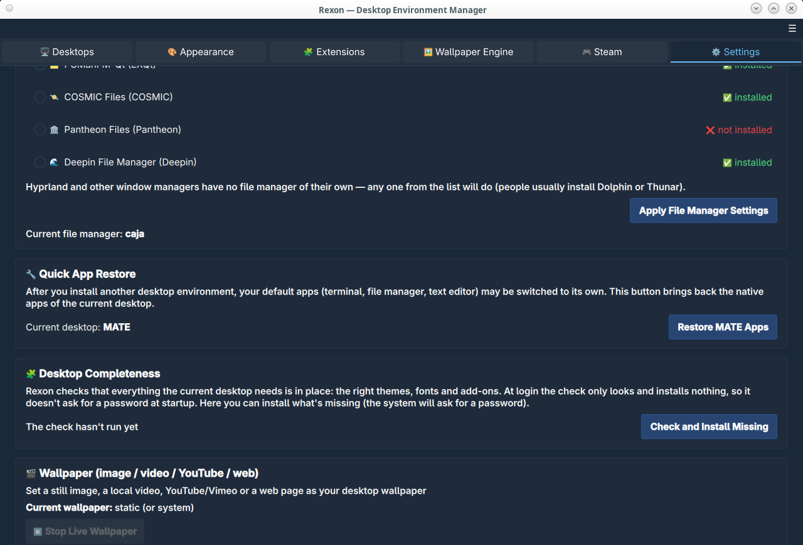
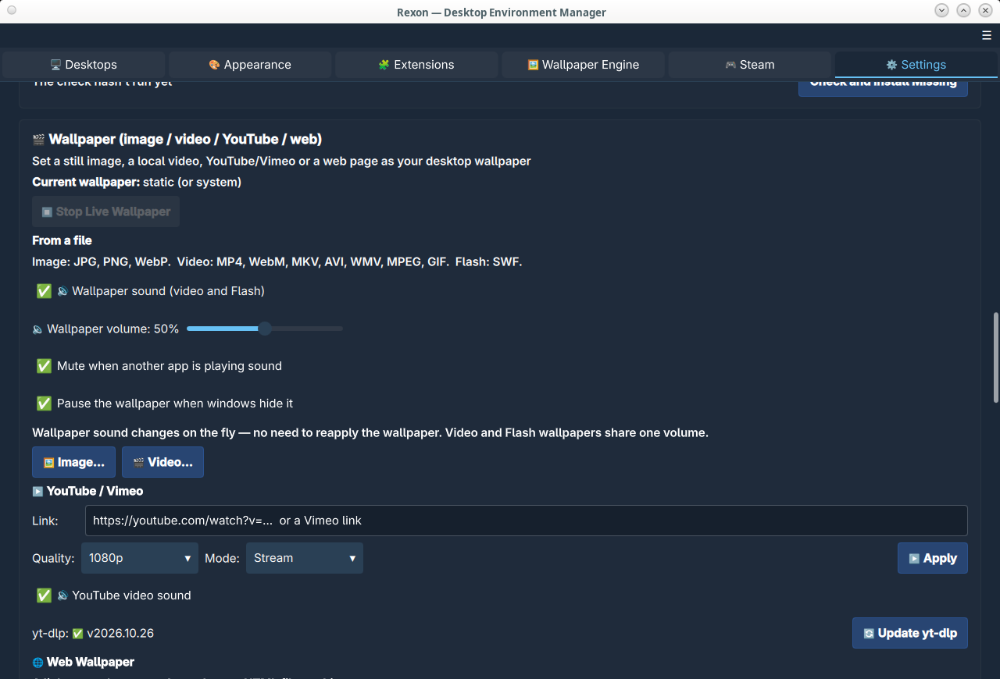

[English](../en/settings.md) | Русский | [Deutsch](../de/settings.md) | [简体中文](../zh-CN/settings.md) | [Français](../fr/settings.md) | [Español](../es/settings.md) | [Українська](../uk/settings.md)

# Настройки

Здесь настраивается сам Rexon (язык, вид окна, значок в лотке) и несколько
общих вещей для всего компьютера: какой файловый менеджер открывает папки,
какие программы открывают файлы по умолчанию, обои из картинки или видео,
фоновые звуки и звуки событий. Разделы идут сверху вниз одной лентой; часть
из них появляется только там, где имеет смысл (например, защита панели —
только на столах, панель которых Rexon умеет сохранять).

## Что на вкладке

| Раздел | Зачем |
| --- | --- |
| 🌐 **Язык** | Язык окон, меню и сообщений Rexon |
| 🎨 **Скин интерфейса** | Цвета окна самого Rexon |
| **Обучение при первом запуске** | Короткие подсказки поверх окна |
| 🔔 **Значок в системном лотке** | Значок у часов и автозапуск |
| 📁 **Файловый менеджер** | Какая программа открывает папки |
| 🔧 **Быстрое восстановление приложений** | Вернуть родные программы текущего стола |
| 🧩 **Комплектность рабочего стола** | Проверить, всё ли нужное столу установлено |
| 🎬 **Обои (картинка / видео / YouTube / веб)** | Обои из файла, видео с YouTube или Vimeo, веб-страница |
| 📚 **Библиотека обоев** | Пакеты обоев Rexon (.rxn) |
| 🪟 **Импорт тем Windows** | Перенести оформление со старого компьютера на Windows |
| 🔒 **Защита приложений по умолчанию** | Не дать новому столу подменить ваши программы |
| 🛡️ **Защита панели** | Копии панелей, апплетов и сочетаний клавиш любого стола |
| 🪟 **Оформление рабочего стола** | Только при установленном оформлении-форке Plasma (AeroShell и т. п.) |

Анимация, шрифты, кнопки заголовка окна, отклик при запуске программ,
значки в программах, размытие обоев, фоновые звуки и звуки событий — во
вкладке «Оформление», там же, где их держат
Параметры системы KDE.

Если вы уже вводили пароль, вверху вкладки видна полоса «🔓 Rexon может
изменять систему до закрытия окна». Кнопка **«Запретить сейчас»** отзывает
это разрешение: в следующий раз Rexon снова спросит пароль.

## Как сменить язык и скин

1. В разделе **🌐 Язык** выберите язык в списке. Первый пункт — «Как в
   системе».
2. Язык сменится после перезапуска Rexon: нажмите **«Перезапустить Rexon»**.
3. В разделе **🎨 Скин интерфейса** выберите вид окна: «Тёмный (Steam)» —
   стандартный, «Светлый», «Тёмный (Material)», «Synthwave / Neon Space Retro»
   или «Системный (как в системе)». Скин меняется сразу.

Скин — это только цвета окна Rexon, а не тема всего рабочего стола. Тему
стола меняют во вкладке «Оформление».

## Обучение при первом запуске

При первом запуске Rexon спрашивает «Показать краткое обучение?». Обучение
занимает около минуты и показывает, где менять темы, обои и оформление.

- Галочка **«Показывать обучение при первом запуске»** включает и выключает
  этот вопрос.
- Кнопка **«Пройти обучение заново»** запускает обучение в любой момент.

## Значок в лотке и автозапуск

Rexon держит значок рядом с часами: оттуда доступны обои, разделы и выход —
без открытия окна. Пока значок на месте, крестик окна прячет Rexon в лоток,
а не закрывает его.

- **«Запускать при входе в систему»** — Rexon поднимется в лоток при входе,
  окно показано не будет.
- **«Докачивать значки и курсоры к теме автоматически»** — если выбранной
  теме не хватает значков или курсора, Rexon скачает их в вашу домашнюю
  папку и применит. Если выключить, он сначала спросит. Наборы, которые
  ставятся только системными пакетами, Rexon всегда спрашивает.

Если в сеансе нет лотка, Rexon так и напишет: значок не поставлен, а крестик
закрывает программу как обычно.

## Файловый менеджер

Выберите, какая программа открывает папки — и в Rexon, и во всей системе.
**«Автоматически (по рабочему столу)»** берёт родной менеджер текущего стола.
Рядом с каждым видно, установлен он или нет. Нажмите **«Применить настройки
файлового менеджера»**. У Hyprland и других оконных менеджеров своего
файлового менеджера нет — подойдёт любой из списка.

## Как вернуть приложения по умолчанию

После установки другого рабочего стола терминал, файловый менеджер и
текстовый редактор могут смениться на его собственные.

**Быстро:** в разделе **🔧 Быстрое восстановление приложений** нажмите
**«Восстановить приложения …»** (там стоит имя вашего стола, например
«Восстановить приложения MATE»).

**Свои программы:** в разделе **🔒 Защита приложений по умолчанию**:

1. Включите **«Включить защиту (рекомендуется)»**.
2. Галочками отметьте, что защищать: файловый менеджер, браузер, почту,
   просмотр картинок, видео, PDF, архивы, музыку, терминал. Рядом видно,
   какая программа запомнена.
3. Нажмите **«📌 Запомнить сейчас»** — Rexon запомнит ваш нынешний выбор.
4. Если программы всё же подменились, нажмите **«↩️ Вернуть как было»**.

## Цвета терминала после смены темы

Некоторые терминалы по умолчанию берут цвета текста и фона из темы. С
неудачной тёмной темой текст в них может стать тёмно-серым на чёрном. Поэтому
после смены темы GTK, глобальной темы, цветовой схемы, светлого/тёмного
режима, цвета акцента или образа «Как в дистрибутиве» Rexon сам даёт таким
терминалам свою читаемую пару цветов: светлый текст на тёмном фоне для
тёмной темы, тёмный на светлом — для светлой.

- **Каких терминалов касается:** mate-terminal, gnome-terminal и Tilix (они
  берут цвета темы по умолчанию), а также xfce4-terminal и Terminator — если
  в них включены цвета из темы. Konsole, Console, Ptyxis, kitty, Alacritty и
  другие терминалы со своими схемами не трогаются.
- **Свои цвета не трогаются.** Если вы сами выбрали цвета в профиле и они
  читаются, Rexon их оставит.
- **Как выключить:** в разделе **🔒 Защита приложений по умолчанию** снимите
  галочку **«Не давать темам портить цвета терминала (рекомендуется)»**. По
  умолчанию она включена.
- **Как вернуть:** прежние цвета терминала Rexon запоминает вместе с темой.
  Кнопка **«Вернуть как было до «…»»** во вкладке «Оформление» (или
  **«↩️ Вернуть как было»** у образа «Как в дистрибутиве») возвращает и их.

## Копии панели

Раздел **🛡️ Защита панели** сохраняет вид панели, апплеты и сочетания клавиш
вашего рабочего стола и возвращает их, если после установки другого стола
что-то сломалось. Он работает на всех столах Rexon: KDE Plasma, GNOME,
Cinnamon, MATE, XFCE, Budgie, Pantheon, LXQt, COSMIC, Deepin, Wayfire,
Hyprland, Sway, niri и river.

1. Нажмите **«📦 Сохранить копию»**. Подсказка над кнопкой говорит, что
   именно копируется на этом столе.
2. Копии этого стола появятся списком «Сохранённые копии». На каждый стол
   хранится до 10 копий; самая первая — **«⭐ исходная, до Rexon»** — не
   стирается никогда.
3. Перед установкой или сменой рабочего стола Rexon сам снимает копии панелей
   **всех установленных столов** — ломается чаще всего не тот стол, который
   ставят, а соседний.
4. Если панель сломалась, нажмите **«Восстановить»** у нужной копии и
   подтвердите. Копии других столов лежат ниже, в свёрнутом блоке **«Копии
   других столов»**: их можно вернуть и отсюда — стол подхватит копию при
   следующем входе в него.

Что стоит знать:

- GNOME, Budgie и Pantheon читают часть сочетаний клавиш из общих настроек.
  Если вернуть сочетания одного из них, изменятся и другие — Rexon назовёт их
  в вопросе перед возвратом.
- В KDE Plasma сочетания возвращаются сразу. Если какое-то сочетание не
  удалось передать работающему столу, Rexon скажет, сколько их вступит в силу
  после повторного входа. У river сочетания всегда применяются только после
  повторного входа.
- В Deepin при возврате сочетаний службы стола на секунду перезапускаются:
  тема, слайд-шоу обоев и питание могут мигнуть. Rexon предупредит заранее.
- Тему, обои, шрифты и цвета защита панели не трогает: у них свои разделы и
  своё «Вернуть как было».

## Обои, звуки и прочее

- **🎬 Обои** — **«🖼️ Картинка…»** и **«🎬 Видео…»** ставят обои из файла
  (картинки JPG, PNG, WebP; видео MP4, WebM, MKV и другие; Flash SWF). Ниже —
  ссылка на YouTube или Vimeo (**Качество**, **Режим**: «Онлайн» или
  «Скачать») и веб-обои по ссылке или из HTML-файла. Для YouTube нужна
  программа yt-dlp: если её нет, Rexon предложит её поставить. **«⏹️
  Остановить живые обои»** убирает живые обои.
- Там же — звук обоев: громкость, «Приглушать, когда звук идёт из другой
  программы» и «Останавливать обои, когда их не видно за окном». Звук
  меняется сразу, переставлять обои не нужно.

  

- **🪟 Импорт тем Windows** — **«📥 Выбрать файл темы…»**: темы (.themepack,
  .theme), визуальные стили (.msstyles), значки, курсоры и видеообои
  DreamScene. Готовая тема появится во вкладке «Расширения».
- **🧩 Комплектность рабочего стола** — **«Проверить и доустановить»**
  проверит, всё ли нужное столу установлено (темы, шрифты, дополнения), и
  поставит недостающее. Система спросит пароль.

## Если что-то пошло не так

- **Язык не сменился.** Нажмите **«Перезапустить Rexon»** — язык меняется
  только после перезапуска.
- **Нет значка у часов.** В этом сеансе нет системного лотка. Rexon работает
  как обычное окно; «Запускать при входе» всё равно поднимет его при входе.
- **Не удалось изменить автозапуск.** Подробности — в журнале Rexon.
- **Программы по умолчанию сменились после установки стола.** Нажмите
  **«Восстановить приложения …»** или **«↩️ Вернуть как было»** в защите
  приложений.
- **«⚠️ Движок обоев не загрузился — раздел недоступен».** Раздел обоев
  работать не будет, пока не запустится движок обоев; откройте вкладку
  Wallpaper Engine и посмотрите, что она пишет.
- **Пропали анимация или шрифты.** Они теперь во вкладке «Оформление» — внизу
  этой вкладки есть ссылки прямо туда.
