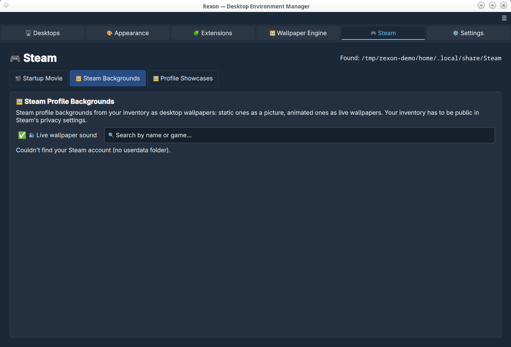

[English](../en/steam.md) | Русский | [Deutsch](../de/steam.md) | [简体中文](../zh-CN/steam.md) | [Français](../fr/steam.md) | [Español](../es/steam.md)

# Steam

Здесь то, что связывает рабочий стол со Steam: видеозаставка при входе в
систему, как на Steam Deck, фоны вашего профиля Steam в качестве обоев и
помощник, который готовит картинку для витрины профиля Steam.

Вкладке нужен установленный Steam. Справа вверху Rexon пишет, где он нашёл
папку Steam, или «Steam не найден — установите Steam, чтобы использовать
заставки и фоны».

Вверху четыре подвкладки: **🎬 Видеозаставка**, **🖼️ Steam-фоны**,
**🖼️ Витрины профиля** и **🌙 Заставка**.

## Видеозаставка при входе

Ролик при входе — фишка Steam Deck. Rexon приносит её на обычный компьютер:
встроенные заставки Valve и те, что вы уже купили в Points Shop, — с полным
звуком и без мелькания стола.

Что на экране:

- **Большое превью** выбранного ролика, его название и откуда он: «Встроенная
  в Steam», из Points Shop или «Свой файл».
- **▶️ Смотреть на весь экран** — показать ролик прямо сейчас так, как он
  будет выглядеть при входе.
- **☆ В избранное** — отметить ролик звёздочкой.
- Строка состояния под превью: «⚪ Выключено — при входе ничего не
  проигрывается» или «✅ Готово: при следующем входе покажется «…»».
- Галочки **Показывать при входе**, **Каждый вход — новый ролик** и
  **🔊 Звук**.
- Поиск по названию, игре или событию и кнопка **📁 Свой файл…** — выбрать
  своё видео (webm, mp4, mkv).
- Ниже — все найденные ролики карточками.

*На снимках — демонстрационные ролики; у вас будут заставки из вашего Steam.*

### Как включить видеозаставку

1. Откройте **Steam** → **🎬 Видеозаставка**.
2. Щёлкните карточку ролика — он появится в большом превью. Чтобы взять своё
   видео, нажмите **📁 Свой файл…**.
3. При желании проверьте его кнопкой **▶️ Смотреть на весь экран**.
4. Включите галочку **Показывать при входе**. Под превью появится
   «✅ Готово: при следующем входе покажется «…»».
5. Хотите каждый раз новый ролик — включите **Каждый вход — новый ролик**.
   Если звёздочкой отмечены хотя бы два ролика, сменяются только они, иначе
   все найденные.

Выключить заставку — снять галочку **Показывать при входе**.

## Steam-фоны

Фоны профиля Steam из вашего инвентаря в качестве обоев рабочего стола:
статичные — картинкой, анимированные — живыми обоями.

*На снимке — компьютер, где в Steam ещё не входили. После входа здесь
появятся ваши фоны.*

Для этого нужно:

- войти в клиент Steam на этом компьютере хотя бы раз;
- сделать инвентарь открытым в настройках приватности Steam.

### Как применить фон профиля

1. Откройте **Steam** → **🖼️ Steam-фоны** и подождите, пока загрузится
   инвентарь.
2. Найдите фон поиском или переключателем **Все / Статичные /
   Анимированные**. Фон, который сейчас стоит в профиле, помечен
   «🎮 надет в профиле». Листать страницы — **‹ Пред.** и **След. ›**.
3. Нажмите **«Применить»** на карточке. Анимированный фон станет видео-обоями;
   галочка **🔊 Звук видео-обоев** решает, будет ли у них звук.

## Витрины профиля

Rexon нарезает вашу картинку под размеры витрины профиля Steam и показывает,
как будет выглядеть профиль. Затем ведёт по шагам загрузки: открывает нужные
страницы Steam, копирует названия и проверяет результат. Сам Rexon в Steam
ничего не загружает — кнопки на страницах Steam нажимаете вы.

Витрины доступны с 10-го уровня Steam.

### Как сделать витрину

1. Нажмите **«Выбрать картинку…»** — подойдут PNG, JPG или GIF (анимация GIF
   сохранится).
2. Выберите **Вид витрины**: **Витрина иллюстраций** (две картинки рядом:
   широкая и узкая) или **Избранная иллюстрация** (одна широкая).
3. Для точного превью выберите **Фон профиля** — из ваших фонов Steam или
   **«Свой фон…»**. Подгоните кадр ползунками **Масштаб**, **Сдвиг по
   горизонтали** и **Сдвиг по вертикали**.
4. Нажмите **«Сохранить части»**. Готовые файлы лежат в папке
   «Изображения/Rexon/steam-showcase», её открывает кнопка **«Открыть папку»**.
5. Пройдите три шага, которые появятся ниже:
   - **Шаг 1. Загрузите части** — **«Открыть страницу загрузки»** откроет
     страницу Steam и папку с частями. Загружайте части по одной, начиная с
     главной; название для каждой копирует кнопка **«Скопировать название»**.
     Видимость оставьте «Для всех». После каждой загрузки отмечайте часть
     здесь галочкой **«Загружено»** — Rexon запомнит, где вы остановились.
   - **Шаг 2. Поставьте их в витрину** — **«Открыть редактор профиля»**,
     выберите витрину, расставьте части по местам, сохраните и отметьте
     **«Готово — части стоят в витрине»**.
   - **Шаг 3. Проверьте** — **«Проверить мой профиль»**: Rexon прочитает
     открытую страницу профиля и сравнит её с вашими частями. Профиль должен
     быть открытым.

Галочку «Я подтверждаю, что я создал это произведение» на странице Steam
ставьте, только если картинка действительно ваша.

## Заставка

Rexon делает заставку для Steam Big Picture: Steam показывает её, когда
Steam Deck, Steam Machine, телевизор или компьютер какое-то время
простаивает. На ней — арт недавних игр и ваши скриншоты или прыгающий
логотип. Rexon только кладёт заставку в папку Steam, а включаете её вы сами
в настройках Steam.

Что на экране:

- Строка состояния: «⚪ Пока не установлена» или «✅ Установлена — …
  картинок».
- **Показывать**: **Слайд-шоу** (арт недавних игр и ваши скриншоты сменяют
  друг друга) или **Прыгающий логотип**.
- Для слайд-шоу — галочки **Арт игр** и **Мои скриншоты** и ползунок
  **Смена картинки каждые** (от 4 до 60 секунд). Под ними Rexon пишет,
  сколько картинок нашёл в вашем Steam.
- Для прыгающего логотипа — **Логотип**: **Логотип Rexon** (меняет цвет при
  каждом ударе о край) или **Логотипы ваших игр**.
- Галочка **Показывать часы**.

### Как поставить заставку

1. Откройте **Steam** → **🌙 Заставка**, выберите, что показывать.
2. Нажмите **«Установить заставку»**. Через несколько секунд в строке
   состояния появится «✅ Установлена». Кнопка **«👁️ Посмотреть»** откроет
   заставку в браузере.
3. Включите её в Steam: в Steam Big Picture откройте «Настройки» →
   «Персонализация» → «Заставка» и выберите «Rexon (User Created)».

Сыграли в новые игры или сделали новые скриншоты — нажмите **«Обновить
заставку»**: Rexon соберёт картинки заново. Этой же кнопкой применяются
изменённые настройки. Убрать заставку из Steam — **«Удалить»** и ещё раз
**«Нажмите ещё раз, чтобы удалить»**.

## Если что-то пошло не так

- **«Steam не найден…».** Установите Steam и запустите его хотя бы раз.
- **«Заставок не найдено».** Steam не установлен или ролики ещё не скачаны.
  Можно выбрать своё видео кнопкой **📁 Свой файл…**.
- **«Сначала выберите заставку».** Щёлкните карточку ролика, а потом уже
  включайте **Показывать при входе** или **Смотреть на весь экран**.
- **«mpv не установлен (нужен для проигрывания)».** Установите программу mpv
  из вашего дистрибутива.
- **«Для смены роликов нужно хотя бы два видео».** Галочка **Каждый вход —
  новый ролик** работает, когда роликов больше одного.
- **«Не удалось определить аккаунт Steam (нет userdata)».** Войдите в клиент
  Steam на этом компьютере.
- **Фоны не загружаются.** Сделайте инвентарь открытым в настройках
  приватности Steam и нажмите **«Повторить»**.
- **Проверка профиля пишет «Профиль скрыт — читать нечего».** Откройте в Steam
  «Редактировать профиль» → «Приватность» и сделайте профиль открытым.
- **Заставки Rexon нет в списке Steam.** Полностью закройте Steam и
  запустите снова.
