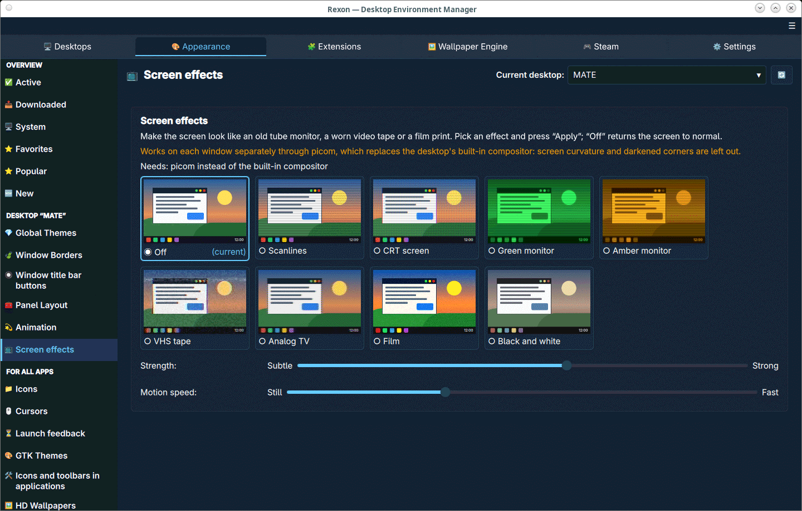

[English](../en/appearance.md) | [Русский](../ru/appearance.md) | [Deutsch](../de/appearance.md) | [简体中文](../zh-CN/appearance.md) | [Français](../fr/appearance.md) | [Español](../es/appearance.md) | Українська

# Вигляд

Тут змінюють вигляд комп’ютера: теми, кольори, піктограми, курсори, шрифти,
обрамлення вікон, анімацію, екран входу й заставку завантаження. Rexon показує
лише те, що справді працює на вашій стільниці, і прямо каже, на що вплине
кожен розділ — на саму стільницю, на всі програми чи лише на деякі. Нові теми
можна взяти з крамниці KDE Store, з AUR, з Cinnamon Spices або встановити з
файлу, який уже є на комп’ютері.

## Як улаштована вкладка

Ліворуч — бічна панель із розділами, праворуч — вміст вибраного розділу.
Над вмістом:

- **Пошук** — шукає за назвою, автором і мітками.
- **Крамниця:** — звідки брати нові теми: **KDE Store**, **AUR** або
  **Усі** (обидва джерела в одному списку). У розділах Cinnamon натомість —
  каталог Cinnamon Spices, той самий, що в налаштуваннях самого Cinnamon.
- **Поточне середовище:** — для якої стільниці показувати вигляд. Зазвичай
  воно визначається саме за поточним сеансом. Можна вибрати іншу стільницю,
  наприклад, щоб заздалегідь дібрати теми для стільниці, на яку ви збираєтеся
  перейти. Тайлові стільниці (Hyprland, Sway, niri) зведено в один пункт:
  набір тем у них однаковий.
- **Сортування** — «🆕 Нові», «⬇️ Завантаження», «⭐ Рейтинг», «🔤 Абетка».
- **Встановити з файлу…** — встановити тему, яка вже є на комп’ютері.
- **🔄 Оновити каталог** — заново завантажити список.

У розділі спершу йдуть уже встановлені теми, нижче — товари з крамниці.
Унизу — кнопки «← Назад» і «Вперед →» для гортання сторінок.

### Огляд

Перша група бічної панелі — «Огляд». Ці розділи не прив’язані до одного
виду оформлення:

- **Активні** — усе, що ввімкнено просто зараз: тема, піктограми, курсор,
  заставка завантаження, ефекти вікон тощо.
- **Завантажені** — те, що ви встановили самі.
- **Системні** — те, що прийшло разом із системою та пакунками.
- **Обране** — теми, позначені кнопкою «☆ Обране».
- **Популярні** і **Нові** — вітрина крамниці з найходовішим для вашої
  стільниці: піктограмами, курсорами, темами GTK, шпалерами тощо.

### Групи розділів

Решту розділів розкладено за групами. Заголовок групи відповідає на питання
«на що це вплине»:

- **Стільниця «…»** — рідний вигляд стільниці, яку вибрано в полі
  «Поточне середовище».
- **Для всіх програм** — те, що підхоплюють усі програми: піктограми,
  курсори, теми GTK, шрифти, звуки, шпалери.
- **Програми Qt і KDE** — з’являється поза KDE і LXQt. Тут кольори й стиль
  програм на кшталт VLC, qBittorrent, Krita, Dolphin. Сама стільниця при цьому
  не змінюється.
- **Віджети стільниці** — віджети Plasma, десклети Cinnamon і віджети
  Conky (годинник, погода, датчики системи; Conky працює на будь-якій
  стільниці).
- **Система: завантаження і вхід** — екран входу й заставка під час
  увімкнення комп’ютера. Вони спільні для всіх стільниць на цьому комп’ютері.

Якщо розділу для вашої стільниці немає, Rexon його не показує. А якщо ви
відкрили розділ, який на вибраній стільниці не працює, замість порожньої
полиці буде пояснення, чому, і порада вибрати інший розділ ліворуч.

### Плитка теми

Кожна тема має плитку із зображенням, назвою та кнопками:

- **Встановити** — завантажити й встановити тему з крамниці;
- **🎨 Застосувати** — увімкнути вже завантажену тему;
- **✅ Застосовано** — тему ввімкнено зараз (натискання застосує її знову);
- **▶️ Увімкнути** / **⏸️ Вимкнути** — у доповнень: ефектів і скриптів
  KWin, розширень і аплетів;
- **▶️ Запустити** / **⏹️ Зупинити** — у віджетів Conky;
- **☆ Обране** — позначити тему;
- **🗑️** — вилучити.

Клацання по зображенню відкриває сторінку теми: знімки екрана (стрілки ◀️ ▶️
гортають, клацання відкриває зображення на весь екран), опис, оцінку, кількість
завантажень, коментарі та кнопки **🌐 Відкрити на сайті** і
**🔗 Копіювати посилання**. Назад — **← Назад до каталогу**.

## Розділи

### Глобальні теми

Глобальна тема — готовий набір усього одразу: кольори, стиль програм,
обрамлення вікон, піктограми, курсори, заставка й іноді розташування панелей.
Над плитками є кнопка **Зберегти поточний вигляд…** і блок **Світлий і темний**
(про нього нижче).

Натисніть «🎨 Застосувати» біля теми — відкриється вікно «Застосувати «…»?».
Там видно, що саме встановить тема. Кнопка **Вибрати компоненти вигляду…**
розгортає докладний список: можна зняти позначки з того, що змінювати не
потрібно.

Пункт **Розташування стільниці й віджетів** типово вимкнено. Якщо його
ввімкнути, Rexon попередить: розташування вилучить нинішні стільниці, панелі,
доки й віджети та замінить їх тими, що задано в темі.

Глобальні теми зроблено для KDE Plasma, але Rexon уміє застосовувати їх і на
інших стільницях — частинами, лише те, що на цій стільниці є: кольори
(для програм Qt), стиль програм, піктограми, курсори, шрифти й кнопки
заголовка. Те, що існує лише в Plasma (панелі, стиль Plasma, заставка Plasma),
у списку вимкнено, і поруч сказано чому.

### Кольори: схеми кольорів, колір акценту, світлий і темний

У KDE розділ називається **Схеми кольорів**, на інших стільницях — **Кольори
Qt-програм** (там схема фарбує лише програми Qt і KDE). Над плитками є
перемикач **Вигляд:** — «Усі», «Світлі», «Темні».

**Колір акценту** — колір виділення, прапорців і активних кнопок. Варіанти:

- **Зі схеми кольорів** (або **Як у темі** на інших стільницях) — той, що
  задано в схемі;
- **Зі шпалер** — колір береться із зображення на стільниці. Rexon оновлює
  його, коли сам змінює шпалери; якщо шпалери змінили не через Rexon, знову
  натисніть «Зі шпалер»;
- **Свій колір** — один із готових кружечків або будь-який через
  **Вибрати колір…**.

Під кнопками написано, хто отримає колір на вашій стільниці. Наприклад, у
GNOME лише дев’ять кольорів акценту, і програми GTK 4 отримають найближчий.
Кнопка **Повернути як було** повертає колір, який стояв до Rexon.

**Світлий і темний** — пари тем на день і на ніч. Блок є в розділах
«Глобальні теми» і «Схеми кольорів» у KDE, «Схеми кольорів» і «GTK-теми»
на інших стільницях.

1. Позначте частини, які потрібно змінювати: глобальна тема (лише KDE),
   схема кольорів, тема GTK, піктограми, шпалери.
2. Для кожної виберіть світлий і темний варіант.
3. Натисніть **Світлий**, **Темний** або **Автоматично**. У режимі
   «Автоматично» виберіть **Від заходу до світанку** (місце визначається за
   часовим поясом або вводиться широтою й довготою) або **За часом** —
   «Світлий з» і «Темний з».
4. Натисніть **Зберегти**.

Прапорець **Світлий або темний режим програм** заодно перемикає режим
програм, які вміють слідувати за системою. У заголовку згорнутого блока
видно, що зараз увімкнено, наприклад «Світлий і темний: за розкладом
07:00–19:00».

Встановлена схема кольорів має на своїй сторінці кнопки **Змінити…**
(основні кольори схеми; якщо встановлено редактор KDE — відкривається він) і
**Створити на основі…** (нова схема з цієї, вихідна лишається як є).

### Обрамлення вікон і кнопки заголовка

Обрамлення вікон у кожному середовищі своє: у KDE — **Вікна (Aurorae)**, у
XFCE, MATE і LXQt (Openbox, labwc) — **Обрамлення вікон**. У Cinnamon
обрамлення малює тема GTK.

Кнопки заголовка вікна налаштовуються там само, у розділі обрамлення: кнопка
**⚙️ Налаштування** в його шапці (як вкладка «Кнопки заголовка» модуля
«Обрамлення вікон» KDE), назад — **←  Назад до каталогу**. У Cinnamon це
розділ **Тема Cinnamon**; у стільниць без власного розділу обрамлення (GNOME,
Budgie, Pantheon, COSMIC, Deepin, тайлові) — розділ **GTK-теми**: там
заголовки малює тема GTK або самі програми GTK. У налаштуваннях:

- **Розташування кнопок:** — «Праворуч (як у Windows)» або «Ліворуч (як у
  macOS)»;
- кнопки можна перетягувати між полицею і смугою «Заголовок вікна»; без
  миші — виберіть кнопку й натискайте «Лівіше», «Правіше», «Прибрати із
  заголовка», «Додати ліворуч», «Додати праворуч»;
- **Розмір рамки вікна:** — від «Без рамок» до «Колосальні»;
- у KDE ще три прапорці: закривати вікна подвійним клацанням по кнопці меню,
  показувати підказки кнопок і завжди показувати кнопку «Приховати від
  знімків і запису екрана»;
- **Типово** — повернути початкове компонування.

Якщо якоїсь кнопки у віконного менеджера вашої стільниці немає, Rexon про це
скаже.

### Стиль програм

**Стиль програм** (поза KDE і LXQt — **Стиль Qt-програм (Kvantum)**)
показує однією сіткою стилі Qt і теми Kvantum. Перемикач над сіткою:
«Усі», «Стилі Qt», «Kvantum». Нові теми Kvantum беруться з KDE Store,
готові стилі Qt (Darkly, Lightly, Klassy) — з AUR.

### Піктограми, курсори, відгук під час запуску

- **Піктограми** і **Курсори** — теми піктограм і вказівника. Кнопка
  **⚙️ Налаштування** в шапці розділу «Піктограми» відкриває там само
  піктограми в меню й на кнопках і підписи на панелях інструментів у програмах
  («Лише піктограми», «Лише текст», «Текст поруч із піктограмами», «Текст під
  піктограмами»); **←  Назад до каталогу** повертає до тем. У розділі курсорів
  є поле **Розмір:** — розмір вказівника в пікселях. Rexon застосовує його в
  налаштуваннях стільниці, у програмах GTK і Qt та в конфігурації sway, niri
  або Hyprland.
- **Відгук під час запуску** (лише KDE) — кнопка **⚙️ Налаштування** в шапці
  розділу «Курсори»: як вказівник і панель завдань показують, що програма
  запускається: вказівник «Немає», «Нерухомий», «Блимальний» або «Стрибучий»,
  анімація кнопки на панелі завдань і через скільки її зупинити. Де у
  стільниці такого налаштування немає, немає й кнопки.

### Теми GTK

Теми програм на GTK (Firefox, GIMP, більшість програм GNOME, XFCE, MATE,
Cinnamon). На стільницях GNOME, Cinnamon, MATE і XFCE поруч є й власні
розділи: **Тема оболонки GNOME**, **Тема Cinnamon**, **Тема LXQt** та інші.
На стільницях без анімацій вікон кнопка **⚙️ Налаштування** в шапці розділу
відкриває прапорець **Без анімацій** — анімація всередині програм.

### Шрифти й керування шрифтами

Розділ **Шрифти** (з піктограмою 🔤 у групі «Для всіх програм») — шрифти з
крамниці KDE Store. Кнопка **⚙️ Налаштування** в його шапці відкриває там
само системні шрифти: шрифти інтерфейсу, термінала, дрібних підписів, панелей
інструментів, меню й заголовків вікон; **←  Назад до каталогу** повертає до
крамниці. Натисніть кнопку потрібного шрифту, щоб вибрати родину й кегль, або
**🔤 Змінити всі шрифти…**, щоб задати один шрифт усім одразу. Нижче —
**Згладжування тексту** (згладжування, субпіксельне відтворення, хінтинг) і
**Примусове DPI шрифтів**.

Кнопка **🗂️ Керування шрифтами…** відкриває список усіх шрифтів на
комп’ютері:

- зразок кожного шрифту і таблиця його символів;
- **➕ Встановити з файлу…** — для себе або для всіх користувачів (у другому
  разі Rexon запитає пароль адміністратора);
- **Вилучити** — лише шрифти, які встановили ви. Системні шрифти можна
  тільки переглянути;
- **Вимкнути** / **Увімкнути** — приховати шрифт від усіх програм, не
  видаляючи файл;
- **🔍 Знайти дублікати** — накреслення, які є в кількох файлах;
- власні групи шрифтів (**➕ Нова група…**), увімкнення й вимкнення всієї
  групи, вивантаження групи в ZIP-архів.

### Шпалери й звуки

- **Шпалери HD** — зображення для стільниці з крамниці. Кнопка
  **⚙️ Налаштування** в шапці розділу — **🌫️ Розмиття шпалер**: розмиває
  шпалери-зображення, щоб піктограми й вікна поверх читалися легше (повзунок
  **Сила**, **Розмити шпалери**, **Прибрати розмиття**); оригінал
  зберігається. Якщо на комп’ютері є Razer Axon (під Wine), у полі
  **Крамниця:** є й **Razer Axon** — завантажені в ньому шпалери: пошук за
  назвами або тегами, сортування й фільтри, як у самому Axon; клацання правою
  кнопкою по плитці — **Застосувати** (на всі екрани), **Перейти до
  розташування файлу** і **Докладніше**. У **⚙️ Налаштуваннях** розділу тоді
  є блок **Razer Axon**: **Готувати шпалери заздалегідь** і **Повернути
  оригінальні описи**.
- **Шпалери-додатки** (лише KDE) — живі шпалери Plasma.
- **Звуки** — звукові теми. Звуки теми можна прослухати до встановлення
  (**🔊 Прослухати до встановлення**): тема завантажується в тимчасову теку,
  і нічого не встановлюється. Якщо системні звуки вимкнено, Rexon запропонує
  їх **Увімкнути**. Кнопка **⚙️ Налаштування** в шапці розділу — **🔔 Звуки
  подій** (звукова тема стільниці, увімкнення звуків подій, перевірка звуку)
  і **🔊 Фонові звуки** (**➕ Додати файл…** відтворює звук по колу,
  гучність, **⏹️ Зупинити всі**, список звуків, що грають). Фонові звуки
  грають і після виходу з розділу.

Рухомі шпалери — на вкладці Wallpaper Engine.

### Анімація та ефекти екрана

Ці розділи — останні в групі стільниці.

- **Анімація** — **Без анімацій** або **Швидкість анімацій:** від «Повільно»
  до «Швидко», а також вибір ефектів: відкриття й закриття вікон,
  згортання, перемикання стільниць, спливні вікна тощо. Де у віконного
  менеджера немає анімацій вікон (MATE, Xfce, LXQt, Deepin, sway та інші
  тайлові, крім Hyprland і niri), розділу немає: прапорець **Без анімацій**
  для програм — кнопка **⚙️ Налаштування** в розділі «Теми GTK».
- **Ефекти екрана** — екран як старий кінескопний монітор, затерта
  відеокасета або кіноплівка: «Рядки розгортки», «Кінескоп», «Зелений
  монітор», «Бурштиновий монітор», «Відеокасета», «Аналогове ТБ»,
  «Кіноплівка», «Чорно-білий». Повзунки **Сила:** і **Швидкість руху:**.
  Як розділ працює на вашій стільниці і що для цього потрібно, написано
  вгорі (рядок «Потрібно: …»). Там, де ефекти ввімкнути ніяк не можна (sway,
  river, labwc, niri, Budgie, Deepin), розділу немає; у MATE, Xfce і LXQt
  його немає в сеансі Wayland — там ефекти працюють лише на X11.

### Віджети

- **Віджети** (KDE) — віджети Plasma з крамниці.
- **Десклети Cinnamon**, **Аплети Cinnamon**, **Розширення Cinnamon**,
  **Дії Nemo** — з Cinnamon Spices.
- **Віджети Conky** — годинник, погода, датчики системи. Їхня кнопка —
  **▶️ Запустити** / **⏹️ Зупинити**, а на сторінці віджета є прапорець
  **Запускати під час входу в систему**.

### Екран входу, екран блокування, заставки

- **Екран входу в систему** — теми SDDM. Над ними блок **Менеджер входу**:
  яка програма показує екран входу і яка буде основною (нова основна
  з’явиться після перезавантаження, поточний сеанс не переривається). Якщо
  екран входу малює Plasma Login Manager, сторонніх тем у нього немає — Rexon
  запропонує **Відкрити налаштування екрана входу**.
- **Заставка завантаження (Plymouth)** — те, що видно під час увімкнення
  комп’ютера, до входу в систему.
- **Екран блокування** (KDE і Deepin) — два режими: **🔒 Повні теми**
  (застосовується лише частина теми, що відповідає за блокування) і
  **🖼️ Шпалери блокування** (зображення на тлі, вигляд екрана не змінюється).
- **Вікно вітання KDE** — заставка під час входу в Plasma.

Екран входу й заставка завантаження — системні: під час встановлення Rexon
запитає пароль адміністратора. На SteamOS (Steam Deck, Steam Machine) ці
розділи закрито, і Rexon одразу пояснює чому.

### Розділи окремих стільниць

- KDE: **Стилі Plasma**, **Перемикач вікон (Alt+Tab)**, **Скрипти KWin**,
  **Ефекти KWin** — нові ефекти з KDE Store; кнопка **⚙️ Налаштування**
  вгорі розділу вмикає й налаштовує ефекти, які вже є в KWin («Чарівна
  лампа», прозорість, розмиття та інші), — з пошуком і кнопкою
  «Налаштувати…» біля кожного.
- GNOME: **Тема оболонки GNOME**, **Розширення GNOME**.
- MATE: **Компонування панелі** — готові компонування панелі однією кнопкою.

## Як зробити

### Застосувати глобальну тему частинами

1. Відкрийте **Глобальні теми**.
2. Натисніть **🎨 Застосувати** біля потрібної теми (або **Встановити**, якщо
   її ще немає, а потім «Застосувати»).
3. У вікні натисніть **Вибрати компоненти вигляду…**.
4. Зніміть позначки з того, що змінювати не потрібно, наприклад «Піктограми»
   або «Курсори».
5. Натисніть **Застосувати**.

На інших стільницях вікно одразу відкривається докладним, і вимкнені пункти
пояснюють, чому їх сюди не перенесено.

### Зберегти поточний вигляд

1. Відкрийте **Глобальні теми**.
2. Натисніть **Зберегти поточний вигляд…**.
3. Введіть **Назва:** (і за бажання **Автор:**).
4. У списку **Що зберегти:** залиште позначеним те, що потрібно.
5. Виберіть зображення для плитки: **Зробити знімок екрана…**, **Вибрати
   зображення…** або **Плитка в кольорах теми**.
6. Натисніть **Зберегти**.

Нова тема одразу з’явиться серед плиток. Її можна застосувати тут або на
будь-якій іншій стільниці — повністю чи частинами, — і в Plasma теж.

### Змінити кольори, акцент, світлий і темний

1. Відкрийте **Схеми кольорів** (або **Кольори Qt-програм**).
2. Натисніть **🎨 Застосувати** біля потрібної схеми.
3. У блоці **Колір акценту** виберіть **Зі схеми кольорів**, **Зі шпалер**
   або **Свій колір**.
4. Щоб вигляд сам змінювався вдень і вночі, розгорніть **Світлий і
   темний**, виберіть пари тем, натисніть **Автоматично** і **Зберегти**.

### Встановити тему з крамниці, з AUR або з файлу

**З крамниці:**

1. Відкрийте потрібний розділ, наприклад **Піктограми**.
2. У полі **Крамниця:** залиште **KDE Store**.
3. Знайдіть тему пошуком або в списку й натисніть **Встановити**.
4. Коли встановлення завершиться, натисніть **🎨 Застосувати**.

**З AUR** (дистрибутиви на основі Arch):

1. У полі **Крамниця:** виберіть **AUR** (або **Усі**).
2. Введіть у пошук хоча б кілька літер.
3. Відкрийте сторінку пакунка. Rexon показує, чи все з ним гаразд: чи
   покинуто пакунок, чи позначено його застарілим, чи змінився супровідник,
   чи не замало в нього голосів. Кнопка **📄 Показати PKGBUILD** показує
   рецепт збирання.
4. Натисніть **Встановити**. Пакунок збирається з початкового коду — це може
   забрати час. Для збирання потрібен paru або yay.

**З файлу:**

1. Натисніть **Встановити з файлу…**.
2. Натисніть **Вибрати файли…** або **Вибрати теку…**.
3. Вкажіть архів, теку або окремі файли — шрифти, курсори й піктограми з
   Windows, схеми кольорів, шпалери.

Rexon сам визначить, що це, і встановить у потрібний розділ. Якщо тема
змінює системний екран (вхід, завантаження), Rexon попросить встановити її з
того розділу — там запитають пароль адміністратора.

### Повернути як було

- Після застосування теми над плитками з’являється рядок
  **«Повернути як було до «…»»**: перед застосуванням Rexon зберіг те, що
  було. Уже відкриті програми можуть показати повернення лише після
  перезапуску або нового входу.
- Поза Plasma схеми кольорів мають **Повернути кольори як були**.
- Колір акценту й ефекти екрана мають **Повернути як було**.
- У розділах із кнопкою **Типово** («Кнопки заголовка вікна», «Відгук під
  час запуску», «Анімація» тощо) вона повертає початкові налаштування.
- Тему, вилучену кнопкою 🗑️, спершу лише позначено: унизу кілька секунд
  висить рядок із кнопкою **Повернути**.

### Увімкнути ефект екрана

1. Відкрийте **Ефекти екрана**.
2. Виберіть ефект, наприклад **Кінескоп**.
3. Налаштуйте **Сила:** і **Швидкість руху:**. Рухомі ефекти весь час
   навантажують відеокарту; на позначці **Завмерло** зображення не
   змінюється й майже нічого не коштує.
4. Натисніть **Застосувати**.
5. З’явиться питання «Залишити цей ефект? Інакше за 15 с екран повернеться
   як був». Натисніть **Залишити**. Якщо екран став темним або незрозумілим,
   нічого не натискайте: за 15 секунд усе повернеться саме. Кнопка
   **Повернути** повертає одразу.

Щоб вимкнути ефект, виберіть **Вимкнено** й натисніть «Застосувати» або
натисніть **Повернути як було**.

## Якщо щось пішло не так

- **Розділу немає на бічній панелі.** Отже, на вибраній стільниці він не
  працює. Перевірте поле **Поточне середовище:** — можливо, вибрано не ту
  стільницю.
- **Тему застосовано, але програма має старий вигляд.** Уже відкриті
  програми часто підхоплюють новий вигляд лише після перезапуску або нового
  входу в систему.
- **Схема кольорів не дійшла до програм Qt поза KDE.** Rexon скаже, якщо не
  встановлено qt6ct: без нього кольори отримають лише програми KDE (Dolphin,
  Kate, Okular).
- **«Крамниця KDE зараз не відповідає».** Це збій на боці крамниці;
  спробуйте пізніше або натисніть **🔄 Оновити каталог**.
- **Не встановлюється з AUR.** Потрібен збирач пакунків paru або yay. Пошук
  в AUR починає працювати з кількох літер.
- **«Тема у застарілому форматі Plasma 5».** Plasma 6 таку тему не
  застосовує — потрібна версія теми під Plasma 6.
- **Активну тему не можна вилучити.** Спершу ввімкніть іншу. Системні теми
  (з пакунків) Rexon теж не вилучає — вони зникають разом зі своїм пакунком.
- **Після ефекту екрана щось не так.** Нічого не натискайте 15 секунд —
  ефект зніметься сам. Пізніше — **Повернути як було** в розділі «Ефекти
  екрана».
- **Тема екрана входу не діє.** Теми цього розділу — для SDDM. Якщо екран
  входу показує інша програма, Rexon напише про це над плитками; вибрати
  основну можна в блоці **Менеджер входу**.
- **Зламалися панелі після глобальної теми.** Таке буває, лише якщо було
  ввімкнено пункт «Розташування стільниці й віджетів». Натисніть
  **Повернути як було до «…»**; у KDE Plasma, MATE і XFCE заздалегідь можна
  зробити копію панелі на вкладці «Стільниці» («🛟 Зберегти панель»).

