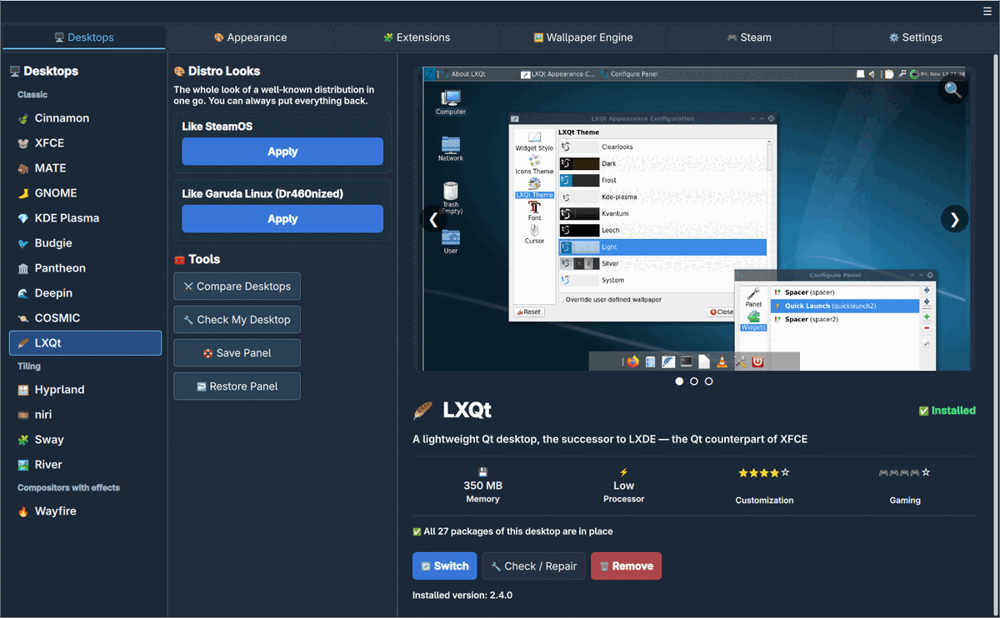
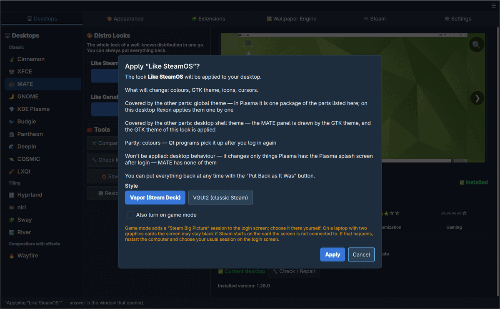

[English](../en/desktops.md) | [Русский](../ru/desktops.md) | [Deutsch](../de/desktops.md) | [简体中文](../zh-CN/desktops.md) | [Français](../fr/desktops.md) | [Español](../es/desktops.md) | Українська

# Стільниці

На цій вкладці стільниці встановлюють, перемикають і вилучають. Тут також
можна перевірити, чи все на місці у вашій стільниці, порівняти стільниці між
собою та одним натисканням зробити стільницю схожою на відомий дистрибутив.

## Що є на вкладці

**Список стільниць (ліворуч).** Стільниці поділено на групи: «Класичні»
(Cinnamon, XFCE, MATE, GNOME, KDE Plasma, Budgie, Pantheon, Deepin, COSMIC,
LXQt), «Тайлові» (Hyprland, niri, Sway, River) і «Композитори з ефектами»
(Wayfire). Якщо стільницю не можна встановити у вашому дистрибутиві, про це
сказано просто в списку.

**Картка стільниці (праворуч)** — усе про вибрану стільницю:

- знімки екрана (стрілки гортають, лупа або клацання по зображенню
  відкривають його на весь екран);
- стан: «Встановлено», «Не встановлено», «Поточна стільниця»;
- короткий опис і чотири оцінки: «Пам’ять» (скільки займає одразу після
  входу), «Процесор», «Налаштування» та «Ігри»;
- скільки пакунків стільниці вже встановлено, яких бракує і для яких вийшли
  оновлення;
- встановлена версія і, якщо є, новіша з репозиторіїв;
- кнопки дій:
  - **📦 Встановити** — у стільниці, якої ще немає;
  - **🔄 Перемкнутися** — вийти із сеансу й увійти в цю стільницю;
  - **🔧 Перевірити / Відновити** — знайти й доставити відсутні пакунки;
  - **🗑️ Вилучити** — прибрати стільницю. У поточної стільниці цієї кнопки
    немає;
  - **➕ Додати варіант Wayland** — у встановленої стільниці, яка вміє
    працювати і на X11, і на Wayland, якщо варіант Wayland ще не встановлено.
- у Hyprland, niri і Sway — блок **«Оболонки»**: готові панелі з меню
  запуску та сповіщеннями (Noctalia, DankMaterialShell). Їх можна
  встановити, увійти з ними або вилучити.

**🎨 Як у дистрибутиві (посередині).** Готовий вигляд відомого дистрибутива
цілком: зараз «Як у SteamOS» і «Як у Garuda Linux (Dr460nized)». У
застосованого образу з’являється кнопка **↩️ Повернути як було**.

**🧰 Інструменти (під ним):**

- **⚔️ Порівняння стільниць** — таблиця всіх стільниць поруч;
- **🔧 Перевірити мою стільницю** — те саме, що «Перевірити / Відновити», але
  для стільниці, у якій ви зараз працюєте;
- **🛟 Зберегти панель** і **↩️ Повернути панель** — копія налаштувань панелі
  на випадок, якщо експерименти з темами її зламають. Ці кнопки є лише в KDE
  Plasma, MATE і XFCE.

## Як це зробити

### Встановити стільницю

1. Виберіть стільницю в списку ліворуч.
2. Натисніть **📦 Встановити**.
3. У вікні «Встановити?» перевірте, що буде встановлено. Якщо стільниця має
   вибір «Як працюватиме стільниця», виберіть варіант (див. нижче).
4. Підтвердьте й введіть пароль адміністратора, коли система його запитає.
5. Коли з’явиться «Встановлення завершено», вийдіть із сеансу й виберіть
   нову стільницю на екрані входу. Якщо стільниці потрібне
   перезавантаження, Rexon напише про це в тому самому вікні.

### Вибрати X11 або Wayland

Cinnamon, XFCE, MATE і LXQt мають два варіанти роботи. Вибір з’являється
просто у вікні «Встановити?» в рядку «Як працюватиме стільниця»:

- **X11 — перевірений** — так стільниця працює роками, усі програми й
  налаштування поводяться як слід;
- **Wayland — новіший** — зображення плавніше й чіткіше на екранах із
  високою роздільністю. У деяких стільниць він поки експериментальний:
  частина програм, аплетів панелі й налаштувань може не працювати;
- **Wayland — експериментально, з AUR** — так позначено Wayland у MATE: його
  збирають з AUR на вашому комп’ютері, і Rexon попереджає про це просто у
  вікні.

Рекомендований варіант позначено «(рекомендовано)». Якщо вибрати Wayland,
варіант X11 теж залишиться — на екрані входу будуть обидва. Наприкінці Rexon
підкаже, який сеанс вибрати під час входу. Варіант Wayland можна додати й
пізніше — кнопкою **➕ Додати варіант Wayland** на картці.

### Перемкнутися на іншу стільницю

1. Виберіть встановлену стільницю в списку.
2. Натисніть **🔄 Перемкнутися**.
3. Збережіть відкриті документи й підтвердьте. Rexon збереже копію
   налаштувань поточної стільниці й завершить сеанс.
4. На екрані входу виберіть нову стільницю.

### Вилучити стільницю

1. Виберіть стільницю й натисніть **🗑️ Вилучити**.
2. У вікні «Вилучити?» Rexon покаже, яка стільниця зараз поточна, — її це
   не зачепить. Підтвердьте й введіть пароль.

Вилучити не можна:

- **поточну стільницю** — інакше після наступного входу буде чорний екран.
  Спершу перемкніться на іншу стільницю, увійдіть у неї і лише потім
  вилучайте;
- **останню встановлену стільницю** — спершу встановіть іншу.

Спільні з іншими програмами пакунки залишаються: вилучається лише те, що
більше нічому не потрібне.

### Перевірити й відновити стільницю

Якщо стільниця поводиться дивно (зникла панель, не відкриваються
налаштування), натисніть **🔧 Перевірити мою стільницю** в «Інструментах» або
**🔧 Перевірити / Відновити** на картці будь-якої встановленої стільниці.
Rexon звірить список пакунків стільниці й доставить відсутні. Якщо картка
вже пише, що бракує пакунків, ця кнопка їх і встановить.

### Порівняти стільниці

Натисніть **⚔️ Порівняння стільниць**. Відкриється таблиця «Усі стільниці»:
пам’ять, навантаження на процесор, на чому побудована стільниця і що малює
вікна. Рядок можна розгорнути. Кнопки «Швидкі пари» показують часті
порівняння поруч (наприклад, XFCE ↔ KDE). Повернутися — кнопкою
**← Стільниці**.

### Зробити стільницю «як у дистрибутиві»

1. У блоці **🎨 Як у дистрибутиві** натисніть **Застосувати** біля потрібного
   образу.
2. Rexon перевірить, що для цього потрібно, і покаже вікно: що зміниться,
   що у вашій стільниці застосується лише частково, а що не застосується
   зовсім. Для образу SteamOS можна вибрати стиль і за бажанням увімкнути
   ігровий режим.
3. Натисніть **Застосувати**. Якщо для образу потрібні програми, Rexon
   встановить їх і запитає пароль.
4. Передумали — натисніть **↩️ Повернути як було**: повернуться попередній
   вигляд і налаштування. Встановлені для образу програми залишаться, їх
   можна вилучити самостійно.

## Якщо щось пішло не так

- **Після встановлення стільниці немає на екрані входу.** Вийдіть із сеансу
  ще раз. Якщо Rexon написав, що потрібне перезавантаження, перезавантажте
  комп’ютер. Для Cinnamon, XFCE, MATE і LXQt перевірте, який сеанс (X11 чи
  Wayland) ви вибираєте.
- **Стільниця запускається без панелі або з помилками.** Увійдіть у будь-яку
  іншу стільницю або залишіться в цій і натисніть **🔧 Перевірити мою
  стільницю**.
- **Тема зламала панель.** Якщо ви заздалегідь натиснули **🛟 Зберегти
  панель**, натисніть **↩️ Повернути панель**.
- **Не подобається образ «як у дистрибутиві».** Кнопка **↩️ Повернути як
  було** на його плитці.
- **Вікно «Пакунок більше не оновлюється».** У системі залишився пакунок,
  який прибрали з репозиторіїв. Якщо ви ним не користуєтеся, Rexon може його
  вилучити; інакше натисніть «Не зараз».
- **«Стільницю не визначено».** Rexon не розпізнав стільницю, у якій ви
  працюєте. Виберіть її в списку ліворуч і натисніть **🔧 Перевірити /
  Відновити** на її картці.
- **Потрібно відкотити всю систему.** Сам Rexon знімків системи не робить.
  Якщо у вас налаштовано snapper із snap-pac (так буває в CachyOS та інших
  дистрибутивах на Btrfs), знімок створюється автоматично перед кожним
  встановленням і вилученням пакунків, і до нього можна повернутися засобами
  snapper (наприклад, через Btrfs Assistant).
- **Після перемикання зникла панель KDE Plasma.** Перед перемиканням із
  Plasma Rexon зберігає її панель; повернути її можна в **Налаштування →
  🛡️ Захист панелі KDE Plasma**. Якщо нова стільниця перехопила типовий
  браузер або програвач, загляньте в **Налаштування → 🔒 Захист типових
  програм**.

## Див. також

- [Вигляд](appearance.md) — теми, піктограми, курсори, шрифти, екран входу
- [Розширення](extensions.md) — пакунки `.rxn` і теми Windows
- [Wallpaper Engine](wallpaper-engine.md) — живі шпалери
- [Steam](steam.md) — заставка під час входу та тла профілю
- [Налаштування](settings.md) — резервні копії та параметри Rexon
- [Зміст посібника](../README.md)
