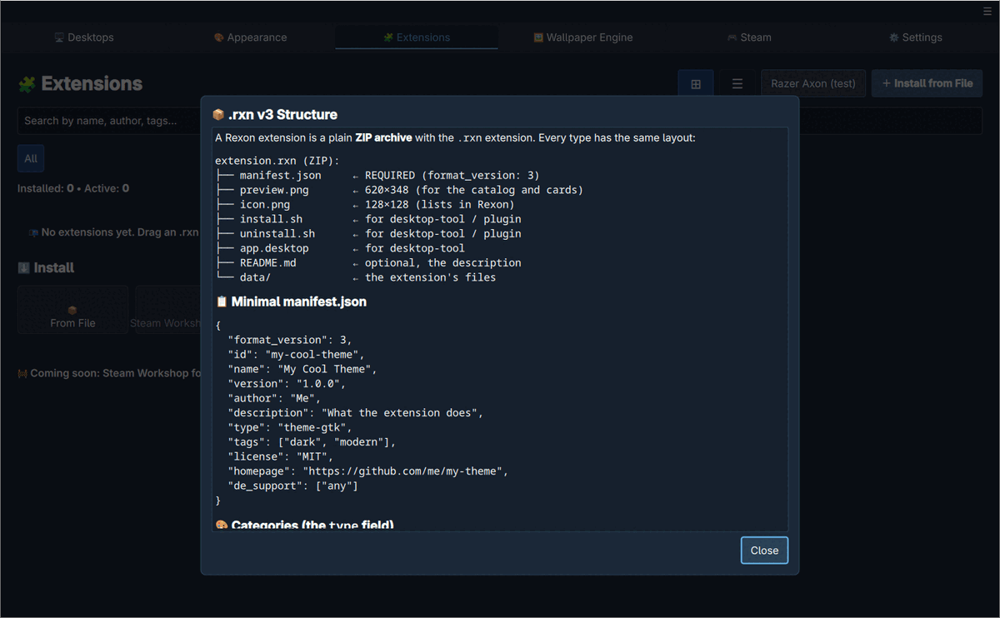

[English](../en/extensions.md) | [Русский](../ru/extensions.md) | [Deutsch](../de/extensions.md) | [简体中文](../zh-CN/extensions.md) | [Français](../fr/extensions.md) | [Español](../es/extensions.md) | Українська

# Розширення

На цій вкладці живуть пакунки `.rxn` — власний формат доповнень Rexon: теми,
набори шпалер, шрифти, інструменти для стільниці та модулі. Сюди ж можна
перетягнути тему або курсори з Windows — Rexon перетворить їх для Linux.

Розширення GNOME Shell і Cinnamon встановлюються не тут, а на вкладці
[Вигляд](appearance.md), у розділах «Розширення GNOME» і «Розширення
Cinnamon».

## Що є на вкладці

- **Перемикачі вигляду** «Сітка» (⊞) і «Список» (☰) — плитки із зображенням
  або компактні рядки.
- **＋ Встановити з файлу** — вибрати файл на диску.
- **Пошук** — за назвою, автором і тегами.
- **Фільтри за типом** — «Усі» і по кнопці на кожен тип, який у вас уже
  встановлено (наприклад, лише теми GTK або лише інструменти).
- **Рядок лічильників** — «Встановлено» й «Активних».
- **Мої розширення** — встановлені пакунки. У кожного:
  - **▶️ Увімкнути** / **⏸️ Вимкнути** — в інструментів, модулів і доповнень
    стільниць (скрипти й ефекти KWin, розширення GNOME, аплети й десклети
    Cinnamon, дії Nemo). Після встановлення вони вимкнені — вмикаєте ви
    самі;
  - **Застосувати** — у наборів шпалер;
  - **🗑️ Вилучити**.

  Клацання по плитці відкриває вікно «Розширення» з описом і кнопкою
  **📁 Відкрити теку**.
- **⬇️ Встановити** — три способи:
  - **З файлу** — відкрити `.rxn`, `.themepack` або тему Windows;
  - **Майстерня Steam — незабаром** — поки не працює, з’явиться пізніше;
  - **Створити своє** — пам’ятка, як зібрати власне розширення.

## Як це зробити

### Встановити розширення

1. Натисніть **＋ Встановити з файлу** (або **З файлу** в розділі
   «⬇️ Встановити»).
2. Виберіть файл `.rxn`.
3. Зачекайте на рядок «✅ Встановлено: …» унизу вікна.

Можна й простіше: перетягніть файл просто у вікно Rexon.

### Встановити тему або курсори з Windows

Перетягніть у вікно або відкрийте через **З файлу**:

- теми: `.themepack`, `.deskthemepack`, `.theme`, `.msstyles`;
- курсори: `.cur`, `.ani`, `.inf`, `.curxptheme`;
- набори піктограм: `.7tsp`.

Rexon перетворить їх на пакунок `.rxn` і встановить: пакунок з’явиться в
«Моїх розширеннях», а сама тема — у [Вигляді](appearance.md), у розділі
свого типу. Застосовують її звідти.

### Знайти розширення

Почніть вводити назву, ім’я автора або тег у рядку пошуку. Щоб залишити
лише один тип пакунків, натисніть кнопку потрібного типу під рядком пошуку;
«Усі» знімає фільтр.

### Увімкнути або вимкнути

Натисніть **▶️ Увімкнути** на плитці — унизу з’явиться «▶️ Увімкнено: …».
Вимкнути — **⏸️ Вимкнути**. У тем і шрифтів такої кнопки немає: вони просто
лежать встановленими, а застосовуються у [Вигляді](appearance.md).

### Вилучити

1. Натисніть **🗑️ Вилучити** на плитці або у вікні «Розширення».
2. Підтвердьте у вікні «Вилучити?». Файли розширення видаляються
   безповоротно.

### Створити власне розширення `.rxn`

Натисніть **Створити своє**. Rexon покаже пам’ятку: `.rxn` — це звичайний
ZIP-архів із файлом `manifest.json` (назва, версія, автор, тип), зображенням
для каталогу та файлами самого розширення. У пам’ятці є приклад
`manifest.json` і список типів.

## Якщо щось пішло не так

- **«⚠️ Встановлення вже триває».** Зачекайте, доки завершиться попереднє
  встановлення або вилучення, і повторіть.
- **«⚠️ Помилка: …».** Файл пошкоджено, або це не розширення Rexon. Текст
  після двокрапки підкаже причину. Якщо в рядку «Встановлено» є застереження
  (наприклад, не знайшлося потрібної програми для перетворення теми Windows),
  розширення встановилося, але не повністю.
- **«⚠️ Помилка перемикання: …».** Розширення не вдалося увімкнути або
  вимкнути. Часто допомагає вийти із сеансу й увійти знову — особливо для
  розширень GNOME і Cinnamon.
- **Після ввімкнення розширення стільниця поводиться дивно.** Вимкніть його
  кнопкою **⏸️ Вимкнути** або вилучіть. Якщо стільниця зламалася зовсім,
  увійдіть в іншу стільницю й натисніть **🔧 Перевірити / Відновити** на
  картці проблемної на вкладці [Стільниці](desktops.md).
- **Обережно з інструментами й модулями.** Пакунки цих двох типів
  запускають власні сценарії встановлення й вилучення (від вашого імені, без
  прав адміністратора). Встановлюйте їх лише від тих, кому довіряєте.

## Див. також

- [Стільниці](desktops.md)
- [Вигляд](appearance.md) — де застосовуються теми і де лежать розширення
  GNOME і Cinnamon
- [Wallpaper Engine](wallpaper-engine.md)
- [Steam](steam.md)
- [Налаштування](settings.md)
- [Зміст посібника](../README.md)
