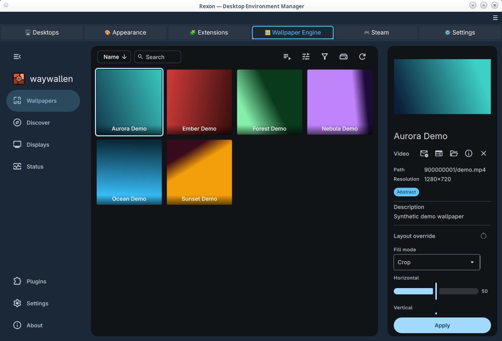
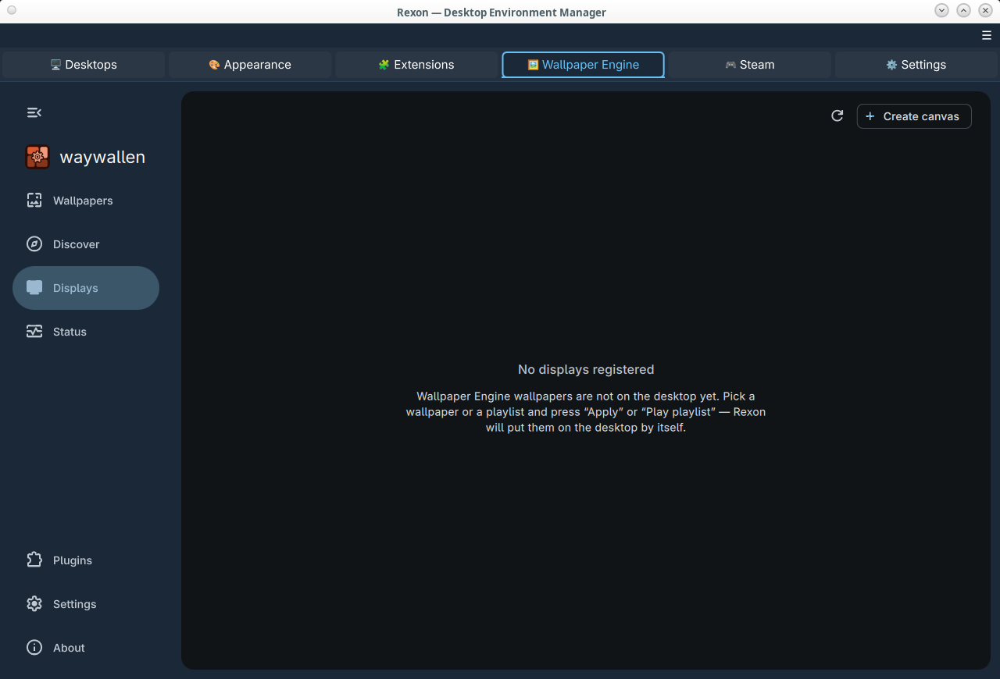
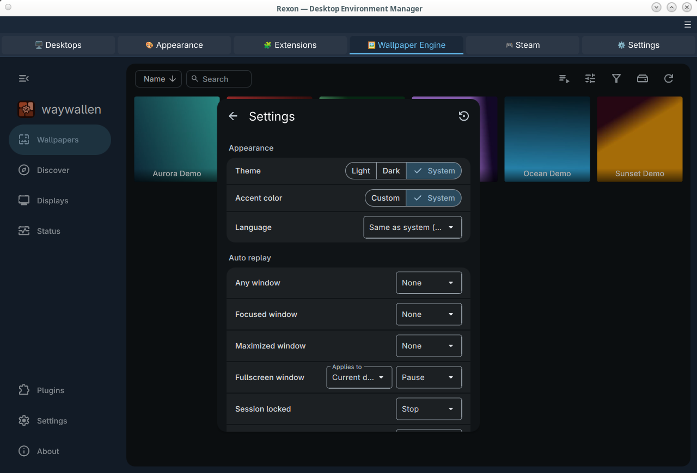

[English](../en/wallpaper-engine.md) | [Русский](../ru/wallpaper-engine.md) | [Deutsch](../de/wallpaper-engine.md) | [简体中文](../zh-CN/wallpaper-engine.md) | [Français](../fr/wallpaper-engine.md) | [Español](../es/wallpaper-engine.md) | Українська

# Wallpaper Engine

Тут живуть живі шпалери: сцени, відео і вебшпалери з Wallpaper Engine, а також
зображення з безплатного каталогу Wallhaven. Шпалери можна встановити на всю
стільницю або на окремий монітор, зібрати в список відтворення, який сам
змінює шпалери за часом, і підписуватися на нові шпалери в Майстерні Steam
просто з Rexon.

Вкладку малює рушій живих шпалер [waywallen](https://github.com/hypengw/waywallen):
його вікна вбудовано в Rexon як є, тому вигляд і підписи тут трохи
відрізняються від інших вкладок. Rexon додає до нього власні підказки і
сам виводить шпалери на вашу стільницю.

> Щоб користуватися шпалерами з Майстерні Steam, ви маєте **придбати
> Wallpaper Engine у Steam**: Майстерня віддає його шпалери лише власникам.
> Без придбання працюють відео й зображення з ваших тек і каталог Wallhaven.

## Що є на вкладці

Ліворуч — панель розділів (кнопка «☰» угорі згортає її до піктограм):

- **Шпалери** — ваша бібліотека: усе, що є на комп’ютері.
- **Огляд** — каталоги в мережі: **Майстерня Steam** і **Wallhaven**.
- **Монітори** — ваші екрани і те, що показується на кожному з них.
- **Стан** — чи працює рушій шпалер і що він зараз малює.
- Унизу: **Додатки**, **Налаштування** (поведінка самих шпалер) і **Про програму**.

Над бібліотекою — сортування (за назвою, розміром, датою зміни), пошук
і кнопки праворуч: **Списки відтворення**, **Вигляд** (розмір карток), **Фільтри**
(за типом, мітками, віковим рейтингом), **Керування бібліотеками** (які теки
переглядати) і **Оновити**.

## На яких стільницях працює

Rexon сам вибирає, як вивести шпалери на вашу стільницю, — нічого налаштовувати не треба:

- **KDE Plasma** — шпалери вбудовуються в стільницю Plasma: піктограми і клацання
  по стільниці працюють як завжди.
- **Hyprland, Sway, niri, river, COSMIC, Wayfire** — шпалери показує сам
  рушій.
- **GNOME і Cinnamon у сеансі Wayland** — шпалери показує розширення Rexon.
  Якщо шпалери не з’явилися, увімкніть розширення і перезайдіть у систему.
- **MATE, Xfce, Cinnamon, Budgie, LXQt, LXDE, Pantheon, Deepin та інші
  стільниці в сеансі X11** — шпалери виводить власний програвач Rexon.
  Частина можливостей рушія тут може бути недоступна. Піктограми стільниці
  в MATE залишаються поверх живих шпалер, якщо Caja вміє прозоре тло
  стільниці, — Rexon вмикає його сам. Якщо не вміє, піктограми на час живих шпалер
  приховано (вкладка скаже про це одним рядком), і вони повертаються, коли шпалери
  зупинено.

На невідомому для Rexon композиторі Wayland живих шпалер не буде.

Якщо ваша стільниця малює тло сама (наприклад, оболонки Noctalia або
DankMaterialShell), угорі вкладки з’явиться смуга з поясненням і кнопками
**«Віддати шпалери Rexon»** (вимкнути тло оболонки) і **«Повернути оболонці»**
(увімкнути його знову з попереднім налаштуванням).

## Як знайти і встановити шпалери

1. Відкрийте вкладку **Wallpaper Engine** → розділ **Шпалери**.
2. Якщо бібліотека порожня, натисніть **«Знайти бібліотеки автоматично»**:
   Rexon знайде теку Steam і шпалери Wallpaper Engine, які вже завантажено.
   Іншу теку можна додати кнопкою **Керування бібліотеками** →
   **«Додати бібліотеку»**.

   

3. Клацніть картку шпалер. Праворуч відкриється панель подробиць: мініатюра,
   опис, **Режим заповнення** (обрізати, вписати, розтягнути, по центру),
   поворот, віддзеркалення і **Властивості**, які задав автор шпалер (колір, звук,
   швидкість тощо).
4. Якщо моніторів кілька, у панелі є рядок **«Застосувати до»** —
   виберіть монітор або **«До всіх»**.
5. Натисніть **«Застосувати»**. Rexon сам виведе шпалери на стільницю.

Поки на стільниці ще нічого не показується, розділ **Монітори** може бути
порожнім і повідомляти «Шпалери Wallpaper Engine на стільниці поки не
показуються…». Це нормально: після першого «Застосувати» монітори з’являться.

## Монітори

У розділі **Монітори** видно кожен екран і шпалери на ньому. Тут можна:

- перейменувати монітор (**«Змінити монітор»**) і вибрати для нього режим
  заповнення;
- призупинити шпалери на одному моніторі (**«Призупинити дисплей»**);
- об’єднати кілька моніторів у **полотно** (**«Створити полотно»**), щоб
  одні шпалери розтягнулися на всі екрани одразу.

## Списки відтворення: шпалери змінюються самі

1. У розділі **Шпалери** виділіть кілька карток: клацніть правою кнопкою
   миші (або з затиснутою Ctrl, або довгим натисканням).
2. Унизу з’явиться панель — натисніть **«Новий список відтворення»**, введіть назву і
   **«Створити»**. Наявний список відтворення можна поповнити кнопкою
   **«Додати до списку відтворення»**.

   

3. Відкрийте перелік кнопкою **Списки відтворення** (праворуч над бібліотекою).
   Кожен список відтворення має кнопки: **«Відтворити список»**,
   **«Редагувати список»**, **«Змінити шпалери»** і **«Вилучити список»**.
   Над переліком можна вибрати, на яких моніторах відтворювати (**«До всіх»**
   охоплює й монітори, під’єднані пізніше).

   

4. У **«Редагувати список»** виберіть **Режим** — **По черзі**,
   **Упереміш** або **Випадково** — та **Інтервал зміни** (години, хвилини,
   секунди). Збережіть позначкою вгорі.

## Майстерня Steam: підписка на нові шпалери

Потрібні придбаний Wallpaper Engine у Steam і запущений клієнт Steam.

1. Відкрийте розділ **Огляд** і в першому списку виберіть **Майстерня Steam**.
2. Натисніть **«Увійти в Steam»** і відскануйте QR-код мобільною програмою
   Steam. Пароля від Steam Rexon не бачить і не запитує.

   

3. Після входу з’явиться каталог. Сортування — «Популярні (сьогодні)»,
   «Популярні (тиждень)» і так далі, «Нещодавно додані», «Лідери
   рейтингу»; є пошук і **Фільтри**. Пункт **«Мої підписки»** показує те, на що ви вже
   підписані.
4. Відкрийте шпалери і натисніть **«Підписатися»**. Файли завантажує сам клієнт
   Steam — тримайте його запущеним, і шпалери з’являться в розділі **Шпалери**
   автоматично.
5. Відписатися можна там само (**«Відписатися»**) або в панелі подробиць
   шпалер у бібліотеці.

Шпалери з позначкою 18+ приховано, доки ви самі не увімкнете цей фільтр (Rexon
перепитає).

**Wallhaven** — друге джерело в **Огляді**: безплатні зображення, вхід не
потрібен. Зображення, яке сподобалося, можна завантажити кнопкою **«Завантажити»**.

## Налаштування шпалер

Кнопка **Налаштування** внизу панелі розділів відкриває налаштування самого рушія:

- **Автопауза** — що робити зі шпалерами, коли відкрито будь-яке, активне,
  розгорнуте або повноекранне вікно, сеанс заблоковано або комп’ютер працює від
  батареї: нічого, вимкнути звук, поставити на паузу або зупинити.
  Так ігри й фільми не ділять відеокарту зі шпалерами.
- **Звук** — гучність і «Вимикати звук, коли звук відтворюють інші
  програми».
- **Ефект зміни шпалер** і його тривалість, **Виключені вікна**, кеш
  зображень із мережі.

## Якщо щось пішло не так

- **«Запускаємо рушій шпалер waywallen…» тримається довго.** Перший запуск
  після встановлення може тривати хвилину-дві: рушій розпаковує себе.
  Зачекайте.
- **«Рушій шпалер waywallen не запустився».** Натисніть **«Повторити запуск»**.
  Якщо не допомогло, загляньте в розділ **Стан** → **Журнали**.
- **Бібліотека порожня, хоча шпалери придбано.** Перевірте, що Steam уже завантажив
  їх (вони лежать у `steamapps/workshop/content/431960`), і натисніть
  **«Знайти бібліотеки автоматично»** або **Оновити**. Якщо Steam встановлено в
  нестандартному місці, додайте його теку в **Керуванні бібліотеками** — потрібна
  тека, усередині якої лежить `steamapps`.
- **Підписалися, але шпалери не з’явилися.** Клієнт Steam має бути запущений —
  шпалери завантажує він, а не Rexon.
- **У KDE Plasma вгорі попередження про модуль шпалер Plasma.** Натисніть
  **«Встановити версію Rexon»** — Rexon встановить відповідний модуль.
- **На GNOME або Cinnamon шпалер не видно.** Увімкніть розширення Rexon і
  перезайдіть у систему.
- **Шпалери малює оболонка, а не Rexon.** Натисніть **«Віддати шпалери Rexon»** у
  смузі вгорі вкладки.
