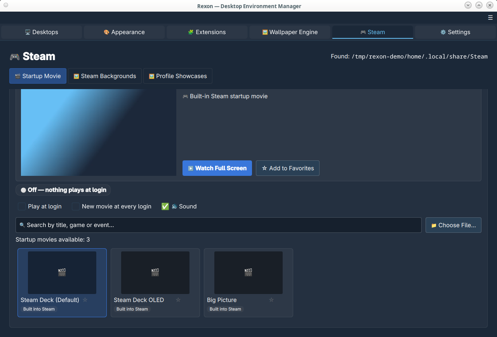

[English](../en/steam.md) | [Русский](../ru/steam.md) | [Deutsch](../de/steam.md) | 简体中文 | [Français](../fr/steam.md) | [Español](../es/steam.md)

# Steam

这里是把桌面和 Steam 连接起来的功能：像 Steam Deck 那样在登录系统时播放启动影片，
把你的 Steam 个人资料背景用作壁纸，以及一个为 Steam 个人资料展柜准备图片的助手。

这个标签页需要已安装的 Steam。Rexon 会在右上角显示它在哪里找到了 Steam 文件夹，
或者显示“未找到 Steam——安装 Steam 后才能使用启动影片和背景”。

顶部有四个子标签页：**🎬 启动影片**、**🖼️ Steam 背景**、**🖼️ 个人资料展柜** 和
**🌙 屏幕保护**。

## 登录时的启动影片

登录时播放影片是 Steam Deck 的标志性功能。Rexon 把它带到普通电脑上：Valve 内置的
启动影片，以及你已在点数商店购买的影片，声音完整，也不会闪现桌面。

屏幕上有：

- 所选影片的 **大预览图**、影片名称及其来源：“Steam 内置”、点数商店或“自有文件”。
- **▶️ 全屏观看**：立即按登录时的样子播放这部影片。
- **☆ 收藏**：给影片加上星标。
- 预览图下方的状态行：“⚪ 已关闭——登录时不播放任何内容”或“✅ 就绪：下次登录将播放“…””。
- 复选框 **登录时播放**、**每次登录换一部影片** 和 **🔊 声音**。
- 按标题、游戏或活动搜索，以及 **📁 选择文件…** 按钮：选择你自己的视频（webm、mp4、mkv）。
- 下方以卡片形式列出找到的所有影片。

*截图中是演示用的影片；你看到的会是你 Steam 中的启动影片。*

### 如何开启启动影片

1. 打开 **Steam** → **🎬 启动影片**。
2. 点击一张影片卡片，它会出现在大预览图中。要使用自己的视频，请点击 **📁 选择文件…**。
3. 如有需要，可以用 **▶️ 全屏观看** 按钮先看一遍。
4. 勾选 **登录时播放**。预览图下方会出现“✅ 就绪：下次登录将播放“…””。
5. 想每次都看一部新影片，就勾选 **每次登录换一部影片**。如果至少有两部影片加了星标，
   只在它们之间轮换，否则在找到的所有影片之间轮换。

要关闭启动影片，取消勾选 **登录时播放** 即可。

## Steam 背景

把库存中的 Steam 个人资料背景用作桌面壁纸：静态背景作为图片，动态背景作为动态壁纸。

*截图中的电脑还没有登录过 Steam。登录后，这里会显示你的背景。*

为此需要：

- 在这台电脑上至少登录过一次 Steam 客户端；
- 在 Steam 隐私设置中将库存设为公开。

### 如何应用个人资料背景

1. 打开 **Steam** → **🖼️ Steam 背景**，等待库存加载完毕。
2. 用搜索或 **全部 / 静态 / 动态** 切换按钮找到背景。当前装备在个人资料上的背景标有
   “🎮 已装备”。用 **‹ 上一页** 和 **下一页 ›** 翻页。
3. 点击卡片上的 **“应用”**。动态背景会成为视频壁纸；**🔊 动态壁纸声音** 复选框
   决定它是否有声音。

## 个人资料展柜

Rexon 会把你的图片裁切成 Steam 个人资料展柜的尺寸，并显示个人资料将会是什么样子。
然后它会一步步引导你上传：打开所需的 Steam 页面、复制标题并检查结果。Rexon 本身
不会向 Steam 上传任何内容——Steam 页面上的按钮由你自己点击。

展柜从 Steam 10 级起可用。

### 如何制作展柜

1. 点击 **“选择图片…”**：支持 PNG、JPG 或 GIF（GIF 动画会保留）。
2. 选择 **展柜类型**：**艺术作品展柜**（两张图片并排：一宽一窄）或
   **精选艺术作品展柜**（一张宽图）。
3. 为了得到准确的预览，请选择 **个人资料背景**：从你的 Steam 背景中选，或选
   **“自定义背景…”**。用 **缩放**、**水平位置** 和 **垂直位置** 滑块调整画面。
4. 点击 **“保存各部分”**。生成的文件位于“图片/Rexon/steam-showcase”文件夹中，
   **“打开文件夹”** 按钮可以打开它。
5. 完成下方出现的三个步骤：
   - **第 1 步：上传各部分**：**“打开上传页面”** 会打开 Steam 页面和存放各部分的文件夹。
     从主图开始逐个上传；每一部分的标题都可以用 **“复制标题”** 按钮复制。
     可见性保持为“公开”。每上传一部分，就在这里勾选它的 **“已上传”**，
     Rexon 会记住你进行到哪里。
   - **第 2 步：将它们放入展柜**：**“打开个人资料编辑器”**，选择展柜，把各部分放到
     对应位置，保存，然后勾选 **“完成——各部分已放入展柜”**。
   - **第 3 步：检查**：**“检查我的个人资料”**：Rexon 会读取公开的个人资料页面，
     并与你的各部分进行比较。个人资料必须是公开的。

只有当图片确实是你自己的作品时，才在 Steam 页面上勾选“我保证这件作品由我创作”。

## 屏幕保护

Rexon 为 Steam Big Picture 制作屏幕保护：当 Steam Deck、Steam Machine、电视或电脑
闲置一段时间后，Steam 就会显示它。内容是最近玩过的游戏的美术图和你的截图，或者一个
弹跳标志。Rexon 只是把屏幕保护放进 Steam 文件夹，启用它需要你自己在 Steam 设置中完成。

界面上有：

- 状态行：“⚪ 尚未安装。”或“✅ 已安装 —— … 张图片。”
- **显示**：**幻灯片**（最近玩过的游戏的美术图和你的截图轮流显示）或 **弹跳标志**。
- 幻灯片模式下：**游戏美术图** 和 **我的截图** 两个复选框，以及 **切换图片间隔**
  滑块（4 到 60 秒）。下方会显示 Rexon 在你的 Steam 中找到了多少张图片。
- 弹跳标志模式下：**标志**：**Rexon 标志**（每次碰到边缘都会变色）或
  **你的游戏标志**。
- **显示时钟** 复选框。

### 如何安装屏幕保护

1. 打开 **Steam** → **🌙 屏幕保护**，选择要显示的内容。
2. 点击 **“安装屏幕保护”**。几秒钟后状态行会显示“✅ 已安装”。**“👁️ 预览”** 会在
   浏览器中打开屏幕保护。
3. 在 Steam 中启用：在 Steam Big Picture 中打开“设置”→“个性化”→“屏幕保护”，
   然后选择“Rexon (User Created)”。

玩了新游戏或截了新图？点击 **“更新屏幕保护”**，Rexon 会重新收集图片。修改后的设置
也用这个按钮应用。要从 Steam 中移除屏幕保护，点击 **“删除”**，再点击
**“再次点击以删除”**。

## 出了问题怎么办

- **“未找到 Steam。”** 安装 Steam 并至少运行一次。
- **“未找到启动影片。”** Steam 未安装，或影片尚未下载。可以用 **📁 选择文件…** 按钮
  选择自己的视频。
- **“请先选择启动影片”。** 先点击一张影片卡片，然后再勾选 **登录时播放** 或点击
  **全屏观看**。
- **“未安装 mpv（播放需要它）”。** 从你的发行版中安装 mpv 程序。
- **“轮换至少需要两个视频”。** **每次登录换一部影片** 复选框只在影片多于一部时起作用。
- **“找不到 Steam 账户（没有 userdata 文件夹）。”** 在这台电脑上登录 Steam 客户端。
- **背景加载不出来。** 在 Steam 隐私设置中将库存设为公开，然后点击 **“重试”**。
- **个人资料检查显示“个人资料为私密——无法读取。”** 在 Steam 中打开“编辑个人资料”→
  “隐私设置”，把个人资料设为公开。
- **Steam 列表里没有 Rexon 屏幕保护。** 请完全退出 Steam 后重新启动。
