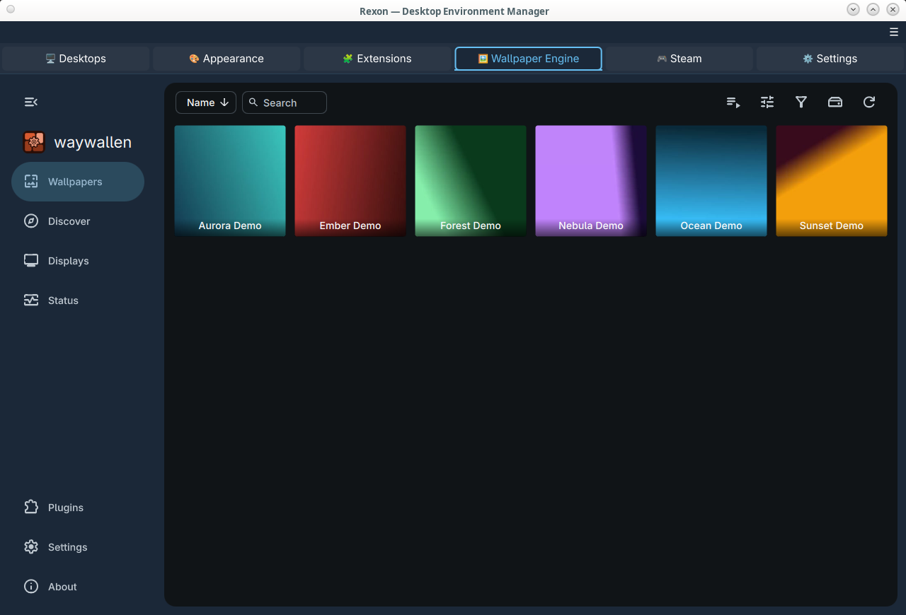

[English](../en/wallpaper-engine.md) | [Русский](../ru/wallpaper-engine.md) | [Deutsch](../de/wallpaper-engine.md) | 简体中文 | [Français](../fr/wallpaper-engine.md) | [Español](../es/wallpaper-engine.md) | [Українська](../uk/wallpaper-engine.md)

# Wallpaper Engine

这里是动态壁纸：来自 Wallpaper Engine 的场景、视频和网页壁纸，以及免费图库 Wallhaven
中的图片。壁纸可以设置到整个桌面或单独的显示器上，可以组成按时间自动切换壁纸的播放列表，
还可以直接在 Rexon 中订阅 Steam 创意工坊里的新壁纸。

这个标签页由动态壁纸引擎 [waywallen](https://github.com/hypengw/waywallen) 绘制：
它的界面原样嵌入 Rexon，因此这里的外观和文字与其他标签页略有不同。Rexon 为它加上了
自己的提示，并自行把壁纸显示到你的桌面上。

> 要使用 Steam 创意工坊中的壁纸，你必须 **在 Steam 上购买了 Wallpaper Engine**：
> 创意工坊只向拥有者提供它的壁纸。没有购买的话，可以使用你自己文件夹中的视频和图片，
> 以及 Wallhaven 图库。

## 标签页上有什么

左侧是版块面板（顶部的“☰”按钮可以把它收起为图标）：

- **壁纸**：你的壁纸库，即电脑上已有的全部壁纸。
- **发现**：在线图库：**Steam 创意工坊** 和 **Wallhaven**。
- **显示器**：你的屏幕，以及每个屏幕上显示的内容。
- **状态**：壁纸引擎是否在运行，以及它当前在绘制什么。
- 底部：**插件**、**设置**（壁纸本身的行为）和 **关于**。

壁纸库上方是排序（按名称、大小、修改日期）、搜索，以及右侧的按钮：**播放列表**、
**调整**（卡片大小）、**筛选**（按类型、标签、年龄分级）、**库管理器**（浏览哪些文件夹）
和 **刷新**。

## 支持哪些桌面

Rexon 会自己选择如何把壁纸显示到你的桌面上，无需任何设置：

- **KDE Plasma**：壁纸嵌入 Plasma 桌面：桌面图标和点击桌面都像平常一样工作。
- **Hyprland、Sway、niri、river、COSMIC、Wayfire**：壁纸由引擎自己显示。
- **Wayland 会话中的 GNOME 和 Cinnamon**：壁纸由 Rexon 的扩展显示。如果壁纸没有出现，
  请启用该扩展并重新登录。
- **X11 会话中的 MATE、Xfce、Cinnamon、Budgie、LXQt、LXDE、Pantheon、Deepin 等桌面**：
  壁纸由 Rexon 自己的壁纸播放器显示。引擎的部分功能在这里可能不可用。在 MATE 中，
  如果 Caja 支持透明的桌面背景，桌面图标会留在动态壁纸上方——Rexon 会自动开启它。
  如果不支持，动态壁纸运行期间图标会被隐藏（标签页会用一行文字说明），壁纸停止后
  图标会恢复。

在 Rexon 不认识的 Wayland 合成器上，不会有动态壁纸。

如果你的桌面自己绘制背景（例如 Noctalia 或 DankMaterialShell 外壳），标签页顶部会出现
一条说明，带有 **“将壁纸交给 Rexon”**（关闭外壳的背景）和 **“交还外壳”**
（按原来的设置重新开启外壳背景）按钮。

## 如何查找和设置壁纸

1. 打开 **Wallpaper Engine** 标签页 → **壁纸** 版块。
2. 如果壁纸库是空的，请点击 **“自动检测库”**：Rexon 会找到 Steam 文件夹和已经下载的
   Wallpaper Engine 壁纸。其他文件夹可以通过 **库管理器** → **“添加库”** 添加。

   

3. 点击一张壁纸卡片。右侧会打开详情面板：预览、说明、**填充模式**（裁剪、适应、拉伸、
   居中）、旋转、翻转，以及壁纸作者设定的 **属性**（颜色、声音、速度等）。
4. 如果有多台显示器，面板中会有 **“应用到”** 一行：选择一台显示器或 **“全部”**。
5. 点击 **“应用”**。Rexon 会自行把壁纸显示到桌面上。

在桌面上还没有显示任何壁纸时，**显示器** 版块可能是空的，并显示“Wallpaper Engine
壁纸尚未显示在桌面上……”。这很正常：第一次点击“应用”之后，显示器就会出现。

## 显示器

在 **显示器** 版块中可以看到每个屏幕及其上的壁纸。在这里可以：

- 重命名显示器（**“编辑显示器”**），并为它选择填充模式；
- 暂停某一台显示器上的壁纸（**“暂停显示器”**）；
- 把几台显示器合并为一块 **画布**（**“创建画布”**），让一张壁纸同时铺满所有屏幕。

## 播放列表：壁纸自动切换

1. 在 **壁纸** 版块中选中几张卡片：点击鼠标右键（或按住 Ctrl 点击，或长按）。
2. 底部会出现一个面板：点击 **“新建播放列表”**，输入名称并点击 **“创建”**。
   已有的播放列表可以用 **“添加到播放列表”** 按钮补充。

   

3. 用 **播放列表** 按钮（壁纸库上方右侧）打开列表。每个播放列表都有这些按钮：
   **“播放此列表”**、**“编辑播放列表”**、**“编辑壁纸”** 和 **“删除播放列表”**。
   在列表上方可以选择在哪些显示器上播放（**“全部”** 也包括以后连接的显示器）。

   

4. 在 **“编辑播放列表”** 中选择 **模式**（**顺序**、**乱序** 或 **随机**）和
   **轮换间隔**（小时、分钟、秒）。点击顶部的对勾保存。

## Steam 创意工坊：订阅新壁纸

需要在 Steam 上购买 Wallpaper Engine，并运行 Steam 客户端。

1. 打开 **发现** 版块，在第一个列表中选择 **Steam 创意工坊**。
2. 点击 **“登录 Steam”**，用 Steam 手机应用扫描二维码。Rexon 看不到也不会询问你的
   Steam 密码。

   

3. 登录后会出现目录。排序方式有“热门（今日）”、“热门（本周）”等，以及“最近添加”和
   “评分最高”；还有搜索和 **筛选**。**“我的订阅”** 显示你已经订阅的内容。
4. 打开一个壁纸并点击 **“订阅”**。文件由 Steam 客户端自己下载——保持它运行，
   壁纸就会自动出现在 **壁纸** 版块中。
5. 可以在同一处（**“取消订阅”**）或在壁纸库的壁纸详情面板中取消订阅。

标有 18+ 的壁纸会被隐藏，除非你自己开启这个筛选（Rexon 会再次确认）。

**Wallhaven** 是 **发现** 中的第二个来源：免费图片，无需登录。喜欢的图片可以用
**“下载”** 按钮下载。

## 壁纸设置

版块面板底部的 **设置** 按钮会打开引擎本身的设置：

- **自动重播**：当有任意窗口打开、窗口处于活动状态、窗口最大化或全屏、会话被锁定，
  或者使用电池供电时，如何处理壁纸：不做任何事、静音、暂停或停止。这样游戏和电影
  就不会和壁纸争用显卡。
- **音频**：音量和“其他播放流活跃时静音”。
- **壁纸切换效果** 及其时长、**排除的窗口**、网络图片的缓存。

## 出了问题怎么办

- **“正在启动 waywallen 壁纸引擎…”持续很久。** 安装后的第一次启动可能需要一两分钟：
  引擎正在自解压。请稍候。
- **“waywallen 壁纸引擎未能启动”。** 点击 **“重试启动”**。如果没有用，请查看
  **状态** → **日志** 版块。
- **壁纸库是空的，但壁纸已经购买。** 确认 Steam 已经把它们下载下来（它们位于
  `steamapps/workshop/content/431960`），然后点击 **“自动检测库”** 或 **刷新**。
  如果 Steam 安装在非标准位置，请在 **库管理器** 中添加它的文件夹——需要的是包含
  `steamapps` 的那个文件夹。
- **已订阅，但壁纸没有出现。** Steam 客户端必须在运行——下载壁纸的是它，而不是 Rexon。
- **KDE Plasma 中顶部出现关于 Plasma 壁纸插件的警告。** 点击 **“安装 Rexon 附带的版本”**：
  Rexon 会安装合适的插件。
- **在 GNOME 或 Cinnamon 上看不到壁纸。** 启用 Rexon 扩展并重新登录。
- **壁纸由外壳绘制，而不是 Rexon。** 点击标签页顶部说明条中的 **“将壁纸交给 Rexon”**。
